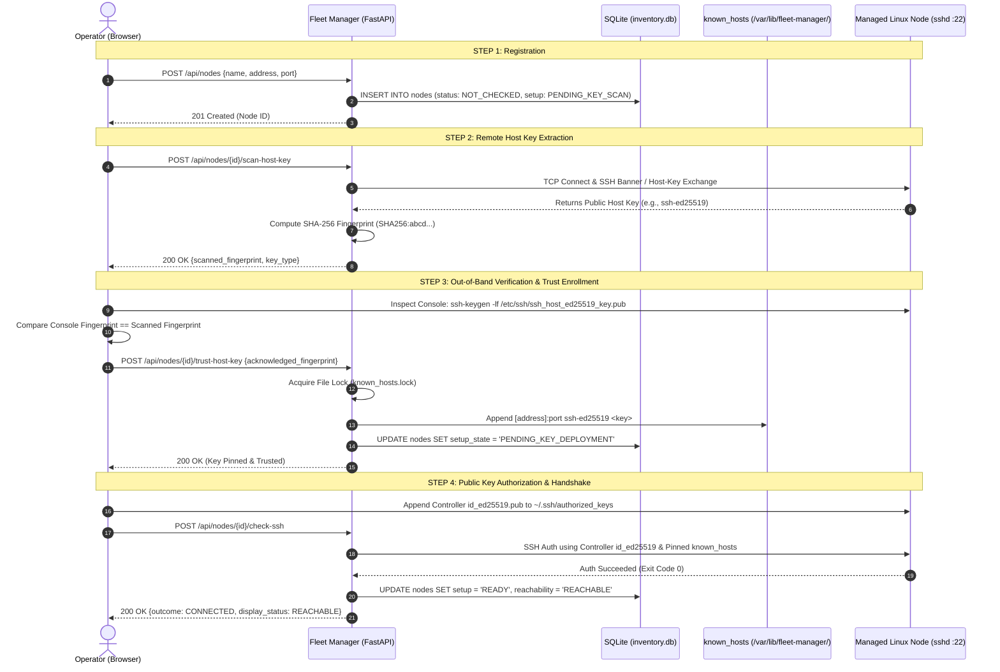
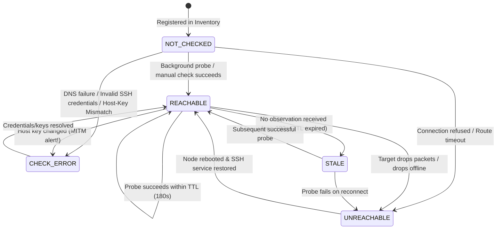
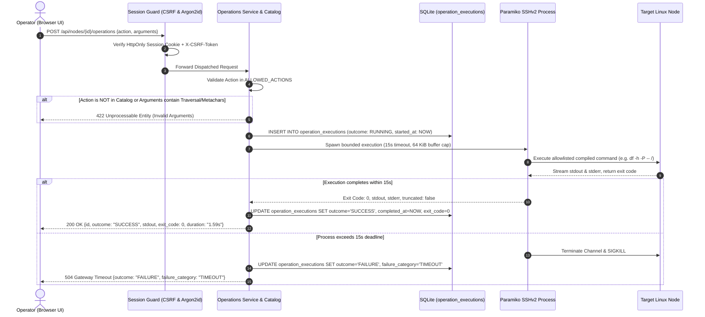
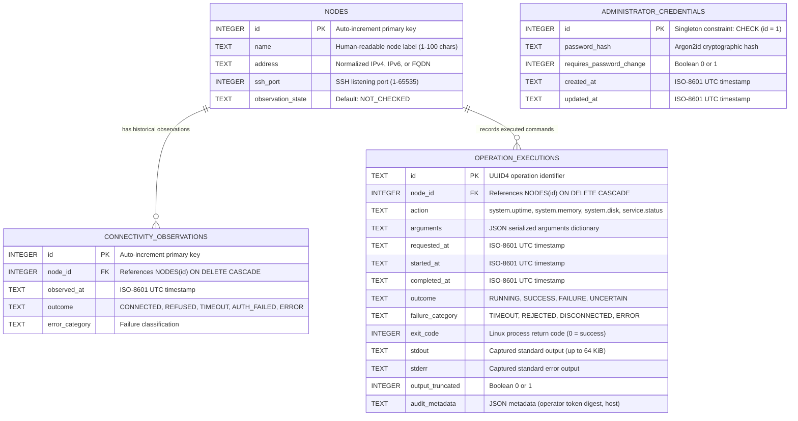

# Master System Architecture & Diagram Context Pack
**Project**: SWFW_5S_12 — Distributed Linux Fleet Management  
**Author / Developer**: Adarsh Singh  
**Prepared For**: AI Diagramming, Visual Design, Flowchart Generation & Architectural Review  
**Date**: 10 November 2026  
**Status**: 100% Implemented & Verified on Live GCP Multi-Node Topology

---

## 📌 Instructions for the Recipient AI
> **Role & Objective**: You are acting as a Principal Systems Architect and Technical Illustrator.  
> You have been provided with the complete architectural specification, networking topology, cryptographic handshake protocols, data schemas, and execution lifecycles of the **Distributed Linux Fleet Manager** (SWFW_5S_12).
> 
> **Your Task**: Use the comprehensive context below to generate high-fidelity architectural diagrams, sequence flows, state machines, entity-relationship diagrams, or UI wireframes (using **Mermaid.js**, **PlantUML**, **SVG**, **ASCII art**, or **Draw.io XML**).

---

## 1. Executive Project Brief & Core Requirements

### 1.1 Problem Statement
Enterprise Linux fleet management demands four core guarantees:
1. **Dependable inventory and host identity**: Insecure Trust-On-First-Use (TOFU) creates Man-in-the-Middle (MITM) vulnerabilities. Host keys must be cryptographically pinned and verified out-of-band.
2. **Decoupled telemetry & honest observability**: An SSH port being open does NOT prove system health. Telemetry must be collected continuously by standard tools (Prometheus Node Exporter). Missing metrics must be rendered as disconnected gaps, never fabricated as zero.
3. **Availability detection with graceful degradation**: Failures must be isolated. If Node-A drops offline, the controller must not hang, and peer nodes (Node-B, Node-C) must continue operating unaffected.
4. **Controlled remote execution**: Arbitrary shell access (`/bin/sh`, raw interactive terminals) is dangerous. Commands must be strictly allowlisted, non-interactive, bounded by memory and execution timeouts, and audited immutably.

### 1.2 ZOHO Evaluated Outcomes
- **Outcome 1**: Multiple Linux nodes (VM or Baremetal) managed and monitored via Prometheus and Grafana.
- **Outcome 2**: Node on-boarding managed cryptographically by the Fleet Manager.
- **Outcome 3**: Node availability detection and failure-handling mechanism for graceful degradation.
- **Outcome 4**: Controlled remote command execution with bounded output and persistent audit history.

---

## 2. Infrastructure Topology & Network Architecture

### 2.1 Live Google Cloud Platform (GCP) Topology
The production deployment runs in **Google Cloud Platform (`asia-south1-a`)** inside an isolated Virtual Private Cloud (VPC) subnet `10.160.0.0/24`:

```
                 [ OPERATOR WORKSTATION / LAPTOP ]
                                 │
                   HTTPS / TCP (Loopback 127.0.0.1)
                                 │
     ════════════════════════════▼════════════════════════════
     [ Google Cloud Identity-Aware Proxy (IAP) TCP Tunnel ]
       • No Public IPs on any VM
       • VPC Ingress strictly via 35.235.240.0/20 on Port 22
     ════════════════════════════┬════════════════════════════
                                 │
                     Port 22 SSH Forwarding
                                 │
                                 ▼
 ┌─────────────────────────────────────────────────────────────┐
 │ CONTROLLER NODE: `fleet-controller` (Internal IP: 10.160.0.2)│
 │                                                             │
 │  • Fleet Manager Service: 127.0.0.1:8000 (FastAPI/Uvicorn) │
 │  • Prometheus Service:   127.0.0.1:9090                    │
 │  • Grafana Service:      127.0.0.1:3000                    │
 │  • Storage:              /var/lib/fleet-manager/           │
 │      - SQLite WAL:       inventory.db                      │
 │      - Host Trust Store: known_hosts (pinned host keys)    │
 │  • Credentials:          /etc/fleet-manager/id_ed25519     │
 └───────┬──────────────────────┬──────────────────────┬───────┘
         │                      │                      │
         │ Port 22 (SSHv2)      │ Port 22 (SSHv2)      │ Port 22 (SSHv2)
         │ Port 9100 (Exporter) │ Port 9100 (Exporter) │ Port 9100 (Exporter)
         ▼                      ▼                      ▼
┌─────────────────┐    ┌─────────────────┐    ┌─────────────────┐
│ MANAGED NODE A  │    │ MANAGED NODE B  │    │ MANAGED NODE C  │
│ `fleet-node-a`  │    │ `fleet-node-b`  │    │ `fleet-node-c`  │
│ IP: 10.160.0.5  │    │ IP: 10.160.0.3  │    │ IP: 10.160.0.4  │
│ Debian Linux 12 │    │ Debian Linux 12 │    │ Debian Linux 12 │
│                 │    │                 │    │                 │
│ • sshd (:22)    │    │ • sshd (:22)    │    │ • sshd (:22)    │
│   (fleetbootstrap)   │   (fleetbootstrap)   │   (fleetbootstrap)
│ • node_exporter │    │ • node_exporter │    │ • node_exporter │
│   (:9100)       │    │   (:9100)       │    │   (:9100)       │
└─────────────────┘    └─────────────────┘    └─────────────────┘
```

### 2.2 Port & Protocol Matrix

| Source | Destination | Port | Protocol | Purpose / Authentication |
| :--- | :--- | :--- | :--- | :--- |
| Operator Laptop | Controller (via IAP) | `8000` | HTTP | Fleet Manager Web UI & API (HttpOnly Cookie / Argon2id) |
| Operator Laptop | Controller (via IAP) | `9090` | HTTP | Prometheus Metric Inspection & PromQL |
| Operator Laptop | Controller (via IAP) | `3000` | HTTP | Grafana Operational Monitoring Dashboards |
| Controller | Controller | `8000` | HTTP | Prometheus scrapes Fleet Manager `/metrics` endpoint |
| Controller | Node A, B, C | `22` | SSHv2 | Bounded health probes & allowlisted command dispatch (Ed25519) |
| Controller | Node A, B, C | `9100` | HTTP | Prometheus scrapes Linux kernel metrics via `node_exporter` |

---

## 3. Cryptographic State Machines & Core Lifecycles

### 3.1 Flow 1: 4-Step Cryptographic Node Onboarding & MITM Defense



---

### 3.2 Flow 2: Node Availability & Freshness State Machine



---

### 3.3 Flow 3: Controlled Remote Command Execution Engine



---

## 4. Allowlisted Operations Catalog

Free-form interactive terminal access is prohibited. The backend catalog strictly permits four commands:

| Action Identifier | Input Parameters | Regex Validation | Compiled Remote Command |
| :--- | :--- | :--- | :--- |
| `system.uptime` | *None* | Must be empty `{}` | `uptime` |
| `system.memory` | *None* | Must be empty `{}` | `free -m` |
| `system.disk` | `path: string` | `^/[a-zA-Z0-9_\-\./]*$` (Absolute POSIX path, no traversal `..` or spaces) | `df -h -P -- <path>` |
| `service.status` | `service_name: string` | `^[a-zA-Z0-9_\-\.@]{1,64}$` (Alphanumeric safe service grammar) | `systemctl --no-pager status -- <service>` |

---

## 5. Relational Database Schema (SQLite WAL Mode)



---

## 6. Observability & Telemetry Architecture

### 6.1 Telemetry Pipeline
1. **Target Scrapes**: `node_exporter` runs as an unprivileged daemon on each managed node, exposing Linux `/proc` and `/sys` metrics on port 9100.
2. **Prometheus Server**: Scrapes each node every 60 seconds and writes time-series samples to the local Prometheus TSDB on `fleet-controller`.
3. **Fixed PromQL API Gateway**: Fleet Manager exposes `/api/nodes/{id}/health`. It acts as an authenticated security proxy evaluating predefined PromQL expressions:
   - **CPU Utilization (%)**: `100 - (avg by (instance) (rate(node_cpu_seconds_total{mode="idle"}[5m])) * 100)`
   - **Memory Usage (%)**: `((node_memory_MemTotal_bytes - node_memory_MemAvailable_bytes) / node_memory_MemTotal_bytes) * 100`
   - **Root Disk Usage (%)**: `((node_filesystem_size_bytes{mountpoint="/"} - node_filesystem_free_bytes{mountpoint="/"}) / node_filesystem_size_bytes{mountpoint="/"}) * 100`
   - **Network RX/TX (B/s)**: `rate(node_network_receive_bytes_total{device!="lo"}[5m])`
4. **Honest Sparkline Rendering**: The frontend parses the evaluation matrix. If Prometheus returns missing timestamps, the UI renders **disconnected gap markers** without interpolating smooth curves or inventing zero values.

---

## 7. User Interface Layout & Visual Hierarchy

The application interface follows a **dark Graphite + Warm Neutral + Muted Sage** design system (`#121516` surface, `#e3e5e4` text, `#8fa89b` accent).

```
┌─────────────────────────────────────────────────────────────────────────────┐
│ 🚀 LINUX FLEET MANAGER               [Loopback 127.0.0.1]  [👤 Admin] [🚪 Logout]│
├─────────────────────────────────────────────────────────────────────────────┤
│ 📊 FLEET OVERVIEW                                                           │
│  [Total Nodes: 4]  [Reachable: 4]  [Unreachable: 0]  [Check Error: 0]  [Stale: 0] │
├─────────────────────────────────────────────────────────────────────────────┤
│ 🩺 FLEET HEALTH (Node Exporter Telemetry · 60s Scrapes)                     │
│  ┌───────────────────┐ ┌───────────────────┐ ┌───────────────────┐          │
│  │ fleet-node-a      │ │ fleet-node-b      │ │ fleet-node-c      │          │
│  │ CPU: 4.1%         │ │ CPU: 3.2%         │ │ CPU: 2.6%         │          │
│  │ RAM: 0.4 / 1.9 GiB│ │ RAM: 0.4 / 1.9 GiB│ │ RAM: 0.4 / 1.9 GiB│          │
│  │ Disk: 42.4% [/]   │ │ Disk: 37.8% [/]   │ │ Disk: 37.8% [/]   │          │
│  └───────────────────┘ └───────────────────┘ └───────────────────┘          │
│  ┌─ Selected Node Detailed Linux Telemetry ───────────────────────────────┐ │
│  │  Disk Capacity: [████████████░░░░░░░░░░] 42.4%                         │ │
│  │  CPU 1h Sparkline:      ~~~~~~~····· (4.1% 5m rate)                     │ │
│  │  Memory 1h Sparkline:   ──────────── (21% 5m rate)                     │ │
│  │  Network RX Sparkline:  _/\_/\__/\_  (453 B/s waves)                   │ │
│  └────────────────────────────────────────────────────────────────────────┘ │
├─────────────────────────────────────────────────────────────────────────────┤
│ 🖥️ MANAGED NODE INVENTORY                         [🔍 Filter] [+ Add Node]   │
│  Node Name      Endpoint        Status      Setup     Last Seen   Actions   │
│  fleet-node-a   10.160.0.5:22   REACHABLE   READY     4s ago      [Ops] [Setup]│
│  fleet-node-b   10.160.0.3:22   REACHABLE   READY     4s ago      [Ops] [Setup]│
│  fleet-node-c   10.160.0.4:22   REACHABLE   READY     5s ago      [Ops] [Setup]│
├─────────────────────────────────────────────────────────────────────────────┤
│ ⚡ OPERATIONS WORKBENCH (Target: Node #1 fleet-node-a · 10.160.0.5)          │
│  ┌─ Dispatch Console ─────────────┐ ┌─ Live Output Inspector ────────────┐ │
│  │ (•) system.uptime              │ │ Status: SUCCESS (Exit Code 0)      │ │
│  │ ( ) system.memory              │ │ Duration: 1.59s                    │ │
│  │ ( ) system.disk [/          ]  │ │ Output:                            │ │
│  │ ( ) service.status [ssh     ]  │ │ 11:46:37 up 2 days, 1:59, 1 user   │ │
│  │ Read-only Preview:             │ │ load average: 0.10, 0.07, 0.01     │ │
│  │ > uptime                       │ │                                    │ │
│  │ [ Execute Remote Operation ]   │ │ [ 📋 Copy Output ]                 │ │
│  └────────────────────────────────┘ └────────────────────────────────────┘ │
├─────────────────────────────────────────────────────────────────────────────┤
│ 📜 AUDIT HISTORY                                                            │
│  Time       Target         Action         Duration   Exit   Outcome         │
│  5:31 PM    fleet-node-a   system.disk    2.20s      0      SUCCESS [Inspect]│
│  5:31 PM    fleet-node-a   service.status 1.51s      0      SUCCESS [Inspect]│
└─────────────────────────────────────────────────────────────────────────────┘
```

---

## 8. Suggested Diagram Deliverables to Create

When feeding this context to other AI visual/diagramming tools, prompt them for:
1. **End-to-End System Architecture (Block Diagram / C4 Container Level)**:
   - Highlighting the loopback isolation of Controller, IAP proxy tunnel, VPC network boundaries, and managed node daemons (`sshd`, `node_exporter`).
2. **Cryptographic Host-Key Verification & MITM Defense Sequence Flow**:
   - Showing step-by-step why scanning + console comparison + atomic `known_hosts` pinning prevents network spoofing.
3. **Availability State Transition Diagram (UML State Machine)**:
   - Clearly distinguishing `REACHABLE` from `STALE` (TTL expiration) and `CHECK_ERROR` (identity/auth failure).
4. **Operations Execution Lifecycle & Bounded Failure Sequence**:
   - Illustrating allowlist validation, PKey signing, 15-second execution deadline, output buffer cap, and SQLite transactional audit log.
5. **Entity-Relationship Diagram (ERD)**:
   - Showing SQLite database tables, primary keys, cascading foreign keys, and singleton credential constraints.
