<div align="center">

# 🌐 Fleet Manager — Distributed Linux Fleet Management

**A production-grade, agentless controller for Linux node onboarding, anti-TOFU host key pinning, periodic SSH availability probing, sandboxed diagnostics, and decoupled Prometheus–Grafana observability.**

[](https://github.com/adarsh-singh106/SWFW_5S_12/actions/workflows/verify.yml)
[](https://www.python.org/)
[](https://fastapi.tiangolo.com/)
[](https://sqlite.org/)
[](https://www.paramiko.org/)
[](https://prometheus.io/)
[](https://grafana.com/)
[-success?style=flat&logo=pytest&logoColor=white)](https://docs.pytest.org/)
[-blueviolet?style=flat)](https://github.com/adarsh-singh106/SWFW_5S_12/releases/tag/v1.0.0)

<br/>

*Developed for the **Zoho SETU 2026 Engineering Initiative** · Problem Statement ID: **SWFW_5S_12***

</div>

---

### 👤 Candidate & Project Metadata

| Field | Details |
| :--- | :--- |
| **Candidate Name** | **Adarsh Singh** |
| **Registered Email** | `bt24f05f057@geca.ac.in` |
| **Degree & Year** | B.Tech in Computer Science and Engineering (5th Semester / 3rd Year) |
| **Institution** | Government College of Engineering, Aurangabad (GECA) |
| **Domain** | Software / Firmware (`SWFW`) |
| **Problem Statement** | `SWFW_5S_12` — Distributed Linux Fleet Management |
| **Official Submission Report** | [📄 `ADARSH-SINGH_SWFW_5S_12.pdf` (31 Pages, 18 Figures)](fleet-manager/submission/final/ADARSH-SINGH_SWFW_5S_12.pdf) |
| **Companion Word Master** | [📝 `ADARSH-SINGH_SWFW_5S_12.docx`](fleet-manager/submission/final/ADARSH-SINGH_SWFW_5S_12.docx) |
| **Automated Verification** | **535 passed, 0 failed** (100% pass rate in CI & local suite) |
| **Target Infrastructure** | 4-node GCP VPC Cluster (`10.160.0.0/24`) via IAP TCP Tunneling |

---

## 🏛️ End-to-End System Architecture & Boundaries

Fleet Manager enforces an agentless architecture. Managed Linux nodes only require standard OpenSSH (`sshd`) and Prometheus Node Exporter. Telemetry and control planes operate completely independently.

### System Context & Responsibilities (Report Figure 1)
The controller coordinates diagnostics; telemetry has an independent collection path.
<div align="center">
  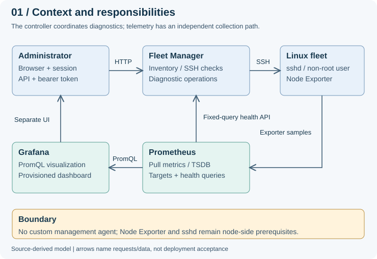
</div>

### Runtime & Trust Boundaries (Report Figure 2)
Reference multi-node deployment topology across Google Cloud Platform VPC (`10.160.0.0/24`) with Identity-Aware Proxy (IAP) zero-public-IP ingress.
<div align="center">
  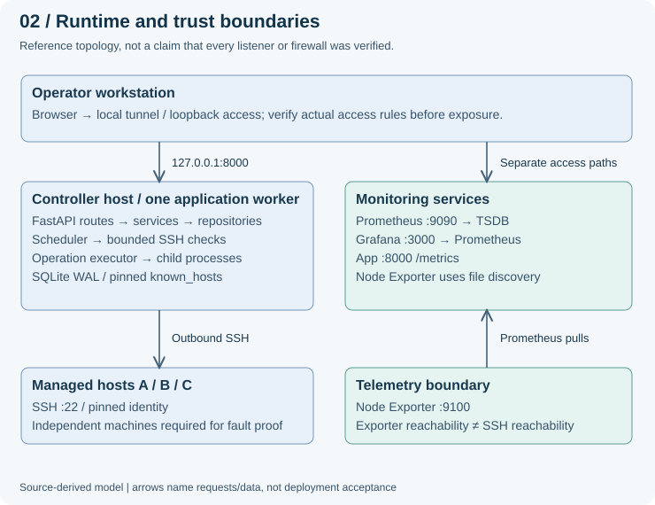
</div>

### Controller Process & Layer Ownership (Report Figure 3)
Single controller process with async event loop; child worker processes isolate Paramiko SSH calls to protect concurrency.
<div align="center">
  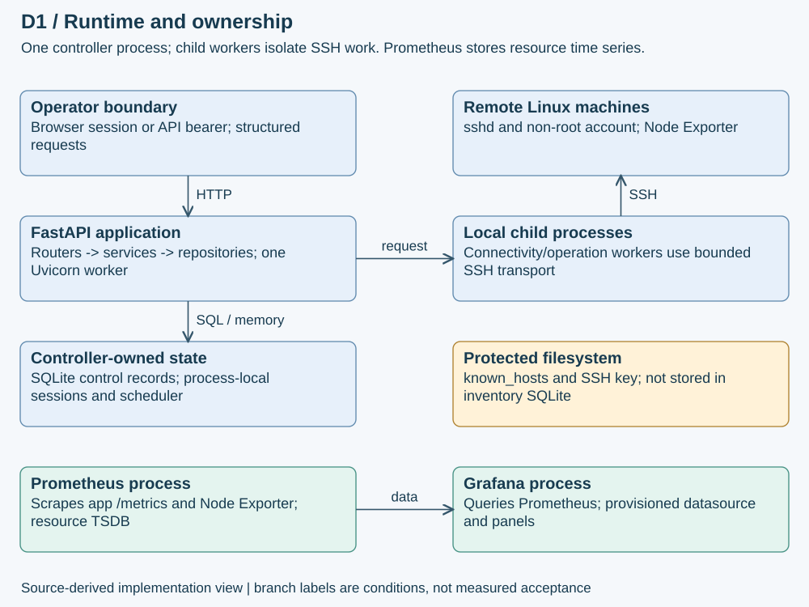
</div>

---

## 🚀 Core Architectural Pillars & Four Evaluated Outcomes

```
Workflow:  Monitor ────► Understand ────► Operate ────► Audit
```

### 1. 🛡️ Cryptographic Node Onboarding & Anti-TOFU Defense (Outcome 2)
- **The Problem:** Blind Trust-On-First-Use (TOFU) invites Man-in-the-Middle (MITM) attacks during initial SSH enrollment.
- **The Solution:** Two-step guided cryptographic enrollment. The controller performs an unauthenticated host key scan, extracts the cryptographic SHA-256 fingerprint, and requires the operator to confirm identity out-of-band before pinning the key into SQLite.
- **Key Safety Rule:** An endpoint cannot be activated without explicit cryptographic binding.

#### Onboarding Sequence Flow (Report Figure 4)
<div align="center">
  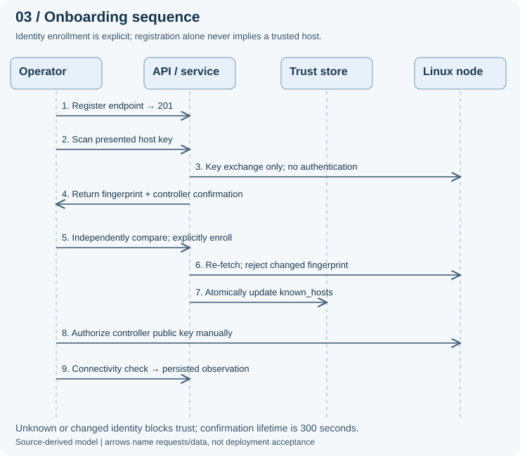
</div>

#### Enrollment Decision Gates (Report Figure D2)
<div align="center">
  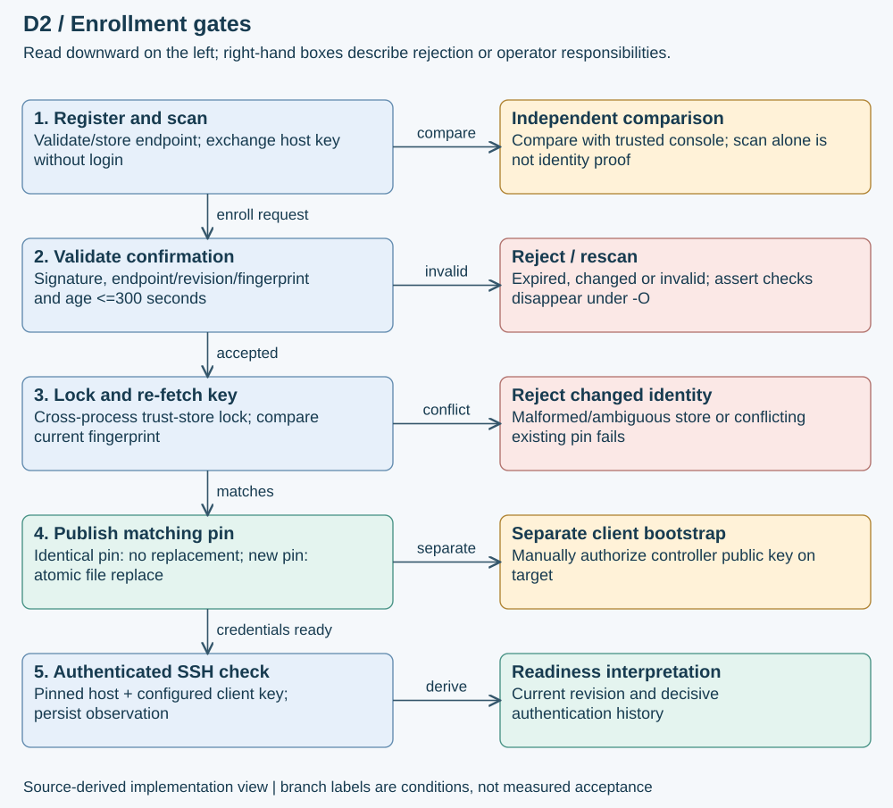
</div>

---

### 2. 📊 Decoupled Observability & Honest Missing Telemetry (Outcome 1)
- **The Problem:** Many monitoring tools fill missing telemetry with zero (misleading operators into thinking a downed host has 0% CPU utilization).
- **The Solution:** True decoupled time-series collection via Prometheus and Grafana. The native Fleet Health dashboard computes 5-minute PromQL range queries and explicitly renders broken lines / empty buckets during communication gaps.
- **Independence:** Telemetry collection via port 9100 continues even if SSH port 22 is disabled or degraded.

#### Metrics and Freshness Dataflow (Report Figure 9)
<div align="center">
  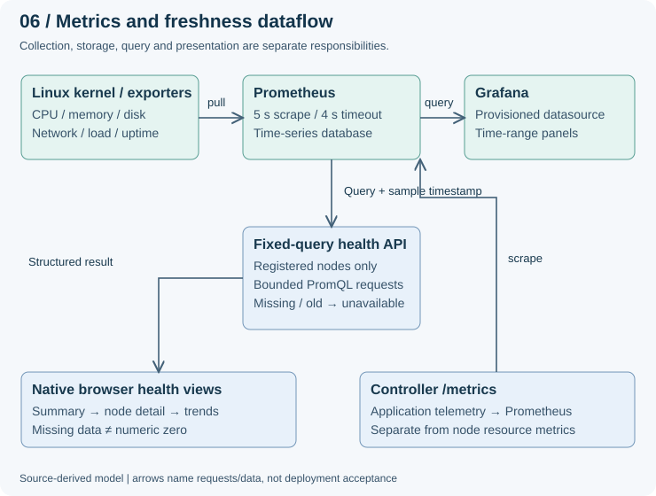
</div>

#### Source-Time Semantics & Gap Rendering (Report Figure 10)
<div align="center">
  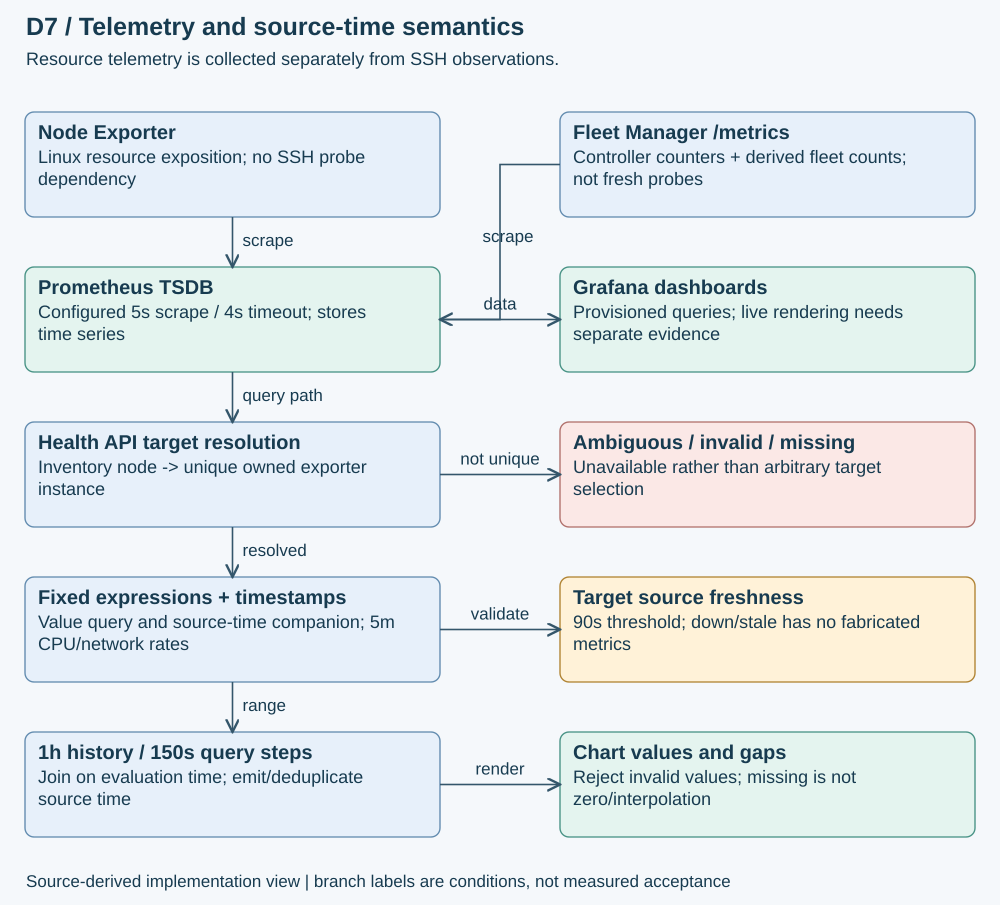
</div>

---

### 3. ⏱️ Availability Probing & Failure Handling (Outcome 3)
- **5-State Availability Classifier:** `CONNECTED`, `NOT_CHECKED`, `UNREACHABLE`, `TIMEOUT`, and `CHECK_ERROR`.
- **Bounded Concurrency:** Periodic sweeps every 60 seconds with $\pm 10\%$ random jitter to prevent "thundering herd" load spikes on network boundaries.
- **Freshness TTL:** Observations older than 180 seconds automatically degrade to stale status.

#### Periodic Monitoring Sweep Timeline (Report Figure 5)
<div align="center">
  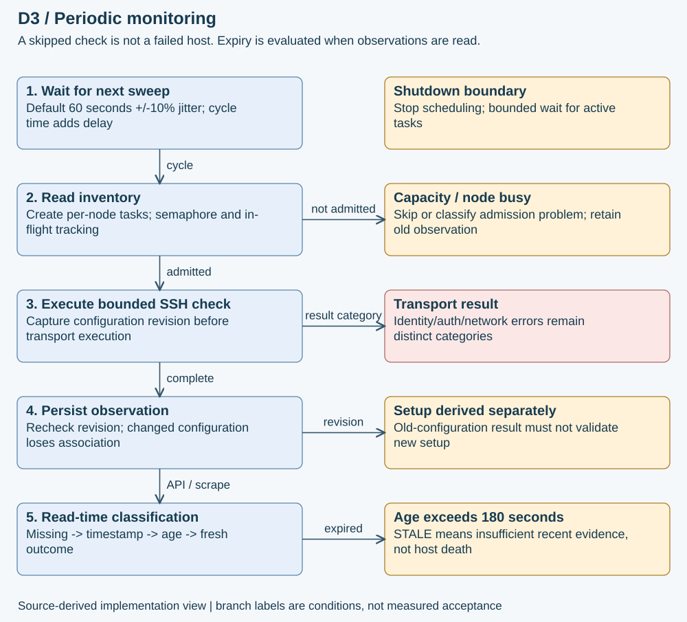
</div>

#### Ordered SSH Display Classifier (Report Figure 6)
<div align="center">
  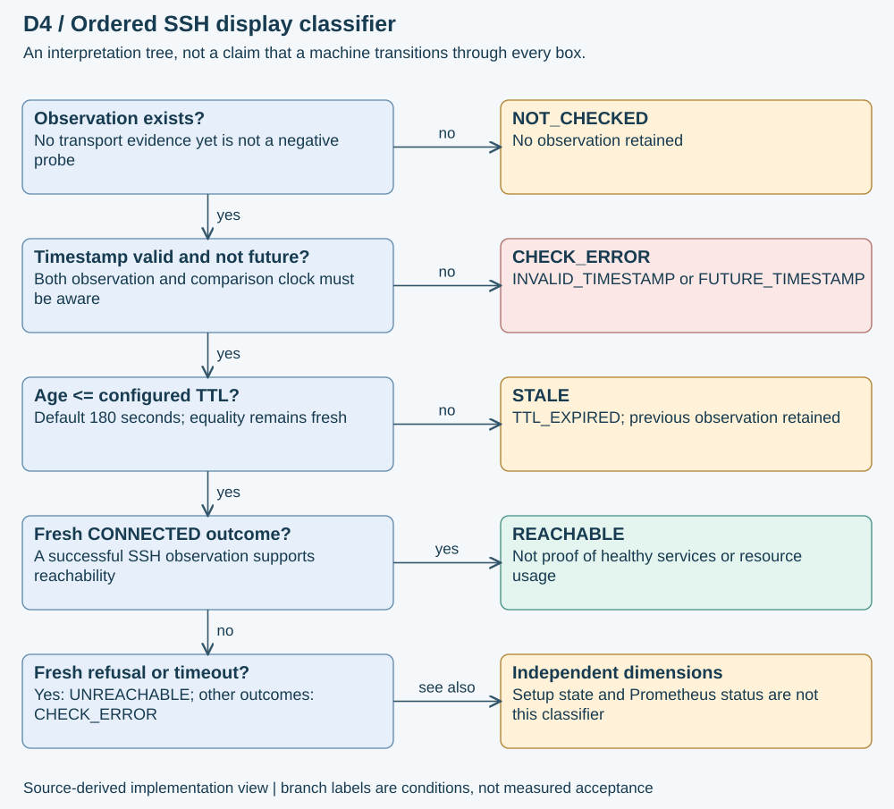
</div>

---

### 4. 🔒 Sandboxed Execution & Durable Pre-Dispatch Audit Barrier (Outcome 4)
- **Strict Allowlist:** Free-form shell input is strictly prohibited. Only pre-defined typed diagnostic actions (`system.uptime`, `system.memory`, `system.disk_free`, `system.service_status`) are executed.
- **Pre-Dispatch Audit Barrier:** The operation record is committed to persistent SQLite storage in `RUNNING` state **before** the SSH execution channel opens.
- **No-Replay Guarantee:** If the controller loses power mid-execution, restart recovery reconciles interrupted tasks to `UNCERTAIN` rather than blindly replaying commands.

#### Operation Dispatch Barrier (Report Figure 7)
<div align="center">
  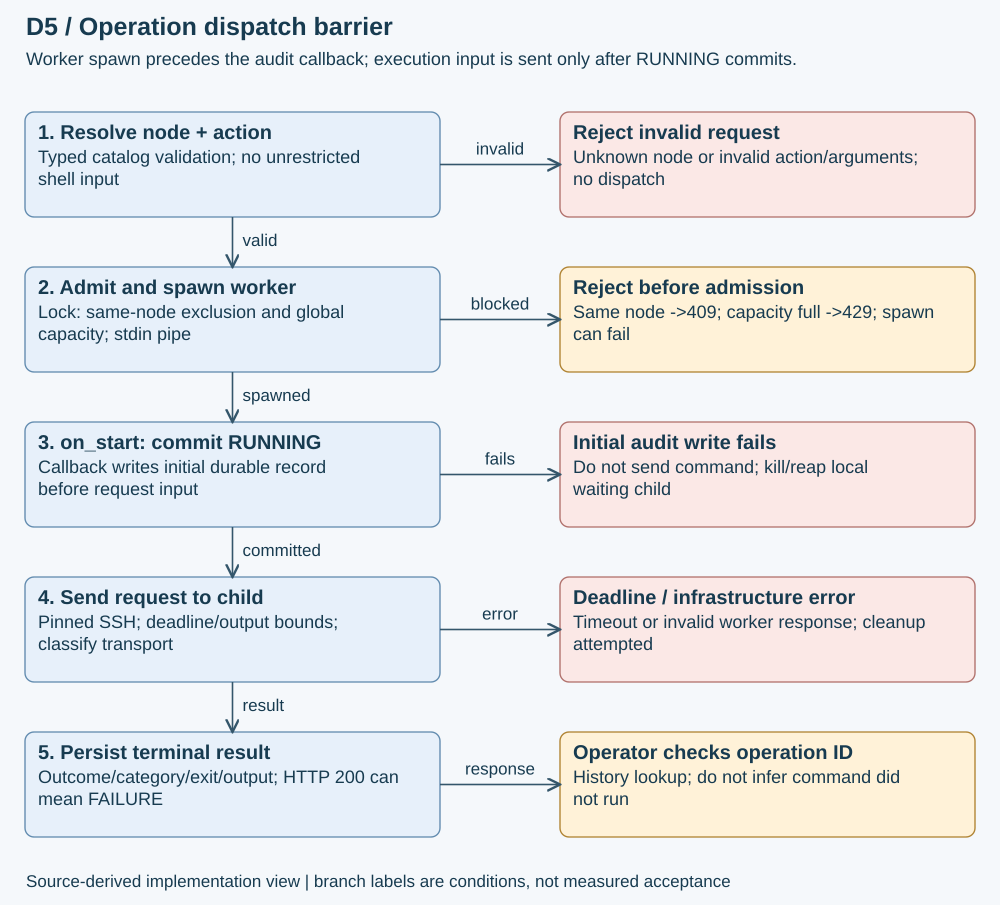
</div>

#### Crash Recovery Without Replay (Report Figure 8)
<div align="center">
  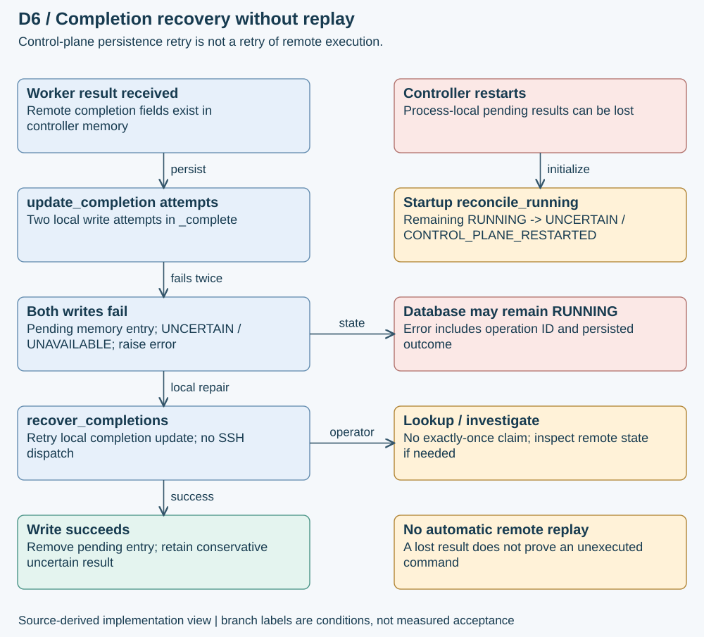
</div>

---

## 🗃️ Data Integrity, Security & Disaster Recovery

### Relational Schema & Ownership (Report Figure 11)
Persistent storage backed by SQLite operating in Write-Ahead Logging (`WAL`) mode with foreign key cascade constraints and strict schema migrations via `PRAGMA user_version`:
<div align="center">
  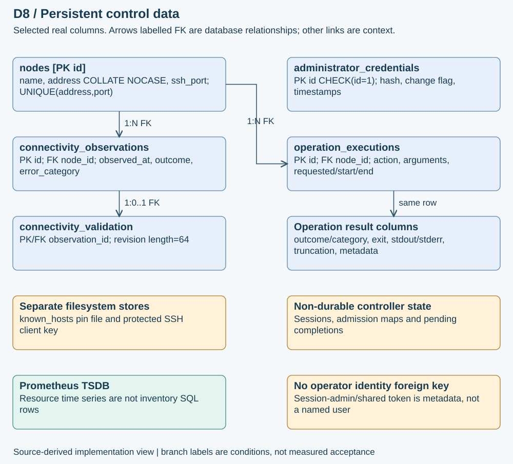
</div>

### Authentication & Mutation Gates (Report Figure 12)
Argon2id password hashing, HttpOnly session cookies, double-submit CSRF tokens, and automated Bearer tokens:
<div align="center">
  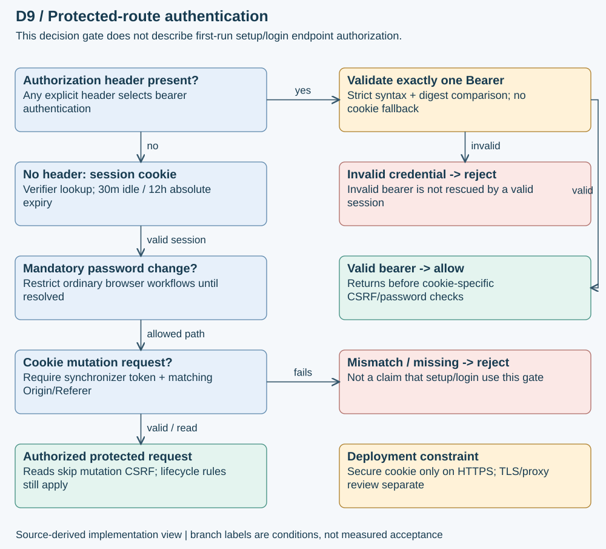
</div>

### Recovery Boundaries & Live Backups (Report Figure 13)
Zero-downtime hot backup via SQLite `VACUUM INTO` and immutable audit durability:
<div align="center">
  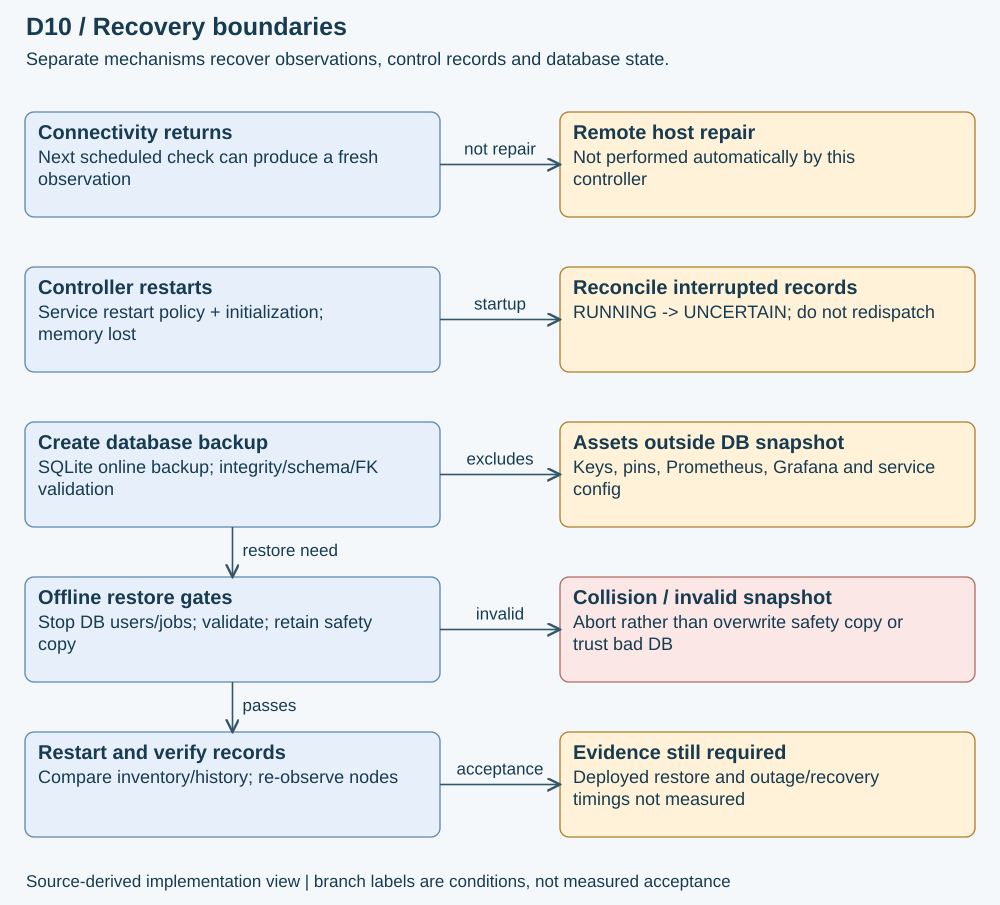
</div>

---

## 📖 Master Report Figures Index (31-Page Submission Report)

All 18 figures embedded in the official submission report ([`ADARSH-SINGH_SWFW_5S_12.pdf`](fleet-manager/submission/final/ADARSH-SINGH_SWFW_5S_12.pdf)) directly correspond to these published assets:

| Figure # | Title in Report | Asset Path | Description |
| :---: | :--- | :--- | :--- |
| **Fig 1** | System Context & Responsibilities | [`engineering-context.svg`](fleet-manager/submission/diagrams/engineering-context.svg) | Decoupled control and telemetry paths |
| **Fig 2** | Runtime & Trust Boundaries | [`engineering-deployment.svg`](fleet-manager/submission/diagrams/engineering-deployment.svg) | Multi-node GCP VPC reference topology |
| **Fig 3** | Controller Module Ownership | [`depth-runtime.svg`](fleet-manager/submission/diagrams/depth-runtime.svg) | Async event loop & worker process isolation |
| **Fig 4** | Cryptographic Onboarding Sequence | [`engineering-onboarding.svg`](fleet-manager/submission/diagrams/engineering-onboarding.svg) | Anti-TOFU host key fingerprint verification |
| **Fig 5** | Periodic Monitoring Timeline | [`depth-monitoring.svg`](fleet-manager/submission/diagrams/depth-monitoring.svg) | 60s ±10% jittered sweep vs 180s TTL |
| **Fig 6** | Ordered SSH Display Classifier | [`depth-status.svg`](fleet-manager/submission/diagrams/depth-status.svg) | 5-state availability classification tree |
| **Fig 7** | Pre-Dispatch Audit Barrier | [`depth-operation.svg`](fleet-manager/submission/diagrams/depth-operation.svg) | Durable SQLite `RUNNING` commit before SSH |
| **Fig 8** | Crash Recovery Without Replay | [`depth-persistence.svg`](fleet-manager/submission/diagrams/depth-persistence.svg) | Interrupted tasks reconciled to `UNCERTAIN` |
| **Fig 9** | Metrics & Freshness Dataflow | [`engineering-metrics.svg`](fleet-manager/submission/diagrams/engineering-metrics.svg) | Node Exporter $\to$ Prometheus $\to$ Grafana |
| **Fig 10** | Source-Time Telemetry Semantics | [`depth-telemetry.svg`](fleet-manager/submission/diagrams/depth-telemetry.svg) | Outage gap rendering without zero-filling |
| **Fig 11** | Persistent Relational Data Schema | [`depth-data.svg`](fleet-manager/submission/diagrams/depth-data.svg) | SQLite WAL mode & foreign key constraints |
| **Fig 12** | Protected-Route Authentication | [`depth-auth.svg`](fleet-manager/submission/diagrams/depth-auth.svg) | Argon2id + CSRF + Bearer auth branches |
| **Fig 13** | Recovery Boundaries & Backup | [`depth-recovery.svg`](fleet-manager/submission/diagrams/depth-recovery.svg) | Hot backup via `VACUUM INTO` |
| **Fig 14** | Measured Admission Latency | [`admission-latency-distribution.png`](fleet-manager/submission/screenshots/admission-latency-distribution.png) | High-res QPC latency distribution |
| **Fig 15** | Fleet Inventory Console | [`inventory.png`](fleet-manager/submission/screenshots/inventory.png) | Node status, endpoints & setup indicators |
| **Fig 16** | Diagnostic Operations Workbench | [`operations-workbench.png`](fleet-manager/submission/screenshots/operations-workbench.png) | Allowlisted command execution & live output |
| **Fig 17** | Decoupled Fleet Health Dashboard | [`health-1440x900.png`](fleet-manager/submission/screenshots/health-1440x900.png) | Native Prometheus sparkline telemetry |
| **Fig 18** | Security Setup & Audit History | [`audit-history.png`](fleet-manager/submission/screenshots/audit-history.png) | Immutable audit trail & first-run setup |

---

## 📸 Interface & Operator Workbench Gallery

| 1. Live Fleet Inventory (`/dashboard`) | 2. Diagnostic Operations Workbench |
| :---: | :---: |
| 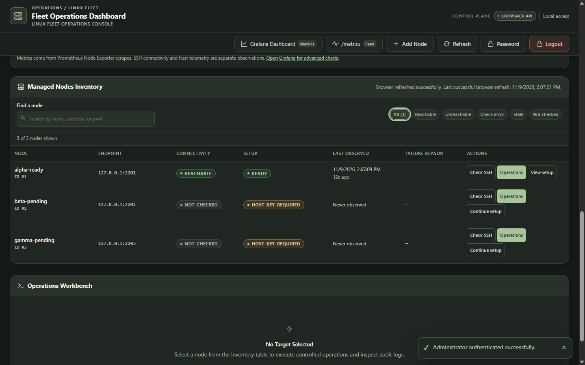 | 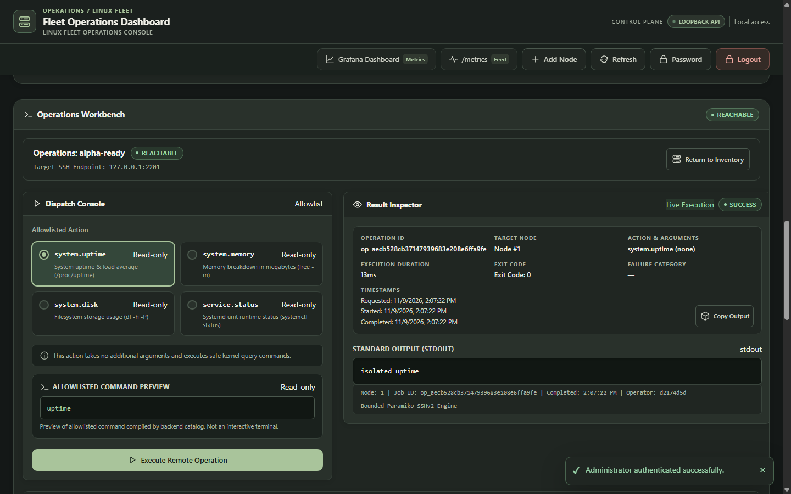 |
| *Status indicators, host fingerprints & scrape health* | *Catalog selection, structured input & live exit code* |

| 3. Native Fleet Health Trends | 4. Honest Missing Telemetry Presentation |
| :---: | :---: |
| 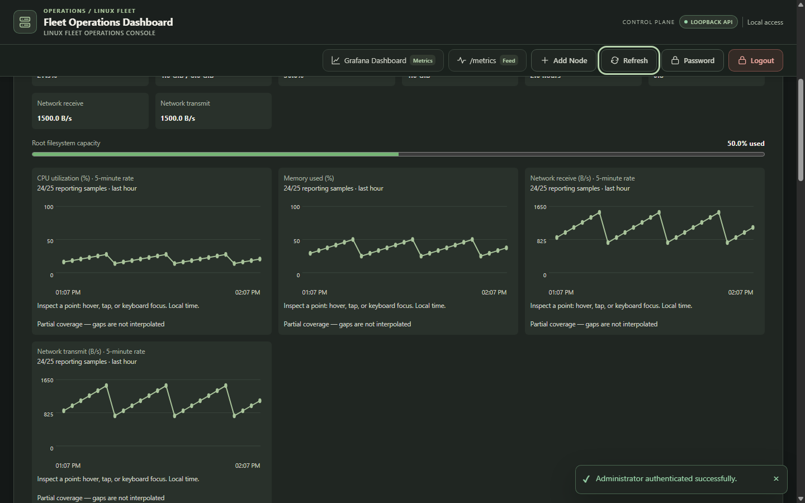 | 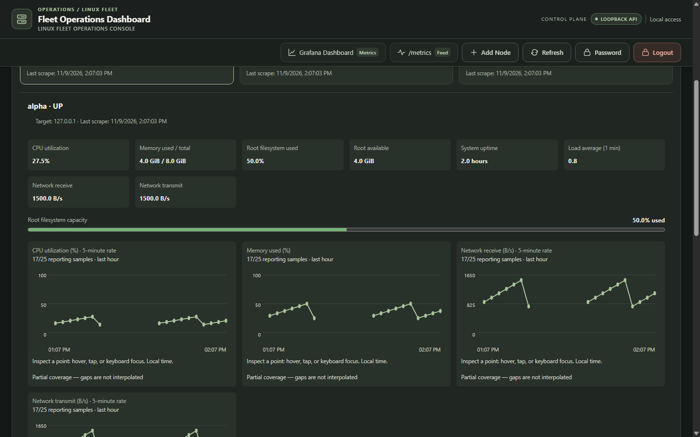 |
| *Live CPU, memory & network queries via Prometheus* | *No fake zeroes: clear gap representation during outages* |

| 5. First-Run Setup & Password Bootstrapping | 6. Durable Persistent Audit Trail |
| :---: | :---: |
| 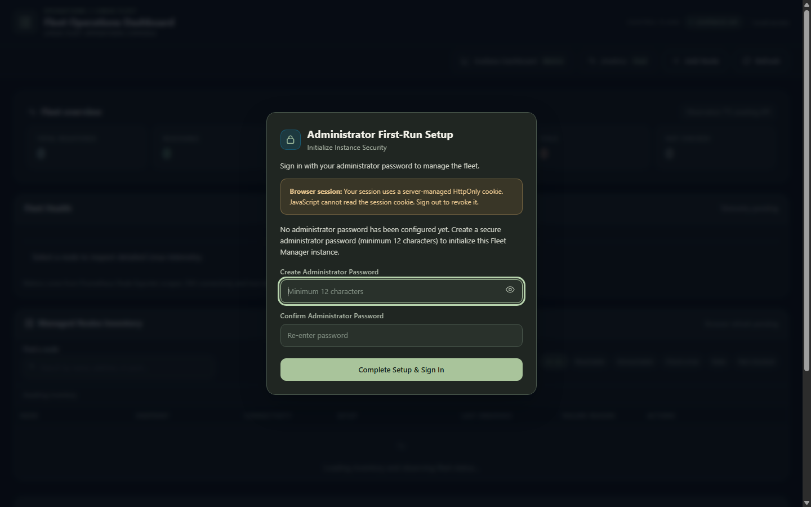 | 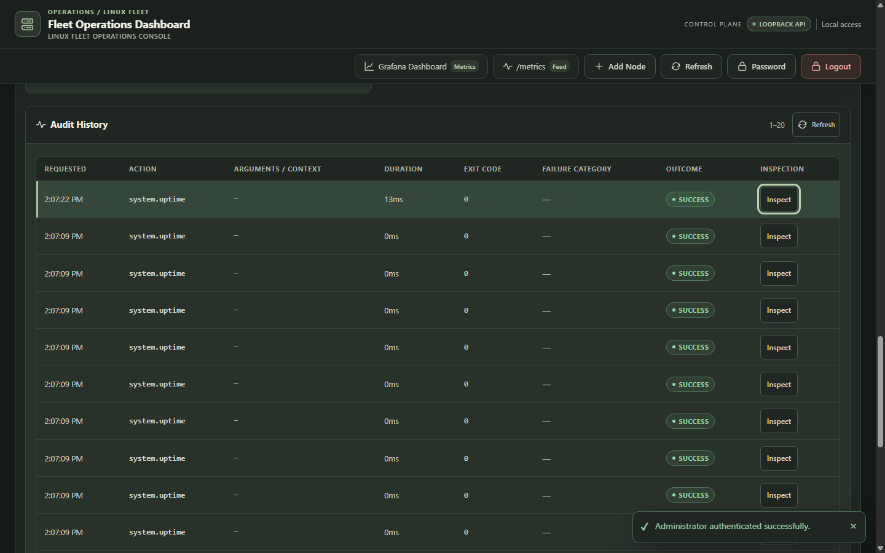 |
| *Argon2id password initialization with complexity check* | *Every remote action logged with duration, exit code & output* |

---

## ⚡ Quickstart & Local Reproduction

### 1. Prerequisites
- Python 3.12+ (Windows native or Linux)
- `uv` package manager (recommended) or standard `pip`

### 2. Setup & Automated Verification (535 Tests)
```bash
# Clone the repository
git clone https://github.com/adarsh-singh106/SWFW_5S_12.git
cd SWFW_5S_12/fleet-manager

# Install locked dependencies
uv sync

# Execute full automated test suite (535 tests)
uv run pytest -q --tb=short
```
*Expected output: `535 passed, 7 warnings in ~130s` (100% pass rate).*

### 3. Launch Controller & Open Dashboard
```bash
# Start the FastAPI controller
uv run python -m uvicorn fleet_manager.main:app --host 127.0.0.1 --port 8000
```
Open your browser to:
- **Interactive Dashboard:** [`http://127.0.0.1:8000/dashboard`](http://127.0.0.1:8000/dashboard)
- **First-Run Password Setup:** [`http://127.0.0.1:8000/setup`](http://127.0.0.1:8000/setup)
- **Interactive OpenAPI Documentation:** [`http://127.0.0.1:8000/docs`](http://127.0.0.1:8000/docs)
- **Prometheus Metrics Scrape:** [`http://127.0.0.1:8000/metrics`](http://127.0.0.1:8000/metrics)

---

## 📐 Architecture Decision Records (ADRs)

| ADR | Decision Summary | Principle / Tradeoff Justification |
| :--- | :--- | :--- |
| [ADR 0001](fleet-manager/docs/decisions/0001-inventory-backend.md) | **SQLite WAL over PostgreSQL** | Zero external daemon dependency for edge nodes; zero-latency embedded queries; WAL concurrency. |
| [ADR 0002](fleet-manager/docs/decisions/0002-local-inventory-authentication.md) | **Dual Authentication Boundary** | `HttpOnly` session cookies + double-submit CSRF for browser users; static Bearer tokens for automation. |
| [ADR 0003](fleet-manager/docs/decisions/0003-verified-ssh-observations.md) | **Explicit Key Pinning (Anti-TOFU)** | Out-of-band host key comparison before trust establishment; eliminates blind credential trust. |
| [ADR 0004](fleet-manager/docs/decisions/0004-observation-freshness-and-automatic-monitoring.md) | **Jittered Scheduling & TTL Freshness** | Eliminates connection storms; clearly distinguishes observation age from transport connectivity. |
| [ADR 0005](fleet-manager/docs/decisions/0005-prometheus-grafana-metrics-pipeline.md) | **Decoupled Prometheus Storage** | Prometheus owns time-series storage; controller proxies query ranges without duplicating TSDB overhead. |
| [ADR 0006](fleet-manager/docs/decisions/0006-controlled-remote-operations.md) | **Allowlisted Command Execution** | Free-form terminal input prohibited; strict typed catalog with pre-dispatch durable audit barrier. |
| [ADR 0007](fleet-manager/docs/decisions/0007-three-node-integration-topology.md) | **Three-Node Integration Topology** | GCE VPC isolated topology; controller on loopback with multi-host independent node connectivity. |

---

## 📜 Submission Deliverables & Verification Receipt

The official submission deliverables assembled for ZOHO SETU 2026 are packaged under [`fleet-manager/submission/final/`](fleet-manager/submission/final/):

| File Name | Size | Verification SHA-256 | Purpose |
| :--- | :---: | :--- | :--- |
| **`ADARSH-SINGH_SWFW_5S_12.pdf`** | 1.46 MB | `df6243580d00593579a0b7202b51f86881d9e0045d2724f3672e7b0eb3a46557` | Primary 31-page publication report with all 18 figures rendered. |
| **`ADARSH-SINGH_SWFW_5S_12.docx`** | 1.28 MB | `c424dfac45ccd005b544141d2c6e5007fe9ddf73498453bb39a37e92be970a55` | Companion editable master document (*DejaVu Sans* styling). |
| **`ADARSH-SINGH_SWFW_5S_12_PROJECT-FILES.zip`** | 4.45 MB | `9239dc88f6c9f2b551b2b4f7dfbea0c750092209513f06353da86303bc9be164` | Complete submission bundle containing report + clean codebase. |

*Automated test certificate:* **`535 passed, 0 failed (100% pass rate)`** recorded in [`SUBMISSION_VALIDATION.json`](fleet-manager/submission/final/SUBMISSION_VALIDATION.json).
