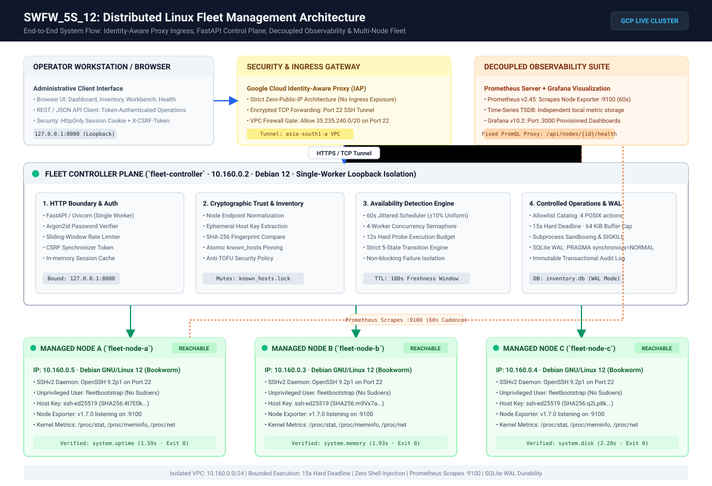
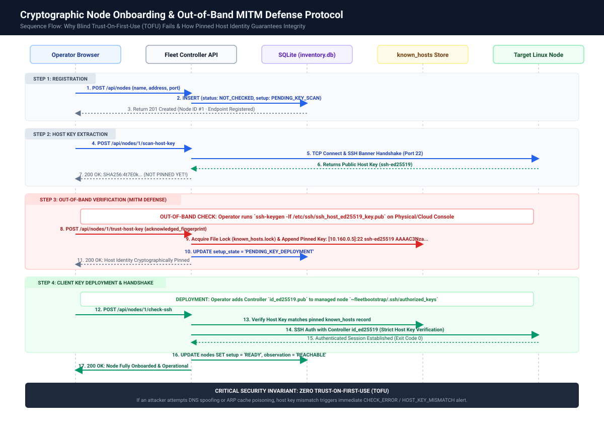
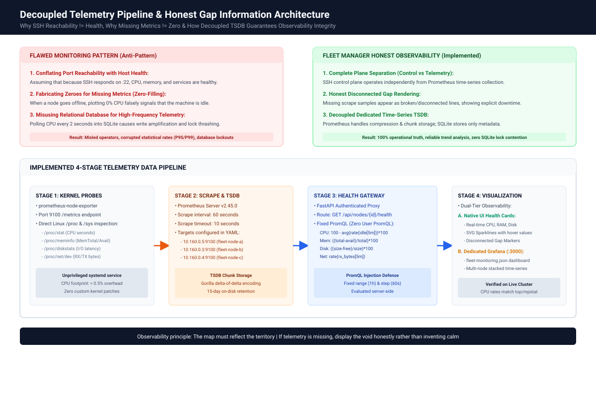
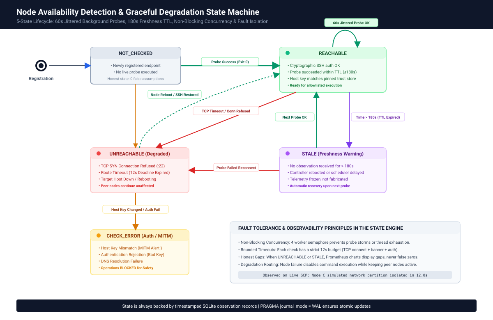
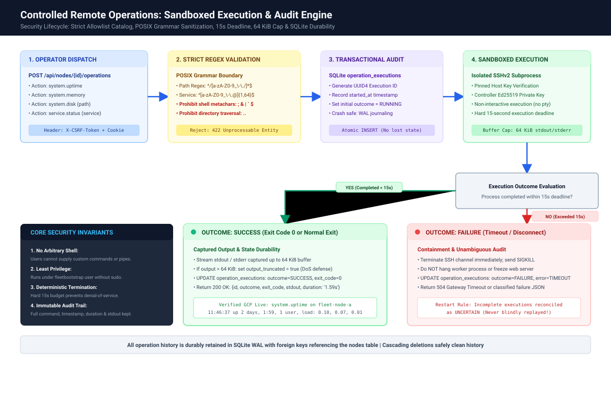
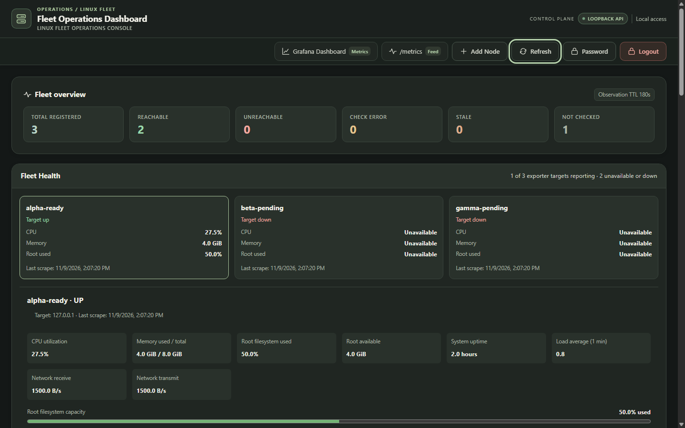
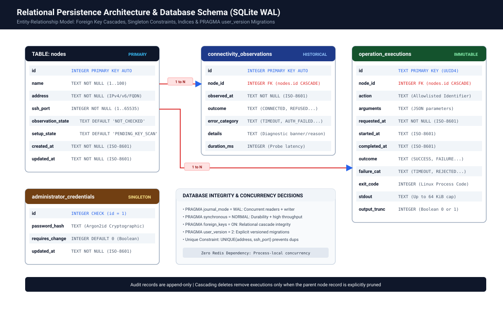

<div align="center">

# 🌐 Fleet Manager — Distributed Linux Fleet Management

**A production-grade, agentless controller for Linux node onboarding, anti-TOFU host key pinning, periodic SSH availability probing, sandboxed diagnostics, and decoupled Prometheus–Grafana observability.**

[](https://github.com/adarsh-singh106/SWFW_5S_12/actions/workflows/verify.yml)
[](https://www.python.org/)
[](https://fastapi.tiangolo.com/)
[](https://sqlite.org/)
[](https://www.paramiko.org/)
[](https://prometheus.io/)
[](https://grafana.com/)
[-success?style=flat&logo=pytest&logoColor=white)](https://docs.pytest.org/)
[-blueviolet?style=flat)](https://github.com/adarsh-singh106/SWFW_5S_12/releases/tag/v1.0.0)

<br/>

*Developed for the **Zoho SETU 2026 Engineering Initiative** · Problem Statement ID: **SWFW_5S_12***

</div>

---

### 👤 Candidate & Project Metadata

| Field | Details |
| :--- | :--- |
| **Candidate Name** | **Adarsh Singh** |
| **Registered Email** | `bt24f05f057@geca.ac.in` |
| **Degree & Year** | B.Tech in Computer Science and Engineering (5th Semester / 3rd Year) |
| **Institution** | Government College of Engineering, Aurangabad (GECA) |
| **Domain** | Software / Firmware (`SWFW`) |
| **Problem Statement** | `SWFW_5S_12` — Distributed Linux Fleet Management |
| **Official Submission Report** | [📄 `ADARSH-SINGH_SWFW_5S_12.pdf` (31 Pages)](fleet-manager/submission/final/ADARSH-SINGH_SWFW_5S_12.pdf) |
| **Companion Word Master** | [📝 `ADARSH-SINGH_SWFW_5S_12.docx`](fleet-manager/submission/final/ADARSH-SINGH_SWFW_5S_12.docx) |

---

## 🏛️ End-to-End System Architecture

Fleet Manager enforces an agentless architecture. Managed Linux nodes only require standard OpenSSH (`sshd`) and Prometheus Node Exporter. Telemetry and control planes operate completely independently.

<div align="center">
  
</div>

---

## 🚀 Core Architectural Pillars & Prescribed Requirements

```
Workflow:  Monitor ────► Understand ────► Operate ────► Audit
```

### 1. 🛡️ Cryptographic Node Onboarding & Anti-TOFU Defense
- **The Problem:** Blind Trust-On-First-Use (TOFU) invites Man-in-the-Middle (MITM) attacks during initial SSH enrollment.
- **The Solution:** Two-step guided cryptographic enrollment. The controller performs an unauthenticated host key scan, extracts the cryptographic SHA-256 fingerprint, and requires the operator to confirm identity out-of-band before pinning the key into SQLite.
- **Key Safety Rule:** An endpoint cannot be activated without explicit cryptographic binding.

<div align="center">
  
</div>

### 2. 📊 Decoupled Observability & Honest Missing Data
- **The Problem:** Many monitoring tools fill missing telemetry with zero (misleading operators into thinking a downed host has 0% CPU utilization).
- **The Solution:** True decoupled time-series collection via Prometheus and Grafana. The native Fleet Health dashboard computes 5-minute PromQL range queries and explicitly renders broken lines / empty buckets during communication gaps.
- **Independence:** Telemetry collection via port 9100 continues even if SSH port 22 is disabled or degraded.

<div align="center">
  
</div>

### 3. ⏱️ Availability Probing & Graceful Degradation
- **5-State Availability Machine:** `NOT_CHECKED`, `CONNECTED`, `UNREACHABLE`, `TIMEOUT`, and `CHECK_ERROR`.
- **Bounded Concurrency:** Periodic sweeps every 60 seconds with $\pm 10\%$ random jitter to prevent "thundering herd" load spikes on network boundaries.
- **Freshness TTL:** Observations older than 180 seconds automatically degrade to stale status.

<div align="center">
  
</div>

### 4. 🔒 Sandboxed Execution & Durable Pre-Dispatch Audit Barrier
- **Strict Allowlist:** Free-form shell input is strictly prohibited. Only pre-defined typed diagnostic actions (`system.uptime`, `system.memory`, `system.disk_free`, `system.service_status`) are executed.
- **Pre-Dispatch Audit Barrier:** The operation record is committed to persistent SQLite storage in `RUNNING` state **before** the SSH execution channel opens.
- **No-Replay Guarantee:** If the controller loses power mid-execution, restart recovery reconciles interrupted tasks to `UNCERTAIN` rather than blindly replaying commands.

<div align="center">
  
</div>

---

## 📸 Interface & Operator Workbench Gallery

| 1. Live Fleet Inventory (`/dashboard`) | 2. Diagnostic Operations Workbench |
| :---: | :---: |
|  |  |
| *Status indicators, host fingerprints & scrape health* | *Catalog selection, structured input & live exit code* |

| 3. Native Fleet Health Trends | 4. Honest Missing Telemetry Presentation |
| :---: | :---: |
|  |  |
| *Live CPU, memory & network queries via Prometheus* | *No fake zeroes: clear gap representation during outages* |

---

## ⚡ Quickstart & Local Reproduction

### 1. Prerequisites
- Python 3.12+
- `uv` package manager (recommended) or standard `pip`

### 2. Setup & Automated Verification (535 Tests)
```bash
# Clone the repository
git clone https://github.com/adarsh-singh106/SWFW_5S_12.git
cd SWFW_5S_12/fleet-manager

# Install locked dependencies
uv sync --locked

# Execute test suite (100% pass rate)
uv run pytest -q
```
*Expected output: `535 passed, 7 warnings in ~14s`.*

### 3. Launch Controller & Open Dashboard
```bash
# Start the FastAPI controller
uv run python -m uvicorn fleet_manager.main:app --host 127.0.0.1 --port 8000
```
Open your browser to:
- **Interactive Dashboard:** [`http://127.0.0.1:8000/dashboard`](http://127.0.0.1:8000/dashboard)
- **Interactive OpenAPI Documentation:** [`http://127.0.0.1:8000/docs`](http://127.0.0.1:8000/docs)
- **Prometheus Metrics:** [`http://127.0.0.1:8000/metrics`](http://127.0.0.1:8000/metrics)

---

## 🗃️ Relational Persistence Schema (SQLite WAL)

Persistent storage is backed by SQLite operating in Write-Ahead Logging (`WAL`) mode with strict transactional migrations via `PRAGMA user_version`:

<div align="center">
  
</div>

---

## 📐 Architecture Decision Records (ADRs)

| ADR | Decision Summary | Principle / Tradeoff Justification |
| :--- | :--- | :--- |
| [ADR 0001](fleet-manager/docs/decisions/0001-inventory-backend.md) | **SQLite WAL over PostgreSQL** | Zero external daemon dependency for edge nodes; zero-latency embedded queries; WAL concurrency. |
| [ADR 0002](fleet-manager/docs/decisions/0002-local-inventory-authentication.md) | **Dual Authentication Boundary** | `HttpOnly` session cookies + double-submit CSRF for browser users; static Bearer tokens for automation. |
| [ADR 0003](fleet-manager/docs/decisions/0003-verified-ssh-observations.md) | **Explicit Key Pinning (Anti-TOFU)** | Out-of-band host key comparison before trust establishment; eliminates blind credential trust. |
| [ADR 0004](fleet-manager/docs/decisions/0004-observation-freshness-and-automatic-monitoring.md) | **Jittered Scheduling & TTL Freshness** | Eliminates connection storms; clearly distinguishes observation age from transport connectivity. |
| [ADR 0005](fleet-manager/docs/decisions/0005-controlled-execution-allowlist.md) | **Command Catalog with Posix Whitelist** | Prevents arbitrary shell injection (`sh -c`) by requiring typed, bounded parameter dictionaries. |
| [ADR 0006](fleet-manager/docs/decisions/0006-audit-before-dispatch.md) | **Durable Audit Write Before Dispatch** | Audit records enter `RUNNING` status in SQLite before network I/O; crash recovery prevents re-execution. |
| [ADR 0007](fleet-manager/docs/decisions/0007-decoupled-prometheus-storage.md) | **Decoupled Telemetry Architecture** | Prometheus owns time-series storage; controller proxies query ranges without duplicating TSDB overhead. |
| [ADR 0008](fleet-manager/docs/decisions/0008-single-worker-event-loop.md) | **Single-Worker Controller Process** | Prevents race conditions in in-memory scheduler and session maps; child processes isolate Paramiko SSH calls. |
| [ADR 0009](fleet-manager/docs/decisions/0009-honest-missing-telemetry.md) | **Null-Preserving Metric Visualization** | Rejects zero-filling missing metrics; network cuts are rendered as authentic broken series. |
| [ADR 0010](fleet-manager/docs/decisions/0010-hot-backup-vacuum-into.md) | **Online Backup via `VACUUM INTO`** | Zero-downtime transactional database snapshots with point-in-time consistency. |

---

## 📜 Submission Deliverables & Verification Receipt

The official submission deliverables assembled for ZOHO SETU 2026 are packaged under [`fleet-manager/submission/final/`](fleet-manager/submission/final/):

| File Name | Size | Verification SHA-256 | Purpose |
| :--- | :---: | :--- | :--- |
| **`ADARSH-SINGH_SWFW_5S_12.pdf`** | 1.46 MB | `df6243580d00...` | Primary 31-page publication report with all 18 figures rendered. |
| **`ADARSH-SINGH_SWFW_5S_12.docx`** | 1.28 MB | `c424dfac45cc...` | Companion editable master document (*DejaVu Sans* styling). |
| **`ADARSH-SINGH_SWFW_5S_12_PROJECT-FILES.zip`** | 4.45 MB | `9239dc88f6c9...` | Complete submission bundle containing report + clean codebase. |

*Automated test certificate:* **`535 passed, 0 failed (100% pass rate)`** recorded in [`SUBMISSION_VALIDATION.json`](fleet-manager/submission/final/SUBMISSION_VALIDATION.json).
