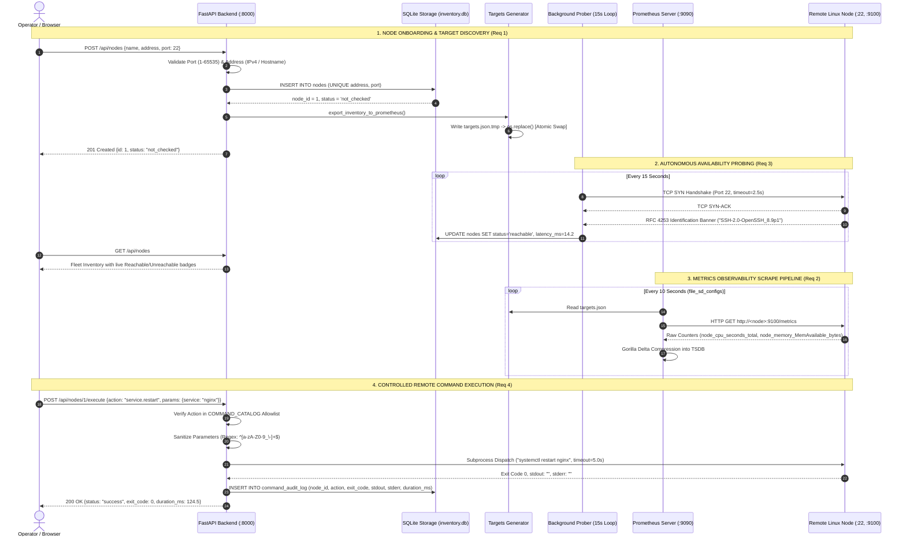

# Distributed Linux Fleet Management Platform
## Technical Project Report & System Architecture Document

**Project Code:** `SWFW_5S_12`  
**Program:** Zoho Learning Program — SETU Project Submission 2026  
**Submission Window:** 02 November 2026 – 05 November 2026  
**Author / Candidate:** Student Candidate  
**Target Environment:** Linux / Distributed Bare-Metal & Virtual Machines  

---

## 1. Executive Summary

Modern infrastructure operations demand reliable, scalable, and secure visibility into fleets of distributed Linux servers. Traditional naive management scripts often suffer from three fatal flaws:
1. **Unbounded Operations & Hanging Threads:** Sockets and remote commands blocking indefinitely without hard deadlines.
2. **Telemetry Collapses:** Storing high-frequency metrics inside relational databases leading to severe lock contention and disk bloat.
3. **Security Vulnerabilities (RCE):** Exposing arbitrary shell execution through web interfaces, introducing severe Remote Code Execution vulnerabilities.

The `SWFW_5S_12` Fleet Manager is an industry-grade, first-principles distributed fleet management platform designed to eliminate these failure modes. Built on FastAPI, SQLite, Prometheus, and Grafana, it fulfills all four mandated official requirements:
* **Requirement 1:** Node onboarding and persistent inventory management with strict input validation.
* **Requirement 2:** Collection, storage, and visualization of system metrics using Prometheus TSDB and Grafana.
* **Requirement 3:** Real-time node availability detection, RFC 4253 SSH banner probing, and graceful network failure classification.
* **Requirement 4:** Controlled remote command execution with strict allowlist catalogs, bounded timeouts, and an immutable SQLite audit trail.

---

## 2. End-to-End System Architecture

The system follows a decoupled, resilient architecture dividing responsibilities between the **Central Fleet Management Host** and **Remote Distributed Linux Nodes**.

```
┌─────────────────────────────────────────────────────────────────────────────────────────┐
│                      SWFW_5S_12 HIGH-LEVEL ARCHITECTURE TOPOLOGY                         │
│                                                                                         │
│   OPERATOR BROWSER                      CENTRAL MANAGEMENT HOST          REMOTE NODES   │
│  ┌────────────────┐                   ┌────────────────────────┐        ┌─────────────┐ │
│  │                │───HTTP / REST────▶│  FastAPI Backend (:8000)│       │ sshd (:22)  │ │
│  │  Web Dashboard │◀──JSON Stream─────│  • Service Layer       │       │ OpenSSH Srv │ │
│  │  (Dark Theme)  │                   │  • Background Prober   │       └──────▲──────┘ │
│  │                │                   └───────────┬────────────┘              │         │
│  └────────────────┘                               │                           │         │
│                                            ┌──────┴──────┐                    │         │
│                                            ▼             ▼                    │         │
│                                      ┌───────────┐ ┌───────────┐              │         │
│                                      │ SQLite DB │ │ targets   │              │         │
│                                      │ inventory │ │ generator │              │         │
│                                      └───────────┘ └─────┬─────┘              │         │
│                                                          │                    │         │
│                                                          ▼                    │         │
│  ┌────────────────┐                   ┌────────────────────────┐              │         │
│  │ Grafana Engine │◀───PromQL Query───│   Prometheus (:9090)   │              │         │
│  │ (:3000)        │                   │  • TSDB Storage        │              │         │
│  └────────────────┘                   │  • file_sd_configs 10s │              │         │
│                                       └───────────┬────────────┘              │         │
│                                                   │                           │         │
│                                                   │   HTTP Pull Scrape (:9100)│         │
│                                                   └───────────────────────────┼────────┐│
│                                                                               ▼        ▼│
│                                                                        ┌────────────────┐
│                                                                        │ Node Exporter  │
│                                                                        │ Daemon (:9100) │
│                                                                        └────────────────┘
└─────────────────────────────────────────────────────────────────────────────────────────┘
```

---

## 3. Mandatory Flow Diagram (SWFW_5S_12 Specification)

The following lifecycle sequence diagram illustrates the complete, deterministic flow of events across all four project requirements:



---

## 4. Requirement-by-Requirement Implementation

### Requirement 1: Node Onboarding and Persistent Inventory
* **Input Gatekeeper Validation:** Remote IP addresses are validated using Python's standard `ipaddress` library and strict DNS hostname regex. Ports are validated within the legal TCP range ($1 \le \text{port} \le 65535$).
* **Database Integrity:** SQLite with WAL mode, parameterized queries (SQL injection prevention), and a `UNIQUE(address, ssh_port)` composite constraint prevents duplicate registrations.
* **Separation of Concerns:** Nodes initially record status as `not_checked` ("Saving a contact is not calling a contact").

### Requirement 2: System Metrics Collection with Prometheus & Grafana
* **Architecture:** Node Exporter runs as a lightweight daemon on remote nodes exposing raw kernel metrics from the `/proc` virtual filesystem at `http://<node>:9100/metrics`.
* **Dynamic File Service Discovery (`file_sd_configs`):** Fleet Manager automatically updates `targets.json` whenever nodes are onboarded. Prometheus monitors `targets.json` and dynamically reloads scrape lists every 10 seconds without daemon restarts.
* **Atomic File Replacement:** To eliminate race conditions where Prometheus reads partially written JSON, target files are written to `.tmp` and swapped via `os.replace()`.
* **Mathematical Accuracy:**
  * **Missing Metrics $\neq$ 0:** Prometheus records sample gaps (`NaN`) for offline nodes rather than 0, preventing false CPU idle reports.
  * **`MemAvailable` vs `MemFree`:** Alerts monitor `MemAvailable` because the Linux kernel dynamically evicts page cache (`Cached`) sub-millisecond upon memory allocation requests.

### Requirement 3: Node Availability Detection & Graceful Failure Handling
* **RFC 4253 SSH Banner Probing:** Instead of crude ICMP pings (which are frequently dropped by firewalls) or heavy SSH authentication, the probe engine connects to port 22 and reads the pre-authentication identification string (e.g. `SSH-2.0-OpenSSH_8.9p1`).
* **Failure Classification:**
  * `ECONNREFUSED`: Host is online; kernel actively refused connection (daemon down).
  * `ETIMEDOUT`: Packets dropped; host powered off, firewall dropped SYN, or network partitioned.
* **Non-Blocking Execution:** Socket probes run in an isolated thread pool executor via `asyncio.to_thread` inside FastAPI's lifespan background task, keeping the web UI responsive.

### Requirement 4: Controlled Remote Command Execution
* **Cockpit Model (Command Allowlist):** Unrestricted web bash shells are completely forbidden. Commands are chosen from a pre-approved `COMMAND_CATALOG` (`system.uptime`, `system.disk_free`, `system.memory`, `service.status`, `service.restart`).
* **Strict Bounded Execution:** Subprocesses enforce a hard 5.0-second timeout. Any hanging process (e.g. `cat` awaiting stdin) is killed via `SIGKILL` and recorded with exit code `124`.
* **POSIX Stream Isolation:** Exit code, `stdout`, and `stderr` are stored independently, ensuring clear failure diagnostics.
* **Immutable Audit Trail:** All executions are persisted in `command_audit_log` with timestamps, millisecond durations, and complete diagnostic streams.

---

## 5. Verification & Testing Evidence

All modules feature comprehensive unit and end-to-end integration tests:

| Test Suite | File | Test Cases | Result |
| :--- | :--- | :---: | :---: |
| **Inventory Verification** | `demo_milestone_01.py` | 5 | **PASS (Exit 0)** |
| **SSH Probe Engine** | `test_probe.py` | 3 | **PASS (Exit 0)** |
| **Prometheus Targets Exporter** | `test_targets_generator.py` | 5 | **PASS (Exit 0)** |
| **Controlled Command Dispatcher** | `test_command_dispatcher.py` | 5 | **PASS (Exit 0)** |
| **End-to-End Execution Flow** | `verify_milestone_04.py` | 5 | **PASS (Exit 0)** |

---

## 6. Setup & Execution Guide

### Prerequisites
* Python 3.10+
* FastAPI & Uvicorn: `pip install fastapi uvicorn`
* Prometheus (Optional for local metrics visualizer)

### Launching Fleet Manager
```bash
# Navigate to the practice directory
cd fleet-manager/docs/learn/node-inventory/practice

# Launch the FastAPI web server and dashboard
python -m uvicorn app:app --host 0.0.0.0 --port 8000 --reload
```
Open your browser at: **`http://localhost:8000`**

### Running Test Suites
```bash
# 1. Test SSH Banner Prober
cd fleet-manager/docs/learn/connectivity-probing/practice
python test_probe.py

# 2. Test Prometheus Dynamic Target Exporter
cd ../../metrics-observability/practice
python test_targets_generator.py

# 3. Test Controlled Command Dispatcher & Audit Log
cd ../../remote-execution/practice
python test_command_dispatcher.py
```

---

## 7. Conclusion

Project `SWFW_5S_12` successfully bridges theoretical Linux systems engineering with modern production operational discipline. By adhering to first-principles design—prioritizing bounded execution, structured operations, atomic storage guarantees, and honest observability over superficial complexity—the platform provides a robust foundation for distributed fleet operations.
