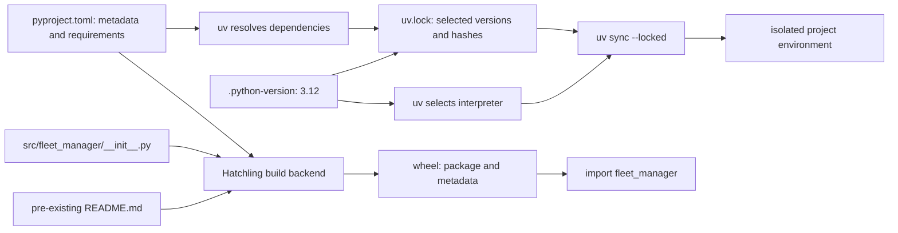

# Chunk 00: Python Engineering Foundation

*How the interpreter, package, dependencies, and development tools fit together*

| Field | Detail |
| --- | --- |
| Baseline commit | `46e78ca7a3873c2e33c2cd5797c4dd4c35c048b5` — `build(foundation): establish reproducible Python project` |
| Baseline date | 28 October 2026 |
| Prepared by | Executing Codex agent, Windows PowerShell environment |
| Source verification | The four committed files were read from the baseline commit. Commands below are exercises; their inclusion is not a claim that a reader ran them. |
| Learning status | Student understanding has not been assessed by this guide. |

This guide covers the **committed Python engineering foundation**: project configuration and a package skeleton. Its only committed Python source was `src/fleet_manager/__init__.py`, containing a package docstring. The application modules and tests in the later working tree are outside this baseline. A pre-existing `README.md` is referenced by package metadata but was not part of the four-file commit.

## Learning objectives

By the end, you should be able to:

1. Explain why the repository chooses Python 3.12 and an isolated environment.
2. Trace how `pyproject.toml`, `uv.lock`, and the package source lead to an installed project and a wheel.
3. Distinguish dependency resolution, locking, packaging, static analysis, and behavior testing.
4. Reproduce a safe build from the baseline commit and state precisely what that build proves.

## Contents

1. [Beginner foundations](#1-beginner-foundations)
2. [Python project engineering](#2-python-project-engineering)
3. [Development tools and commands](#3-development-tools-and-commands)
4. [Repository walkthrough](#4-repository-walkthrough)
5. [Engineering tradeoffs](#5-engineering-tradeoffs)
6. [Hands-on exercises](#6-hands-on-exercises)
7. [Interview preparation](#7-interview-preparation)
8. [Quick-reference sheet](#8-quick-reference-sheet)

**Quick-revision path (5–10 minutes):** read the [artifact map](#4-repository-walkthrough), [tradeoffs](#5-engineering-tradeoffs), and [quick-reference sheet](#8-quick-reference-sheet).

**Deep-learning path:** read chapters 1–5 in order, complete the three [exercises](#6-hands-on-exercises), answer the [interview questions](#7-interview-preparation) without looking, then revise with chapter 8.

## 1. Beginner foundations

### 1.1 Runtime, interpreter, and version

A programming language describes rules for writing programs. A **runtime** is the software and environment that execute them. For this project, the Python interpreter reads `.py` files, imports modules, creates objects, and uses its standard library. It also loads installed third-party packages.

**Why this matters:** a correct `.py` file can still fail if the interpreter is incompatible or a dependency is absent. Choosing one supported interpreter series makes that failure easier to diagnose.

[`.python-version`](../../.python-version) contains `3.12`. [`pyproject.toml`](../../pyproject.toml) narrows this to `requires-python = ">=3.12,<3.13"`; [`uv.lock`](../../uv.lock) says `requires-python = "==3.12.*"`. Together, these select the Python **3.12 minor series**, not one exact 3.12 patch release.

Python 3.12 was the approved project baseline recorded in the [project charter](../PROJECT-CHARTER.md), and the project configuration and tool settings agree with it. The committed files do not document a benchmark or prove that 3.12 is faster or safer than every newer release.

**System Python** is an interpreter installed for the machine or operating system; other programs may depend on it. **Project Python** is the interpreter chosen for this repository. A terminal's `python` command may point to a different version, so check it rather than assume. On a machine with several interpreters, `uv` can select Python 3.12 for this project without replacing system Python.

### 1.2 Virtual environments and packages

A **virtual environment** isolates a project's installed Python dependencies. It is a directory with an interpreter entry point and its own package installation location. Installing FastAPI there avoids changing the system installation or another project's packages.

**Limit:** dependency isolation does not isolate the process from files, the network, or OS permissions. A virtual environment is generated local state and should not be committed.

A **Python package** is an importable group of modules. [`src/fleet_manager/__init__.py`](../../src/fleet_manager/__init__.py) marks `fleet_manager` as the package here. After installation, `import fleet_manager` can find it. At the baseline commit, that import loads only the docstring-bearing initializer; `fleet_manager.main` does not exist yet.

The **distribution name** `swfw-fleet-manager` identifies what a package manager installs. The **import name** `fleet_manager` identifies what Python loads. Their spelling can differ because they serve different purposes.

## 2. Python project engineering

### 2.1 What `pyproject.toml` declares

`pyproject.toml` is the project's machine-readable contract for building, installing, and configuring tools. Its sections answer different questions: what to build, what to install, and how to check the code. The baseline file declares:

| Section | Actual value | Why it matters |
| --- | --- | --- |
| `[build-system]` | `requires = ["hatchling"]`; `build-backend = "hatchling.build"` | A frontend such as `uv build` asks Hatchling to create the distribution. Hatchling is a build dependency, not an application runtime dependency. |
| `[project]` | `swfw-fleet-manager`, version `0.1.0`, inventory/SSH API description, `readme = "README.md"`, Python `>=3.12,<3.13` | Identifies the installable distribution and supported interpreter range. The description states project intent; it does not prove that the API existed in Chunk 00. |
| `[project].dependencies` | `fastapi>=0.162.0`, `paramiko>=5.1.0`, `uvicorn>=0.54.0` | Packages required when installing the application distribution. FastAPI is the planned HTTP framework, Paramiko the SSH library, and Uvicorn the server; their use comes in later source chunks. |
| `[tool.hatch.build.targets.wheel]` | `packages = ["src/fleet_manager"]` | Specifies which package tree goes into the wheel. |
| `[tool.pytest.ini_options]` | `testpaths = ["tests"]` | Tells pytest where to discover tests when that directory gains tests. Chunk 00 committed no test files. |
| `[tool.ruff]` / `[tool.ruff.lint]` | Python target `py312`, line length `100`, source roots `src` and `tests`; rules `E`, `F`, `I`, `B`, `UP` | Sets formatting/lint context. Rule families cover style errors, likely mistakes, import order, bugbear checks, and Python modernization. |
| `[tool.mypy]` | Python `3.12`, files `src`, `strict = true` | Sets the static type-checking scope and stricter checks. |
| `[dependency-groups].dev` | `httpx>=0.28.1`, `mypy>=2.4.0`, `pytest>=9.1.1`, `ruff>=0.17.3`, `types-paramiko>=5.0.0.20261021` | Development/test tools and types; they are not the application's declared runtime dependencies. |

The three runtime requirements use **lower bounds**, so a fresh resolver could choose later versions. `uv.lock` records one resolved set. The development group supplies HTTP test support (`httpx`), type checking (`mypy` and Paramiko stubs), tests (`pytest`), and lint/format checking (`ruff`). Installing only runtime dependencies is a separate deployment choice; the default local development sync includes the dev group.

### 2.2 Build backend, wheel, and `src` layout

A **build frontend** starts a build; a **build backend** knows how to package this project. Here `uv build` is the frontend and Hatchling is the configured backend. A **wheel** (`.whl`) is a ZIP-format Python distribution with package files and metadata.

**Packaging check:** a successful wheel build proves that packaging succeeded. It does not prove that a web server starts or an SSH operation works. The `readme = "README.md"` setting means the pre-existing README must also be present when building from a source snapshot. The lockfile does not itself pin Hatchling's isolated build environment; **build isolation** means the backend can be installed separately for the build.

In a **`src` layout**, importable code lives under `src/fleet_manager/`, while configuration, tests, and docs live outside it. This makes an installed package or an explicit source path necessary for imports, helping reveal packaging mistakes that a flat root package can hide.

An **editable install** lets `import fleet_manager` refer back to the source tree. A wheel install copies the package from the built artifact. The baseline package contains only `__init__.py`.

### 2.3 Dependency resolution, locking, and limits

**Dependency resolution** computes versions satisfying all declared constraints, including **transitive dependencies** (packages required by other packages). **Locking** records the selected versions and artifact hashes for repeatable installation.

The committed `uv.lock` has 38 package entries, a Python 3.12 requirement, the local project as an editable package, and entries for runtime and dev dependencies. For example, it records FastAPI `0.162.0`, Paramiko `5.1.0`, Uvicorn `0.54.0`, pytest `9.1.1`, Ruff `0.17.3`, and mypy `2.4.0`. Those are lockfile observations, not promises about future releases.

`uv lock --check` checks whether the current project requirements and lock agree. `uv sync --locked` installs according to the existing lock and rejects a change that would require updating it.

**Reproducibility limit:** the lock narrows dependency drift, but does not pin the exact Python patch version, the OS, available native libraries, uv itself, or the separately resolved Hatchling build environment. Platform-specific wheel choices can differ. Hashes help verify fetched artifacts; they do not certify dependency safety, application correctness, successful tests, or identical behavior on every machine. Generated environments must be recreated, not committed.

## 3. Development tools and commands

Run from `fleet-manager/`. The environment path stays under ignored `.local/`, so this workflow does not touch an existing `.venv`. Expected behavior is described beside each command, without claiming a result from this editing pass.

```powershell
uv python find 3.12                 # Show the selected 3.12 interpreter, or report it unavailable
uv lock --check                     # Exit successfully if pyproject and lock agree
$env:UV_PROJECT_ENVIRONMENT = Join-Path (Get-Location) '.local/chunk00-dev-env'
uv sync --locked --python 3.12      # Create/update this isolated environment from the lock
uv run --no-sync ruff check src tests
uv run --no-sync ruff format --check src tests
uv run --no-sync python -m mypy src
uv run --no-sync pytest -q
Remove-Item Env:UV_PROJECT_ENVIRONMENT
```

| Tool | Configured role | What a clean result cannot establish |
| --- | --- | --- |
| **uv** | Selects Python, resolves and locks dependencies, creates environments, installs packages, runs commands, and builds distributions. | uv prepares the environment; it is not the Python runtime or a behavior test. |
| **Ruff** | Checks the selected lint rules and verifies formatting for `src` and `tests`. | Lint and formatting do not prove type safety or correct behavior. |
| **mypy** | Performs **static analysis** of type consistency in `src`, with `strict = true`. | It does not execute network or database paths; third-party typing quality also matters. |
| **pytest** | Discovers and runs tests under `tests`. | Tests establish only the behaviors they cover. Chunk 00 committed no tests. |

`--no-sync` asks `uv run` to use the existing environment rather than first update it; sync deliberately before using this flag. `httpx` and `types-paramiko` support later HTTP test and type-checking workflows.

On Windows machines where application control blocks a prebuilt mypy executable, the project README documents building the locked mypy release from source: set `$env:MYPY_USE_MYPYC='0'` and use `uv sync --locked --no-binary-package mypy` in a disposable environment. This is an environment-specific workaround, not a change to `uv.lock`.

## 4. Repository walkthrough

| Committed artifact | Role | Depends on / feeds |
| --- | --- | --- |
| [`.python-version`](../../.python-version) | Chooses Python 3.12 for tools that honor this file. | Agrees with the version ranges in `pyproject.toml` and `uv.lock`. |
| [`pyproject.toml`](../../pyproject.toml) | Defines distribution, dependencies, build backend, package path, and tool settings. | Refers to pre-existing `README.md` and the package directory; its requirements feed resolution. |
| [`uv.lock`](../../uv.lock) | Records one resolved dependency graph and artifact hashes. | Derived from project requirements; used by locked sync. |
| [`src/fleet_manager/__init__.py`](../../src/fleet_manager/__init__.py) | Creates the importable package skeleton. | Hatchling includes it in the wheel; later source files extend this package. |

**Figure 1. Dependency and packaging flow.** Interpreter selection, locked installation, and wheel packaging are related but distinct operations.



The left path prepares a lock-guided **installation**. The right path asks Hatchling to **package** the source and metadata. Follow the arrows to explain why the lockfile affects installation while the build backend controls wheel contents.

## 5. Engineering tradeoffs

The baseline files establish the choices in the first column. The other columns explain engineering alternatives; they are not a historical record that every option was evaluated or rejected.

| Choice in commit `46e78ca` | Why it is reasonable here | Alternative and cost |
| --- | --- | --- |
| Python 3.12 minor series | One interpreter target keeps syntax, tooling, and dependency support aligned. | A newer Python may offer new features, but would require compatibility checks, updating the declared range, re-locking, and rerunning verification. The source does not establish a performance comparison. |
| uv workflow | One tool handles interpreter selection, environment, lock, sync, and build commands. | `python -m venv` plus `pip` can work, but needs separate version selection, dependency locking, and repeatability conventions. Neither tool substitutes for testing. |
| `src/fleet_manager` | Keeps importable package apart from repository-only files and helps test packaging. | A flat package is simpler to browse initially but can let root-directory imports mask a missing installed package. |
| Committed lockfile | Keeps one resolved dependency set reviewable across machines. | Lower bounds alone allow newer packages at each install; the lock still needs updates and platform verification. |

For a larger team, document a supported OS/Python matrix, run locked installs and quality gates in CI, review lockfile updates, define dependency-update ownership, and test built wheels in a clean environment. These are **future practices to consider**, not claims that Chunk 00 configured CI or a team policy.

## 6. Hands-on exercises

Use PowerShell from `fleet-manager/`. The repository's `.local/` directory is ignored; keep all generated work there. Use a Python 3.12 interpreter already available to uv, or install one through uv if needed. The commands make no API requests and need no secrets. Keep the existing `.venv` intact; it may belong to a different environment.

### 6.1 Exercise: Create and inspect an isolated environment

```powershell
uv venv --python 3.12 .local/chunk00-study-venv
& ./.local/chunk00-study-venv/Scripts/python.exe --version
& ./.local/chunk00-study-venv/Scripts/python.exe -c "import sys; print(sys.executable); print(sys.prefix); print(sys.base_prefix)"
& ./.local/chunk00-study-venv/Scripts/python.exe -m pip --version
```

**Inspect:** `sys.prefix` should point to the new environment and differ from `sys.base_prefix`. The final command may say `pip` is absent: uv environments do not need pip to install packages. On Linux/macOS, use `.local/chunk00-study-venv/bin/python` instead of `Scripts/python.exe`.

**Explain:** Why did creating the environment not install FastAPI yet?

### 6.2 Exercise: Build and inspect the committed skeleton wheel

`uv build` in the current working tree might include later, uncommitted modules. Extract only baseline inputs plus the pre-existing README into an ignored study directory:

```powershell
$study = Join-Path (Get-Location) '.local/chunk00-snapshot'
New-Item -ItemType Directory -Force $study | Out-Null
$archive = Join-Path $study 'snapshot.tar'
$paths = @(
    'fleet-manager/.python-version'
    'fleet-manager/pyproject.toml'
    'fleet-manager/uv.lock'
    'fleet-manager/src/fleet_manager/__init__.py'
    'fleet-manager/README.md' # Pre-existing file required by pyproject.toml
)
git -C .. archive --format=tar -o $archive 46e78ca $paths
tar -xf $archive -C $study
$project = Join-Path $study 'fleet-manager'
uv build --wheel --project $project --out-dir (Join-Path $study 'wheels')
$wheel = (Get-ChildItem (Join-Path $study 'wheels') -Filter '*.whl' | Select-Object -First 1).FullName
uv run --no-project --python 3.12 python -m zipfile -l $wheel
```

**Inspect:** find `fleet_manager/__init__.py` and `.dist-info` metadata in the wheel listing. If `tar` is unavailable, copy these exact files with `git show 46e78ca:<path>` into the same layout before building.

**Explain:** Why does a successful build not imply that `fleet_manager.main` exists in this snapshot?

### 6.3 Exercise: Verify a locked installation

Use the extracted baseline project so later working-tree changes cannot affect the check:

```powershell
uv lock --check --project $project
$env:UV_PROJECT_ENVIRONMENT = Join-Path $study 'installed-env'
uv sync --locked --project $project --python 3.12
& (Join-Path $env:UV_PROJECT_ENVIRONMENT 'Scripts/python.exe') -c "import sys, fleet_manager; print(sys.version); print(fleet_manager.__file__)"
Remove-Item Env:UV_PROJECT_ENVIRONMENT
```

**Expected behavior:** `uv lock --check` accepts unchanged baseline requirements; sync installs the locked project and dependencies if the machine can obtain compatible artifacts. On a Windows policy that blocks prebuilt mypy, set `$env:MYPY_USE_MYPYC='0'` and add `--no-binary-package mypy` to the sync.

**Explain:** Why does this not prove identical OS behavior, availability of SSH servers, safety of dependencies, or passing application tests?

## 7. Interview preparation

### 7.1 Beginner questions

1. **What executes this project?**

   **Answer:** A Python 3.12 interpreter executes its modules; `uv` helps select and prepare that interpreter and environment.

2. **Why use a virtual environment?**

   **Answer:** It installs project packages in a separate directory instead of changing system or another project's packages.

3. **What is `fleet_manager`?**

   **Answer:** The importable package under `src/fleet_manager`; the baseline commit contains only its initializer.

4. **What is `pyproject.toml`?**

   **Answer:** The source of declared package metadata, requirements, build settings, and configured development tools.

5. **Does `.python-version` specify an exact binary?**

   **Answer:** No. `3.12` selects a minor series; the patch release and OS build can vary.

### 7.2 Intermediate questions

1. **Runtime versus dev dependencies?**

   **Answer:** Runtime requirements install with the distribution; the dev group provides testing, linting, and typing tools for development.

2. **Resolution versus lock?**

   **Answer:** Resolution chooses a compatible graph; the lock records one graph and artifact hashes for repeatable syncs.

3. **Why can `import fleet_manager` work but `import fleet_manager.main` fail at the baseline commit?**

   **Answer:** `__init__.py` exists; `main.py` was not committed yet.

4. **What does Hatchling do?**

   **Answer:** As the declared build backend, it packages `src/fleet_manager` and metadata into a wheel when asked by a frontend.

5. **Why use `src` layout?**

   **Answer:** It makes packaging boundaries visible and reduces accidental imports from the repository root.

### 7.3 Advanced questions

1. **Why are lower bounds alone insufficient for repeatable installation?**

   **Answer:** They allow the resolver to select newer direct and transitive releases; the lock records a particular choice.

2. **What is outside the lock's reproducibility boundary?**

   **Answer:** Exact Python patch, OS/native libraries, external services, and isolated build-backend resolution, among other environment factors.

3. **What does a wheel build prove?**

   **Answer:** The backend could package the selected files and metadata. Runtime behavior and feature completeness require separate checks.

4. **Why can a cross-platform locked project still behave differently?**

   **Answer:** It may select different platform wheels and rely on OS facilities or native libraries that differ.

5. **How would you update Python to a newer minor version?**

   **Answer:** Change `.python-version`, `requires-python`, Ruff/mypy targets as needed, re-resolve the lock, build a wheel, and run tests on the intended OS matrix.

### 7.4 Debugging scenarios

1. **Symptom:** `python --version` shows 3.14, while the project requires 3.12.

   **Diagnosis:** Inspect `uv python find 3.12` and run through the project environment; do not change system Python blindly.

2. **Symptom:** `uv sync --locked` says the lock needs updating.

   **Diagnosis:** Compare `pyproject.toml` to the committed baseline, run `uv lock --check`, and decide whether a reviewed dependency change is intended. Do not silently regenerate the lock during an unrelated chunk.

3. **Symptom:** The wheel builds but `import fleet_manager.main` fails.

   **Diagnosis:** Inspect the wheel contents and the baseline commit: Chunk 00 intentionally included only `__init__.py`. If a later commit claims to add `main.py`, verify its wheel configuration and installation separately.

## 8. Quick-reference sheet

| Remember | Chunk 00 fact or command | Pitfall |
| --- | --- | --- |
| Runtime | Python 3.12 minor series | Terminal `python` may point elsewhere. |
| Isolation | `uv venv --python 3.12 .local/chunk00-study-venv` | A venv does not isolate OS access or install dependencies by itself. |
| Project contract | `pyproject.toml`, distribution `swfw-fleet-manager` | Description is intent, not proof of implemented features. |
| Import | `src/fleet_manager/__init__.py` → `import fleet_manager` | `fleet_manager.main` was absent at this commit. |
| Lock | `uv lock --check`; `uv sync --locked` | Lock does not guarantee identical behavior or test success. |
| Packaging | `uv build --wheel`; Hatchling | Wheel success is not an application smoke test. |
| Quality | Ruff → lint/format; mypy → types; pytest → tests | Each checks a different failure class; Chunk 00 had no committed tests. |

**Decision boundary:** Python 3.12, uv-based locking, Hatchling, and `src` packaging are present in commit `46e78ca`. Comparisons with newer Python, pip/venv, flat layout, and larger-team practices above are explanatory alternatives, not claims about decisions documented in that commit.
