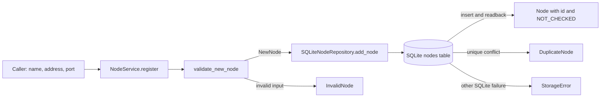

# Chunk 01: Inventory Domain and SQLite Persistence

*How a registered Linux endpoint becomes a validated, durable inventory record*

| Field | Detail |
| --- | --- |
| Source baseline | Existing Chunk 01 working-tree files, inspected 28 October 2026; this chunk has no commit yet. |
| Prepared by | Executing Codex agent, Windows PowerShell environment. |
| Scope | `errors.py`, `inventory/{__init__,models,repository,service}.py`, and `tests/test_repository.py`. |
| Verification | Focused repository tests, Ruff lint/format, and mypy were run for this scope; results appear in [Chapter 4](#4-focused-tests-and-evidence). |
| Learning status | This guide explains the implementation. Student understanding has not been independently assessed. |

This guide studies the existing domain and persistence code before its logical Git commit. HTTP routes, request/response schemas, authentication, application startup, and API integration tests belong to later chunks.

## Learning objectives

After studying this chunk, you should be able to:

1. Trace a registration from untrusted values through normalization, service logic, and an atomic SQLite insert.
2. Explain which invariants Python checks, which SQLite enforces, and where their guarantees differ.
3. Predict the result of two concurrent attempts to register the same endpoint.
4. Reopen an inventory database safely and classify validation, duplicate, and storage failures.

## Contents

1. [Beginner foundations](#1-beginner-foundations)
2. [Domain and validation rules](#2-domain-and-validation-rules)
3. [Persistence architecture](#3-persistence-architecture)
4. [Focused tests and evidence](#4-focused-tests-and-evidence)
5. [Engineering tradeoffs and limits](#5-engineering-tradeoffs-and-limits)
6. [Hands-on exercises](#6-hands-on-exercises)
7. [Interview preparation](#7-interview-preparation)
8. [Quick-reference sheet](#8-quick-reference-sheet)

**Quick-revision path:** study the [flow diagram](#31-source-code-walkthrough), [guarantee table](#33-schema-and-database-guarantees), and [quick-reference sheet](#8-quick-reference-sheet).

**Deep-learning path:** read Chapters 1–5, run the three [exercises](#6-hands-on-exercises), answer Chapter 7 without looking, then revisit Chapter 8.

## 1. Beginner foundations

### 1.1 What inventory represents

An **inventory record** describes an endpoint the operator intends to manage: a display name, address, and SSH port. It is not proof that the address resolves, a server is running, or an SSH host key is trusted. That distinction is why [the model](../../src/fleet_manager/inventory/models.py) starts each stored row with `ObservationState.NOT_CHECKED`.

The record has two identities:

| Field | Meaning | Limit |
| --- | --- | --- |
| `id` | Local database record identifier. | Does not authenticate a physical host. |
| `(address, ssh_port)` | Endpoint uniqueness key within this database. | Different names can point to the same endpoint; two endpoints might still represent one machine. |

### 1.2 Values before and after storage

[`NewNode`](../../src/fleet_manager/inventory/models.py) contains normalized `name`, `address`, and `ssh_port` before insertion. `Node` adds the database-generated `id` and `observation_state` after insertion or retrieval. Both are `@dataclass(frozen=True, slots=True)`: `frozen` prevents normal field reassignment, and `slots` restricts instances to declared fields and reduces per-instance overhead.

Those decorators do **not** validate constructor arguments at runtime. The service obtains a safe `NewNode` through `validate_new_node()`, while the repository reconstructs `Node` from SQLite rows. Directly constructing `NewNode("", "bad_host", 0)` bypasses the validation function; treat the factory path as the domain contract. `ObservationState` is a `StrEnum` with `NOT_CHECKED` in this chunk; it describes the inventory row's initial state, not a live health result.

## 2. Domain and validation rules

### 2.1 Name and address normalization

[`validate_new_node()`](../../src/fleet_manager/inventory/models.py) is side-effect-free: it changes values or raises `InvalidNode`, without DNS, SSH, or database access. That makes input rules testable apart from infrastructure.

| Input | Rule and example | Why |
| --- | --- | --- |
| Name | Must be text; trim surrounding whitespace; require 1–100 code points after trimming; reject Unicode `Cc` control characters. `"  lab-01  "` becomes `"lab-01"`. | Avoid blank or control-filled labels while keeping display names flexible. Python `len()` counts Unicode code points, not encoded bytes or grapheme clusters. |
| IP address | `ipaddress.ip_address()` parses IPv4 or IPv6; `str()` provides canonical form. `2001:0db8:0000::1` becomes `2001:db8::1`. | Equivalent spellings should normally map to one stored endpoint. |
| Hostname | When IP parsing fails, split on dots; require ASCII labels of 1–63 characters and total length at most 253; lowercase the result. `NODE.Example` becomes `node.example`. | Constrain inventory input to a predictable hostname form. This does not resolve DNS. |
| Invalid numeric-looking address | Reject strings made only of digits and dots when they are not valid IP addresses, such as `999.1.2.3`. | Prevent an invalid IPv4-looking value from being accepted as a hostname. |
| IPv6 scope ID | Reject `%`, so `fe80::1%eth0` is not stored. | The current endpoint model does not represent interface scope. |

The hostname rule also rejects underscores, non-ASCII labels, empty labels, and a trailing dot. It does not perform IDNA conversion, DNS lookup, or host-key verification. Two different valid hostnames may resolve to the same host; normalization cannot detect that.

### 2.2 SSH port and invalid input

The port check uses `type(ssh_port) is int` and `1 <= ssh_port <= 65535`. Requiring the exact `int` type matters because Python treats `bool` as a subclass of `int`: `True` would otherwise behave like port `1`. Zero, negative values, values above 65535, booleans, and non-integers raise [`InvalidNode`](../../src/fleet_manager/errors.py). This function does not choose a default port; a caller must supply one. An HTTP default, if present later, is outside this chunk.

## 3. Persistence architecture

### 3.1 Source-code walkthrough

[`NodeService`](../../src/fleet_manager/inventory/service.py) owns the registration use case. `register(name, address, ssh_port)` calls `validate_new_node()` and passes its `NewNode` to `SQLiteNodeRepository.add_node()`. `list_nodes()` delegates to the repository. The service contains no SQL or FastAPI imports.

[`SQLiteNodeRepository`](../../src/fleet_manager/inventory/repository.py) owns the database path, connection creation, schema initialization, inserts, reads, and storage error translation. [`inventory/__init__.py`](../../src/fleet_manager/inventory/__init__.py) marks the feature package. [`errors.py`](../../src/fleet_manager/errors.py) supplies shared exception classes; this file also declares exceptions for later features, even though this chunk's inventory path uses only `InvalidNode`, `DuplicateNode`, and `StorageError`.

**Figure 1. Registration and readback flow.** The database is the final authority for endpoint uniqueness.



The repository uses SQL parameter placeholders (`?`) for caller values. It inserts the row and reads it back by `lastrowid` in the same connection transaction, then returns a `Node`. `list_nodes()` orders by `id`; `get_node(id)` returns `None` when no row matches. No remote machine is contacted by these paths.

### 3.2 Initialization and transactions

`initialize()` creates the database parent directory, opens a connection with a **five-second busy timeout**, and starts `BEGIN IMMEDIATE`. This acquires a write reservation before checking schema state, preventing two initializers from independently deciding to create the same table. It reads `PRAGMA user_version` and checks whether `nodes` exists. An empty version-0 database receives the table and `user_version = 1` in one transaction. A table with an unrecognized or missing version is rejected with `StorageError`; existing versions 1, 2, and 3 with a `nodes` table are accepted, because later chunks extend the schema. This method does not perform their migrations.

`add_node()` uses `with connection:` around `INSERT` and readback. Success commits; an exception rolls back. `contextlib.closing()` separately closes the connection because the SQLite connection context manager manages transactions, not connection lifetime. Reads use fresh connections, so records saved to the database file remain available when a repository object is recreated. This is file-backed persistence, not proof that an application process has been restarted unless a separate process test is run.

### 3.3 Schema and database guarantees

| SQLite declaration | Guarantee | Important boundary |
| --- | --- | --- |
| `id INTEGER PRIMARY KEY` | Integer row identifier generated when omitted from `INSERT`. | It is a SQLite rowid alias, not `AUTOINCREMENT`; do not assume IDs can never be reused after deletion. |
| `name TEXT NOT NULL CHECK (length(trim(name)) BETWEEN 1 AND 100)` | Rejects null, blank, and overlong trimmed names at database level. | Does not itself reject control characters or normalize whitespace. |
| `address TEXT NOT NULL COLLATE NOCASE CHECK (length(trim(address)) > 0)` | Rejects null/blank address and compares ASCII case-insensitively for uniqueness. | Does not canonicalize IPs or validate hostname syntax. |
| `ssh_port INTEGER NOT NULL CHECK (typeof(ssh_port) = 'integer' AND ssh_port BETWEEN 1 AND 65535)` | Rejects non-integer or out-of-range ports inserted directly through SQL. | Python's validation also excludes booleans before they reach SQLite. |
| `observation_state TEXT NOT NULL DEFAULT 'NOT_CHECKED'` | New rows start as `NOT_CHECKED` when the field is omitted. | There is no database `CHECK` limiting future text values to enum members. |
| `UNIQUE (address, ssh_port)` | Allows one row per address-port pair, including concurrent writers. | It does not prove endpoint or host identity; direct SQL can bypass Python's canonicalization. |

SQLite serializes writes. In [`test_concurrent_duplicate_registration_has_one_winner()`](../../tests/test_repository.py), two threads wait at a barrier and then register the same normalized endpoint. One insert commits. The other's `UNIQUE` constraint fails with `sqlite3.IntegrityError`, which the repository maps to `DuplicateNode` when the SQLite error code is `SQLITE_CONSTRAINT_UNIQUE`. The final list contains one row. A Python check-then-insert alone would have a race: both threads could observe no row before either inserts.

### 3.4 Error categories and failure behavior

| Error | Origin | Caller interpretation |
| --- | --- | --- |
| `InvalidNode` | Validation rejects name, address, or port before SQL. | Fix the input; no row was added. |
| `DuplicateNode` | SQLite unique constraint rejects an existing normalized endpoint. | Endpoint already registered; do not assume the name or physical host is identical. |
| `StorageError` | Schema mismatch, non-unique integrity failure, or handled SQLite/OS failure. | Storage could not safely complete the requested operation; inspect the underlying cause in trusted diagnostics. |

`initialize()` catches `OSError` and `sqlite3.Error` and wraps them in `StorageError`. `add_node()`, `list_nodes()`, and `get_node()` catch `sqlite3.Error`; they do not promise to classify every possible non-SQLite exception. Invalid stored enum text is translated to `StorageError` during row conversion. No HTTP status code is chosen here; mapping errors to HTTP belongs to a later application boundary.

## 4. Focused tests and evidence

[`tests/test_repository.py`](../../tests/test_repository.py) has three focused tests:

| Test | Behavior established | What it does not establish |
| --- | --- | --- |
| `test_database_rejects_invalid_port_even_without_api` | Direct SQL with port `0` raises `sqlite3.IntegrityError`. | Full validation coverage or API behavior. |
| `test_concurrent_duplicate_registration_has_one_winner` | Two concurrent registrations produce one created row and one `DuplicateNode`. | Performance under large write loads or coordination across hosts. |
| `test_existing_unversioned_table_is_not_silently_adopted` | An existing `nodes` table with version 0 is rejected as requiring explicit migration. | Migration behavior for later schema versions. |

**Observed on Windows PowerShell, 28 October 2026:** the ignored local Python 3.12 environment ran `python -m pytest -q --noconftest tests/test_repository.py`: **3 passed, 0 skipped, 0 failed**. Ruff lint passed and Ruff format reported **6 files already formatted** for the six scoped files. mypy reported **no issues in 4 source files** (the files with executable definitions). The checks did not contact a managed node.

The three exercise command blocks below were also run on Windows: normalization and port rejection produced the expected values/errors; a second repository read the saved row; concurrent registration produced `['created', 'duplicate']` and one row. These local demonstrations are separate from the automated test count.

`--noconftest` is deliberate for this boundary: the uncommitted `tests/conftest.py` imports later `fleet_manager.main` application composition. The three repository tests themselves import only the package initializer and scoped Chunk 01 modules. API tests, authentication fixtures, and HTTP status mapping belong to later chunks. A direct repository reopen can demonstrate persistence, but the three committed-scope tests do not currently assert a separate process restart.

## 5. Engineering tradeoffs and limits

| Choice visible in source | Benefit | Cost or limit |
| --- | --- | --- |
| Frozen, slotted dataclasses | Small explicit value objects with restricted reassignment. | Construction still bypasses validation if callers ignore the factory. |
| Python normalization before SQL | Predictable endpoint representation and readable errors. | Direct SQL can bypass stronger Python rules; the database enforces only its declared constraints. |
| SQLite file for inventory | Local durable storage without a separate database service. | Writes are serialized; suitability for a larger multi-writer fleet needs measurement. |
| Database `UNIQUE` constraint | Correctly resolves concurrent duplicate attempts. | One row per address-port pair is a product rule, not authenticated host identity. |
| Service separated from repository | Use-case rules stay independent of SQL and HTTP. | Two layers add code, but make responsibilities and tests clearer. |
| Shared `errors.py` | Callers can distinguish invalid input, duplicates, and storage failures. | The same file already declares later feature errors; committing it exposes names beyond this chunk's active behavior. |

The current model stores no authenticated SSH identity. The hostname form is deliberately ASCII and omits IDNA and trailing-dot forms. Database constraints are narrower than Python validation, and `observation_state` has no database enum check. SQLite durability depends on filesystem and hardware behavior; a successful `commit()` is not an absolute guarantee against every storage failure. These are implementation limits, not claims that a migration or redesign is required before this chunk can be understood.

## 6. Hands-on exercises

Run the following PowerShell commands from `fleet-manager/`. Each exercise uses Python 3.12, inserts `src` into the process import path, and avoids application startup. The database exercises use disposable temporary directories. If uv cannot find Python 3.12, install or select that interpreter first. The expected outcomes are stated so you can compare your run with the observed Windows demonstration in Chapter 4.

### 6.1 Exercise: Trace normalization and rejection

```powershell
@'
import sys
sys.path.insert(0, "src")
from fleet_manager.errors import InvalidNode
from fleet_manager.inventory.models import validate_new_node

print(validate_new_node("  Lab  ", "NODE.Example", 22))
print(validate_new_node("v6", "2001:0db8::1", 2222))
for port in (0, 65536, True):
    try:
        validate_new_node("lab", "node.example", port)
    except InvalidNode as exc:
        print(type(exc).__name__, str(exc))
'@ | uv run --no-project --python 3.12 python -
```

**Inspect:** trimmed name, lowercase hostname, canonical IPv6, and three rejected ports. **Explain:** Why does the exact-type check reject `True`?

### 6.2 Exercise: Prove persistence by reopening

```powershell
@'
import sys
import tempfile
from pathlib import Path
sys.path.insert(0, "src")
from fleet_manager.inventory.repository import SQLiteNodeRepository
from fleet_manager.inventory.service import NodeService

with tempfile.TemporaryDirectory() as directory:
    path = Path(directory) / "inventory.db"
    first = SQLiteNodeRepository(path)
    first.initialize()
    saved = NodeService(first).register("  Lab  ", "NODE.Example", 22)
    second = SQLiteNodeRepository(path)
    second.initialize()
    print(saved)
    print(second.list_nodes())
'@ | uv run --no-project --python 3.12 python -
```

**Inspect:** the new repository object reads the same row from the file. **Explain:** What does this prove, and what would require a separate-process test? The temporary database is removed when the block exits.

### 6.3 Exercise: Reproduce the duplicate race safely

```powershell
@'
import sys
import tempfile
from concurrent.futures import ThreadPoolExecutor
from pathlib import Path
from threading import Barrier
sys.path.insert(0, "src")
from fleet_manager.errors import DuplicateNode
from fleet_manager.inventory.repository import SQLiteNodeRepository
from fleet_manager.inventory.service import NodeService

with tempfile.TemporaryDirectory() as directory:
    repo = SQLiteNodeRepository(Path(directory) / "inventory.db")
    repo.initialize()
    service = NodeService(repo)
    start = Barrier(2)
    def attempt(_):
        start.wait(timeout=5)
        try:
            service.register("lab", "NODE.Example", 22)
            return "created"
        except DuplicateNode:
            return "duplicate"
    with ThreadPoolExecutor(max_workers=2) as pool:
        print(sorted(pool.map(attempt, range(2))))
    print("rows:", len(service.list_nodes()))
'@ | uv run --no-project --python 3.12 python -
```

**Inspect:** expect one `created`, one `duplicate`, and one row. **Explain:** Why would checking `list_nodes()` before each insert fail to guarantee this result?

## 7. Interview preparation

### 7.1 Beginner questions

1. **What does a node inventory record describe?**

   **Answer:** A locally registered SSH endpoint and display name; it does not establish that a host is reachable or authenticated.

2. **What is the difference between `NewNode` and `Node`?**

   **Answer:** `NewNode` is intended to be the validated pre-insert value; `Node` includes the database ID and observation state read after storage. Direct construction can bypass validation.

3. **What does `frozen=True` do?**

   **Answer:** It blocks normal reassignment of dataclass fields. It does not validate values passed to the constructor.

4. **Why normalize an address?**

   **Answer:** Equivalent input spellings should be stored consistently so users can identify and compare endpoints more reliably.

5. **What does `NOT_CHECKED` mean?**

   **Answer:** The inventory row has no recorded verification in this state; it is not a claim that the node is healthy or unhealthy.

### 7.2 Intermediate questions

1. **Why does the service call validation before the repository?**

   **Answer:** Use-case input rules stay independent of storage, and the repository receives a normalized `NewNode` for insertion.

2. **Why reject `True` as an SSH port?**

   **Answer:** In Python, `bool` is an `int` subclass. `type(value) is int` excludes it even though `True == 1`.

3. **What does `COLLATE NOCASE` contribute to the unique key?**

   **Answer:** It makes ASCII case differences in an address compare equal for SQLite uniqueness; it does not canonicalize IPs or resolve DNS.

4. **Why use SQL `?` placeholders?**

   **Answer:** They bind caller values as data instead of mixing them into SQL syntax, reducing injection risk and quoting errors.

5. **Why use `closing(connection)` as well as `with connection:`?**

   **Answer:** The connection context manager controls commit/rollback; `closing()` ensures the connection itself is closed.

### 7.3 Advanced questions

1. **Why must uniqueness live in SQLite rather than only in a service pre-check?**

   **Answer:** Concurrent callers can both pass a pre-check. The database constraint resolves the race atomically.

2. **What does `BEGIN IMMEDIATE` protect during initialization?**

   **Answer:** It reserves the write transaction before schema inspection, so concurrent initializers cannot both act on an apparently empty schema.

3. **Does `INTEGER PRIMARY KEY` guarantee IDs are never reused?**

   **Answer:** No. This schema uses the rowid alias without `AUTOINCREMENT`; do not promise permanent non-reuse after deletion.

4. **Can a direct SQL insert bypass all domain rules?**

   **Answer:** It can bypass Python normalization and some validation, but SQLite `NOT NULL`, `CHECK`, and `UNIQUE` constraints still apply.

5. **What is the difference between a stored endpoint and authenticated host identity?**

   **Answer:** The endpoint is a configured address-port pair. Identity requires a separate trusted SSH host-key verification process.

### 7.4 Debugging scenarios

1. **Symptom:** registering `NODE.Example:22` after `node.example:22` raises `DuplicateNode`.

   **Diagnosis:** Python lowercases hostnames and SQLite's unique address column uses `NOCASE`; inspect the stored endpoint, not just the display name.

2. **Symptom:** `initialize()` refuses an existing `nodes` table with `user_version = 0`.

   **Diagnosis:** The repository will not silently adopt an unknown schema. Inspect schema provenance and use an explicit migration plan rather than changing the version blindly.

3. **Symptom:** a database row contains an unknown observation state and reading it fails.

   **Diagnosis:** Row conversion constructs `ObservationState`; invalid enum text becomes `StorageError`. Inspect the stored data through trusted diagnostics; the schema currently has no enum `CHECK` constraint.

## 8. Quick-reference sheet

| Remember | Code path or guarantee | Pitfall |
| --- | --- | --- |
| Domain values | `NewNode` before insert; `Node` after readback. | Frozen dataclasses do not validate construction. |
| Validation | `validate_new_node()` trims, normalizes, and rejects bad inputs. | No DNS or SSH check occurs. |
| Service | `NodeService.register()` validates then stores. | No SQL or HTTP contract belongs here. |
| Repository | `initialize()`, `add_node()`, `list_nodes()`, `get_node()`. | Call `initialize()` before ordinary use. |
| Schema version | `PRAGMA user_version = 1` for a new inventory database. | Do not silently adopt an unversioned existing table. |
| Uniqueness | `UNIQUE(address, ssh_port)` with address `COLLATE NOCASE`. | It identifies a configured endpoint, not a physical machine. |
| Transactions | `BEGIN IMMEDIATE` for initialization; insert/readback in a transaction. | `with connection:` does not close the connection by itself. |
| Errors | `InvalidNode`, `DuplicateNode`, `StorageError`. | Not every imaginable non-SQLite exception is translated. |
| Focused check | `python -m pytest -q --noconftest tests/test_repository.py`. | API fixtures import later application composition. |

**Next learning checkpoint:** explain the validation-versus-database boundary and the two-thread uniqueness result in your own words. Then review the exact six-file Chunk 01 staging set; this guide itself does not authorize a commit or claim student mastery.
