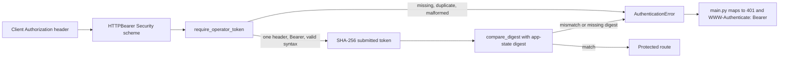

# Chunk 02: Configuration and Authentication

*How process settings establish the local API access boundary*

| Field | Detail |
| --- | --- |
| Source baseline | Chunk 02 `config.py` and `security/` files, reviewed 29 October 2026. |
| Prepared by | Executing Codex agent, Windows PowerShell environment. |
| Earlier checkpoints | Chunk 00 `46e78ca`; Chunk 01 `de4241c`. |
| Proposed source scope | `src/fleet_manager/config.py`, `security/__init__.py`, and `security/auth.py`. |
| Test boundary | Standalone `tests/test_auth_unit.py` belongs to this chunk; `tests/test_auth.py` and `tests/conftest.py` import later `main.py`. See [Chapter 4](#4-tests-evidence-and-commit-boundary). |
| Learning status | This guide explains inspected behavior; student understanding has not been independently assessed. |

This chunk concerns configuration parsing and a **single shared bearer token**. It does not add user accounts, roles, or the later HTTP application composition. The working-tree `docs/decisions/0002-local-inventory-authentication.md` records the accepted local access decision; that ADR is outside this proposed commit boundary.

## Learning objectives

After studying this chunk, you should be able to:

1. Trace a token from the environment through startup validation to request verification without printing its value.
2. Explain why missing configuration stops startup before inventory storage is opened.
3. Distinguish HTTP `401` from `403`, authentication from authorization, and local binding from token checking.
4. Identify which protections are implemented in these files and which require later identity and deployment work.

## Contents

1. [Beginner foundations](#1-beginner-foundations)
2. [Configuration walkthrough](#2-configuration-walkthrough)
3. [Authentication walkthrough](#3-authentication-walkthrough)
4. [Tests, evidence, and commit boundary](#4-tests-evidence-and-commit-boundary)
5. [Security tradeoffs and limitations](#5-security-tradeoffs-and-limitations)
6. [Hands-on exercises](#6-hands-on-exercises)
7. [Interview preparation](#7-interview-preparation)
8. [Quick-reference sheet](#8-quick-reference-sheet)

**Quick-revision path:** follow [Figure 1](#31-bearer-token-request-flow), read the [protection table](#5-security-tradeoffs-and-limitations), and finish with the [quick-reference sheet](#8-quick-reference-sheet).

**Deep-learning path:** read Chapters 1–5, run the exercises with disposable tokens, answer Chapter 7 without looking, and revisit Chapter 8.

## 1. Beginner foundations

### 1.1 Configuration and secrets

**Configuration** supplies values that vary between installations without changing source code: a database path, limits, and credentials. [The process settings module](../../src/fleet_manager/config.py) reads environment variables through `os.getenv()`. An **environment variable** is a process-visible key and value inherited from its parent process. It keeps a token out of a committed source file, but a sufficiently privileged local process or administrator may still read the environment. It is a delivery mechanism, not a secret vault.

`FLEET_MANAGER_API_TOKEN` holds one opaque access secret. **Opaque** means the service does not infer an operator identity or permissions from the token. `load_settings()` accepts an explicit `api_token` argument for app construction/tests; otherwise it reads the environment. It rejects a missing token or one that fails `[A-Za-z0-9_-]{32,128}`. The format restricts length and characters; it cannot prove that the token was generated randomly. Generate at least 32 cryptographically random bytes for real use, as the working-tree ADR 0002 specifies.

### 1.2 Authentication, authorization, and transport

**Authentication** answers “does this request possess the configured credential?” **Authorization** answers “may this identified caller perform this action?” The current shared token only provides the first answer. Everyone with that token receives the same access to protected routes; there is no per-user identity, role-based access control (RBAC), or actor-attributable audit trail.

An HTTP **bearer token** grants access to whoever possesses it. The client sends `Authorization: Bearer <token>`. Because the credential travels with requests, a network listener or log that captures the header could reuse it. The current working-tree README launch command and `deploy/fleet-manager.service` bind Uvicorn to `127.0.0.1`; neither is part of this proposed commit. The Python authentication module itself does not enforce a bind address. Exposing this service on a public interface requires a separate, reviewed network/TLS boundary and operator identity design.

## 2. Configuration walkthrough

### 2.1 Fail-closed startup and database selection

[`load_settings()`](../../src/fleet_manager/config.py) validates the token **before** choosing a database path or returning settings. It computes `sha256(token.encode("ascii")).digest()` and returns a frozen, slotted `Settings` value containing `database_path` and `operator_token_digest`. The original token is not placed in `Settings` or application state, although the original environment value and request header still exist in process memory.

The selected database path is an explicit `database_path` argument when supplied, then `FLEET_MANAGER_DATABASE_PATH`, then the project-local `.local/inventory.db`. It is a filesystem path, not a credential. The module does not open the database. In uncommitted `src/fleet_manager/main.py`, the lifespan calls `load_settings()` before repository initialization. Thus a missing or malformed token raises `RuntimeError` before the application creates inventory storage. A failed startup is preferable to silently serving an unprotected API: this is **fail-closed** behavior.

The token regex appears separately in `config.py` and `security/auth.py`. Both currently require 32–128 URL-safe ASCII characters. Their duplication creates a maintenance risk: changing one without the other could make a configured token impossible to submit, or make request parsing inconsistent. No such mismatch was observed in the inspected source.

### 2.2 Other settings in the same file

`config.py` is a shared configuration module. Committing the file includes settings for later SSH, monitoring, and operation chunks; their execution behavior is outside this guide. The module currently defines:

| Loader | Values and validation visible here | When it matters |
| --- | --- | --- |
| `load_ssh_settings()` | Requires non-root, whitespace-free username and existing known-hosts/private-key files. On POSIX, rejects a private key with group/other permission bits. | Called for an SSH check, not by `load_settings()`; file existence and mode are not host-key verification. |
| `load_connectivity_limits()` | Defaults to 4 concurrent checks and 12 seconds total; allows 1–16 and finite 1–60 seconds. | Application startup validates admission and deadline settings. |
| `load_monitoring_settings()` | Defaults: observation TTL 180 seconds, polling 60 seconds, jitter 0.1, enabled. Validates TTL 1–86400, finite interval 0.1–3600, finite jitter 0–0.5. | Later monitoring behavior uses these settings. An unrecognized enabled string currently becomes `False`, not a startup error. |
| `load_operation_limits()` | Defaults: 4 concurrent operations, 15 seconds total, 65536 output bytes; validates 1–16, finite 1–120 seconds, 1024–1048576 bytes. | Later operation execution uses these settings. |

These limits reduce unsafe or unbounded behavior, but parsing a configuration value is not proof that a later worker enforces it. The later feature chunks must verify that execution separately.

## 3. Authentication walkthrough

### 3.1 Bearer-token request flow

[`security/auth.py`](../../src/fleet_manager/security/auth.py) defines an `HTTPBearer` security scheme with `auto_error=False` and the OpenAPI name `OperatorToken`. The `Security(...)` parameter advertises the scheme in the generated API contract; the implementation performs its own raw-header validation. [`security/__init__.py`](../../src/fleet_manager/security/__init__.py) marks the package boundary.

**Figure 1. Protected-request flow.** The `401` response mapping belongs to `main.py`, which is a later commit dependency.



`require_operator_token()` reads `request.headers.getlist("authorization")` and requires **exactly one** header. It splits at the first space, accepts the case-insensitive `Bearer` scheme, and requires the entire token to match the URL-safe regex. That also rejects empty tokens, double spaces, and extra text. It retrieves a `bytes` digest from `request.app.state`; absence or wrong type is denied. It hashes the submitted token and calls `secrets.compare_digest()` on the fixed-length digests. This avoids comparison time varying with the length of a matching prefix. Hashing here reduces retention of the raw token in application state; it is not a substitute for a high-entropy token or safe transport.

The inventory, connectivity, and operation routers attach `Depends(require_operator_token)` at router level. The current application composition maps `AuthenticationError` to a generic JSON `401` and `WWW-Authenticate: Bearer`. It does not echo the submitted credential. The `HTTPBearer` declaration also marks protected operations in OpenAPI; documentation itself remains accessible locally. The `/metrics` route intentionally does not require this token for Prometheus scraping, and the dashboard HTML route is also not token-gated. Binding and network restrictions matter for those paths as well.

### 3.2 Why `401`, and when `403` would apply

`401 Unauthorized` means the request lacks acceptable authentication credentials; the challenge header tells the client which scheme is expected. The implementation uses `401` for missing, malformed, duplicate, and incorrect credentials. `403 Forbidden` would describe an authenticated caller who lacks permission for a particular action. This implementation does not make per-user permission decisions, so it has no token-based `403` path. Do not infer authorization or RBAC from a successful bearer-token check.

## 4. Tests, evidence, and commit boundary

### 4.1 What was checked

| Check | Observed result | Scope of evidence |
| --- | --- | --- |
| `pytest --noconftest -q tests/test_auth_unit.py` | **8 passed, 0 skipped, 0 failed; 1 Starlette/httpx deprecation warning.** | Standalone settings and guard checks; no import of `main.py` or project fixtures. A disposable FastAPI handler supplies the `401` mapping. |
| `pytest -q tests/test_auth.py` in the current working tree | **12 passed, 0 skipped, 0 failed; 1 Starlette/httpx deprecation warning.** | Exercises the existing full `create_app()` composition, inventory routes, and test fixtures. This relies on uncommitted later modules. |
| Ruff `check` and `format --check` on `config.py` and `security/` | **Lint passed; 3 files already formatted.** | Static lint and formatting for the proposed source files. |
| mypy on `config.py` and `security/` | **No issues in 3 source files.** | Static type analysis of the proposed source files. |
| Isolated minimal FastAPI harness plus `load_settings()` | **Passed:** missing token rejected before database creation; digest matched; missing, wrong, and duplicate request headers rejected; correct token accepted. | Verifies the committed-dependency source modules without importing `fleet_manager.main`; the harness supplies its own temporary route and `401` handler. |

The auth test file covers missing/invalid/malformed/duplicate credentials, valid GET/POST, denial before request validation or inventory write, absence of tokens from response/OpenAPI/log text, missing/short startup token, and environment-selected database path. These are focused working-tree results, not evidence that `tests/test_auth.py` can be committed with only Chunk 02 source.

### 4.2 Exact proposed commit boundary

The **independently importable source** boundary is `src/fleet_manager/config.py`, `src/fleet_manager/security/__init__.py`, and `src/fleet_manager/security/auth.py`. The focused test boundary is `tests/test_auth_unit.py`; the documentation boundary is this guide and the handbook index. They depend on committed `fleet_manager.errors` and the foundation dependencies. The standalone test uses `--noconftest` because the repository's later-chunk fixture file imports `main.py`.

`tests/test_auth.py` imports `fleet_manager.main.create_app`, and `tests/conftest.py` does too. `main.py` imports inventory HTTP schemas and routers plus connectivity, metrics, operations, and UI modules planned for later chunks. Including `test_auth.py`, `conftest.py`, or `main.py` now would cross the approved logical boundary. The working-tree integration result remains useful evidence, while `test_auth_unit.py` checks configuration and the guard independently. Its miniature route and exception handler do not prove production route wiring or production `401` response formatting.

## 5. Security tradeoffs and limitations

| Implemented protection | Practical effect | Limit or next design need |
| --- | --- | --- |
| Token comes from environment or explicit app argument | Keeps the production credential out of source and SQLite. | Local privileged processes may inspect environment; a test override must not become a public credential channel. |
| Strict token shape at startup and request | Rejects missing, short, malformed, and non-URL-safe values. | Syntax cannot prove entropy; weak but well-formed strings are possible. |
| Only SHA-256 digest retained in application state | Avoids keeping the raw configured token in `Settings`/app state. | Raw token still exists in environment/request memory; SHA-256 is not password-hardening for a low-entropy secret. |
| `compare_digest()` over digests | Reduces prefix-dependent timing differences. | Does not address token theft, replay, or transport interception. |
| Exactly one Authorization header and generic errors | Reduces ambiguity and accidental credential reflection. | Reverse proxies and logs must preserve and protect headers correctly. |
| Startup rejects missing token before database initialization | Prevents an unprotected inventory service from starting under that configuration. | This depends on the later `main.py` lifespan wiring. |
| Documented loopback bind in README/systemd unit | Reduces exposure of plain HTTP and tokenless diagnostic routes. | `auth.py` cannot force Uvicorn to bind loopback; a different launch command can expose the service. |

This is a **single-operator gate**, not multi-user authentication. It has no login/session lifecycle, per-user identity, RBAC, rate limit, actor-attributable audit trail, or built-in token rotation; rotation requires replacing the environment value and restarting the process. A remote deployment needs TLS, a reviewed proxy/firewall boundary, identifiable operators, permission checks, and attributable audit events. These are improvement needs, not claims that those features already exist. Keep SSH private keys and host-identity verification separate from the API bearer token.

## 6. Hands-on exercises

Use PowerShell from `fleet-manager/` and a prepared Python 3.12 project environment. Generate disposable tokens at runtime; do not print or commit them. These exercises avoid real SSH nodes and the live inventory database.

### 6.1 Exercise: Validate environment loading

Run in a Python 3.12 environment with the project installed or `src` on `PYTHONPATH`:

```powershell
@'
import os
import secrets
import sys
from pathlib import Path
from tempfile import TemporaryDirectory
from unittest.mock import patch
sys.path.insert(0, "src")
from fleet_manager.config import load_settings

with TemporaryDirectory() as folder, patch.dict(os.environ, {}, clear=True):
    path = Path(folder) / "inventory.db"
    try:
        load_settings(path)
    except RuntimeError:
        print("missing token rejected")
    token = secrets.token_urlsafe(32)
    settings = load_settings(path, api_token=token)
    print("digest bytes:", len(settings.operator_token_digest))
    print("database created:", path.exists())
'@ | & .local/windows-verify/Scripts/python.exe -
```

**Explain:** Why should the database remain absent? Why does a 32–128 character format alone not establish token entropy? Replace the final interpreter path with your own Python 3.12 environment when needed.

### 6.2 Exercise: Inspect the guard without `main.py`

Create a disposable FastAPI route in memory. Use a fresh token and never print it:

```powershell
@'
import hashlib
import secrets
import sys
sys.path.insert(0, "src")
from fastapi import Depends, FastAPI
from fastapi.responses import JSONResponse
from fastapi.testclient import TestClient
from fleet_manager.errors import AuthenticationError
from fleet_manager.security.auth import require_operator_token

token = secrets.token_urlsafe(32)
app = FastAPI()
app.state.operator_token_digest = hashlib.sha256(token.encode("ascii")).digest()
@app.exception_handler(AuthenticationError)
async def denied(request, error):
    return JSONResponse(status_code=401, content={"error": "unauthorized"})
@app.get("/protected", dependencies=[Depends(require_operator_token)])
def protected():
    return {"ok": True}
with TestClient(app) as client:
    print("missing:", client.get("/protected").status_code)
    print("valid:", client.get("/protected", headers={"Authorization": f"Bearer {token}"}).status_code)
    print("duplicate:", client.get("/protected", headers=[("Authorization", f"Bearer {token}"), ("Authorization", f"Bearer {token}")]).status_code)
'@ | & .local/windows-verify/Scripts/python.exe -
```

**Explain:** Which result comes from `require_operator_token()`, and which part of the `401` response is supplied by this exercise's handler? This harness does not prove production `main.py` mapping.

### 6.3 Exercise: Classify `401`, `403`, and network exposure

In the current working tree, inspect `src/fleet_manager/inventory/router.py`, the exception handler in `src/fleet_manager/main.py`, and `deploy/fleet-manager.service`. These are later-chunk context, not files in the proposed Chunk 02 commit. Write down the expected response and reason for: no token; wrong token; valid token with a valid inventory request; a hypothetical authenticated operator without a future permission. Then inspect the configured `--host` in the unit and explain what changes if someone launches Uvicorn with `--host 0.0.0.0`. Do not expose the server to a public interface for this exercise.

## 7. Interview preparation

### 7.1 Beginner questions

1. **What is an environment variable?**

   **Answer:** A process-visible key/value supplied by its parent environment; it keeps deployment values outside source but is not a secret vault.

2. **What does a bearer token prove here?**

   **Answer:** The request possesses the shared configured token. It does not identify which human sent it.

3. **Why does startup reject a missing token?**

   **Answer:** To avoid starting the inventory service without its configured access gate.

4. **Where is the configured token stored after loading?**

   **Answer:** `Settings` and application state retain a SHA-256 digest, while the original environment value may still exist in process memory.

5. **What is the difference between authentication and authorization?**

   **Answer:** Authentication checks a credential or identity; authorization decides whether that caller may perform a specific action.

### 7.2 Intermediate questions

1. **Why use `secrets.compare_digest()`?**

   **Answer:** It compares fixed-length digests without prefix-dependent early exit that can reveal timing information.

2. **Why is the token shape checked twice?**

   **Answer:** Startup validates configured state; the request guard validates every submitted header. The duplicated regex must stay in sync.

3. **Why reject duplicate Authorization headers?**

   **Answer:** Multiple values can be interpreted differently by proxies and frameworks; requiring exactly one avoids that ambiguity.

4. **Why is a missing token a `401`, not a `403`?**

   **Answer:** Credentials are absent or invalid. `403` would apply to an authenticated caller denied by a permission rule, which this shared-token design lacks.

5. **Does `HTTPBearer` alone enforce this contract?**

   **Answer:** No. It advertises/parses the scheme; with `auto_error=False`, `require_operator_token()` performs the strict raw-header and digest checks.

### 7.3 Advanced questions

1. **Does SHA-256 make a weak token safe?**

   **Answer:** No. A low-entropy token can still be guessed; high-entropy generation and safe transport remain necessary.

2. **Why is loopback binding a separate control from token checking?**

   **Answer:** The token protects selected routes; binding restricts which network peers can reach the service, including tokenless paths such as `/metrics`.

3. **What does fail-closed startup depend on beyond `load_settings()`?**

   **Answer:** The application lifespan must call it before opening storage and serving requests; that wiring lives in later `main.py`.

4. **Why can `test_auth.py` pass now but not belong to this independent commit?**

   **Answer:** It imports `main.py` and fixtures that require later uncommitted HTTP and feature modules. A working-tree pass is not an import-closed commit.

5. **What would make audit events attributable to humans?**

   **Answer:** Distinct operator identities linked to requests and permission decisions, plus audit records that preserve the actor without exposing credentials.

### 7.4 Debugging scenarios

1. **Symptom:** startup fails despite a token-looking environment value.

   **Diagnosis:** Check the environment variable name, length, and URL-safe ASCII syntax without printing the secret. A 31-character value, spaces, or punctuation outside `_` and `-` is rejected.

2. **Symptom:** a valid token receives `401` when sent twice.

   **Diagnosis:** Inspect raw Authorization header count. The guard requires exactly one header, even if both values are identical.

3. **Symptom:** an operator assumes the bearer token protects `/metrics` after binding to `0.0.0.0`.

   **Diagnosis:** The metrics route is intentionally tokenless; the deployment bind or proxy/firewall boundary must restrict access. Revert the exposure before testing further.

## 8. Quick-reference sheet

| Remember | Implemented path | Limit |
| --- | --- | --- |
| Secret source | `FLEET_MANAGER_API_TOKEN` or explicit app/test argument. | Environment access is possible for privileged local processes. |
| Startup | `load_settings()` rejects absent/malformed token; later `main.py` calls it before storage initialization. | This ordering is a cross-chunk guarantee. |
| Stored verifier | SHA-256 digest in `Settings` and app state. | High-entropy token still required. |
| Request guard | One `Authorization: Bearer <token>` header, strict syntax, digest comparison. | No operator identity or per-action permission. |
| HTTP error | Later `main.py` maps `AuthenticationError` to `401` plus challenge. | No token-based `403` rule exists. |
| Bind | Documented Uvicorn/systemd command uses `127.0.0.1`. | Python auth does not enforce bind; `/metrics` and dashboard routes are tokenless. |
| Focused verification | `tests/test_auth_unit.py` with `--noconftest`; Ruff and mypy. | Production route wiring still requires later integration tests; `test_auth.py` depends on uncommitted `main.py` and fixtures. |

**Next checkpoint:** explain where the startup guarantee crosses from `config.py` into `main.py`. Keep the full `test_auth.py` integration suite with the later HTTP composition chunk; the standalone test in this chunk establishes the independent configuration and guard boundary.
