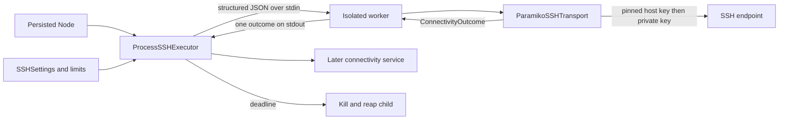

# Chunk 03: Verified SSH Connectivity

*Establishing a bounded, identity-checked SSH observation*

| Field | Detail |
| --- | --- |
| Baseline | Chunk 02 commit `85494627966f1b68e4d93dfeef32f944c0532738` |
| Scope | SSH transport, child-process executor, worker, outcome model, and focused tests |
| Prerequisites | Committed inventory `Node`, configuration types, errors, and Paramiko dependency |
| Boundary | HTTP routing, observation persistence, scheduling, and the mixed API loopback test belong to later chunks. |

This chapter explains the files introduced in Chunk 03. The earlier [configuration guide](02-configuration-authentication.md) covers how the process obtains SSH paths and limits. A successful SSH observation proves only that this endpoint presented a trusted host key and accepted the configured credential at that moment; it does not prove general host health.

## Learning objectives

After this chapter, you should be able to trace a check through the executor and worker, explain host identity separately from encryption and user authentication, distinguish unknown from changed host keys, and describe how both phase timeouts and a total deadline bound work.

## Contents

1. [SSH trust from first principles](#1-ssh-trust-from-first-principles)
2. [Source walkthrough](#2-source-walkthrough)
3. [Timeouts and cleanup](#3-timeouts-and-cleanup)
4. [Outcomes and tests](#4-outcomes-and-tests)
5. [Tradeoffs and limitations](#5-tradeoffs-and-limitations)
6. [Practice and debugging](#6-practice-and-debugging)
7. [Interview questions](#7-interview-questions)
8. [Quick revision](#8-quick-revision)

**Quick-revision path:** read the flow diagram, outcome table, and Chapter 8. **Deep-learning path:** read Chapters 1–5, run the isolated tests, then answer the interview questions without the guide.

## 1. SSH trust from first principles

An SSH connection has two distinct identity checks. First, the client verifies the **server's host key** against a trusted entry in `known_hosts`. Then the server verifies the client's configured private-key credential. Encryption protects traffic in transit, but encryption to an attacker-controlled server does not establish that the server is the intended node. If the application automatically accepted an unknown host key, an attacker between the client and node could present their own key and impersonate the node.

The trusted fingerprint must therefore be checked through an independent channel before enrollment. Copying `ssh-keyscan` output directly into `known_hosts` only records what the network returned; it does not establish who returned it. For a nonstandard port, the host entry uses `[address]:port`. This chunk reads the file; it never enrolls, replaces, or overwrites host keys.

An **unknown** key means there is no matching trusted entry for that endpoint. A **changed** key means an entry exists but the presented key differs. Both checks must fail closed, but different outcomes help an operator distinguish first-time enrollment from a possible reimage, address reassignment, or interception. A mismatch is never resolved by silently updating trust.

## 2. Source walkthrough

**Figure 1. One check, with no shell or command channel.**



| Artifact | Responsibility |
| --- | --- |
| [`connectivity/models.py`](../../src/fleet_manager/connectivity/models.py) | `ConnectivityOutcome` classifies the handshake result; `ConnectivityObservation` is a value for later persistence. |
| [`connectivity/transport.py`](../../src/fleet_manager/connectivity/transport.py) | Loads trusted host keys and the configured private key, opens one SSH connection, classifies failures, closes the client. |
| [`connectivity/worker.py`](../../src/fleet_manager/connectivity/worker.py) | Reconstructs a node endpoint and settings from one JSON request, runs the transport, emits one outcome. |
| [`connectivity/executor.py`](../../src/fleet_manager/connectivity/executor.py) | Limits active checks, excludes simultaneous checks of the same node, starts a child, enforces a total deadline, and reaps it. |
| [`connectivity/__init__.py`](../../src/fleet_manager/connectivity/__init__.py) | Marks the package boundary. |

The transport calls `load_host_keys()` on the configured file and installs a policy that **raises** for a missing key. Paramiko raises `BadHostKeyException` when a known host presents a different key. The adapter maps these to `HOST_KEY_UNKNOWN` and `HOST_KEY_MISMATCH` respectively; neither reaches the `CONNECTED` return after `client.connect()`.

It passes `pkey=private_key`, `allow_agent=False`, and `look_for_keys=False` to `connect()`. Thus it neither queries the local SSH agent nor scans default key files. It does not open a remote shell. The configured username, host path, and key path come from previously committed [`config.py`](../../src/fleet_manager/config.py); the endpoint address and SSH port come from the committed inventory node.

```python
client.connect(
    hostname=node.address,
    port=node.ssh_port,
    username=settings.username,
    pkey=private_key,
    allow_agent=False,
    look_for_keys=False,
    timeout=settings.connect_timeout_seconds,
    banner_timeout=settings.banner_timeout_seconds,
    auth_timeout=settings.authentication_timeout_seconds,
)
```

The production worker receives file **paths**, not the private-key contents. Its child environment is an allowlist that excludes the API bearer token. The worker's stdout is a single outcome string; stderr is discarded by the executor. `DirectSSHExecutor` exists for injected test transports and does not supply process isolation.

## 3. Timeouts and cleanup

The default connect, SSH banner, and authentication timeouts are each five seconds. These bound particular phases of Paramiko's connection, but DNS resolution, multiple address attempts, or a stuck library call can exceed an individual timeout. [`ProcessSSHExecutor`](../../src/fleet_manager/connectivity/executor.py) therefore applies a separate total budget: 12 seconds by default, configurable from 1 to 60 seconds through the committed settings loader. It starts the clock before child launch, and kills and reaps the worker when the budget expires. The result is `TIMEOUT`, an observation about this attempt rather than proof that the node is down.

The executor allows four active checks by default (configurable from 1 to 16) and rejects a second active check for the same node. Rejections are control-plane errors, not SSH outcomes. It also kills and waits for children during graceful shutdown. Its `communicate()` error path kills and reaps a still-running child before raising `ConnectivityUnavailable`.

The transport uses `with paramiko.SSHClient() as client:`. A **context manager** runs cleanup on both normal return and exceptions, so even a rejected key or failed authentication closes the client. A configured host-key file that cannot be loaded and an unusable private key raise `ConnectivityConfigurationError`; the worker exits nonzero, and the executor reports unavailability rather than a successful observation.

## 4. Outcomes and tests

| Outcome | Trigger in the transport | Interpretation |
| --- | --- | --- |
| `CONNECTED` | `connect()` completes after host-key verification and authentication. | SSH was available for this attempt only. |
| `HOST_KEY_UNKNOWN` | No trusted host key matches the endpoint. | Enrollment requires independent fingerprint verification. |
| `HOST_KEY_MISMATCH` | A trusted entry differs from the presented key. | Investigate reimage, reassignment, or interception. |
| `AUTH_FAILED` | Server rejects credential or encrypted key needs unsupported passphrase. | Check account/key configuration; host health is unknown. |
| `CONNECTION_REFUSED`, `DNS_ERROR`, `TIMEOUT` | Socket resolution or connection fails. | Specific network observation, not a host-health verdict. |
| `UNKNOWN_ERROR` | Other SSH or socket failure. | Preserve uncertainty instead of inventing a cause. |

[`test_ssh_transport.py`](../../tests/test_ssh_transport.py) checks arguments, strict policy, classification, and client closure with a fake client. [`test_ssh_transport_loopback.py`](../../tests/test_ssh_transport_loopback.py) uses disposable keys and a real in-process Paramiko server: trusted login succeeds, unknown and changed keys produce separate failures, and a wrong client key fails authentication. [`test_connectivity_executor.py`](../../tests/test_connectivity_executor.py) checks deadline termination, capacity and same-node rejection, shutdown, and cleanup when `communicate()` raises `OSError`.

Run from `fleet-manager/` in the project environment:

```powershell
python -m pytest --noconftest -p no:cacheprovider -q tests/test_ssh_transport.py tests/test_connectivity_executor.py tests/test_ssh_transport_loopback.py
python -m ruff check src/fleet_manager/connectivity tests/test_ssh_transport.py tests/test_connectivity_executor.py tests/test_ssh_transport_loopback.py
python -m ruff format --check src/fleet_manager/connectivity tests/test_ssh_transport.py tests/test_connectivity_executor.py tests/test_ssh_transport_loopback.py
python -m mypy src/fleet_manager/connectivity
```

`--noconftest` matters at this checkpoint: the repository fixture file imports the later uncommitted `main.py`. The mixed `test_ssh_loopback.py` also imports `main.py` for its API test, so it is not part of this independently importable commit. These isolated checks do not prove later HTTP routing or observation persistence.

## 5. Tradeoffs and limitations

| Choice | Benefit | Limit |
| --- | --- | --- |
| Explicit `known_hosts` and reject policy | Prevents silent trust of an unknown or changed server key. | An operator must verify fingerprints out of band; a poisoned trusted file defeats this boundary. |
| Explicit private key, no agent discovery | Makes the credential source predictable. | Encrypted keys have no passphrase workflow; server-side account privileges remain an operator responsibility. |
| Separate phase timeouts plus child deadline | Bounds blocked DNS and sequential attempts that phase timeouts alone may miss. | Process creation and abrupt parent termination have platform-specific limits. |
| Per-process admission gate | Stops uncontrolled local fanout. | Multiple Uvicorn workers would each have their own gate; there is no global rate limit or egress policy. |

On POSIX, `load_ssh_settings()` rejects group/other permission bits on the private-key file. It checks file existence but does not verify that the known-hosts fingerprints were enrolled correctly. Windows ACL strength is not validated there. This chunk does not provide multi-user authorization, SSH command execution, or persistent observations; those require later modules.

## 6. Practice and debugging

1. **Trace a known host:** identify the `known_hosts` entry for `[127.0.0.1]:port` in the standalone loopback test. Explain why omitting the port would make the key unknown.
2. **Trace a deadline:** follow `ProcessSSHExecutor.run()` from `started` through `communicate(timeout=remaining)`. Explain why phase timeouts alone cannot safely cancel blocked DNS.
3. **Classify a failure:** compare the `HOST_KEY_MISMATCH` and `AUTH_FAILED` paths. Which occurs before the server accepts a user credential, and what should an operator investigate first?

If a trusted node suddenly reports `HOST_KEY_MISMATCH`, stop and verify its new fingerprint independently before changing the trust file. If a check times out, inspect DNS, routing, firewall, and SSH daemon state; do not record “host down” from that result alone. If checks become `ConnectivityUnavailable`, inspect worker startup, credential files, and child-process errors locally without logging private-key contents.

## 7. Interview questions

1. **Why is encryption insufficient to identify the server?** Encryption can protect a connection to an impostor; the host key must match independently established trust.
2. **What distinguishes an unknown key from a changed key?** Unknown has no matching entry; changed conflicts with an existing entry. Both are rejected.
3. **Why disable agent and default-key discovery?** The check must use only the configured credential, making authority and failures predictable.
4. **Why combine phase timeouts with a child-process deadline?** A phase timeout may not cover DNS or repeated addresses; the parent can terminate a blocked child at the total deadline.
5. **What does `CONNECTED` prove?** A trusted host key and configured user credential completed an SSH handshake during that check, not that every service or the node itself is healthy.
6. **What happens after `communicate()` raises `OSError`?** The executor terminates and waits for a live child, then raises `ConnectivityUnavailable`; it does not report a successful SSH observation.

## 8. Quick revision

**Trust:** verify fingerprint out of band → place exact endpoint key in `known_hosts` → reject unknown or changed key. **Credential:** configured non-root username and private key; agent and key search disabled. **Bounds:** connect/banner/auth timeouts plus total worker deadline and admission limit. **Cleanup:** SSH context manager closes client; executor kills and reaps timed-out or failed children. **Evidence:** fake transport tests, disposable real SSH handshake, and executor tests; HTTP and persistence remain later-chunk checks.
