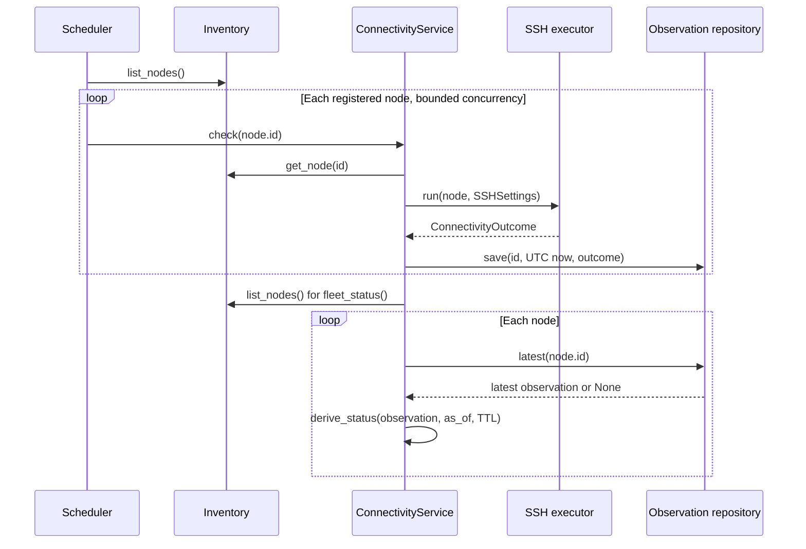

# Chunk 04: Health Monitoring and Scheduling

*Turning bounded SSH checks into durable, time-aware endpoint status*

| Field | Detail |
| --- | --- |
| Baseline | Chunk 03 commit `3998a670263f778b7a9f2d68ed6e84710a87372e` |
| Scope | Observation storage, freshness, monitoring service, scheduler, and timeout-origin correction |
| Dependencies | Committed inventory, configuration, SSH executor, transport, and outcome model |
| Boundary | The later `main.py` lifecycle and HTTP routers are inspected context, not part of this chunk. |

This chapter describes **SSH endpoint observations**. `REACHABLE` means a fresh, verified SSH check succeeded; it does not assert that every service on the Linux node is healthy. The inventory row retains its original `observation_state`; displayed status comes from the latest observation at read time.

## Learning objectives

Trace a check from the scheduler through the service and executor into SQLite; explain why a stored outcome and a displayed status differ; classify timeout origins conservatively; and reason about cancellation, overlap, freshness, and recovery.

## Contents

1. [Observation lifecycle](#1-observation-lifecycle)
2. [State and timeout semantics](#2-state-and-timeout-semantics)
3. [Freshness and persistence](#3-freshness-and-persistence)
4. [Scheduling and shutdown](#4-scheduling-and-shutdown)
5. [Tests and tradeoffs](#5-tests-and-tradeoffs)
6. [Exercises and debugging](#6-exercises-and-debugging)
7. [Interview questions](#7-interview-questions)
8. [Quick revision](#8-quick-revision)

**Quick revision:** read the two tables in Chapter 2 and the summary in Chapter 8. **Deep learning:** follow the diagram, run the focused tests, then explain each state transition and the shutdown race without looking at the code.

## 1. Observation lifecycle

An **observation** records what one SSH check found at one time. A **derived status** interprets the latest observation using the current clock and a time-to-live (TTL). The distinction matters: a successful check from hours ago must not remain green forever, and a new failure must supersede an old success without deleting history.

**Figure 1. Scheduled sweep and status read.**



[`service.py`](../../src/fleet_manager/connectivity/service.py) is the use-case boundary: it gets a persisted `Node`, loads SSH settings unless injected, invokes the committed executor, records `datetime.now(UTC)`, and asks [`repository.py`](../../src/fleet_manager/connectivity/repository.py) to save. Known admission/configuration errors propagate without fabricating an SSH observation. Unexpected executor exceptions become `UNKNOWN_ERROR`, while a storage failure propagates; it cannot look like a successful persisted check. `fleet_status()` reads each latest observation and calls [`derive_status()`](../../src/fleet_manager/connectivity/freshness.py).

[`schemas.py`](../../src/fleet_manager/connectivity/schemas.py) and [`inventory/schemas.py`](../../src/fleet_manager/inventory/schemas.py) supply the existing response values used by the service. This is a current coupling to HTTP-shaped Pydantic types; the chunk includes those imports without changing API routes. [`scheduler.py`](../../src/fleet_manager/connectivity/scheduler.py) selects nodes through the service's inventory repository and calls `service.check()` in worker threads. The application lifespan in later `main.py` constructs and starts it when monitoring is enabled.

## 2. State and timeout semantics

**Table 1. Display state, recalculated on every read.** The latest row is selected by insertion ID, so a newer failure wins over an older success.

| Latest observation | Age/condition | Display state and reason |
| --- | --- | --- |
| None | Any | `NOT_CHECKED`, no reason |
| `CONNECTED` | Age ≤ TTL | `REACHABLE`, no reason |
| `CONNECTION_REFUSED` or `CONNECTION_TIMEOUT` | Age ≤ TTL | `UNREACHABLE`, outcome as reason |
| Any other failure | Age ≤ TTL | `CHECK_ERROR`, outcome as reason |
| Any outcome | Age > TTL | `STALE`, `TTL_EXPIRED`; original outcome remains in the observation |
| Observation timestamp without timezone, naive display clock, or future timestamp | Invalid ordering | `CHECK_ERROR`, `INVALID_TIMESTAMP` or `FUTURE_TIMESTAMP` |

The names describe **SSH endpoint reachability**, not general node health. `CONNECTION_REFUSED` means every resolved TCP endpoint rejected the connection; `CONNECTION_TIMEOUT` means at least one bounded TCP connection attempt timed out and none succeeded. An exact TTL boundary remains fresh (`age > ttl` becomes stale). A fresh failed observation does not become `REACHABLE` just because an older success exists. A later `CONNECTED` observation restores `REACHABLE`.

**Table 2. Timeout origin and conservative interpretation.**

| Origin | Outcome or error | Derived state |
| --- | --- | --- |
| Any resolved TCP candidate times out and none connects | `CONNECTION_TIMEOUT` | `UNREACHABLE` |
| TCP connects, then SSH banner/protocol negotiation times out | `TIMEOUT` | `CHECK_ERROR` |
| Other SSH banner or protocol problem | `UNKNOWN_ERROR` | `CHECK_ERROR` |
| Authentication rejection or Paramiko authentication exception | `AUTH_FAILED` | `CHECK_ERROR` |
| Parent executor reaches its total worker deadline | `EXECUTION_TIMEOUT` | `CHECK_ERROR` |
| Local capacity/same-node admission or worker unavailability | Exception; no new observation | Previous observation continues to age |
| HTTP client stops waiting | No automatic observation from that event alone | Existing status is unchanged |

The committed [`transport.py`](../../src/fleet_manager/connectivity/transport.py) and [`executor.py`](../../src/fleet_manager/connectivity/executor.py) preserve three timeout origins in the shared [`ConnectivityOutcome`](../../src/fleet_manager/connectivity/models.py): TCP establishment, post-connect SSH verification, and the parent worker deadline. Resolution returns IPv4 and IPv6 candidates in an operating-system-defined order. The transport tries all candidates, closes each failed socket, and uses a deterministic final policy: any timeout wins over refusals, all-refused becomes `CONNECTION_REFUSED`, and other mixed socket errors remain `UNKNOWN_ERROR`. DNS and all sequential attempts remain inside the child-process deadline. Paramiko does not expose a distinct typed exception for every authentication delay, so an encrypted SSH connection or a local deadline is still not proof that a remote node is down.

## 3. Freshness and persistence

The repository migrates a version-1 inventory database to a version-2 `connectivity_observations` table in a transaction. Existing version 2 or 3 databases are accepted; unexpected schemas fail. Each append-only row has an integer primary key, node foreign key, ISO timestamp, outcome, and nullable error category. A SQL `CHECK` requires a successful row to have no error category and a failed row's category to match its outcome. `latest(node_id)` orders by descending row ID, preserving previous rows for history and recovery analysis.

`save()` rejects a naive timestamp and normalizes timezone-aware input to UTC before writing. The service itself supplies `datetime.now(UTC)`. On read, `datetime.fromisoformat()` reconstructs the timestamp. The pure freshness function rejects a naive observation clock or a future observation instead of reporting a false success. Its caller can inject `as_of` for deterministic tests.

Committed [configuration](../../src/fleet_manager/config.py) keeps the defaults: **180-second TTL**, **60-second polling interval**, **10% jitter**, monitoring **enabled**. The loader validates TTL 1–86400 seconds, interval 0.1–3600 seconds, and jitter 0–0.5. The scheduler's first sweep waits a jittered interval unless an explicit initial delay is injected. A newly registered node is `NOT_CHECKED` until a check is saved.

## 4. Scheduling and shutdown

Each cycle lists registered nodes and starts one async task per node. An `asyncio.Semaphore` bounds simultaneous checks, and a protected in-flight ID set prevents overlapping checks of the same node in this scheduler. The committed `ProcessSSHExecutor` adds its own process-local admission and same-node exclusion, including manual checks. A busy, already-running, missing-node, or configuration failure is logged and skipped without a false observation. A storage listing failure aborts that cycle; a per-node storage failure is logged.

An **async task** schedules Python coroutine work; `asyncio.to_thread()` moves the blocking service call into an OS thread. Cancelling the coroutine does **not** stop the thread. The scheduler therefore shields the thread task from cancellation, retains the node's in-flight marker until the thread truly finishes, and waits only up to the configured stop timeout. If work remains, it logs that fact and returns; the later application lifespan closes the process executor, which terminates its active child workers. This is a bounded shutdown, not a claim that a Python thread can be force-killed.

`run_cycle()` checks results returned by `gather(..., return_exceptions=True)` and logs task failures; it no longer silently discards them. A normal loop waits a jittered interval after each completed cycle, so it does not intentionally pile up overlapping periodic cycles. Direct concurrent `run_cycle()` calls still share the in-flight guard. The gate is per application process: multiple Uvicorn workers would run separate schedulers and need coordination.

## 5. Tests and tradeoffs

[`test_freshness.py`](../../tests/test_freshness.py) fixes the clock and checks first state, exact TTL, stale success/failure, timeout origin, future/naive times, and timezone offsets. [`test_ssh_transport.py`](../../tests/test_ssh_transport.py) checks hostname, IPv4 and IPv6 resolution, mixed candidate failures, per-candidate timeout assignment, socket cleanup, strict SSH identity arguments, and post-connect timeouts. [`test_connectivity_executor.py`](../../tests/test_connectivity_executor.py) proves blocked DNS and sequential attempts are killed at the parent deadline. [`test_monitoring_unit.py`](../../tests/test_monitoring_unit.py) uses a temporary SQLite database and fake executor to check latest-row ordering, UTC persistence, recovery, multi-node scheduling, overlap, storage errors, and bounded shutdown without importing `main.py`.

From `fleet-manager/` with the project environment:

```powershell
python -m pytest --noconftest -p no:cacheprovider -q tests/test_freshness.py tests/test_monitoring_unit.py tests/test_ssh_transport.py tests/test_connectivity_executor.py
python -m ruff check src/fleet_manager/connectivity tests/test_freshness.py tests/test_monitoring_unit.py
python -m ruff format --check src/fleet_manager/connectivity tests/test_freshness.py tests/test_monitoring_unit.py
python -m mypy src/fleet_manager/connectivity src/fleet_manager/inventory/schemas.py
```

The focused tests do not prove application startup, route authorization, Prometheus/Grafana behavior, or cross-process scheduling. The service currently returns Pydantic response types for fleet status, so it has an API-shape dependency even though its checks and SQLite writes are not HTTP requests. Jitter is randomized in production; tests should use explicit delays, fixed clocks, and synchronization events rather than exact wall-clock sleeps.

## 6. Exercises and debugging

1. **Trace recovery:** save `CONNECTED`, then a newer `CONNECTION_REFUSED`, then a newer `CONNECTED` for one temporary node. At each step, call `latest()` and `fleet_status(as_of=...)`. Explain why old rows remain but do not control the display.
2. **Test the boundary:** use a fixed UTC instant and TTL of 60 seconds. Derive status at exactly 60 seconds and at 60 seconds plus one microsecond. Explain the `>` comparison.
3. **Reason about shutdown:** hold a fake executor with a `threading.Event`, cancel its scheduler task, and inspect why the node remains in flight until the event releases. Explain what the parent process executor can terminate and what it cannot.

**Debugging:** A formerly reachable node showing `STALE` may simply lack a recent observation; inspect scheduler enabled state, cycle logs, and the newest row. `EXECUTION_TIMEOUT` points first to the control-plane deadline, DNS, or a blocked worker, not directly to node health. `CHECK_ERROR` with `AUTH_FAILED` calls for credential diagnosis. A storage failure must be investigated before trusting the newest displayed status: the latest successfully stored row continues to age but no new row records the failed write.

## 7. Interview questions

1. **Why derive status at read time?** The same stored success can be fresh now and stale later without rewriting history.
2. **Which row determines status?** The latest inserted observation for that node; prior rows remain historical evidence.
3. **Why is a local executor deadline a check error?** It says the control plane stopped waiting; it does not identify which remote phase failed.
4. **How is an exact TTL boundary handled?** `age == ttl` is still fresh; `age > ttl` is stale.
5. **Why keep in-flight state after coroutine cancellation?** The underlying thread can still be running, so clearing early could permit a duplicate check.
6. **What bounds concurrent checks?** The scheduler semaphore and per-node guard, plus the committed executor's process-local capacity and same-node guard.
7. **What happens on a SQLite write failure?** `StorageError` propagates or is logged by the scheduler; no success observation is fabricated.

## 8. Quick revision

**Observation:** append-only UTC outcome. **Display:** latest row + `as_of` + TTL. **State:** none → `NOT_CHECKED`; fresh success → `REACHABLE`; fresh refused/connection timeout → `UNREACHABLE`; other fresh failure → `CHECK_ERROR`; expired result → `STALE`. **Scheduler:** jittered sweeps, bounded parallelism, no same-node overlap. **Cancellation:** async wait can stop while a thread runs; retain in-flight identity, wait only a bounded time, then close the process executor at application shutdown. **Limit:** SSH status is an endpoint observation, not full-node health.
