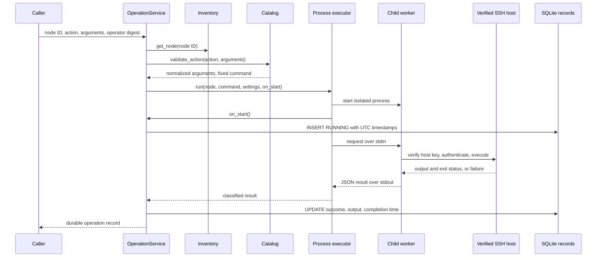

# Chunk 05: Controlled Remote Operations

*Allowlisted Linux diagnostics with verified SSH, bounded execution, and durable outcomes*

| Field | Detail |
| --- | --- |
| Baseline | Chunk 04 commit `0c97ef1bf5c127767e67eeb22586ed0f200ba107` |
| Scope | Operation catalog, service, models, SQLite records, SSH transport, worker, and executors |
| Dependencies | Committed inventory, configuration, authentication guard, and verified SSH host-key policy |
| Boundary | The HTTP router, API schemas, `main.py`, dashboard, and mixed API tests belong to later composition work. |

This chapter describes the operation core in this chunk. The existing HTTP route uses the shared bearer token and passes an action ID, arguments, node ID, and token digest to the service. The route itself is outside this commit. A persisted operation record proves what the control plane observed; it does not prove the remote machine did nothing when the result is uncertain.

## Learning objectives

Explain why a fixed action catalog is safer than accepting shell text; trace validation through SSH and SQLite; distinguish confirmed command failure from an unknown outcome; and reason about child-process deadlines, output limits, duplicate submissions, and sensitive output.

## Contents

1. [Operation boundary and catalog](#1-operation-boundary-and-catalog)
2. [Command security and SSH identity](#2-command-security-and-ssh-identity)
3. [Execution and persistence lifecycle](#3-execution-and-persistence-lifecycle)
4. [Outcomes, deadlines, and cleanup](#4-outcomes-deadlines-and-cleanup)
5. [Tests and engineering tradeoffs](#5-tests-and-engineering-tradeoffs)
6. [Exercises and debugging](#6-exercises-and-debugging)
7. [Interview questions](#7-interview-questions)
8. [Quick revision](#8-quick-revision)

**Quick revision:** read the catalog and outcome tables, then Chapter 8. **Deep learning:** trace one successful operation and one lost post-dispatch response through the diagram, run the focused tests, and explain the durable records.

## 1. Operation boundary and catalog

An arbitrary shell endpoint would give every bearer-token holder the ability to run any command allowed by the SSH account. A typo, injection, or stolen token could then modify a machine. [`catalog.py`](../../src/fleet_manager/operations/catalog.py) instead accepts one of four action IDs and compiles a fixed command template after validating its typed arguments.

| Action ID | Arguments | Generated command | Purpose |
| --- | --- | --- | --- |
| `system.uptime` | None | `uptime` | Report uptime and load. |
| `system.memory` | None | `free -m` | Report memory in MiB. |
| `system.disk` | Required absolute `path` | `df -h -P -- <quoted path>` | Report filesystem capacity for a path. |
| `service.status` | Required `service_name` | `systemctl --no-pager status -- <quoted name>` | Read service status and recent detail. |

The catalog first rejects unknown action IDs. No-argument actions reject every supplied key. Disk paths must be strings, nonempty after trimming, at most 255 characters, absolute, free of whitespace and shell punctuation, and without a `..` segment. Service names must be strings, 1–64 characters after trimming, match a narrow ASCII pattern, and not begin with `-`; extra keys are rejected. The returned `ValidatedAction` carries normalized arguments and the exact remote command. This is a read-only diagnostic catalog; it does not offer service start, stop, reboot, file write, or a generic command field.

[`service.py`](../../src/fleet_manager/operations/service.py) fetches a registered [`Node`](../../src/fleet_manager/inventory/models.py), validates the action, loads SSH settings when they were not injected, creates an operation ID, and calls an executor. An unknown node or invalid action cannot reach SSH. [`models.py`](../../src/fleet_manager/operations/models.py) defines immutable records, execution results, outcomes, and failure categories. The node ID determines the target; callers cannot supply a new address in an operation request. Inventory changes between lookup and dispatch are not rechecked.

## 2. Command security and SSH identity

SSH command execution commonly passes one command string to a remote shell. Quoting alone is not a security boundary: command selection and parameter shape must also be constrained. Here the command verb and options are fixed, metacharacters are rejected, and `shlex.quote()` is applied to the remaining path or service-name value. The `--` marker terminates options for `df` and `systemctl` where used. For example:

```python
validate_action("system.disk", {"path": "/var/log"}).remote_command
# "df -h -P -- /var/log"

validate_action("system.disk", {"path": "/tmp;id"})
# Raises InvalidOperationArguments; no SSH call is made.
```

[`transport.py`](../../src/fleet_manager/operations/transport.py) uses a new Paramiko `SSHClient` per operation. It loads the configured `known_hosts` file, installs the committed reject-unknown-host policy, reads the configured private key, and connects with `allow_agent=False` and `look_for_keys=False`. Unknown and changed host keys have separate failure categories. Encrypted SSH without trusted host-key verification could encrypt data to an attacker acting as the server. Neither this transport nor the catalog enrolls or replaces host keys.

The transport never creates a local shell or enables a remote interactive terminal. It opens an SSH session channel and sends the compiled command. Read-only intent still depends on the remote binaries and the SSH account's permissions. `service.status` can include recent logs or configuration details; the API response and SQLite record may therefore contain sensitive output. There is no output redaction, per-user identity, or role-based access control in this chunk. Restrict the bearer token, SSH account, database access, and network exposure accordingly.

## 3. Execution and persistence lifecycle

**Figure 1. One operation request.**



The production [`ProcessOperationExecutor`](../../src/fleet_manager/operations/executor.py) admits at most four operations by default and at most one active operation per node. It starts one child process for each admitted request. A callback inserts the `RUNNING` record before the worker receives its request. The callback only marks startup successful after SQLite insertion succeeds; a storage failure prevents remote dispatch. The worker receives a JSON request through stdin and returns a JSON result through stdout. The private-key **path**, not private-key contents, travels to the child; the child reads the key itself. Worker stderr is discarded, avoiding raw diagnostics in application logs.

[`repository.py`](../../src/fleet_manager/operations/repository.py) upgrades the committed schema version 2 to 3, adding `operation_executions`. Its primary key is the generated operation ID; `node_id` references inventory. SQLite stores action, normalized arguments, UTC request/start/completion timestamps, outcome, failure category, exit code, bounded stdout/stderr, truncation flag, and a token-digest prefix. Individual writes use SQLite transactions. The digest prefix is not a human operator identity and may correlate requests from the same shared token.

After a control-plane restart, `reconcile_in_flight()` changes leftover `RUNNING` rows to `UNCERTAIN` with `CONTROL_PLANE_RESTARTED`. It cannot tell whether the remote command ran. Sequential duplicate submissions receive separate IDs and records; there is no idempotency key or automatic retry. Admission is in memory, so separate control-plane processes do not share its same-node lock.

## 4. Outcomes, deadlines, and cleanup

**Table 1. State transitions and evidence.**

| Situation | Durable outcome or request result | Meaning |
| --- | --- | --- |
| Unknown action, invalid arguments, or unknown node | Request rejected before execution | No operation is dispatched. |
| Admitted request | `RUNNING` | SQLite has recorded intent; execution may not have finished. |
| Exit status 0 received | `SUCCESS` | Successful completion confirmed. |
| Nonzero exit status received | `FAILURE` / `COMMAND_ERROR` | Command ran and reported failure; partial output is retained. |
| Unknown/mismatched host key, auth, DNS, or refused connection | `FAILURE` with specific category | No verified command dispatch. |
| Channel failure after `exec_command()` | `UNCERTAIN` / `TRANSPORT_ERROR` | Dispatch occurred; remote completion is unknown. |
| Channel or worker deadline | `TIMEOUT` | Completion was not confirmed; this is not proof the remote command failed. |
| Worker loses a result after the `RUNNING` write | `UNCERTAIN` / `UNAVAILABLE` | Service preserves an ambiguous durable result and reports the execution error. |
| Process restart with leftover `RUNNING` | `UNCERTAIN` / `CONTROL_PLANE_RESTARTED` | Conservative reconciliation, without replay. |

The production total deadline defaults to **15 seconds**. SSH connection, banner, and authentication each have separately configured timeouts, normally five seconds. The child process makes the overall deadline enforceable even if a Paramiko call blocks. On deadline or communication error, the executor terminates and reaps the child with a bounded wait. `close()` likewise stops active children with bounded reaping. The in-process `DirectOperationExecutor` exists for injected test transports; it passes a timeout value to the transport but cannot forcibly stop arbitrary in-process code. Do not treat it as the production hard deadline.

[`transport.py`](../../src/fleet_manager/operations/transport.py) reads stdout and stderr incrementally, retaining at most **65,536 bytes per stream** by default. It continues draining excess bytes to avoid channel backpressure and sets `output_truncated=True`; the limit bounds retained output, not the number of bytes a remote process can send before the deadline. UTF-8 decoding replaces malformed byte sequences. Empty output is valid; an exit code still decides command success. A transport error after command dispatch returns `UNCERTAIN`, not `COMMAND_ERROR`.

## 5. Tests and engineering tradeoffs

[`test_operations_unit.py`](../../tests/test_operations_unit.py) runs without `main.py` or application `conftest.py`. It checks catalog rejection and generated strings, service persistence and restart reconciliation, same-node/capacity admission, process startup and communication cleanup, and a post-dispatch transport failure. [`test_operations_transport_loopback.py`](../../tests/test_operations_transport_loopback.py) uses a disposable SSH server to check a real public-key handshake, trusted host identity, command dispatch, nonzero exit status, and bounded stdout/stderr. The older mixed `test_operations.py` and `test_operations_ssh_loopback.py` import uncommitted API composition and are intentionally outside this chunk.

| Choice | Benefit | Limit |
| --- | --- | --- |
| Four fixed actions | Small, auditable remote privilege surface. | Adding diagnostics requires code review and tests. |
| One child per operation | Killable overall deadline and isolation from blocked SSH calls. | Process startup cost and a JSON boundary. |
| One SSH connection per request | Simple resource lifetime and host-key check per execution. | No connection pooling; repeated handshake cost. |
| Persist stdout/stderr | Useful debugging and reproducible operator history. | May retain sensitive service details. |
| In-memory admission | Explicit local concurrency and same-node limit. | No cross-process lock or serial duplicate detection. |

The audit row is operational evidence, not a tamper-proof or attributable audit log. A larger deployment would need per-user authentication, authorization, retention controls, and cross-instance admission before relying on it for accountability. These are explanatory future options, not features established by this chunk.

## 6. Exercises and debugging

Run from `fleet-manager/` with the project's Python 3.12 verification environment. The commands are examples, not claims of execution on another machine.

### Exercise 1: Inspect the command boundary

```powershell
.local/windows-verify/Scripts/python.exe -B -c "from fleet_manager.operations.catalog import validate_action; print(validate_action('system.disk', {'path':'/var/log'}).remote_command)"
```

Change the path to `/tmp;id`, add an extra key, and try `service.status` with `-ssh`. Predict which validation rule rejects each input. Explain why quoting and a fixed action ID are both needed.

### Exercise 2: Verify persistence and uncertainty

```powershell
.local/windows-verify/Scripts/python.exe -B -m pytest -q --noconftest -p no:cacheprovider tests/test_operations_unit.py
```

Find the tests that create three sequential records and reconcile an interrupted `RUNNING` row. Explain why neither case should silently become `SUCCESS`.

### Exercise 3: Inspect the SSH boundary

```powershell
.local/windows-verify/Scripts/python.exe -B -m pytest -q --noconftest -p no:cacheprovider tests/test_operations_transport_loopback.py
```

Trace where the temporary host key is pinned, where the command is received, and where excess output is discarded. Do not point this exercise at a production node.

**Debugging scenarios.** If an operation is rejected before an SSH call, inspect the action ID, argument keys, node registration, and catalog rules. If host-key mismatch appears, compare the trusted fingerprint through an independent channel; never automatically replace it. If a row becomes `UNCERTAIN`, inspect whether the worker or SSH channel lost the response, then verify remote effects before considering a manual retry. If output is truncated, check the per-stream limit and use a narrower diagnostic command instead of assuming the remote command failed.

## 7. Interview questions

1. **Why use an allowlist rather than accept a command string?** It limits execution to reviewed templates and removes arbitrary shell selection from the API caller.
2. **Why reject extra argument keys?** They can hide caller mistakes and become dangerous if later code starts interpreting them.
3. **Why validate before quoting?** Quoting protects shell syntax; validation also constrains meaning, type, length, and allowed options.
4. **What does `shlex.quote()` do here?** It converts one validated POSIX shell argument into a safely quoted token; it does not make an arbitrary command safe.
5. **Why pin host keys?** Authentication must identify the server as well as protect the encrypted connection from interception.
6. **Why disable the SSH agent and key discovery?** The operation must use the explicitly configured credential, not an unexpected ambient identity.
7. **Why retain stdout and stderr separately?** They carry different diagnostics; a nonzero status can include useful partial output on either stream.
8. **What does exit code zero prove?** It proves the command reported success and its result was received, within the limits of the remote command's semantics.
9. **Why can a post-dispatch disconnect be `UNCERTAIN`?** The remote command may have run even though its exit status never reached the control plane.
10. **How is a hard deadline enforced?** The production executor runs the SSH worker in a separate process that it can terminate and reap.
11. **Why does a direct test executor have a weaker deadline?** Python cannot safely kill an arbitrary blocked function in its own process; passing a timeout is cooperative.
12. **What does output truncation mean?** The retained stream exceeded its configured byte cap; it does not by itself imply command failure.
13. **Why insert `RUNNING` before dispatch?** It preserves evidence that an admitted operation was attempted, including across a crash.
14. **Why reconcile `RUNNING` to `UNCERTAIN` after restart?** The control plane lost the result and cannot prove the remote command did or did not run.
15. **Are sequential duplicate requests prevented?** No. Each gets a new ID; callers must avoid retrying ambiguous operations automatically.

## 8. Quick revision

| Topic | Remember |
| --- | --- |
| Catalog | Four fixed read-only diagnostics; unknown IDs and extra keys rejected before SSH. |
| Target | Registered inventory node ID determines address and port. |
| SSH | Configured private key, pinned known hosts, no ambient key discovery. |
| Production execution | One child per admitted operation; four concurrent by default, one per node. |
| Deadline | 15-second overall process limit; child is killed and reaped on timeout. |
| Output | 65,536 retained bytes **per stream** by default; overflow is drained and flagged. |
| Outcomes | `SUCCESS` needs confirmed zero; `COMMAND_ERROR` needs confirmed nonzero; lost post-dispatch results are `UNCERTAIN`. |
| Durability | SQLite records `RUNNING` before dispatch and updates completion; restart reconciles unfinished rows. |
| Duplicate policy | Simultaneous same-node work rejected locally; sequential requests are separate executions. |
| Sensitive data | Output can contain service logs and is stored and returned; no per-user attribution or redaction. |

Focused commands: `pytest -q --noconftest -p no:cacheprovider tests/test_operations_unit.py tests/test_operations_transport_loopback.py`, `ruff check src/fleet_manager/operations tests/test_operations_unit.py tests/test_operations_transport_loopback.py`, `ruff format --check` on the same paths, and `mypy src/fleet_manager/operations`. Use the project environment's executables as shown in the exercises.
