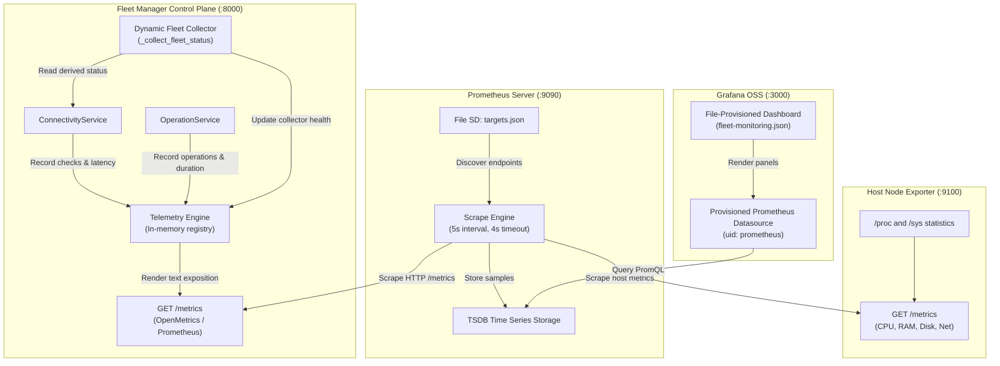
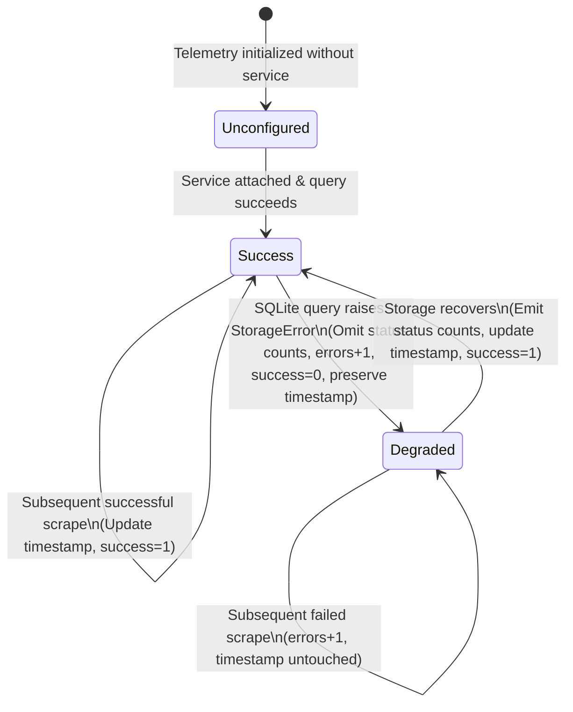
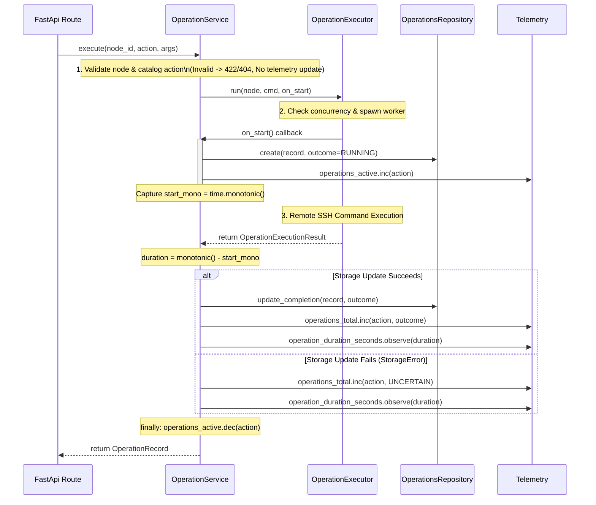

# Chunk 06: Prometheus and Grafana Observability

*Control-plane Telemetry, collector self-monitoring, remote operation instrumentation, Prometheus scraping, and Grafana provisioning*

| Field | Detail |
| --- | --- |
| Baseline | Chunk 05 commit `6c8dd6f68200f64964a3630879f79b1881a91984` |
| Scope | Control-plane metrics registry, dynamic fleet collector self-observability, remote operation instrumentation, Prometheus configuration, Grafana datasource/dashboard provisioning |
| Dependencies | Committed inventory, connectivity service, and controlled remote operations |
| Boundary | Application HTTP route composition in `main.py` and mixed end-to-end integration tests are finalized in application composition milestones. |

This chapter details the production observability architecture of the Distributed Linux Fleet Manager. Observability is not an afterthought or an intrusive wrapper; it is an intrinsic part of the control plane. We examine how the system registers and formats OpenMetrics/Prometheus time series, how dynamic collector failures are decoupled from HTTP scrape success, how remote operations are instrumented across child process boundaries, and how Prometheus and Grafana are provisioned reproducibly as version-controlled infrastructure as code.

---

## Learning objectives

After studying this chapter, you will be able to:
1. Explain the thread-safe lifecycle of custom in-memory metrics registries and why global default registries lead to test pollution and race conditions.
2. Distinguish Prometheus scrape availability (`up == 1`) from dynamic collector execution health (`fleet_collector_success == 1`).
3. Explain why missing observations must never be rendered as genuine numeric zeros.
4. Trace remote operation latency measurement across process admission, worker execution, and SQLite audit trail persistence.
5. Apply strict label cardinality policies that prevent memory exhaustion and credential leakage.
6. Differentiate application control-plane metrics from kernel host statistics exposed by `prometheus-node-exporter`.
7. Author PromQL queries using `rate()`, `histogram_quantile()`, and label aggregations (`sum by (...)`).
8. Configure Grafana datasource and dashboard provisioning as code with immutable file sources of truth.

---

## Contents

1. [Observability architecture and core invariants](#1-observability-architecture-and-core-invariants)
2. [Metrics registry and thread-safe exposition](#2-metrics-registry-and-thread-safe-exposition)
3. [Collector self-observability and graceful degradation](#3-collector-self-observability-and-graceful-degradation)
4. [Remote operation lifecycle instrumentation](#4-remote-operation-lifecycle-instrumentation)
5. [Label cardinality guardrails and security boundary](#5-label-cardinality-guardrails-and-security-boundary)
6. [Host metrics vs control-plane metrics](#6-host-metrics-vs-control-plane-metrics)
7. [Prometheus scrape configuration and target labels](#7-prometheus-scrape-configuration-and-target-labels)
8. [Grafana provisioning and immutable dashboards](#8-grafana-provisioning-and-immutable-dashboards)
9. [PromQL queries, quantiles, and alerts](#9-promql-queries-quantiles-and-alerts)
10. [Tests and engineering tradeoffs](#10-tests-and-engineering-tradeoffs)
11. [Debugging scenarios and operational runbooks](#11-debugging-scenarios-and-operational-runbooks)
12. [Interview questions and viva defense](#12-interview-questions-and-viva-defense)
13. [Quick revision and metric reference sheet](#13-quick-revision-and-metric-reference-sheet)

---

## 1. Observability architecture and core invariants

Distributed control planes manage remote infrastructure over lossy, unpredictable networks. Without telemetry, an operator cannot distinguish between a slow SSH handshake, a blocked DNS lookup, a crushed SQLite database, or a crashed child worker.

The Fleet Manager implements three primary monitoring layers:



### Core Invariants

1. **Per-instance registry isolation**: Every [`Telemetry`](file:///C:/Users/adars/Desktop/ZOHO/SWFW-12-Sem5/fleet-manager/src/fleet_manager/metrics/telemetry.py) instance creates an isolated [`MetricsRegistry`](file:///C:/Users/adars/Desktop/ZOHO/SWFW-12-Sem5/fleet-manager/src/fleet_manager/metrics/registry.py). No module-global singletons exist. Tests instantiate independent registries with deterministic clocks, guaranteeing zero state leakage.
2. **Missing metrics are not zero**: If an inventory query fails, node status counts are completely omitted from the exposition. Emitting `0.0` for healthy nodes would deceive alerting rules into believing nodes are dead or unregistered.
3. **Collector health is distinct from scrape health**: A dynamic query error during collection does not abort the `/metrics` endpoint with an HTTP 500 error unless the registry formatting itself fails. Instead, the endpoint returns HTTP 200, sets `fleet_collector_success{collector="fleet_status"} = 0`, increments `fleet_collector_errors_total`, and preserves the timestamp of the last known good collection.
4. **Strict label cardinality**: Labels must be bounded to known enumerations (`action`, `outcome`, `status`, `reason`, `le`, `collector`). Dynamic variables like IP addresses, hostnames, node IDs, exception strings, or user commands are strictly forbidden in metric labels.
5. **Separation of host vs application domains**: Fleet Manager control-plane health is decoupled from host hardware resources. While Node Exporter reports Linux kernel utilization, Fleet Manager reports operational throughput and SSH verification states.

---

## 2. Metrics registry and thread-safe exposition

[`registry.py`](file:///C:/Users/adars/Desktop/ZOHO/SWFW-12-Sem5/fleet-manager/src/fleet_manager/metrics/registry.py) provides a lightweight, thread-safe OpenMetrics/Prometheus exposition engine without external dependencies.

### Metric Primitives

1. **`Counter`**: Monotonically increasing 64-bit float. Increments must be non-negative.
2. **`Gauge`**: Instantaneous numerical value that can arbitrarily increase, decrease, or be set directly.
3. **`Histogram`**: Cumulative histogram counting observations across configured upper bounds (`le`). It automatically maintains `<name>_bucket{le="..."}`, `<name>_count`, and `<name>_sum`. The `+Inf` bucket is enforced automatically.
4. **Dynamic Collectors**: Callbacks invoked on-demand during render time that calculate current states (e.g., querying SQLite inventory status).

### Render Synchronization

To prevent race conditions where concurrent scrapes observe half-collected state or interleaved dynamic metric samples, [`MetricsRegistry.render()`](file:///C:/Users/adars/Desktop/ZOHO/SWFW-12-Sem5/fleet-manager/src/fleet_manager/metrics/registry.py#L207-L213) acquires a re-entrant render lock:

```python
def render(self) -> str:
    with self._render_lock:
        return self._render()
```

In `_render()`, dynamic collectors execute **before** static gauges and counters are formatted. This ensures that collector health series (`fleet_collector_success`, `fleet_collector_errors_total`) accurately reflect the attempt executed for *that specific scrape*.

---

## 3. Collector self-observability and graceful degradation

The Fleet Manager derives dynamic node status counts by querying [`ConnectivityService.fleet_status()`](file:///C:/Users/adars/Desktop/ZOHO/SWFW-12-Sem5/fleet-manager/src/fleet_manager/connectivity/service.py#L88) over SQLite tables. In previous versions, an unhandled database lock or storage corruption caused partial omission or uncaught exceptions.

Chunk 06 introduces collector self-observability metrics:

```
# HELP fleet_collector_success Whether the latest collection succeeded (1) or is unavailable (0)
# TYPE fleet_collector_success gauge
fleet_collector_success{collector="fleet_status"} 1.0

# HELP fleet_collector_errors_total Total failed collection attempts; each scrape triggers an attempt when configured
# TYPE fleet_collector_errors_total counter
fleet_collector_errors_total{collector="fleet_status"} 0.0

# HELP fleet_collector_last_success_timestamp_seconds Unix timestamp of the most recent successful collection, or 0 before any success
# TYPE fleet_collector_last_success_timestamp_seconds gauge
fleet_collector_last_success_timestamp_seconds{collector="fleet_status"} 1762084800.0
```

### State Transition Matrix

| Scenario | `fleet_nodes_by_status` Samples | `fleet_collector_success` | `fleet_collector_errors_total` | `last_success_timestamp` | HTTP Status |
|---|---|---|---|---|---|
| **Normal Scrape** | 5 series (NOT_CHECKED, REACHABLE, etc.) | `1.0` | Unchanged | Updated to current epoch seconds | `200 OK` |
| **Empty Inventory** | 5 series (all genuine `0.0`) | `1.0` | Unchanged | Updated to current epoch seconds | `200 OK` |
| **SQLite Query Error** | Completely omitted (0 series) | `0.0` | Incremented by `1.0` | Preserved from prior success (or `0.0`) | `200 OK` |
| **Unconfigured Service** | Completely omitted | `0.0` | `0.0` (no attempt made) | `0.0` | `200 OK` |
| **Registry Render Crash** | None | N/A | N/A | N/A | `500 Internal Error` |



---

## 4. Remote operation lifecycle instrumentation

Controlled remote operations run allowlisted diagnostics (`system.uptime`, `system.memory`, `system.disk`, `service.status`) via dedicated child processes (`ProcessOperationExecutor`). Observability must track execution volume, latency distribution, and active concurrency without interfering with command isolation.

### Metrics Definitions

1. **`fleet_operations_total{action="...", outcome="..."}`**:
   - Increments once when an admitted operation attempt reaches a terminal state.
   - Outcomes: `SUCCESS`, `FAILURE`, `TIMEOUT`, `UNCERTAIN`.
2. **`fleet_operation_duration_seconds{action="...", outcome="..."}`**:
   - Histogram observing duration from execution admission (`on_start()`) to terminal result receipt.
   - Explicit buckets: `(0.1, 0.25, 0.5, 1.0, 2.5, 5.0, 10.0, 15.0, +Inf)`.
3. **`fleet_operations_active{action="..."}`**:
   - Gauge incremented upon admission in `on_start()` and decremented on exit via an outer `try/finally` block.

### Lifecycle Measurement Boundaries



### Persistence and Outcome Semantics

It is crucial to distinguish:
1. **Observed Remote Result**: What happened on the remote machine (e.g., exit code 0).
2. **Durability of the Audit Record**: Whether the terminal record was successfully written to SQLite.
3. **Reported Outcome**: What the API returns to the caller.

If remote execution succeeds but the subsequent SQLite write fails (`StorageError`), the API raises an HTTP 503 error. The database row remains in state `RUNNING` (which will be marked `UNCERTAIN` upon reboot by `reconcile_in_flight()`). Telemetry **must not falsely claim a confirmed `SUCCESS`**; it classifies the operation as `UNCERTAIN`.

---

## 5. Label cardinality guardrails and security boundary

High-cardinality labels cause unbounded memory growth in Prometheus TSDB (a phenomenon known as *cardinality explosion*). Furthermore, leaking hostnames, IP addresses, tokens, or command strings into labels creates severe security vulnerabilities.

### Label Policy

| Metric Name | Permitted Labels | Forbidden Labels |
|---|---|---|
| `fleet_nodes_by_status` | `status` (`NOT_CHECKED`, `REACHABLE`, `UNREACHABLE`, `STALE`, `CHECK_ERROR`) | Node ID, IP address, hostname |
| `fleet_connectivity_checks_total` | `outcome` (`CONNECTED`, `AUTH_FAILED`, `CONNECTION_REFUSED`, etc.) | Username, credentials, IP |
| `fleet_connectivity_check_duration_seconds` | `outcome`, `le` | Host identity, connection port |
| `fleet_operations_total` | `action` (`system.uptime`, etc.), `outcome` (`SUCCESS`, `FAILURE`, etc.) | Arguments, file paths, stdout, stderr |
| `fleet_operation_duration_seconds` | `action`, `outcome`, `le` | Command string, process PID |
| `fleet_operations_active` | `action` | Operator token, caller IP |
| `fleet_collector_success` | `collector` (`"fleet_status"`) | Database path, exception message |

Unit tests in `tests/test_metrics.py` and `tests/test_observability_unit.py` assert that every label key extracted from `/metrics` matches the strict allowlist `{"outcome", "status", "reason", "le", "collector", "action"}`.

---

## 6. Host metrics vs control-plane metrics

A common operational error is conflating host infrastructure metrics with application control-plane metrics.

- **Control-plane metrics** (Port 8000 `/metrics`): Expose the internal behavior of the Fleet Manager application—how many SSH checks are active, what fraction of operations timed out, and whether the SQLite inventory collector is healthy.
- **Host metrics** (Port 9100 `/metrics`): Expose the Linux kernel statistics of the host machine—CPU percentage, RAM availability, root filesystem capacity, and network interface packet throughput.

### WSL2 Kernel Sharing Caveat

In development or test environments running on WSL2, multiple simulated nodes or containers share a single underlying Linux kernel. While three independent SSH endpoints can simulate connectivity and authentication failures, their CPU, memory, and disk counters report the exact same host hardware. In production, every distinct target runs its own Node Exporter instance on its isolated physical machine or VM.

---

## 7. Prometheus scrape configuration and target labels

Prometheus is configured via [`monitoring/prometheus/prometheus.yml`](file:///C:/Users/adars/Desktop/ZOHO/SWFW-12-Sem5/fleet-manager/monitoring/prometheus/prometheus.yml) with a 5-second scrape interval and 4-second timeout:

```yaml
global:
  scrape_interval: 5s
  evaluation_interval: 5s
  scrape_timeout: 4s

scrape_configs:
  - job_name: "prometheus"
    static_configs:
      - targets: ["localhost:9090"]

  - job_name: "fleet-manager"
    metrics_path: "/metrics"
    static_configs:
      - targets: ["127.0.0.1:8000"]
        labels:
          service: "fleet-control-plane"
          environment: "local"

  - job_name: "node_exporter"
    file_sd_configs:
      - files:
          - "/etc/prometheus/targets.json"
        refresh_interval: 5s
```

Dynamic target discovery uses [`monitoring/prometheus/targets.json`](file:///C:/Users/adars/Desktop/ZOHO/SWFW-12-Sem5/fleet-manager/monitoring/prometheus/targets.json):

```json
[
  {
    "targets": ["127.0.0.1:9100"],
    "labels": {
      "node_id": "1",
      "node_name": "debian-wsl2",
      "job": "node_exporter",
      "fleet": "local"
    }
  }
]
```

---

## 8. Grafana provisioning and immutable dashboards

Manual dashboard creation via the Grafana UI creates undocumented divergence and configuration drift. The Fleet Manager provisions datasources and dashboards automatically via file-based provisioning.

### Provisioning Files

1. **Datasource Provisioning** ([`prometheus.yaml`](file:///C:/Users/adars/Desktop/ZOHO/SWFW-12-Sem5/fleet-manager/monitoring/grafana/provisioning/datasources/prometheus.yaml)):
   - Defines UID `prometheus` pointing to `http://127.0.0.1:9090`.
   - `editable: false` locks the datasource against web modifications.
2. **Dashboard Provider** ([`dashboards.yaml`](file:///C:/Users/adars/Desktop/ZOHO/SWFW-12-Sem5/fleet-manager/monitoring/grafana/provisioning/dashboards/dashboards.yaml)):
   - Loads dashboards from `/etc/grafana/dashboards`.
   - Enforces `editable: false` and `allowUiUpdates: false` to ensure the committed JSON remains the single source of truth.
3. **Dashboard Definition** ([`fleet-monitoring.json`](file:///C:/Users/adars/Desktop/ZOHO/SWFW-12-Sem5/fleet-manager/monitoring/grafana/dashboards/fleet-monitoring.json)):
   - Organizes panels into 4 distinct rows:
     - Row 1: Fleet Control Plane & Collector Health
     - Row 2: Fleet Status & SSH Connectivity
     - Row 3: Controlled Remote Operations
     - Row 4: Host Node Metrics (Node Exporter)

---

## 9. PromQL queries, quantiles, and alerts

### Essential PromQL Patterns

#### 1. Remote Operation Execution Rate
Calculate operations completed per second grouped by action and outcome over 5-minute sliding windows:
```promql
sum by (action, outcome) (rate(fleet_operations_total[5m]))
```

#### 2. Remote Operation p95 Latency
Calculate the 95th percentile duration across upper bounds (`le`):
```promql
histogram_quantile(0.95, sum by (le, action) (rate(fleet_operation_duration_seconds_bucket[5m])))
```

#### 3. Collector Freshness Age
Measure the elapsed time since the dynamic fleet-status collector last completed successfully:
```promql
time() - fleet_collector_last_success_timestamp_seconds{collector="fleet_status"}
```

#### 4. Host CPU Utilization
Calculate percentage non-idle CPU across instances:
```promql
100 - (avg by (instance) (rate(node_cpu_seconds_total{mode="idle"}[1m])) * 100)
```

---

## 10. Tests and engineering tradeoffs

Validation is conducted via isolated, reproducible tests:

- **Isolated Registry Tests** ([`test_observability_unit.py`](file:///C:/Users/adars/Desktop/ZOHO/SWFW-12-Sem5/fleet-manager/tests/test_observability_unit.py)):
  - Evaluates 34 unit tests verifying collector health transitions, error counters, timestamp survivability, active gauge cleanup, monotonic timing histograms, and label cardinality bounds.
- **Operations Boundary Tests** ([`test_operations_unit.py`](file:///C:/Users/adars/Desktop/ZOHO/SWFW-12-Sem5/fleet-manager/tests/test_operations_unit.py)):
  - Evaluates 33 unit tests verifying parameter sanitization, process timeouts, child worker reaping, and crash recovery.
- **Monitoring Integration Tests** ([`test_metrics.py`](file:///C:/Users/adars/Desktop/ZOHO/SWFW-12-Sem5/fleet-manager/tests/test_metrics.py)):
  - Tests HTTP GET `/metrics` headers, OpenMetrics formatting compliance, and label key safety.

---

## 11. Debugging scenarios and operational runbooks

### Scenario A: `up == 1` but `fleet_collector_success == 0`
- **Symptom**: Prometheus reports the target is UP, but fleet inventory panels are empty.
- **Root Cause**: The FastAPI `/metrics` route is responding with HTTP 200, but SQLite inventory access is degraded (e.g. disk full, permission error, database lock).
- **Investigation**: Check `fleet_collector_errors_total{collector="fleet_status"}` and application systemd logs for `StorageError`.

### Scenario B: Spiking `fleet_operations_active`
- **Symptom**: The active operations gauge increases and reaches capacity limits (`OperationBusy` 429).
- **Root Cause**: Remote SSH daemons are hanging during command execution without closing sessions, or child workers are blocked.
- **Investigation**: Verify operation duration histograms; verify whether child processes are being terminated at the 15-second deadline.

---

## 12. Interview questions and viva defense

**Q1: Why does `Telemetry` instantiate its own `MetricsRegistry` instead of using the global default registry?**\
*Answer*: Global registries introduce hidden mutable state across independent tests and threads. A test running in worker A can pollute the counters of worker B, leading to flaky tests and order-dependent assertions. By scoping the registry to the `Telemetry` instance, each test or application lifecycle possesses a completely isolated metric universe.

**Q2: What is the risk of emitting `0.0` when a dynamic collector fails to query the database?**\
*Answer*: In monitoring, a missing sample (omission) conveys *unknown/unobserved state*, whereas `0.0` conveys *confirmed zero*. If a database error occurs and the system outputs `fleet_nodes_by_status{status="REACHABLE"} 0.0`, alerting rules might falsely trigger catastrophic cluster alerts thinking all nodes went down, when in reality only the monitoring query failed.

**Q3: How do you prevent Prometheus metrics scraping from altering application state?**\
*Answer*: Scrapes must be strictly side-effect-free with respect to application business logic. Calling `GET /metrics` never increments business event counters (such as connectivity checks or operation executions) or dispatches SSH probes. Only collector self-monitoring counters (`fleet_collector_errors_total`) increment on scrape-triggered collection failures.

---

## 13. Quick revision and metric reference sheet

```
========================================================================================
CONTROL PLANE METRICS CHEAT SHEET
========================================================================================
fleet_collector_success{collector="fleet_status"}
  Gauge: 1.0 (latest collection OK), 0.0 (collection failed or unattached)

fleet_collector_errors_total{collector="fleet_status"}
  Counter: Total collection failures encountered during scrapes

fleet_collector_last_success_timestamp_seconds{collector="fleet_status"}
  Gauge: Unix epoch timestamp of most recent successful collection

fleet_nodes_by_status{status="NOT_CHECKED|REACHABLE|UNREACHABLE|STALE|CHECK_ERROR"}
  Gauge: Number of registered nodes in each derived display status

fleet_connectivity_checks_total{outcome="CONNECTED|AUTH_FAILED|..."}
  Counter: Total SSH checks completed by outcome

fleet_connectivity_check_duration_seconds{outcome="...", le="..."}
  Histogram: Latency distribution of SSH connectivity probes

fleet_connectivity_active_checks
  Gauge: Current in-flight SSH checks

fleet_operations_total{action="...", outcome="SUCCESS|FAILURE|TIMEOUT|UNCERTAIN"}
  Counter: Admitted remote operations completed by action and terminal outcome

fleet_operation_duration_seconds{action="...", outcome="...", le="..."}
  Histogram: Duration of remote operations from admission to completion

fleet_operations_active{action="..."}
  Gauge: Number of currently executing operations per catalog action
========================================================================================
```
