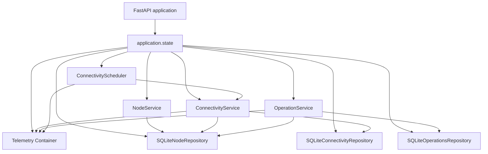
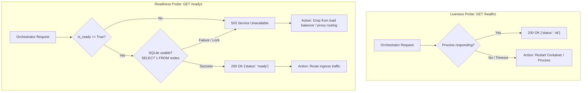
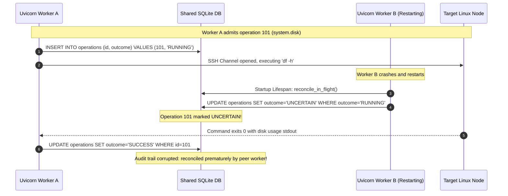
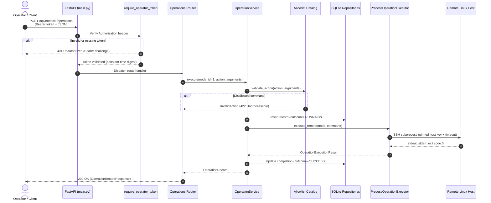

# Chunk 07: Application Composition and HTTP API Integration

*FastAPI lifecycle, dependency injection, shared storage, crash recovery, health probes, bearer authentication, and operations dashboard*

| Field | Detail |
| --- | --- |
| Baseline | Chunk 06 commit `e9b4a641095caf0bcd94a28e1e28d656082d61e0` |
| Scope | FastAPI composition (`create_app`), dependency injection, single shared Telemetry instance, SQLite repository lifecycle, crash recovery reconciliation, public liveness (`/healthz`) and readiness (`/readyz`) probes, bearer authentication boundary, structured exception mapping, browser dashboard (`/`, `/dashboard`), and OpenAPI contract alignment |
| Dependencies | Core inventory, SSH transport, connectivity scheduler, remote operations engine, in-memory metrics registry |
| Constraints | Strict single-process worker architecture (`workers = 1`). Multi-worker deployments require distributed lease ownership and are deliberately out of scope. |

---

## Learning objectives

After studying this chapter, you will be able to:
1. Design a clean FastAPI application factory using asynchronous `@asynccontextmanager` lifespans that guarantees atomic startup initialization and deterministic resource cleanup.
2. Trace object ownership and dependency injection across repositories, services, executors, and background schedulers without relying on global singletons.
3. Explain the sequencing of transactional SQLite schema migrations (v1 $\rightarrow$ v2 $\rightarrow$ v3) on a shared database path.
4. Explain why and how in-flight remote operations (`RUNNING`) must be reconciled to `UNCERTAIN` prior to accepting client requests after a control-plane crash.
5. Justify why multi-worker deployments are unsafe under single-process recovery assumptions and explain the race conditions that occur across peer workers.
6. Differentiate process liveness (`/healthz`) from application readiness (`/readyz`) and implement storage availability checks without probing remote SSH endpoints.
7. Implement constant-time Bearer token verification using SHA-256 digests and prevent token leaks in OpenAPI documentation, error responses, and client-side web memory.
8. Map internal domain and storage exceptions to structured, standardized JSON error responses while eliminating default `HTTPValidationError` schemas.
9. Build an unauthenticated, zero-build single-page operations dashboard that interacts with authenticated backend APIs via ephemeral in-memory tokens.

---

## Contents

1. [Application Architecture and Core Invariants](#1-application-architecture-and-core-invariants)
2. [FastAPI Application Factory and Composition](#2-fastapi-application-factory-and-composition)
3. [Dependency Injection and Object Ownership](#3-dependency-injection-and-object-ownership)
4. [Shared SQLite Repositories and Schema Sequencing](#4-shared-sqlite-repositories-and-schema-sequencing)
5. [Crash Recovery: RUNNING to UNCERTAIN Reconciliation](#5-crash-recovery-running-to-uncertain-reconciliation)
6. [Shared Telemetry Integration](#6-shared-telemetry-integration)
7. [Router Registration and HTTP Endpoint Inventory](#7-router-registration-and-http-endpoint-inventory)
8. [Bearer Authentication and Endpoint Separation](#8-bearer-authentication-and-endpoint-separation)
9. [Structured HTTP Exception Mapping](#9-structured-http-exception-mapping)
10. [Liveness vs Readiness Probes](#10-liveness-vs-readiness-probes)
11. [Startup Failure Cleanup and Shutdown Sequencing](#11-startup-failure-cleanup-and-shutdown-sequencing)
12. [Operations Dashboard UI Integration](#12-operations-dashboard-ui-integration)
13. [OpenAPI Contract and Security Schemas](#13-openapi-contract-and-security-schemas)
14. [Testing Architecture with Isolated TestClients](#14-testing-architecture-with-isolated-testclients)
15. [Single-Worker Architectural Constraints](#15-single-worker-architectural-constraints)
16. [Debugging Scenarios and Common Failure Modes](#16-debugging-scenarios-and-common-failure-modes)
17. [System Architecture and Request Lifecycle Diagrams](#17-system-architecture-and-request-lifecycle-diagrams)
18. [Exercises, Revision Questions, and Interview Defense](#18-exercises-revision-questions-and-interview-defense)

---

## 1. Application Architecture and Core Invariants

A distributed system control plane consists of disparate functional capabilities: inventory persistence, SSH network observation, bounded concurrency queuing, allowlisted remote command execution, and real-time telemetry. In isolation, these modules are clean abstractions; however, an application needs a composition root to wire them together into a unified HTTP service.

In [`src/fleet_manager/main.py`](file:///C:/Users/adars/Desktop/ZOHO/SWFW-12-Sem5/fleet-manager/src/fleet_manager/main.py), the Fleet Manager implements an explicit composition root governed by six fundamental invariants:

1. **Explicit Composition Root**: All concrete dependencies (repositories, transports, executors, telemetry, schedulers, and services) are instantiated and wired inside an application factory (`create_app`). No business logic or background execution begins at module import time.
2. **Single Shared Telemetry Container**: Exactly one [`Telemetry`](file:///C:/Users/adars/Desktop/ZOHO/SWFW-12-Sem5/fleet-manager/src/fleet_manager/metrics/telemetry.py) instance is created per application instance. It is injected into [`ConnectivityService`](file:///C:/Users/adars/Desktop/ZOHO/SWFW-12-Sem5/fleet-manager/src/fleet_manager/connectivity/service.py), [`OperationService`](file:///C:/Users/adars/Desktop/ZOHO/SWFW-12-Sem5/fleet-manager/src/fleet_manager/operations/service.py), and [`ConnectivityScheduler`](file:///C:/Users/adars/Desktop/ZOHO/SWFW-12-Sem5/fleet-manager/src/fleet_manager/connectivity/scheduler.py).
3. **Ordered Persistence Migration**: All SQLite repositories share a single database file and execute their schema migrations in strict dependency order ($v1 \rightarrow v2 \rightarrow v3$).
4. **Crash Reconciliation Before Admission**: Before the application enters its request loop to accept HTTP traffic, orphaned `RUNNING` operations from previous process terminations are reconciled to `UNCERTAIN`.
5. **Fail-Closed Authenticated Boundary**: All management and execution routes require constant-time Bearer authentication. Only `/healthz`, `/readyz`, `/metrics`, and the static dashboard UI are public.
6. **Single-Worker Process Invariant**: The server process operates strictly as a single worker (`workers = 1`). Distributed multi-worker deployments are explicitly unsupported because crash recovery and concurrency admission rely on process-local state.

---

## 2. FastAPI Application Factory and Composition

Rather than exposing a static, pre-configured application object at import time, [`create_app()`](file:///C:/Users/adars/Desktop/ZOHO/SWFW-12-Sem5/fleet-manager/src/fleet_manager/main.py#L73-L86) provides a parameterized factory. This design allows integration tests and deployment runners to inject temporary database paths, mock transports, custom execution limits, and custom monitoring configurations without mutating global state.

```python
def create_app(
    database_path: Path | None = None,
    api_token: str | None = None,
    ssh_transport: SSHTransport | None = None,
    ssh_settings: SSHSettings | None = None,
    ssh_executor: SSHCheckExecutor | None = None,
    monitoring_settings: MonitoringSettings | None = None,
    enable_scheduler: bool | None = None,
    observation_ttl_seconds: int | None = None,
    monitoring_interval_seconds: float | None = None,
    operation_transport: OperationTransport | None = None,
    operation_executor: OperationExecutor | None = None,
    operation_limits: OperationLimits | None = None,
) -> FastAPI:
    ...
```

### The Lifespan Context Manager

FastAPI replaces legacy `on_event("startup")` and `on_event("shutdown")` hooks with the unified Starlette `@asynccontextmanager` lifespan protocol. The lifespan encapsulates the entire active service runtime between its setup phase and its `yield`:

```python
@asynccontextmanager
async def lifespan(application: FastAPI) -> AsyncIterator[None]:
    application.state.is_ready = False
    scheduler: ConnectivityScheduler | None = None
    executor: SSHCheckExecutor | None = None
    active_op_executor: OperationExecutor | None = None

    try:
        # 1. Load settings & limits
        # 2. Instantiate Telemetry & Repositories
        # 3. Initialize Schemas & Reconcile Crash State
        # 4. Construct Services & Executors
        # 5. Start Background Scheduler (if enabled)
        application.state.is_ready = True
        yield
    finally:
        # Guaranteed teardown even on partial startup failure
        application.state.is_ready = False
        if scheduler is not None:
            await scheduler.stop()
        if executor is not None:
            executor.close()
        if active_op_executor is not None:
            active_op_executor.close()
```

---

## 3. Dependency Injection and Object Ownership

To avoid global registries or thread-local lookups, the composition root constructs objects with clear ownership semantics and binds them to `application.state`:



### Dependency Injection in Route Handlers

FastAPI route handlers use `Depends()` with small typed helper functions to retrieve services from `request.app.state`:

```python
def _service(request: Request) -> ConnectivityService:
    return cast(ConnectivityService, request.app.state.connectivity_service)

ServiceDependency = Annotated[ConnectivityService, Depends(_service)]

@router.get("/status", response_model=FleetStatusResponse)
def fleet_status(service: ServiceDependency) -> FleetStatusResponse:
    return service.fleet_status()
```

This guarantees that route handlers do not construct repositories or connect to databases independently.

---

## 4. Shared SQLite Repositories and Schema Sequencing

All subsystems share a single SQLite database path (`settings.database_path`). To prevent schema corruption and race conditions, the composition root runs migrations synchronously during startup in strict dependency order:

1. **Inventory Repository (`SQLiteNodeRepository`)**:
   - Creates the `nodes` table with `PRAGMA user_version = 1`.
   - Protects node name length, port numbers, and unique address-port endpoints.
2. **Connectivity Repository (`SQLiteConnectivityRepository`)**:
   - Upgrades `user_version` to `2`.
   - Creates the `connectivity_observations` table with foreign key `REFERENCES nodes(id) ON DELETE CASCADE`.
3. **Operations Repository (`SQLiteOperationsRepository`)**:
   - Upgrades `user_version` to `3`.
   - Creates the `operations` table with foreign key `REFERENCES nodes(id) ON DELETE CASCADE`.

Each repository checks `PRAGMA user_version` inside an immediate transaction (`BEGIN IMMEDIATE`). If an unknown schema version is encountered, startup halts with a descriptive `StorageError`.

---

## 5. Crash Recovery: RUNNING to UNCERTAIN Reconciliation

### The Problem of In-Flight Operations Across Server Crashes

When the Fleet Manager dispatches a remote operation over SSH (e.g. `service.status` or `system.disk`), the operation record is written to SQLite in state `RUNNING`:

```sql
INSERT INTO operations (id, node_id, action, arguments, requested_at, started_at, outcome)
VALUES (?, ?, ?, ?, ?, ?, 'RUNNING');
```

If the host machine loses power, the control-plane container is killed (`SIGKILL`), or the process crashes during execution, the SSH channel is severed. Upon process restart, the SQLite database still holds rows with `outcome = 'RUNNING'`. 

The remote command may have:
- Succeeded completely before the crash.
- Failed or timed out.
- Remained running on the target Linux host in a detached session.

Because the local control plane cannot know what transpired on the remote node, the outcome is fundamentally indeterminate. Marking these operations as `FAILURE` would be dishonest and could trigger inappropriate automated fallbacks. Marking them as `SUCCESS` would be unsafe.

### The Solution: Startup Reconciliation

Before accepting incoming HTTP requests, [`operations_repository.reconcile_in_flight()`](file:///C:/Users/adars/Desktop/ZOHO/SWFW-12-Sem5/fleet-manager/src/fleet_manager/operations/repository.py#L90-L105) is called in [`main.py`](file:///C:/Users/adars/Desktop/ZOHO/SWFW-12-Sem5/fleet-manager/src/fleet_manager/main.py#L133):

```python
# Reconcile orphaned RUNNING operations to UNCERTAIN before accepting requests
operations_repository.reconcile_in_flight()
```

Under the hood, this executes an atomic SQL transition:

```sql
UPDATE operations
SET outcome = 'UNCERTAIN',
    failure_category = 'SYSTEM_CRASH_ORPHAN',
    completed_at = CURRENT_TIMESTAMP
WHERE outcome = 'RUNNING';
```

When operators inspect the dashboard or query the operations history API, orphaned jobs clearly display as `UNCERTAIN` with the reason `SYSTEM_CRASH_ORPHAN`.

---

## 6. Shared Telemetry Integration

A common defect in multi-service architectures is the accidental instantiation of multiple independent telemetry registries. In such defective setups, `ConnectivityService` records checks in Registry A, `OperationService` records executions in Registry B, while the `/metrics` endpoint exposes an empty Registry C.

In the Fleet Manager:
1. `main.py` creates a single `telemetry = Telemetry()`.
2. `telemetry` is assigned to `application.state.telemetry`.
3. `ConnectivityService(..., telemetry=telemetry)` is passed this instance.
4. `OperationService(..., telemetry=telemetry)` is passed this exact instance.
5. `ConnectivityScheduler(..., telemetry=telemetry)` is passed this exact instance.
6. The circular dependency for dynamic fleet-status metrics is resolved explicitly: `telemetry.service = connectivity_service`.
7. `GET /metrics` renders the Prometheus exposition directly from `request.app.state.telemetry.render()`.

This is verified by [`test_shared_telemetry_instance_identity`](file:///C:/Users/adars/Desktop/ZOHO/SWFW-12-Sem5/fleet-manager/tests/test_app_lifecycle.py#L57-L67):

```python
def test_shared_telemetry_instance_identity(base_app):
    client, _, telemetry = base_app
    app = client.app
    assert app.state.telemetry is telemetry
    assert app.state.connectivity_service.telemetry is telemetry
    assert app.state.operation_service.telemetry is telemetry
    assert app.state.connectivity_scheduler.telemetry is telemetry
```

---

## 7. Router Registration and HTTP Endpoint Inventory

The application mounts five focused routers:

| Method | Path | Security | Request Body | Response Schema | Description |
| --- | --- | --- | --- | --- | --- |
| `GET` | `/healthz` | Public | None | `{"status": "ok"}` | Basic process liveness probe |
| `GET` | `/readyz` | Public | None | `{"status": "ready"}` | Application and database readiness probe |
| `GET` | `/metrics` | Public (loopback) | None | `text/plain` | Prometheus/OpenMetrics exposition |
| `GET` | `/` | Public | None | `text/html` | Browser Operations Dashboard UI |
| `GET` | `/dashboard` | Public | None | `text/html` | Browser Operations Dashboard UI |
| `POST` | `/api/nodes` | Bearer Token | `NodeRegistrationRequest` | `NodeResponse` | Register a new Linux host |
| `GET` | `/api/nodes` | Bearer Token | None | `NodeListResponse` | List all registered fleet nodes |
| `GET` | `/api/nodes/status` | Bearer Token | None | `FleetStatusResponse` | Real-time fleet observation status |
| `POST` | `/api/nodes/{id}/connectivity-check` | Bearer Token | None | `ConnectivityObservationResponse` | Trigger manual synchronous SSH check |
| `GET` | `/api/nodes/{id}/connectivity` | Bearer Token | None | `LatestConnectivityResponse` | Fetch latest observation for a node |
| `POST` | `/api/nodes/{id}/operations` | Bearer Token | `ExecuteOperationRequest` | `OperationRecordResponse` | Dispatch allowlisted remote operation |
| `GET` | `/api/nodes/{id}/operations` | Bearer Token | None | `OperationListResponse` | List operation history for a node |
| `GET` | `/api/nodes/{id}/operations/{op_id}` | Bearer Token | None | `OperationRecordResponse` | Fetch detailed operation audit record |

---

## 8. Bearer Authentication and Endpoint Separation

### Constant-Time Token Digest Verification

Authentication uses single-operator Bearer tokens managed outside the repository. In [`src/fleet_manager/security/auth.py`](file:///C:/Users/adars/Desktop/ZOHO/SWFW-12-Sem5/fleet-manager/src/fleet_manager/security/auth.py), token validation enforces defense-in-depth:

```python
def require_operator_token(
    request: Request,
    _parsed: Annotated[HTTPAuthorizationCredentials | None, Security(_BEARER)],
) -> None:
    headers = request.headers.getlist("authorization")
    if len(headers) != 1:
        raise AuthenticationError

    scheme, separator, token = headers[0].partition(" ")
    if separator != " " or scheme.lower() != "bearer" or _TOKEN_PATTERN.fullmatch(token) is None:
        raise AuthenticationError

    expected = getattr(request.app.state, "operator_token_digest", None)
    if not isinstance(expected, bytes):
        raise AuthenticationError
        
    submitted = hashlib.sha256(token.encode("ascii")).digest()
    if not secrets.compare_digest(submitted, expected):
        raise AuthenticationError
```

### Security Properties
1. **Duplicate Header Rejection**: Prevents HTTP header injection or ambiguity attacks by asserting `len(headers) == 1`.
2. **Regex Format Constraint**: Tokens must match `[A-Za-z0-9_-]{32,128}`.
3. **Constant-Time Comparison**: `secrets.compare_digest` prevents timing side-channel attacks that could infer secret bytes through character-by-character response latency differences.
4. **Zero Credential Echoing**: Rejected requests never echo the submitted token in logs, responses, or stack traces.

---

## 9. Structured HTTP Exception Mapping

FastAPI's default behavior for unhandled exceptions or validation errors produces verbose stack traces or generic schema representations (`HTTPValidationError`). In [`main.py`](file:///C:/Users/adars/Desktop/ZOHO/SWFW-12-Sem5/fleet-manager/src/fleet_manager/main.py#L182-L267), 14 domain-specific exception handlers translate all internal errors into a standardized JSON envelope:

```json
{
  "error": {
    "code": "duplicate_node",
    "message": "Node endpoint is already registered"
  }
}
```

### Exception Mapping Matrix

| Domain / Storage Exception | HTTP Status | Error Code | HTTP Meaning |
| --- | --- | --- | --- |
| `AuthenticationError` | `401 Unauthorized` | `unauthorized` | Missing or invalid Bearer credentials |
| `RequestValidationError` | `422 Unprocessable` | `invalid_request` | Schema validation error in request body/params |
| `InvalidNode` | `422 Unprocessable` | `invalid_node` | Hostname, port, or IP format violation |
| `InvalidAction` | `422 Unprocessable` | `invalid_action` | Action not registered in allowlist catalog |
| `InvalidOperationArguments` | `422 Unprocessable` | `invalid_arguments` | Operation parameters failed schema check |
| `DuplicateNode` | `409 Conflict` | `duplicate_node` | Address and port already registered |
| `ConnectivityInProgress` | `409 Conflict` | `connectivity_in_progress` | Active check already running for this node |
| `OperationInProgress` | `409 Conflict` | `operation_in_progress` | Active operation already running for this node |
| `NodeNotFound` | `404 Not Found` | `node_not_found` | Target node ID does not exist |
| `OperationNotFound` | `404 Not Found` | `operation_not_found` | Operation job ID does not exist |
| `ConnectivityBusy` | `429 Too Many Requests`| `connectivity_busy` | Global SSH check capacity exhausted |
| `OperationBusy` | `429 Too Many Requests`| `operation_busy` | Global operation worker capacity exhausted |
| `StorageError` | `503 Service Unavailable` | `storage_unavailable` | Database locked, corrupt, or unreadable |
| `ConnectivityUnavailable` | `503 Service Unavailable` | `connectivity_unavailable` | SSH executor closed or shutting down |
| `OperationUnavailable` | `503 Service Unavailable` | `operation_unavailable` | Operation executor closed or shutting down |

---

## 10. Liveness vs Readiness Probes

Modern container orchestrators (e.g. Kubernetes, Docker health checks, systemd watchdogs) require two distinct health probes to manage application lifecycles safely:



### Implementing `GET /healthz`
- Emits `{"status": "ok"}` with HTTP 200.
- Completely decoupled from SQLite or SSH.
- If `/healthz` fails, the process is hung or deadlocked; the orchestrator should restart it.

### Implementing `GET /readyz`
- Returns HTTP 503 while the lifespan is executing setup tasks.
- Calls `inventory_repository.check_ready()`, which executes `SELECT 1 FROM nodes LIMIT 1`.
- If the database file is locked or missing tables, returns HTTP 503 `{"status": "not_ready"}` without leaking internal SQLite error details.
- Returns HTTP 200 `{"status": "ready"}` when traffic can safely be accepted.
- Crucially: **Does not execute SSH probes against fleet nodes.** Managed nodes being offline does not mean the Fleet Manager control plane is unready.

---

## 11. Startup Failure Cleanup and Shutdown Sequencing

A major vulnerability in service composition is resource leakage during partial startup failures. If `DirectSSHExecutor` opens child worker pools, but `operations_repository.initialize()` subsequently raises a `StorageError`, an unhardened application would leak child processes and file descriptors.

In [`main.py`](file:///C:/Users/adars/Desktop/ZOHO/SWFW-12-Sem5/fleet-manager/src/fleet_manager/main.py#L94-L179), the lifespan encapsulates all allocations within a single outer `try...finally`:

```python
try:
    ...
    executor = ProcessSSHExecutor(...)
    active_op_executor = ProcessOperationExecutor(...)
    ...
    if active_monitoring.enabled:
        scheduler = ConnectivityScheduler(...)
        await scheduler.start()

    application.state.is_ready = True
    yield
finally:
    application.state.is_ready = False
    if scheduler is not None:
        await scheduler.stop()
    if executor is not None:
        executor.close()
    if active_op_executor is not None:
        active_op_executor.close()
```

### Shutdown Order Invariant
1. Set `is_ready = False`: Causes `/readyz` to immediately return 503, signaling ingress proxies to cease routing traffic.
2. `await scheduler.stop()`: Cancels the periodic background timer and waits for active SSH check workers to exit.
3. `executor.close()`: Terminates the connectivity process pool only after the scheduler has stopped trying to submit checks.
4. `active_op_executor.close()`: Terminates the remote operations process pool.

---

## 12. Operations Dashboard UI Integration

The browser-based management interface is served directly from [`src/fleet_manager/ui/`](file:///C:/Users/adars/Desktop/ZOHO/SWFW-12-Sem5/fleet-manager/src/fleet_manager/ui/) via `GET /` and `GET /dashboard`.

### Zero-Build Vanilla Architecture
The frontend is built entirely with standard HTML5, CSS3, and modern ECMAScript. It requires no Node.js build chain, npm packages, or external CDN dependencies, ensuring it runs completely air-gapped on private management networks.

### Ephemeral In-Memory Authentication
Storing administrative tokens in browser `localStorage` or `sessionStorage` exposes credentials to Cross-Site Scripting (XSS) exfiltration attacks. The dashboard maintains the Bearer token strictly in a private JavaScript closure:

```javascript
let operatorToken = null; // Stored exclusively in browser RAM
```

When an operator locks the session or closes the tab, the token is instantly discarded.

### XSS Prevention via Text-Node Rendering
All dynamic strings received from backend API responses (node names, IP addresses, exit codes, and stdout/stderr output) are inserted using `textContent` or `document.createTextNode`:

```javascript
// Safe DOM insertion prevents script injection from remote SSH command outputs
const tdName = document.createElement("td");
tdName.textContent = node.name;
tr.appendChild(tdName);
```

### Output Truncation and UNCERTAIN Badging
- When remote command outputs exceed the safety limit (e.g. 64 KB), the backend sets `output_truncated = true`. The UI detects this flag and renders an amber `[OUTPUT TRUNCATED]` warning badge.
- When an operation outcome is `UNCERTAIN`, the UI displays a dedicated warning badge explaining that remote execution state could not be verified due to a network timeout or control-plane crash.

---

## 13. OpenAPI Contract and Security Schemas

The OpenAPI schema generated at `/openapi.json` accurately reflects the authenticated security boundaries:

```json
{
  "components": {
    "securitySchemes": {
      "OperatorToken": {
        "type": "http",
        "scheme": "bearer",
        "description": "Single-operator development token; set it outside the repository."
      }
    },
    "schemas": {
      "ErrorResponse": { ... },
      "NodeResponse": { ... },
      "OperationRecordResponse": { ... }
    }
  }
}
```

Protected endpoints declare `security: [{"OperatorToken": []}]`, while public probes and dashboard endpoints declare `security: null`. By declaring explicit `responses={422: {"model": ErrorResponse}}` on parameterized routes, FastAPI's default `HTTPValidationError` is removed, presenting a clean, consistent API documentation contract.

---

## 14. Testing Architecture with Isolated TestClients

Integration testing verifies end-to-end HTTP request handling using Starlette's synchronous [`TestClient`](file:///C:/Users/adars/Desktop/ZOHO/SWFW-12-Sem5/fleet-manager/tests/test_app_lifecycle.py).

### Complete Lifespan Testing
To test lifespan startup and shutdown correctly, `TestClient` must be used as a context manager:

```python
with TestClient(app) as client:
    # Lifespan startup has executed: repositories ready, scheduler started
    response = client.get("/healthz")
    assert response.status_code == 200
# Lifespan shutdown has executed: scheduler stopped, executors closed
```

### Isolation Guarantees
Every test uses pytest's `tmp_path` fixture to allocate a dedicated, isolated SQLite database file. No state, metrics, or locks persist between test cases.

---

## 15. Single-Worker Architectural Constraints

The current Fleet Manager is strictly constrained to **single-worker deployments** (`uvicorn fleet_manager.main:app --workers 1`). Deploying with multiple worker processes (`--workers 4`) creates severe, unrecoverable race conditions:



### Why Multi-Worker Fails in the Current Architecture
1. **Blind Crash Reconciliation**: A newly started worker executes `reconcile_in_flight()`. Without distributed lease ownership, it cannot differentiate between an orphaned job from a previous crash and an active job currently executing in a healthy peer worker.
2. **In-Memory Concurrency Semaphores**: Concurrency caps (`max_concurrent = 4`) and in-flight node tracking are implemented via in-memory Python semaphores and sets. Each worker process has isolated memory, so concurrent requests across 4 workers would allow 16 concurrent operations, violating safety bounds.
3. **Duplicate Schedulers**: Each worker process spawns an independent `ConnectivityScheduler`, multiplying periodic SSH checks against fleet nodes.
4. **SQLite Lock Contention**: Concurrent transactional writes across multiple OS processes trigger `sqlite3.OperationalError: database is locked`.

Supporting multiple workers requires external coordination: distributed leader election for the scheduler, Redis/PostgreSQL row-level leasing with heartbeat timeouts for operations, and a centralized distributed lock manager.

---

## 16. Debugging Scenarios and Common Failure Modes

### Scenario 1: Readiness Probe Fails (HTTP 503) on Container Startup
- **Symptom**: Load balancer rejects container traffic; `/readyz` returns `{"status": "not_ready"}`.
- **Root Cause**: Database directory permissions prohibit writing SQLite journal files, or schema migration failed.
- **Diagnosis**: Check container logs for `StorageError`. Verify `FLEET_MANAGER_DB_PATH` is writable by the application user.

### Scenario 2: Operations Immediately Return HTTP 409
- **Symptom**: `POST /api/nodes/1/operations` returns 409 `operation_in_progress`.
- **Root Cause**: An earlier command on node 1 is still executing or timed out slowly.
- **Diagnosis**: Query `GET /api/nodes/1/operations` to check the running job's `started_at` timestamp and timeout threshold.

### Scenario 3: Metrics Missing Fleet Status Gauges
- **Symptom**: `/metrics` returns 200, but `fleet_nodes_by_status` is absent.
- **Root Cause**: Dynamic collection failed during scrape (e.g. SQLite read lock contention).
- **Diagnosis**: Check `fleet_collector_success{collector="fleet_status"}`. If `0`, inspect `fleet_collector_errors_total` and application error logs.

---

## 17. System Architecture and Request Lifecycle Diagrams

### End-to-End Request Lifecycle



---

## 18. Exercises, Revision Questions, and Interview Defense

### Practical Exercises
1. **Add a Database Latency Gauge to `/readyz`**: Modify `check_ready()` to measure probe duration in milliseconds and record it in a Prometheus gauge `fleet_storage_probe_duration_seconds`.
2. **Implement Graceful Drain on Shutdown**: Update `lifespan` to wait up to 10 seconds for active remote operations to complete before closing the operation executor.
3. **Simulate Crash Recovery**: Write an integration test that manually inserts a `RUNNING` operation directly into SQLite, launches `create_app()`, and asserts that the operation transitions to `UNCERTAIN` with category `SYSTEM_CRASH_ORPHAN`.

### Revision Questions
1. Why must `@asynccontextmanager` be used instead of Starlette's legacy startup event handlers?
2. Why is `GET /healthz` separated from `GET /readyz`? What would happen if `/healthz` executed a database query?
3. How does constant-time digest comparison prevent timing attacks against the operator Bearer token?
4. What is the danger of returning `0` in Prometheus metrics for nodes whose status could not be observed?

### Interview Defense & Viva Questions
- **Q: Why does the application use in-process dependency injection rather than a global singleton container?**
  *Defense*: Global singletons introduce hidden shared state across unit and integration tests. When tests run concurrently or in sequence, mutated singletons cause flaky test pollution, race conditions, and impossible-to-reproduce bugs. Explicit dependency injection via application state guarantees that each application instance owns its resources and can be torn down cleanly.
- **Q: If SQLite is a file on disk, why can't we run multiple Uvicorn worker processes on the same server?**
  *Defense*: While SQLite supports concurrent readers, it only supports a single writer with table/database-level locking. More critically, our control-plane invariants (crash reconciliation, per-node operation locks, and bounded capacity semaphores) are stored in process memory. Multiple workers cannot coordinate memory-based locks, leading to concurrent command collisions on target nodes and premature crash reconciliation of live operations.
