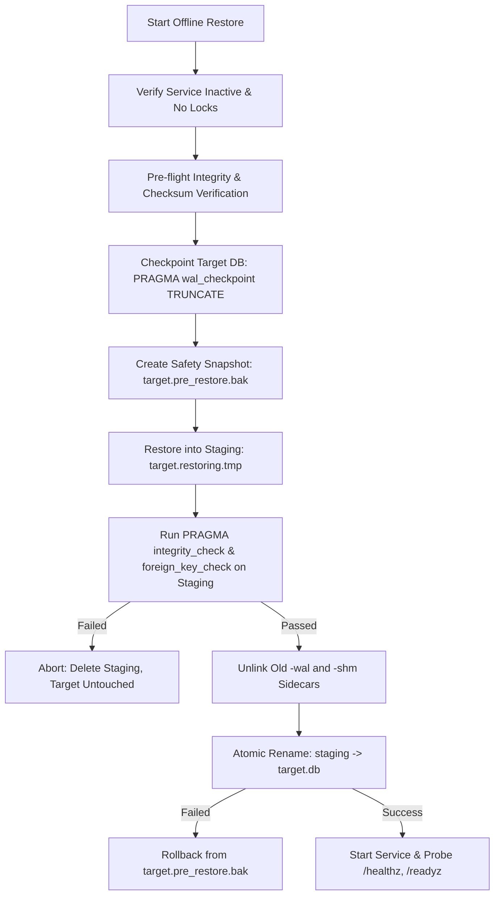

# Chunk 08: Linux Deployment and Backup Recovery

*systemd service hardening, single-worker lifecycle, shutdown timeout budgeting, online SQLite backups, atomic publication, offline recovery, and WAL sidecar crash consistency*

| Field | Detail |
| --- | --- |
| Baseline | Chunk 07 commit `0ce86ca` |
| Scope | Production deployment on Debian 12 (Bookworm), locked dependency sync via `uv`, dedicated unprivileged service account, systemd service sandboxing, mathematical shutdown timeout budgeting (`TimeoutStopSec=35s`), daily backup automation via systemd timers (`02:00:00 UTC`), non-blocking SQLite online backup API, cryptographic manifest generation, atomic publication rollback, offline restore maintenance, and WAL/SHM sidecar crash consistency |
| Dependencies | Core application composition (`create_app`), SQLite storage repositories (v1/v2/v3 schemas), process executors, systemd |
| Constraints | Strict single-process worker architecture (`--workers 1`). Restoration is an offline maintenance operation only. Real-systemd sandboxing and POSIX permissions require validation on a live Linux kernel. |

---

## Learning objectives

After studying this chapter, you will be able to:
1. Explain how `uv` and locked wheel builds achieve reproducible Python 3.12 production environments on Debian 12 without shipping build tools or development packages.
2. Design a hardened systemd unit leveraging namespace isolation (`ProtectSystem=strict`, `ProtectHome=true`, `PrivateTmp=true`, `PrivateDevices=true`, `CapabilityBoundingSet=`) and explain why `MemoryDenyWriteExecute` must be omitted for CPython/Paramiko compatibility.
3. Formulate a mathematically grounded service stop timeout budget ($\text{TimeoutStopSec} = 35\text{s}$) based on admitted remote operation timeouts, scheduler drain deadlines, worker process reaping, and framework teardown.
4. Contrast `KillMode=mixed` with `KillMode=control-group` and explain how process-supervisor architectures avoid premature child process termination during graceful shutdown.
5. Detail why filesystem-level copies (`cp`, `rsync`) of active SQLite databases produce torn pages and corrupt WAL snapshots, and trace how `sqlite3.Connection.backup()` coordinates page locking with SQLite's internal pager.
6. Analyze the crash window that exists when restoring a database over stale `-wal` and `-shm` sidecars and implement crash-consistent promotion using `PRAGMA wal_checkpoint(TRUNCATE)` and pre-promotion sidecar unlinking.
7. Design atomic backup and manifest publication protocols that prevent manifest divergence and preserve previous known-good backup generations upon disk full or I/O failure.
8. Configure resilient systemd timers with explicit UTC scheduling, randomized jitter delays, and reboot catch-up persistence (`Persistent=true`).
9. Execute and verify an offline disaster recovery procedure with automated pre-restore safety snapshots (`.pre_restore.bak`) and emergency rollbacks.

---

## Contents

1. [Linux Deployment Architecture and Invariants](#1-linux-deployment-architecture-and-invariants)
2. [Operating System and Toolchain Reproducibility](#2-operating-system-and-toolchain-reproducibility)
3. [Dedicated Service Account and Filesystem Layout](#3-dedicated-service-account-and-filesystem-layout)
4. [Single-Worker Architecture Constraint](#4-single-worker-architecture-constraint)
5. [systemd Unit Hardening and Sandboxing Directives](#5-systemd-unit-hardening-and-sandboxing-directives)
6. [Graceful Shutdown Budgeting and KillMode](#6-graceful-shutdown-budgeting-and-killmode)
7. [SQLite Online Backup API and WAL Concurrency](#7-sqlite-online-backup-api-and-wal-concurrency)
8. [Cryptographic Manifests and Tamper Detection](#8-cryptographic-manifests-and-tamper-detection)
9. [Atomic Backup Publication and Rollback Safety](#9-atomic-backup-publication-and-rollback-safety)
10. [systemd Daily Backup Automation and Retention Policy](#10-systemd-daily-backup-automation-and-retention-policy)
11. [Offline Restoration Protocol and Crash-Window Elimination](#11-offline-restoration-protocol-and-crash-window-elimination)
12. [Common Failure Modes and Operational Runbooks](#12-common-failure-modes-and-operational-runbooks)
13. [Deployment and Recovery Flow Diagrams](#13-deployment-and-recovery-flow-diagrams)
14. [Exercises, Revision Questions, and Interview Defense](#14-exercises-revision-questions-and-interview-defense)

---

## 1. Linux Deployment Architecture and Invariants

Deploying an infrastructure control plane on Linux requires bridging application-level concurrency and database mechanics with OS-level process supervision, filesystem access controls, and kernel security boundaries. 

The deployment model of the Distributed Linux Fleet Manager is governed by six fundamental architectural invariants:

1. **Dedicated Unprivileged Service Account**: The daemon executes strictly under an unprivileged system user (`fleet-manager`) with a disabled login shell (`/usr/sbin/nologin`). It holds no administrative privileges and drops all Linux kernel capabilities.
2. **Strict Loopback Binding**: The HTTP control plane binds exclusively to `127.0.0.1:8000`. Public ingress requires an external reverse proxy terminating TLS.
3. **Single Uvicorn Worker**: Exactly one Uvicorn worker process is executed. In-process admission queues, scheduler tasks, and in-memory Prometheus metrics rely on single-process semantics.
4. **Non-Blocking Online Backups**: The live database is backed up while the application is fully operational using SQLite's native page-paging backup API without acquiring long-lived exclusive table locks.
5. **Offline-Only Database Restoration**: Database restoration is strictly an offline maintenance procedure. Restoring over an active database process invalidates open file handles and causes silent WAL corruption.
6. **Sidecar Crash Consistency**: Restored databases must never coexist with stale `-wal` or `-shm` sidecar files from a previous database instance.

---

## 2. Operating System and Toolchain Reproducibility

Modern production deployments must avoid "works on my machine" drift caused by implicit host Python environments or floating package versions.

### The Problem with Distro Packages and Global Virtualenvs
- Operating system package managers (e.g., `apt-get install python3-fastapi`) lag behind security releases and tie application dependencies to distro release schedules.
- Unpinned `pip install -r requirements.txt` can resolve different transitive dependencies across installation runs, introducing breaking ABI changes in compiled C extensions (e.g., `cryptography`, `paramiko`).

### The `uv` Locked Hermetic Pipeline
The Fleet Manager standardizes on Astral's `uv` toolchain. In [`docs/DEPLOYMENT-RUNBOOK.md`](file:///C:/Users/adars/Desktop/ZOHO/SWFW-12-Sem5/fleet-manager/docs/DEPLOYMENT-RUNBOOK.md), production installation uses:

```bash
# Install isolated Python 3.12 without contaminating host Python
sudo env UV_PYTHON_INSTALL_DIR=/opt/fleet-manager/python /usr/local/bin/uv python install 3.12
PYTHON_BIN="$(sudo env UV_PYTHON_INSTALL_DIR=/opt/fleet-manager/python /usr/local/bin/uv python find 3.12)"

# Sync strictly from locked manifest without dev packages
sudo env UV_LINK_MODE=copy /usr/local/bin/uv sync --locked --no-dev --python "$PYTHON_BIN"
```

- `--locked`: Asserts that `uv.lock` matches `pyproject.toml` exactly. If a dependency was bumped without updating the lockfile, installation aborts immediately.
- `--no-dev`: Excludes pytest, ruff, and mypy from the production virtual environment, reducing the attack surface.
- `UV_LINK_MODE=copy`: Copies wheel binaries rather than hardlinking, ensuring the `/opt/fleet-manager/.venv` environment is self-contained across distinct filesystems.

---

## 3. Dedicated Service Account and Filesystem Layout

Security on Linux starts with process identity and filesystem permissions.

```
/opt/fleet-manager/          root:root            0755 (ro for service)
├── .venv/                   root:root            0755 (ro for service)
├── src/                     root:root            0755 (ro for service)
└── scripts/                 root:root            0755 (ro for service)

/etc/fleet-manager/          fleet-manager:group  0700 (ro for service via systemd)
├── fleet-manager.env        fleet-manager:group  0600
├── id_ed25519               fleet-manager:group  0600
├── id_ed25519.pub           fleet-manager:group  0644
└── known_hosts              fleet-manager:group  0644

/var/lib/fleet-manager/      fleet-manager:group  0700 (rw for service)
└── inventory.db             fleet-manager:group  0600

/var/backups/fleet-manager/  fleet-manager:group  0700 (rw only for backup service)
├── inventory_latest.db      fleet-manager:group  0600
└── inventory_latest.db.manifest.json  0600
```

### Key Principles:
1. **Immutable Code (`/opt/fleet-manager`)**: Owned by `root:root` with write permissions revoked (`chmod -R go-w`). A compromised service process running as `fleet-manager` cannot modify application code or backdoors in Python files.
2. **Protected Secrets (`/etc/fleet-manager`)**: Contains the operator bearer token (`fleet-manager.env`) and SSH private key (`id_ed25519`). Both are restricted to `0600`.
3. **No File Logging Directory**: Fleet Manager emits structured logs to stdout/stderr, which systemd routes to the journal. Removing `/var/log/fleet-manager` eliminates log-file symlink attacks and unneeded disk write permissions.

---

## 4. Single-Worker Architecture Constraint

In [`deploy/fleet-manager.service`](file:///C:/Users/adars/Desktop/ZOHO/SWFW-12-Sem5/fleet-manager/deploy/fleet-manager.service), Uvicorn is invoked strictly with:

```ini
ExecStart=/opt/fleet-manager/.venv/bin/uvicorn fleet_manager.main:app --host 127.0.0.1 --port 8000 --workers 1
```

### Why Multi-Worker Deployments Break Fleet Manager:
1. **Crash Recovery Reconciliation Race**:
   On startup, [`main.py`](file:///C:/Users/adars/Desktop/ZOHO/SWFW-12-Sem5/fleet-manager/src/fleet_manager/main.py#L131-L136) reconciles in-flight operations from `RUNNING` to `UNCERTAIN`. If multiple workers start concurrently, worker A will reconcile operations that worker B is actively executing, causing data corruption.
2. **Background Scheduler Duplication**:
   The [`ConnectivityScheduler`](file:///C:/Users/adars/Desktop/ZOHO/SWFW-12-Sem5/fleet-manager/src/fleet_manager/connectivity/scheduler.py) runs inside the application process. With $N$ workers, $N$ independent schedulers would fire probes concurrently against target nodes, violating concurrency limits and causing thundering herds.
3. **Split In-Memory Telemetry**:
   Fleet Manager maintains an in-process Prometheus [`MetricsRegistry`](file:///C:/Users/adars/Desktop/ZOHO/SWFW-12-Sem5/fleet-manager/src/fleet_manager/metrics/registry.py). Multi-worker deployments partition counters and gauges across OS processes; successive scrapes to `/metrics` would return wildly fluctuating numbers depending on which worker handled the request.

---

## 5. systemd Unit Hardening and Sandboxing Directives

The service definition in [`deploy/fleet-manager.service`](file:///C:/Users/adars/Desktop/ZOHO/SWFW-12-Sem5/fleet-manager/deploy/fleet-manager.service) applies Linux kernel namespace sandboxing:

```ini
# Security Sandboxing & Least-Privilege Isolation
NoNewPrivileges=true
ProtectSystem=strict
ProtectHome=true
PrivateTmp=true
PrivateDevices=true
ProtectKernelTunables=true
ProtectKernelModules=true
ProtectControlGroups=true
RestrictAddressFamilies=AF_INET AF_INET6 AF_UNIX
RestrictRealtime=true
RestrictSUIDSGID=true
LockPersonality=true
CapabilityBoundingSet=

# Read-only configuration & cryptographic keys
ReadOnlyPaths=/etc/fleet-manager

# Writable paths strictly for SQLite database and WAL/SHM sidecars
ReadWritePaths=/var/lib/fleet-manager
```

### Directive Evaluation:
- `ProtectSystem=strict`: Mounts the entire filesystem `/` read-only for the service. Only directories explicitly declared in `ReadWritePaths` can be modified.
- `ProtectHome=true`: Completely unmounts `/home`, `/root`, and `/run/user`, preventing access to user files.
- `PrivateTmp=true`: Provisions an isolated `/tmp` namespace invisible to other processes.
- `RestrictAddressFamilies=AF_INET AF_INET6 AF_UNIX`: Permits loopback HTTP, outbound SSH, and local UNIX domain sockets (systemd journal and SQLite locks). Blocks raw packet sockets (`AF_PACKET`) and Netlink socket manipulation.
- `CapabilityBoundingSet=`: Drops all 41+ Linux kernel capabilities (e.g., `CAP_SYS_ADMIN`, `CAP_NET_ADMIN`, `CAP_SETUID`).

### Why `MemoryDenyWriteExecute` is Omitted:
`MemoryDenyWriteExecute=true` prohibits creating memory mappings that are writable and executable simultaneously (W^X violation) or calling `mprotect(PROT_EXEC)`. While attractive, CPython uses `ctypes` and `cffi` (relied upon by `cryptography` and `paramiko`), which allocate memory for function trampolines via `libffi`. On Linux systems without dual-mapped page support, `MemoryDenyWriteExecute=true` causes immediate `SIGSEGV` or `PermissionError` when generating cryptographic callbacks. It is therefore omitted to maintain runtime stability.

---

## 6. Graceful Shutdown Budgeting and KillMode

Systemd terminates services by sending `SIGTERM`, waiting for `TimeoutStopSec`, and issuing `SIGKILL` if processes remain. Setting this timeout arbitrarily risks data loss or hung deployments.

### Mathematical Budget Breakdown:
In [`src/fleet_manager/config.py`](file:///C:/Users/adars/Desktop/ZOHO/SWFW-12-Sem5/fleet-manager/src/fleet_manager/config.py#L168-L228), remote operations default to $T_{\text{op}} = 15.0\text{s}$.

$$\text{TimeoutStopSec} = T_{\text{op}} + T_{\text{sched}} + T_{\text{reap}} + T_{\text{teardown}} + T_{\text{margin}}$$

1. **Admitted Operation In-Flight ($T_{\text{op}} = 15.0\text{s}$)**: An admitted command executing on a remote node runs up to 15.0s before its local worker times out.
2. **Scheduler Drain ($T_{\text{sched}} = 5.0\text{s}$)**: [`ConnectivityScheduler.stop(timeout=5.0)`](file:///C:/Users/adars/Desktop/ZOHO/SWFW-12-Sem5/fleet-manager/src/fleet_manager/connectivity/scheduler.py#L291) waits up to 5.0s for active check tasks to cancel.
3. **Subprocess Reaping ($T_{\text{reap}} = 4.0\text{s}$)**: Up to 4 concurrent operation worker subprocesses reaped with 1.0s wait timeouts.
4. **Framework & SQLite Teardown ($T_{\text{teardown}} = 3.0\text{s}$)**: Uvicorn connection draining and repository closing.
5. **Disk Sync Margin ($T_{\text{margin}} = 3.0\text{s}$)**: Buffer against storage flush latency.

$$\text{Calculated Budget} = 15.0 + 5.0 + 4.0 + 3.0 + 3.0 = 30.0\text{s} \xrightarrow{\text{configured}} \mathbf{35\text{s}}$$

### Process Management with `KillMode=mixed`
- `KillMode=mixed`: Systemd sends `SIGTERM` **only to the main Uvicorn supervisor process**.
- Uvicorn invokes its lifespan shutdown context manager, which cooperatively drains the scheduler, notifies workers, and cleans up database handles.
- If any child worker hangs or refuses to exit, systemd waits out the 35s budget and then issues `SIGKILL` to all remaining processes in the cgroup.
- *Contrast*: `KillMode=control-group` would send `SIGTERM` simultaneously to Uvicorn and child workers, abruptly severing worker IPC communication before Uvicorn could record final execution results.

---

## 7. SQLite Online Backup API and WAL Concurrency

A common operations antipattern is taking backups with `cp inventory.db inventory_backup.db`.

### The Torn-Page Failure Mode
SQLite database pages are typically 4096 bytes. Filesystem reads occur in arbitrary block sizes. If a writer commits changes while `cp` reads, `cp` will copy page $N$ from before the commit and page $N+1$ from after the commit. The resulting file fails `PRAGMA integrity_check` with B-tree corruption.

### The Online Backup API Solution
In [`scripts/backup_restore.py`](file:///C:/Users/adars/Desktop/ZOHO/SWFW-12-Sem5/fleet-manager/scripts/backup_restore.py#L46-L54), backups use `sqlite3.Connection.backup()`:

```python
def _copy_database_pages(
    source_conn: sqlite3.Connection,
    target_conn: sqlite3.Connection,
    pages: int = 100,
    sleep: float = 0.01,
) -> None:
    source_conn.backup(target_conn, pages=pages, sleep=sleep)
```

1. **Page-by-Page Locking**: The backup engine locks small ranges of pages (100 pages per step), copies them, and yields the lock for 10ms (`sleep=0.01`).
2. **Restart on Concurrent Write**: If an application writer modifies pages that were already copied, the backup engine automatically rewinds and recopies modified pages.
3. **Consolidation**: When reading a database in WAL mode, the backup API reads committed frames from both the main file and `-wal`, writing a clean, fully checkpointed database that requires no WAL files to open.

---

## 8. Cryptographic Manifests and Tamper Detection

Every backup generates a sidecar manifest: `inventory_latest.db.manifest.json`.

```json
{
  "timestamp_utc": "2026-11-02T15:25:57Z",
  "source_database": "/var/lib/fleet-manager/inventory.db",
  "backup_database": "/var/backups/fleet-manager/inventory_latest.db",
  "backup_size_bytes": 28672,
  "sha256": "0220d8af86cac41e974e64f77c8e9b46e8c89de0ce4f66453ef1bf65b822d1ad",
  "schema_user_version": 3,
  "table_counts": {
    "nodes": 2,
    "connectivity_observations": 1,
    "operation_executions": 1
  },
  "duration_seconds": 0.015
}
```

### Pre-Restore Verification Flow
Before restore begins, the manifest is loaded and verified against the backup file:
- **Digest Verification**: Re-computes SHA-256 in 64 KiB chunks. A single flipped byte halts restore.
- **Size Verification**: Exact byte-for-byte size check.
- **Relational Integrity Check**: Runs `PRAGMA integrity_check` and `PRAGMA foreign_key_check` on the backup file.

---

## 9. Atomic Backup Publication and Rollback Safety

The backup file and its manifest are two distinct files on disk. If publication is not carefully staged, an I/O error during manifest creation leaves an un-manifested or mismatched backup file.

### Publication Protocol:
1. Copy database pages to `inventory_latest.db.tmp` and verify integrity.
2. Generate `inventory_latest.db.manifest.json.tmp` containing the SHA-256 of `inventory_latest.db.tmp`.
3. If a previous backup exists, stage it:
   - `inventory_latest.db` $\rightarrow$ `inventory_latest.db.prev.tmp`
   - `inventory_latest.db.manifest.json` $\rightarrow$ `inventory_latest.db.manifest.json.prev.tmp`
4. Promote new artifacts:
   - `inventory_latest.db.tmp` $\rightarrow$ `inventory_latest.db`
   - `inventory_latest.db.manifest.json.tmp` $\rightarrow$ `inventory_latest.db.manifest.json`
5. If promotion fails at any step, the `except` handler restores the `.prev.tmp` files.
6. The previous known-good backup generation is never destroyed until the new generation is completely published.

---

## 10. systemd Daily Backup Automation and Retention Policy

Periodic backups are driven by systemd timers rather than unmonitored crontabs.

### Timer Definition ([`deploy/fleet-manager-backup.timer`](file:///C:/Users/adars/Desktop/ZOHO/SWFW-12-Sem5/fleet-manager/deploy/fleet-manager-backup.timer))
```ini
[Timer]
OnCalendar=*-*-* 02:00:00 UTC
RandomizedDelaySec=15m
Persistent=true
```
- `02:00:00 UTC`: Explicit UTC timezone prevents daylight-savings clock skips.
- `RandomizedDelaySec=15m`: Adds uniform random delay up to 15 minutes, avoiding synchronized I/O spikes across fleets.
- `Persistent=true`: Triggers missed backups immediately upon boot if the machine was offline at 02:00 UTC.

### Retention Policy Semantics
The backup service maintains **exactly one latest verified snapshot** (`inventory_latest.db`). It does not rotate multi-day archives. If multi-generation historical retention is required, operators must point external backup tools (`restic`, `borg`, `logrotate`) at `/var/backups/fleet-manager/`.

---

## 11. Offline Restoration Protocol and Crash-Window Elimination

Restoration is an offline maintenance operation:

```bash
sudo systemctl stop fleet-manager
sudo -u fleet-manager python3 scripts/backup_restore.py restore \
  /var/backups/fleet-manager/inventory_latest.db \
  /var/lib/fleet-manager/inventory.db
sudo systemctl start fleet-manager
```

### The WAL Sidecar Crash Window
In SQLite WAL mode, transactions are logged to `<db>-wal`. If an operator restores `inventory.db` while `inventory.db-wal` remains on disk:
- When SQLite opens the new database, it sees the old `-wal` file and assumes the database crashed mid-transaction.
- It attempts to replay the old WAL log frames into the newly restored database, mixing old and new data pages and corrupting table B-trees!

### Crash-Consistent Elimination Protocol
In [`scripts/backup_restore.py`](file:///C:/Users/adars/Desktop/ZOHO/SWFW-12-Sem5/fleet-manager/scripts/backup_restore.py#L265-L325), `perform_restore` implements a 5-step sequence:

1. **Pre-Restore Checkpoint**: Executes `PRAGMA wal_checkpoint(TRUNCATE)` on `target_db`. This flushes any pending WAL frames into `target_db` and truncates `target_wal` to 0 bytes.
2. **Consistent Safety Snapshot**: Takes a pre-restore backup to `target_db.pre_restore.bak` via SQLite online backup API.
3. **Staging & Validation**: Restores the backup archive into `target_db.restoring.tmp` and runs integrity checks.
4. **Sidecar Elimination Prior to Swap**: Unlinks `target_wal` (which is already 0 bytes) and `target_shm` **before** the new database is moved into place.
5. **Atomic Promotion**: `target_db.restoring.tmp.replace(target_db)`.

```
Crash at any point before Step 5:
- target_db was fully checkpointed, safety snapshot exists, no corruption.
Crash at Step 5 or later:
- Stale WAL files are already deleted; SQLite opens the new database cleanly.
Failure during replacement:
- Safety snapshot automatically replaces target_db.
```

---

## 12. Common Failure Modes and Operational Runbooks

| Failure Symptom | Mechanism | Resolution Procedure |
|---|---|---|
| **Exit Code 1 / Config Error** | Missing or invalid `FLEET_MANAGER_API_TOKEN` or incorrect permissions on `/etc/fleet-manager/fleet-manager.env`. | Inspect environment file. Ensure token is 32–128 URL-safe characters, ownership is `fleet-manager:fleet-manager`, permissions `0600`. |
| **systemd 203/EXEC** | Missing execute bit or wrong path for virtualenv Python/Uvicorn binary. | Verify `/opt/fleet-manager/.venv/bin/uvicorn` exists and has permissions `chmod a+rx`. |
| **systemd 226/NAMESPACE** | File path specified in `ReadOnlyPaths` or `ReadWritePaths` does not exist on disk. | Verify `/etc/fleet-manager`, `/var/lib/fleet-manager`, and `/var/backups/fleet-manager` exist prior to service startup. |
| **Restore Checksum Mismatch** | Backup archive was modified, truncated, or tampered with on disk. | Inspect `.manifest.json`. Compare `sha256sum <backup>` against manifest digest. Re-run backup or verify source media. |
| **SSH Check Unknown Host** | Pinned host key missing from `/etc/fleet-manager/known_hosts`. | Verify host key fingerprint independently out-of-band and enroll into `/etc/fleet-manager/known_hosts`. |

---

## 13. Deployment and Recovery Flow Diagrams

### Systemd Process Supervision and Shutdown Lifecycle
```mermaid
sequenceDiagram
    autonumber
    actor Admin as System Administrator
    participant Systemd as systemd supervisor
    participant Uvicorn as Uvicorn (PID 1)
    participant Lifespan as FastAPI Lifespan
    participant Sched as ConnectivityScheduler
    participant Workers as Worker Subprocesses

    Admin->>Systemd: systemctl stop fleet-manager
    Note over Systemd: KillMode=mixed starts TimeoutStopSec=35s
    Systemd->>Uvicorn: SIGTERM (sent only to main process)
    Uvicorn->>Lifespan: Exit request loop, trigger shutdown
    Lifespan->>Sched: scheduler.stop(timeout=5.0s)
    Sched->>Sched: Cancel check loop, drain worker tasks
    Lifespan->>Workers: ProcessOperationExecutor.close() (SIGKILL active)
    Workers-->>Lifespan: Workers reaped (wait timeout=1.0s)
    Lifespan-->>Uvicorn: Database & telemetry handles closed
    Uvicorn-->>Systemd: Process exits cleanly (0)
    Note over Systemd: Completed within 35s budget; no SIGKILL needed
```

### Crash-Consistent Restore Promotion Protocol


---

## 14. Exercises, Revision Questions, and Interview Defense

### Practical Exercises
1. **Simulate Crash Window Mitigation**:
   Create a SQLite database in WAL mode and populate 10 rows without closing the connection. Run `PRAGMA wal_checkpoint(TRUNCATE)` and inspect the `-wal` file size with `ls -la`. Verify that the WAL file is truncated to 0 bytes and that all 10 rows are readable from the main database file.
2. **Audit Systemd Sandboxing**:
   On a Linux test machine, inspect the effective sandbox of `fleet-manager.service` using `systemd-analyze security fleet-manager.service`. Identify the exposure score and explain how `CapabilityBoundingSet=` and `ProtectSystem=strict` lower vulnerability risk.
3. **Trigger Manifest Publication Rollback**:
   Write a Python script that calls `perform_backup()`, injects a `PermissionError` when writing the manifest file, and verifies that the previous backup file remains intact with its original SHA-256 digest.

### Revision Questions
1. *Why does Fleet Manager mandate single-worker (`--workers 1`) deployment?*
   - Because in-process admission concurrency, crash recovery reconciliation (`RUNNING` $\rightarrow$ `UNCERTAIN`), and in-memory Prometheus metric registries rely on single-process state. Multiple workers would execute duplicate recovery passes, run conflicting schedulers, and partition metric counters.
2. *Why is `MemoryDenyWriteExecute` omitted from the systemd configuration?*
   - CPython relies on `cffi` and `libffi` for cryptographic operations in `cryptography` and `paramiko`. `libffi` allocates executable memory for C function trampolines; `MemoryDenyWriteExecute=true` blocks dynamic executable page allocation and causes runtime segmentation faults.
3. *What is the difference between `KillMode=mixed` and `KillMode=control-group`?*
   - `KillMode=control-group` sends `SIGTERM` to all processes in the unit simultaneously, terminating child worker processes while the supervisor is trying to coordinate cleanup. `KillMode=mixed` sends `SIGTERM` only to the supervisor (Uvicorn), allowing it to gracefully drain child processes, and reserves `SIGKILL` for any surviving child processes if the timeout expires.

### Interview Defense
> **Question**: "Why don't you simply run database backups by copying the SQLite file with `shutil.copyfile` or `rsync`?"
>
> **Answer**: "Filesystem-level copies like `cp` or `shutil.copyfile` are not atomic across page boundaries. A SQLite database page is 4096 bytes, while filesystem read buffers operate independently. If a transaction commits while the copy is in progress, the destination file can contain a mixture of pre-commit and post-commit pages—a phenomenon known as a 'torn page'—leading to irreversible B-tree corruption. Furthermore, in WAL mode, active transactions live in the `-wal` sidecar. Using `sqlite3.Connection.backup()` delegates page locking to SQLite's internal pager, copying pages safely in small chunks without blocking concurrent readers or writers, and consolidating committed WAL frames into a single, consistent snapshot."
