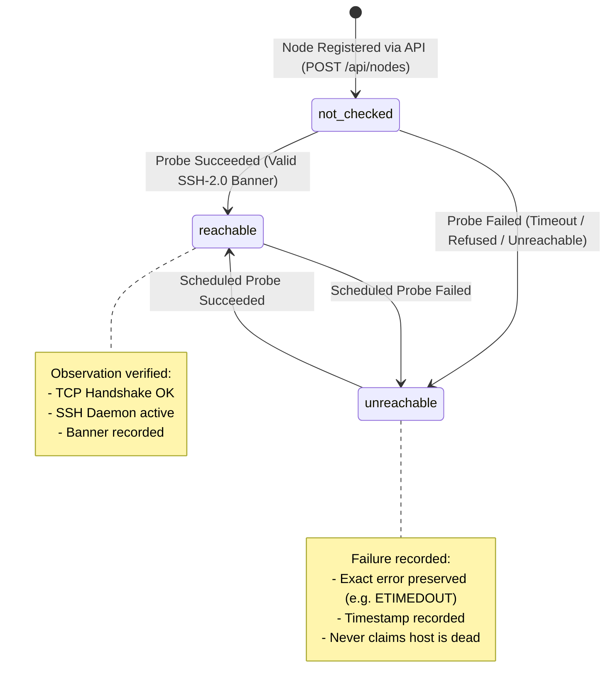

# Document 08: Linux Connectivity Probing & The SSH Handshake

> Draft review pending: the incident story is unsourced; claims about host power, firewall behavior, daemon identity, timing, and banner parsing require correction or verification. Treat the worked answer and proposed states as unapproved teaching material. Do not implement from this draft before that review.

> **Curriculum Navigation:**
> * **Phase 1: Foundation & Architecture:** [Document 01](../foundation/01-vision-and-first-principles.md) · [Document 02](../foundation/02-engineering-pillars-and-portfolio.md)
> * **Phase 2: Feature 1 — Node Inventory:** [Document 03](../node-inventory/03-registration-flow.md) · [Document 04](../node-inventory/04-input-validation-contract.md) · [Document 05](../node-inventory/05-database-persistence.md) · [Document 06](../node-inventory/06-service-layer-integration.md) · [Document 07](../node-inventory/07-http-api-layer.md)
> * **Phase 3: Feature 2 — Node Availability & Probing (This Phase):**
>   * **Document 08 (This Document): Linux Connectivity Probing & The SSH Handshake**

---

## 1. The Core Problem: The Danger of False Assumptions

In Feature 1, we built the inventory engine. An operator enters an IP and port, and Fleet Manager stores it with initial status: **`not_checked`**.

Now comes the critical transition: **How does Fleet Manager verify whether a machine is alive?**

Many junior developers write a naive loop:
```python
# The Naive "Junior Developer" Anti-Pattern
response = os.system(f"ping -c 1 {node_ip}")
if response == 0:
    node['status'] = "Online"
else:
    node['status'] = "Dead"
```

In an enterprise environment or a high-stakes Zoho technical review, this code will be torn apart within 30 seconds.

Why? Because in real Linux networking:
1. **Firewalls drop ICMP (Ping):** Cloud security groups (AWS, Azure, GCP) and enterprise corporate firewalls routinely drop ICMP Echo packets by default (`iptables -A INPUT -p icmp -j DROP`). Why?
   * *Reconnaissance Defense:* Attackers run automated subnet scans (`nmap -sn`) to find live targets. Dropping ICMP turns your server into a silent "black hole" to casual scanners.
   * *DDoS Defense:* Prevents historical attacks like Smurf attacks and Ping-of-Death floods.
2. **Ping is handled by the Kernel, NOT userspace services:** ICMP Echo replies are generated directly inside the Linux OS kernel's network stack. If your Python backend, MySQL database, and SSH service are all dead or killed (`kill -9`), **the Linux kernel still replies to ping!**
3. **Missing observation is not "Dead":** A network packet drop does **not** prove the physical host is powered off. Confusing *"I could not talk to you"* with *"You do not exist"* is the #1 cause of catastrophic automated failover disasters.

### If Ping is so limited, why does it still exist? Why isn't it dead?
**Ping is NOT useless — it was just built for a completely different purpose:**
* **Cable & Link Diagnostics (Where Ping is King):** If you are a network engineer testing whether a physical fiber cable is plugged into a switch, or measuring the raw round-trip time (RTT) between two routers, `ping` is the fastest, lowest-overhead diagnostic tool on Earth.
* **Application Health (Where Ping is Garbage):** Ping was never designed to test whether an application (like `sshd` or an API server) is running and ready to accept commands. Using ping to test server health is like checking if a house has electricity to decide whether the resident is awake and ready to talk to you.

---

## 2. A Real-World Disaster Case Study: The Silent Black Hole

> [!CAUTION]
> **Case Study: The 2019 Cloud Partition Disaster**
> A major financial platform ran a cluster of 500 database servers. Their monitoring daemon checked host health using ICMP ping.
> During a routine router firmware upgrade, a network switch misconfiguration started dropping ICMP packets on one VLAN for 45 seconds, while TCP traffic was completely unaffected.
>
> **The Cascade Failure:**
> The monitoring system concluded: *"All 500 primary databases are DEAD!"*
> It immediately initiated automatic emergency failovers across the entire cluster. Secondary databases attempted to promote themselves simultaneously, causing split-brain data corruption, lock contention, and an 8-hour total global trading blackout.
>
> **The First-Principles Lesson:**
> **A probe outcome is ONLY an observation of the probe.** It is never absolute proof of remote host health. Your software must record what it *measured*, not what it *assumed*.

---

## 3. The 4 Levels of Probing (First Principles)

To build an industry-grade Fleet Manager, we must understand the 4 progressive levels of interacting with a remote Linux node:

```
[ Level 0: ICMP Ping ]
     │ (Layer 3: Network packet echo. Dropped by firewalls; proves no service)
     ▼
[ Level 1: TCP Handshake ]
     │ (Layer 4: SYN -> SYN-ACK -> ACK. Proves OS kernel & port listener exist)
     ▼
[ Level 2: SSH Banner Exchange (THE SWEET SPOT!) ]
     │ (Layer 7: Pre-auth identification string. Proves sshd process is executing)
     ▼
[ Level 3: Full Authenticated Session ]
     │ (Layer 7: Crypto key-exchange, public-key auth, PTY shell execution. Heavy & slow)
```

### What is "Probing" and What Are We Actually Trying to Discover?

Probing means sending a lightweight network stimulus to a target and observing the response to infer system health.

In production fleet management, there are **3 fundamentally different questions** that beginners often confuse into one:
1. **Question 1: Is the physical machine powered ON and connected to the network?** (Hardware / Kernel alive)
2. **Question 2: Is the SSH daemon running and ready to communicate?** (Service readiness in userspace)
3. **Question 3: Do we possess authorized cryptographic keys to execute commands?** (Administrative control)

The 4 levels correspond directly to these 3 questions:

```
[ Level 0: Ping (ICMP) ]
     │ Answers Question 1 only (unreliably, because firewalls drop it).
     ▼
[ Level 1: TCP Handshake ]
     │ Answers: "Kernel is processing IP packets and port 22 has an open listener."
     ▼
[ Level 2: SSH Banner Exchange (The Fleet Manager Probe) ]
     │ Answers BOTH Question 1 and Question 2 with 99.9% certainty!
     ▼
[ Level 3: Full Auth & Remote Command ]
     │ Answers Question 3 (Requires credentials; reserved for actual command execution).
```

Let's use an everyday analogy to understand these levels:

### 🏠 The Relatable Analogy: Visiting a Secure Building

Imagine you need to know if your friend **Alex (the SSH Daemon)** is inside his apartment:

| Probing Level | Analogy Action | What It Actually Proves | What It Fails to Prove |
| :--- | :--- | :--- | :--- |
| **Level 0: Ping (ICMP)** | You look at the building from the street. | The building physically stands there. | Does not prove Alex is inside or awake. |
| **Level 1: TCP Connect** | You press the doorbell outside the apartment door. | The electrical doorbell chime works. | Does not prove Alex heard it or can answer. |
| **Level 2: SSH Banner Exchange** | Alex opens the door latch and says: *"Hello, I am Alex, OpenSSH 8.9"* through the peep-hole. | **Alex is alive, awake, and speaking the expected protocol!** | You haven't exchanged your keys yet, but you know 100% that the service is running. |
| **Level 3: Full Auth & Shell** | You unlock the door, sit on the couch, and start having a conversation. | Full execution rights confirmed. | Very heavy. You can't do this to 1,000 apartments every 10 seconds. |

---

## 4. The Engineering Sweet Spot: RFC 4253 SSH Banner Exchange

### What is an RFC?
The Internet is not owned by any single company. Internet protocols (TCP, IP, HTTP, SSH) are defined by the **IETF (Internet Engineering Task Force)** in official specification documents called **RFCs (Request for Comments)**. **RFC 4253** is the official specification for the SSH Transport Layer.

According to **RFC 4253 Section 4.2**:
> *"When the connection has been established, both the server and the client MUST send an identification string of the form: `SSH-protoversion-softwareversion comments` terminated by a Carriage Return (CR) and Line Feed (LF)."*

### Why are NO passwords or credentials needed for the banner?
Before two computers can encrypt data or verify passwords, they must first agree on **what protocol version and cipher suite they both speak**!
1. If two humans meet, before whispering a secret password, they must first agree: *"Are we speaking English or Hindi?"*
2. In SSH, before any Diffie-Hellman cryptographic key exchange begins, both sides must declare their version (`SSH-2.0-`).
3. Because this identification happens **pre-authentication**, we can read the server's identity string without needing any private keys, passwords, or certificates!

### Can a hacker fake or intercept this banner?
**YES, absolutely!**
A malicious actor could write a 5-line Python script that binds to port 22 and sends `SSH-2.0-OpenSSH_8.9p1 Ubuntu\r\n`.

**This reveals a critical First Principle of System Design:**
* **Availability Monitoring (Feature 2):** Level 2 (Banner Exchange) is the perfect tool. We only want to verify that an SSH daemon is listening and responsive, without burning server CPU or exposing private keys across the network.
* **Controlled Execution (Feature 4):** When we actually send commands (like `reboot` or `apt update`), we **NEVER** trust the banner alone. We use **Level 3 Cryptographic Host Key Verification**, where the remote server must mathematically prove its identity using its private host key!

Notice what Level 2 gives us for monitoring:
1. **Zero Credentials Required:** Security risk during routine probing = 0.
2. **Userspace Execution Proven:** The Linux kernel cannot fake this string. For the string to be sent, the actual `sshd` process in Linux userspace must accept the socket, read its buffers, and write the string back.
3. **Free OS Intelligence:** The banner contains real diagnostic data:
   ```text
   SSH-2.0-OpenSSH_8.9p1 Ubuntu-3ubuntu0.6
   ```
   Without authenticating, we already discovered:
   * Protocol: `SSH 2.0`
   * Daemon: `OpenSSH 8.9p1`
   * Distribution: `Ubuntu Linux`!
4. **Extreme Efficiency:** The exchange takes fewer than 200 bytes of bandwidth and less than 1 millisecond of server CPU time.

---

## 5. Network Failure Modes: The Exact Linux Error Codes

When a TCP/SSH probe fails, an enterprise engineer does not say *"it didn't work"*. We inspect the exact network failure mode reported by the OS:

```
                          ┌───────────────────────────┐
                          │   PROBE FAILURE TAXONOMY  │
                          └─────────────┬─────────────┘
                                        │
         ┌──────────────────────────────┼──────────────────────────────┐
         ▼                              ▼                              ▼
  1. CONNECTION REFUSED           2. TIMEOUT                   3. INVALID BANNER
  (errno: ECONNREFUSED)        (errno: ETIMEDOUT)            (Protocol Mismatch)
 ──────────────────────       ────────────────────          ────────────────────
 Machine is REACHABLE,        Packets silently DROPPED.     Port is open, but NOT SSH.
 but NO process is            Host powered off, cable cut,  e.g. Apache HTTP server
 listening on port 22.        OR firewall `-j DROP`.        or honeypot responded.
```

### The Error Matrix

| Error Code | Linux Kernel Meaning | Concrete Physical Cause | Honest Fleet Manager Claim |
| :--- | :--- | :--- | :--- |
| `ECONNREFUSED` | The target host sent back an explicit **TCP RST** (Reset) packet. | The Linux OS is running, the network is clear, but `sshd` is stopped (`systemctl stop ssh`) or listening on a different port. | *"Host reachable; SSH service not listening."* |
| `ETIMEDOUT` | Sent SYN packets, but received zero responses before the timer expired. | Host is physically powered off, OS is kernel panicked, OR a firewall is silently dropping packets (`iptables -A INPUT -p tcp --dport 22 -j DROP`). | *"Connection timed out. Host state uncertain."* |
| `EHOSTUNREACH` / `ENETUNREACH` | An intermediate router sent an ICMP "Host/Network Unreachable". | Local LAN routing table broken, gateway down, or Wi-Fi disconnected. | *"Local/network routing failure."* |
| `InvalidBannerError` | TCP connected, but bytes received did not start with `SSH-2.0-`. | The port belongs to another service (e.g., HTTP server, database, or proxy). | *"Port open, but service is not an SSH daemon."* |

> [!IMPORTANT]
> **The Golden Rule of Timeouts:**
> A timeout proves **only** that your timer reached zero before an expected byte arrived. It does **not** prove the remote machine is powered off. In distributed systems, this is known as **Partial Failure / Network Asymmetry**.

---

## 6. The Blocking Socket Trap: Why Timeouts Must Be Explicit

In Python, if you create a raw TCP socket and attempt to connect:
```python
import socket
s = socket.socket(socket.AF_INET, socket.SOCK_STREAM)
s.connect(("192.168.1.99", 22))  # If the host is off, what happens?
```

If the target host is offline and packets are dropped, **Python will freeze for 2 to 3 minutes** waiting for the OS TCP retransmission limit!

If your fleet manager has 20 offline machines, a naive sequential check will freeze your entire backend server for **40 to 60 minutes**!

### The Engineering Solution: Bounded Sockets
Every network operation in production systems **MUST** have an explicit, non-negotiable timeout:

```python
s = socket.socket(socket.AF_INET, socket.SOCK_STREAM)
s.settimeout(2.5)  # Maximum 2.5 seconds window
```
If the host does not complete the handshake within 2.5 seconds, Python raises `socket.timeout`, freeing our thread immediately to continue work.

---

## 7. The State Transition Machine

Our Fleet Manager inventory table now moves across honest, well-defined states:



---

## 8. Check Understanding

Before we write the hands-on probe engine in Python, test your systems intuition on this real-world scenario:

### The Scenario
You deploy Fleet Manager in your college lab. You register a node with address `192.168.1.100` and port `22`.
When Fleet Manager probes the node, it instantly (in 2 milliseconds) receives:
```text
ConnectionRefusedError: [Errno 111] Connection refused
```

### Questions:
1. Is the physical machine powered ON or powered OFF?
2. Did a network firewall drop the packets?
3. What is the most likely reason for this error?

<details>
<summary><b>Click to check the worked answer</b></summary>

**Answer:**
1. **The physical machine is powered ON.** A powered-off machine cannot send network packets. To receive an explicit `Connection refused` (TCP RST packet), the remote machine's network card and Linux kernel must be running and actively processing IP packets!
2. **No, the firewall did NOT drop the packets.** If a firewall had dropped the packets, your client would have waited and eventually hit a `TimeoutError`. The fact that you got a response in 2 milliseconds proves network packets travelled back and forth unobstructed.
3. **The `sshd` service is not running on that port.** Either the OpenSSH server was stopped (`sudo systemctl stop ssh`), it crashed, or it is configured to listen on a different port (e.g., port 2222).

</details>

---

## 🛠️ What Comes Next?

Now that we understand the exact network physics, we will build:
👉 **[Practice 05: The SSH Banner Probe Engine](practice/practice-05-probe-engine.md)**\
*(We will write a non-blocking Python network prober using standard `socket`, test it against real local and remote endpoints, extract the SSH banner, and safely handle timeouts and refused connections).*
