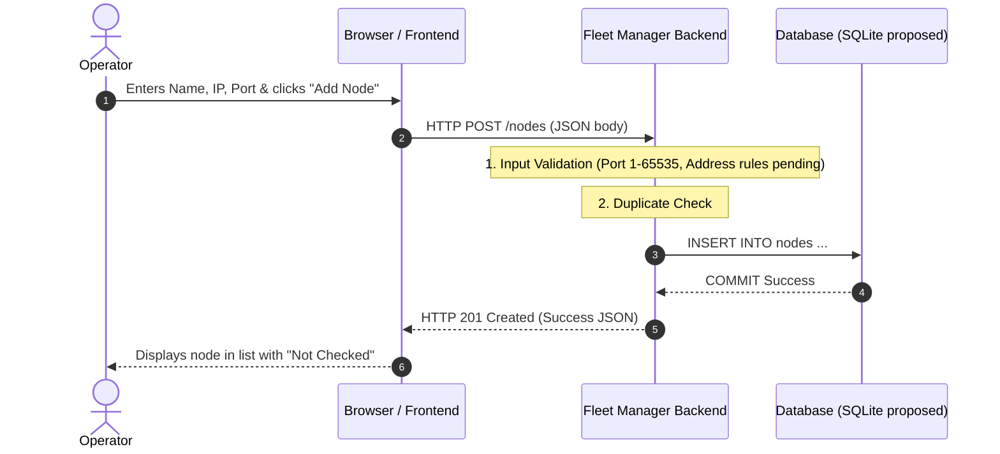

# Document 03: Node Inventory & The Registration Request Flow

**Series:** Fleet Manager Learning Series\
**Topic:** Feature 1 — Node Inventory\
**Status:** Reading completed through Document 04, reported by student on 2026-10-13; independent application pending.\

AI-drafted in the previous agent session (Antigravity per the inherited checkpoint; original draft date unverified). Reviewed by Codex on 2026-10-13. Examples are proposed learning material, not verified product behavior.

---

## 1. What Problem Are We Solving from First Principles?

Maan le tere paas 5 Linux machines hain jo alag-alag kamron ya labs mein rakhi hain. Unhe monitor karne ya command bhejne se pehle, tere paas **unka ek record (Address Book)** hona chahiye.\

Is Address Book ko technical bhasha mein **Node Inventory** bolte hain.

### The Big Trap: Saving a Contact vs. Calling a Contact
Log aksar ek basic galti karte hain: wo sochte hain jab user ne *"Add Node"* dabaya, tabhi server se SSH connect hona chahiye.\

> **Desi Analogy (Phone Contacts):**\
> Agar tu apne phone mein "Rohan: 9876543210" save karta hai:
> 1. Kya phone save karte hi Rohan ko call milata hai? **Nahi.**
> 2. Agar Rohan ka phone abhi switched off ho, toh kya tu uska number apne phone mein save kar sakta hai? **Haan, bilkul!**

Fleet Manager mein bhi same rule apply hota hai:
* **Registration Flow:** Sirf database mein node ka endpoint (IP + Port + Name) save karta hai.
* **Observation / Health Check:** Baad mein alag se SSH bhej kar ek specific connection attempt ka outcome observe karta hai. Timeout se machine dead prove nahi hoti.
* Isliye registration ke turant baad node ka status hota hai: **`Not Checked`**.

---

## 2. The 3 Participants (Actors)

Registration ke dauran sirf 3 cheezein aapas mein baat karti hain:



> ⚠️ **Notice:** Managed Linux machine is diagram mein **hai hi nahi**! Registration ke waqt hum remote machine ko touch bhi nahi karte. Request sirf Browser $\to$ Backend $\to$ Database jaati hai.

---

## 3. Data Flow & The HTTP Contract

Browser aur Backend ke beech jo samjhauta (Contract / API) hota hai:

* **Endpoint:** `POST /nodes`
* **Request Body (JSON):**
```json
{
  "name": "Lab Ubuntu 1",
  "address": "192.168.1.100",
  "ssh_port": 22
}
```

### Validation (Darban / Gatekeeper)
Backend par data aate hi hum aankh band karke database mein nahi daalenge. Backend validation karega:
1. **Name:** Khali (empty) toh nahi hai?
2. **Address:** Valid IP address ya hostname hai?
3. **SSH Port:** Kya yeh valid integer hai between `1` aur `65535`? (e.g. port `-22` ya `99999` reject hona chahiye).

### Persistence & Commit (Disk pe pakka save)
* Agar hum data Python ki list ya dictionary mein rakhenge, toh jaise hi Fleet Manager restart hoga, data ud jayega!
* Isliye persistent storage chahiye; SQLite ek proposal hai, approved choice nahi.
* **Commit:** Transaction successfully finalize hone ke baad hi backend success bolega. Power-loss durability also depends on database settings, filesystem, and hardware; restart persistence does not prove every crash case.

---

## 4. Failure Modes (Agar cheezein kharab hui toh?)

HTTP codes below are illustrative; the exact API error contract is still proposed. Duplicate checks must eventually be enforced by a database uniqueness constraint: checking before INSERT alone can race with another request. Address normalization rules remain to be agreed.

1. **Validation Fail:** User ne port `abc` ya `90000` daal diya $\to$ Backend bolega `400 Bad Request` ("Invalid port number"). Database touch nahi hoga.
2. **Duplicate Entry:** Same IP aur Port pehle se saved hai $\to$ Backend duplicate error dega taaki redundant rows na banein.
3. **Save Failed before Commit:** Disk full ho gayi ya DB lock ho gaya $\to$ Backend `500 Internal Error` dega. Kabhi bhi jhooth nahi bolega ki "Save ho gaya".
4. **Network Timeout on Response:** DB mein save ho gaya, par browser tak confirmation aane se pehle network kat gaya $\to$ Browser ko confirm nahi pata. User refresh karega toh node saved dikhegi.

---

## 📝 Document 03 Revision Notes

> 1. **Registration $\neq$ Connectivity:** Node save karna aur node se connect hona alag-alag baatein hain.
> 2. **Initial State:** Naya node hamesha **`Not Checked`** state se start hota hai.
> 3. **Actors:** Registration mein sirf Browser, Fleet Manager Backend, aur Database shamil hote hain. Remote Linux host nahi.
> 4. **Validation First:** Har input (IP, Port, Name) ko database mein daalne se pehle backend validate karta hai.
