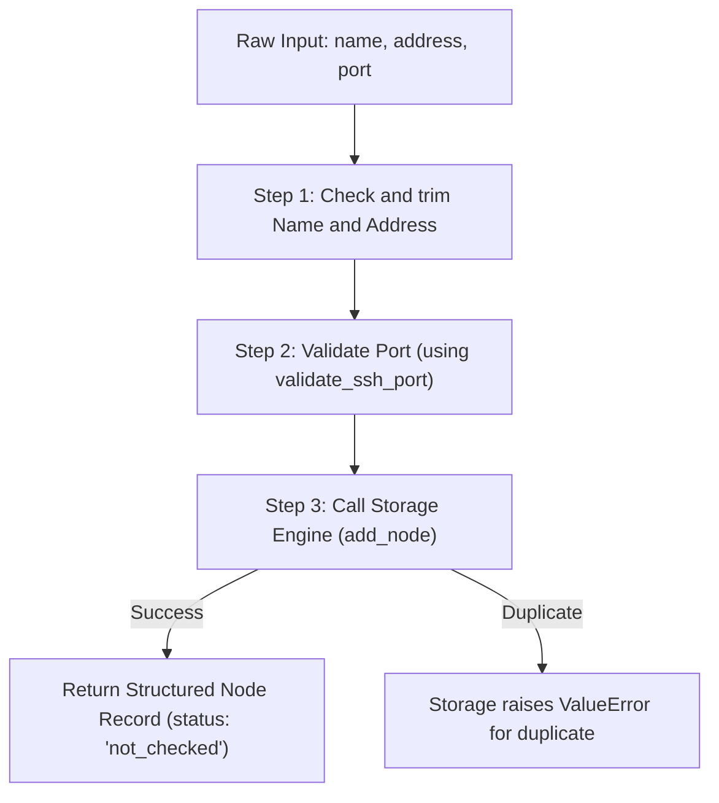

# Document 06: Service Layer Integration & Unified Registration Flow

**Series:** Fleet Manager Learning Series\
**Topic:** Feature 1 — Node Inventory (Architecture & Integration)\
**Parent Lesson:** [⬅️ Document 05: Database Persistence & Storage Engine](05-database-persistence.md)\
**Status:** In Progress / Learning\

AI-drafted in the previous session; reviewed by Codex on 2026-10-15. Proposed practice design only: no service implementation exists yet. Storage and validation limitations remain open.

---

## 1. What Problem Are We Solving from First Principles?

Ab tak humne do alag-alag tools banaye:
1. 🛡️ **Validator:** Jo galat port aur booleans ko rokh deta hai ([`validate_port.py`](practice/validate_port.py)).
2. 💾 **Storage Engine:** Jo valid nodes ko SQLite mein save karta hai aur duplicates ko reject karta hai ([`db_storage.py`](practice/db_storage.py)).

Ab ek bada sawal:\
**Jab kal ko browser se `POST /nodes` request aayegi, toh in dono ko aapas mein kaun jode ga?**

### The Spaghetti Trap (Big Mistake):
Beginners saara code web framework ke route handler ke andar thhoons dete hain:
```python
# ❌ BAD PRACTICE (Spaghetti Route):
@app.post("/nodes")
def add_node_route(data):
    # Port validate kiya...
    # Direct SQL query likhi...
    # Email bheja...
    # Sab ek hi function mein khichdi!
```
Mixing responsibilities makes reuse and focused tests harder; a running server is not necessarily required to test a route.

---

## 2. Three Logical Layers (Proposed Organization)

For this exercise, separate HTTP handling, coordination, and storage. These are logical layers, not necessarily separate deployed tiers; use this separation where it helps reuse and testing.

```
[ Tier 1: API / Web Layer ]     <-- HTTP Request leta hai, JSON parse karta hai, HTTP Status code return karta hai.
            │
            ▼
[ Tier 2: Service Layer ]       <-- THE BRAIN: Validation call karta hai, business rules check karta hai, data sanitize karta hai.
            │
            ▼
[ Tier 3: Storage Layer ]       <-- DATABASE: Sirf disk par SQL chalata hai, ise web/HTTP se koi matlab nahi.
```

> **Why this matters:**\
> **Service Layer** pure Python logic hota hai. Isko test karne ke liye na browser chahiye, na web framework. Isko direct Python script ya unit test se chalaya ja sakta hai!

---

## 3. The Registration Pipeline (Step-by-Step Flow)

Jab ek request aati hai, Service Layer ek pipeline ki tarah kaam karta hai:



### The Service Contract: `register_node(name, address, port)`

```python
def register_node(name: str, address: str, port: int | str = 22, db_path: str = "inventory.db") -> dict:
    """
    Coordinates validation and persistence to onboard a new node.

    1. Validates and strips strings (name, address).
    2. Validates port boundary via validate_ssh_port().
    3. Persists record to SQLite via add_node().
    4. Returns clean dictionary with initial status 'not_checked'.
    """
```

---

## 4. Error Mapping (Viva Question: Errors Flow Kaise Hote Hain?)

The table is a proposed HTTP mapping, not implemented behavior. Both validation and duplicates currently use `ValueError`; an API needs a reliable distinction (such as a dedicated duplicate exception) before it can map them differently. Do not classify by matching message text.

| Kahan Error Aaya | Python Exception | Web API Status Code | User Message |
| :--- | :--- | :--- | :--- |
| Port string `"abc"` ya `-5` tha | `ValueError` | **`400 Bad Request`** | *"Invalid port number"* |
| Name blank tha `""` | `ValueError` | **`400 Bad Request`** | *"Name cannot be empty"* |
| Same IP + Port dobara aaya | `ValueError` (from Duplicate) | **`409 Conflict`** | *"Node already exists"* |
| Database file delete ho gayi / disk full | `sqlite3.OperationalError` | **`500 Internal Error`** | *"Storage failure"* |

Current storage also mislabels other integrity failures as duplicates. Resolve that contract before claiming reliable HTTP error mapping. Database deletion behavior depends on open handles and platform; a missing table is a clearer example of OperationalError.

---

## 📝 Document 06 Revision Notes

> 1. **Separation of Concerns:** Web Route $\to$ Service Layer $\to$ Database Layer.
> 2. **Service Layer:** Application ka dimaag, jo validation aur persistence ko coordinate karta hai.
> 3. **HTTP Error Mapping:**
>    * Validation fail = `400 Bad Request`
>    * Duplicate node = `409 Conflict`
>    * DB failure = `500 Internal Server Error`
> 4. **Initial State:** Inventory registration complete hone par node ka state hamesha **`not_checked`** hota hai.

---

## 🛠️ Hands-on Practice & Exercise

👉 **[Go to Practice 03: Service Layer Integration](practice/practice-03-service-layer.md)**\
*(Write `node_service.py` to combine validation and database storage behind a clean `register_node()` function)*
