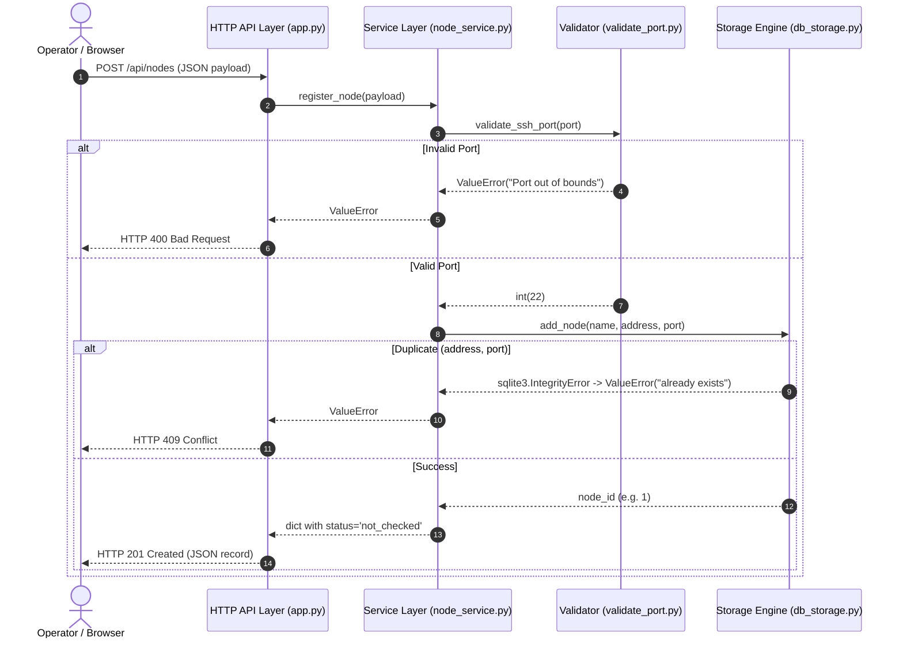

# Document 07: The HTTP API Layer — Connecting the Web to the Service

> Commit review by Codex, 2026-10-16: conceptual lesson; the actual Pydantic request model returns 422 for missing required fields, and HTTPException responses use `detail`. GET on a fresh database currently fails until registration initializes the table. The examples are not a complete verified API contract.

> **Where we are in the curriculum:**
> * Document 03: Inventory Concept & Registration Flow
> * Document 04: Networking Reality & Port Validation
> * Document 05: Database Persistence & SQLite Storage Engine
> * Document 06: Service Layer Integration
> * **Document 07 (This Document): The HTTP API Layer & Web Endpoints**

---

## 1. The Concrete Need: Why Can't the Browser Call Python Directly?

In [Practice 03](practice/practice-03-service-layer.md) and [`demo_milestone_01.py`](practice/demo_milestone_01.py), we successfully built and verified the complete registration pipeline:
1. `validate_port.py` validates the port boundaries.
2. `db_storage.py` writes to disk using SQLite and enforces the unique constraint.
3. `node_service.py` coordinates both and returns a clean dictionary.

However, all of this currently runs **inside a single local Python process**.

Our project requirement states:
> *"A **web-based** system managing multiple remote Linux nodes..."*

A web browser running on an administrator's laptop (or a script running on another server) cannot reach into your backend server's RAM to invoke `node_service.register_node()`.

Computers across a network communicate using standard network protocols. The standard language of the World Wide Web is **HTTP (HyperText Transfer Protocol)** over a TCP connection.

To make our service accessible over the web, we must build an **HTTP Web Layer (an API Controller)** that sits in front of our service layer.

---

## 2. What Actually Happens on the Wire? (First Principles)

An HTTP server is simply a continuous process that opens a TCP socket and listens on a specific port (such as `8000`).

When an administrator fills out a form in a web browser and clicks **"Add Node"**, the browser transmits a stream of raw text bytes over the TCP connection:

```http
POST /api/nodes HTTP/1.1
Host: 127.0.0.1:8000
Content-Type: application/json

{
  "name": "Lab Ubuntu 1",
  "address": "192.168.1.50",
  "port": 22
}
```

Here is what the HTTP Web Layer does with those bytes:

```
[ Incoming HTTP Bytes ]
        │
        ▼ (1. Parse HTTP Request: method, path, headers)
[ Web Controller (app.py) ]
        │
        ▼ (2. Extract JSON body & decode into Python dict)
[ Service Layer (register_node) ]
        │
        ▼ (3. Validate input & write to database)
[ SQLite Engine (inventory.db) ]
        │
        ▼ (4. Return record dict or raise Exception)
[ Web Controller (app.py) ]
        │
        ▼ (5. Map result to HTTP Status Code & serialize to JSON)
[ Outgoing HTTP Response Bytes ]
```

When the operation finishes, the server sends raw bytes back to the browser:

```http
HTTP/1.1 201 Created
Content-Type: application/json

{
  "id": 1,
  "name": "Lab Ubuntu 1",
  "address": "192.168.1.50",
  "ssh_port": 22,
  "status": "not_checked"
}
```

---

## 3. The HTTP Status Code Contract

When writing code inside Python, we use exceptions (like `ValueError` or `KeyError`).

However, network clients (browsers, command-line tools like `curl`, monitoring agents) do not speak Python exceptions. They speak **HTTP Status Codes**.

A status code is a 3-digit number defined by web standards ([RFC 9110](https://www.rfc-editor.org/rfc/rfc9110)) that tells the client whether the request succeeded, and if not, whose fault it was:

| Category | Range | Meaning | Example in Fleet Manager |
| :--- | :--- | :--- | :--- |
| **Success** | `2xx` | The action succeeded. | `201 Created` (Node saved to database) |
| **Client Error** | `4xx` | The client sent invalid data. The client must fix their request. | `400 Bad Request` (Port out of bounds) or `409 Conflict` (Duplicate node) |
| **Server Error** | `5xx` | The server encountered a bug or crash. The server must be fixed. | `500 Internal Server Error` (Disk full, database write failure) |

### Mapping Fleet Manager Outcomes to HTTP Status Codes

| Event in Service Layer | Python Result | HTTP Status Code | Response Body |
| :--- | :--- | :--- | :--- |
| Node passes validation and inserts into DB | Returns `{"id": 1, ...}` | **`201 Created`** | JSON record of the created node |
| Port is invalid (`99999`) or name is missing | Raises `ValueError` | **`400 Bad Request`** | `{"error": "Port must be between 1 and 65535"}` |
| Node already exists (`192.168.1.50:22`) | Raises `ValueError` (from DB `IntegrityError`) | **`409 Conflict`** | `{"error": "Node with this address and port already exists"}` |
| Unexpected bug or database corruption | Uncaught `Exception` | **`500 Internal Server Error`** | `{"error": "Internal server error"}` |

> [!IMPORTANT]
> **Why `409 Conflict` instead of `400 Bad Request` for duplicates?**
> A `400 Bad Request` means the syntax of the request was wrong (e.g., port was a string or out of range).
> A `409 Conflict` means the request syntax was completely valid, but the request cannot be processed because it conflicts with the current state of the database (the node already exists). Using `409` allows the frontend UI to display a specific, helpful message: *"This machine is already registered in your fleet."*

---

## 4. Why Use a Framework (like FastAPI)?

Could we build an HTTP server using Python's built-in `http.server` module without any third-party libraries?

**Yes.** But we would have to manually:
1. Parse the request URL and query parameters.
2. Read the `Content-Length` header and parse raw request body bytes.
3. Parse and serialize JSON strings manually.
4. Set headers (`Content-Type: application/json`) manually.
5. Handle concurrent connections using threading or socket multiplexing.

### Modern Solution: FastAPI

In modern Python systems, **FastAPI** is the industry standard for building backend APIs because:
* **Minimal Boilerplate:** A single decorator `@app.post("/api/nodes")` handles routing and HTTP verbs.
* **Automatic JSON Serialization:** Converts Python dictionaries directly to JSON responses.
* **Standards-Compliant:** Conforms to ASGI (Asynchronous Server Gateway Interface) and OpenAPI specifications.
* **Built-in Interactive Documentation:** Visiting `http://localhost:8000/docs` in your browser automatically generates a live, interactive UI (Swagger UI) where you can test your endpoints without writing any frontend code.

Here is how simple an HTTP route in FastAPI looks when wrapping our existing `node_service.py`:

```python
from fastapi import FastAPI, HTTPException, status
from node_service import register_node

app = FastAPI(title="Fleet Manager API")

@app.post("/api/nodes", status_code=status.HTTP_201_CREATED)
def create_node(payload: dict):
    try:
        return register_node(payload)
    except ValueError as e:
        error_msg = str(e)
        if "already exists" in error_msg:
            raise HTTPException(status_code=status.HTTP_409_CONFLICT, detail=error_msg)
        raise HTTPException(status_code=status.HTTP_400_BAD_REQUEST, detail=error_msg)
```

Notice how clean the separation is:
* The route function **does not** validate ports.
* The route function **does not** touch SQLite.
* It only translates HTTP requests into service calls, and service results back into HTTP responses.

---

## 5. The Complete 3-Tier Architecture in Action



---

## 6. Check Understanding

Before moving to the hands-on practice, test your mental model on this scenario:

### Question
An operator sends a `POST /api/nodes` request with the following JSON:
```json
{
  "name": "Backup Node",
  "address": "10.0.0.5",
  "port": 22
}
```
The database currently already contains a node with address `10.0.0.5` on port `22`.

1. Which layer of our architecture detects the failure first? (HTTP Layer, Validator, or Database?)
2. What HTTP status code should the client receive?

<details>
<summary><b>Click to check the worked answer</b></summary>

**Answer:**
1. **The Database Layer detects the failure first.** The port `22` is completely valid, so the Validator passes. Only the SQLite engine, checking its `UNIQUE(address, ssh_port)` index, detects that this pair is already in the database.
2. **`409 Conflict`**. The syntax of the request was valid, but it conflicts with the existing database state.

</details>

---

## 🛠️ Hands-on Practice Series

Now we are ready to build the HTTP server and verify it using live HTTP requests!

👉 **[Go to Practice 04: HTTP API Layer & Endpoint Verification](practice/practice-04-http-api.md)**\
*(We will build `app.py`, start the server on port 8000, and test registration using real HTTP requests with `curl` and interactive docs)*
