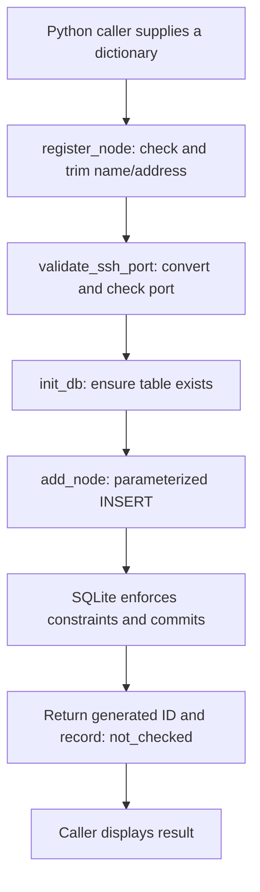

# Milestone Video 1: Before we can manage machines, we must remember them

AI-drafted by Codex on 2026-10-16, using Documents 01–06, the project charter, learning checkpoint, and inspected practice code. This is a storytelling and revision guide, not evidence of recording or independently demonstrated mastery. Commands below are rehearsal instructions; they were not executed for this documentation update.

[Video plan](../../VIDEO-PLAN.md) · [Learning checkpoint](../../LEARNING-STATE.md) · [Original lessons](README.md)

## The promise of this episode

**“I’m building a system to help an operator understand and safely manage remote Linux machines. Today, I’ll build its memory: which endpoints belong to our fleet, how we accept their details, and what saving them actually proves.”**

Suggested title: **Building Fleet Manager #1 — Why saving a server doesn't mean it's online**.

Aim for 12–15 minutes. The audience should leave able to trace one registration through the code and explain why every part exists. Use the narration as speaking prompts, not a script you must memorize. The detailed revision sections are preparation material; you do not need to read every row on camera.

Here, **Milestone 1 means the local Python inventory practice pipeline through Document 06**. The roadmap's full first feature also requires browser integration and further verification. This episode does not claim that broader feature is finished. Document 07 is the next chapter.

## Start with the operator's problem, not the tools

Use one recurring scenario: a college lab operator responsible for three Linux machines. These are story examples, not three connected machines demonstrated by this episode.

> “Imagine tomorrow morning a student says, ‘The lab server isn't working.’ Which server? Where do I connect? Is it really down, or can I just not reach it? And if I restart something, how do I know I helped?
>
> Fleet Manager is the system I'm building to help answer those questions. But before it can monitor or fix a machine, it needs to remember which machines we're talking about.”

Put the intended workflow on screen:

**Register → Observe → Investigate → Act safely → Verify the outcome**

Then highlight only **Register**. This is the episode's place in the larger product. Later monitoring needs targets; later operations need a selected target and verified identity; later evidence needs an association with the relevant node. Inventory supplies a starting record, not all those capabilities.

The storytelling rule: **introduce a problem, let the viewer predict a solution, show the mechanism, then reveal the next question.** Each component earns its place by solving the previous scene's problem.

## The episode, scene by scene

### 1. The hook: “I saved a server. Is it online?” — 0:00–0:45

**Show:** A prepared example record with `status: not_checked`, clearly labelled as a preview. Return to the real output during the demo.

**Say:** “I registered this node successfully. But I refuse to show a green ‘Online’ badge. By the end of this episode, that decision will make sense.”

**Question to carry forward:** What can this software honestly claim after saving an address?

### 2. Why a fleet needs an inventory — 0:45–2:00

**Show:** Three machine sketches, then an empty inventory table. Fill one row with a name, address, and SSH port.

**Say:** “With one machine, I might remember its details. With several machines, memory and scattered notes become a weak foundation. Software needs a structured record that it can list and reuse.”

Derive the fields from questions:

| Operator's question | Field | Meaning and boundary |
| --- | --- | --- |
| Which entry will I recognize? | `name` | Human label; not proof of identity |
| Where might I contact it? | `address` | IP or hostname text; reachability is unverified |
| Which SSH destination port? | `ssh_port` | Usually 22; storing it opens no connection |
| Which inventory record is this? | `id` | Database record identity; not authenticated host identity |
| What have we observed? | `status` | Initially `not_checked` |

**Transition:** “We have a place to write an address. But what does that address actually identify?”

### 3. An endpoint is a route, not an identity — 2:00–3:15

**Show:** Two private addresses behind a router, both using SSH port 22. Label this a simplified IPv4 LAN example.

**Say:** “The address tells us where to try; the port identifies the destination service endpoint. Two machines can both use port 22 because their addresses differ. Sharing a public address through NAT doesn't make them the same machine.”

Same Wi-Fi does not guarantee access: routing, firewalls, or client isolation may block it. DHCP can later assign an address to a different machine. Different address strings can also lead to the same host.

> “Address plus port is our current inventory uniqueness rule. It is not proof that we have identified a physical machine. Secure host-identity verification belongs to a later connection step.”

**Product connection:** A future remote action must not treat an inventory label as authentication.

**Transition:** “Even before connecting, we can reject details that make no sense.”

### 4. Validation: prevent a bad instruction from entering the workflow — 3:15–4:45

**Show:** `validate_ssh_port()` and the name/address checks in `register_node()`. Highlight only the relevant lines.

**Say:** “A port of 99999 is not a slow server or a network outage. It is invalid input. Catching it here prevents us from diagnosing an input mistake as a remote-machine failure later.”

Explain the contract: acceptable input becomes a usable value; unacceptable input raises an error. The current validator converts `"22"` to `22`, rejects booleans and floats, and enforces 1–65535. Name and address must be nonempty strings after trimming.

The Python detail earns a brief explanation: booleans behave like integers in some contexts, so a careless conversion could turn `True` into port 1. Conversion and validation are different responsibilities.

**Boundary:** The code does not yet validate IP/hostname syntax. Its `int()` conversion accepts some text forms that the proposed stricter lesson policy would reject. Do not claim complete input validation.

**Product connection:** A future browser form can offer helpful checks, but direct callers can bypass it. The service needs its own rules.

**Transition:** “Now the details make enough sense to save. Where should they live when Python stops?”

### 5. Persistence: Fleet Manager needs memory beyond a process — 4:45–6:30

**Show:** A Python dictionary disappearing when its process ends, then a database file remaining. Open the table definition and parameterized `INSERT` in `db_storage.py`.

**Say:** “A dictionary is useful while this program runs. If all our inventory lived there, restarting the program would lose it. The practice uses SQLite so records can be stored in a file and read by another process.”

SQLite is embedded: this practice does not require a separately running database server. That makes this small exercise straightforward; it does not establish suitability for every future workload or approve the final application stack.

Connect three mechanisms to three promises:

| Mechanism | What it contributes | Why Fleet Manager needs it |
| --- | --- | --- |
| Table schema | Named fields and selected constraints | Records have a consistent structure |
| Parameterized SQL (`?`) | Values are bound as data, not SQL syntax | Operator-entered text must not rewrite the query |
| Transaction commit | Finalizes the write before success is returned | “Registered” should not be reported before commit succeeds |

In this implementation, leaving `with sqlite3.connect(...)` successfully commits the transaction; an exception rolls it back. **That context manager does not itself close the connection**—connection cleanup is a remaining code concern.

Avoid “commit means no data can ever be lost.” Durability depends on configuration and storage. A process restart test establishes the narrower behavior it actually tests.

**Transition:** “What if the operator adds the same endpoint twice?”

### 6. Two guards, two different jobs — 6:30–8:00

**Show:** Valid port `22` passing validation, then an existing address/port pair hitting `UNIQUE(address, ssh_port)`.

**Say:** “The port is valid. The name is valid. But the record conflicts with what we already know. This is why input validation and database constraints solve different problems.”

The validator asks: **Does this input satisfy our rules?** The unique constraint asks: **Would this write violate the stored-data rule?**

Checking for a duplicate before insertion can help messages, but alone leaves a race: two callers could both see no row before either writes. The database constraint enforces the rule at the write boundary. This is the reason for the mechanism, not a claim that concurrency has been tested here.

**Product connection:** Duplicate entries could later produce confusing target lists or duplicated work. The current rule blocks the same stored address/port pair; it does not deduplicate all aliases of a real host.

A duplicate rejection also does not make a future remote command safe to retry. **Atomicity** concerns a transaction's all-or-nothing changes; **idempotency** concerns the effect of repeating an operation.

**Transition:** “Who makes sure these pieces run in the right order?”

### 7. The service turns separate tools into one operation — 8:00–9:30

**Show:** Trace this actual practice flow with one payload:



**Say:** “The service is our application operation: register a node. It coordinates the validator and storage. The validator doesn't need to know SQL; storage doesn't need to know HTTP. Today a Python script calls this service. Later an HTTP handler could call it.”

Use the real contract: `register_node(payload, db_path=...)`. Input uses `port`; the returned record uses `ssh_port`. The result is a Python dictionary here, not an HTTP response or transmitted JSON.

These are logical responsibilities within a local program, not separately deployed microservices. Separation helps us explain and exercise the workflow without first building a web interface.

**Transition:** “We have returned a record. Now let's resolve the opening question: why isn't it ‘Online’?”

### 8. The payoff: registration is a fact; health needs evidence — 9:30–10:15

**Show:** `status: not_checked`. Beside it: “Saved endpoint: yes. Connection attempted: no.”

> “Contact save karna aur call connect hona alag baat hai. I have saved where we intend to connect. I have not contacted that machine. ‘Not checked’ is the accurate answer.”

This same discipline will matter throughout Fleet Manager: a timeout does not prove the host is powered off; a missing CPU observation is not 0% CPU; an accepted command is not proof of the desired outcome.

**Product connection:** The future dashboard must distinguish knowledge from assumptions before an operator chooses an action.

### 9. Demonstrate the promises — 10:15–13:15

Before every action, say what you expect. Afterward, point to the relevant row or error and say what it establishes. Use the runbook below.

Keep the sequence: valid registration → invalid port → duplicate → original row still present → read from a second process. Treat invalid and duplicate entries as expected rejections, not simulated host failures or outage recovery.

### 10. Close one question; open the next — 13:15–14:00

> “We can now register an endpoint through our local Python service, reject these bad inputs and duplicate entries, and read the saved record. We also know why it must say ‘Not checked.’
>
> But an operator should not have to import my Python function to use Fleet Manager. How does a browser ask this service to do the same job? That is the next chapter: the HTTP boundary.”

Only include the second-process claim after successfully performing that demonstration. Show future HTTP → service → storage as a **planned extension**, not current functionality. End with that concrete unresolved need, rather than a list of technologies.

## Recording runbook and evidence limits

Open these files in advance: [service](practice/node_service.py), [validator](practice/validate_port.py), [storage](practice/db_storage.py), and [demo](practice/demo_milestone_01.py). Keep terminal text readable. Use example addresses; no remote connection is made by this demo.

From the repository root in PowerShell, run the existing demo in a fresh temporary working directory so its fixed database filename cannot overwrite an earlier working copy:

```powershell
$practicePath = (Resolve-Path .\fleet-manager\docs\learn\node-inventory\practice).Path
$demoDir = Join-Path ([System.IO.Path]::GetTempPath()) ('fleet-m1-' + [guid]::NewGuid().ToString('N'))
New-Item -ItemType Directory -Path $demoDir | Out-Null
Push-Location $demoDir
try {
    python (Join-Path $practicePath 'demo_milestone_01.py')
} finally {
    Pop-Location
}
```

| Action | Expected visible result | What that establishes |
| --- | --- | --- |
| Register `Lab Ubuntu 1` | Trimmed name, generated ID, `not_checked` | This registration path completed |
| Try port `99999` | Range error | This invalid port was rejected |
| Repeat `192.168.1.50:22` with another name | Duplicate error | This exact endpoint pair was rejected |
| Query saved rows | Original row remains | Saved data can be read through another connection in this process |

**Important:** The script's Step 5 says “across restarts,” but it never restarts Python. It also prints a success footer unconditionally, even if a branch prints `[FAIL]`. Do not use its footer or exit code alone as a test verdict. Inspect each result. It deletes its demo database at the end, so rerunning the script is not a restart-persistence experiment.

For a real two-process demonstration, use the same PowerShell session and the `$practicePath` established above. Each `python -c` below starts and exits a separate process. A fresh temporary directory keeps the database separate from normal inventory:

```powershell
$restartDir = Join-Path ([System.IO.Path]::GetTempPath()) ('fleet-m1-restart-' + [guid]::NewGuid().ToString('N'))
New-Item -ItemType Directory -Path $restartDir | Out-Null
$restartDb = Join-Path $restartDir 'inventory.db'

# Process A: register and exit.
python -c 'import sys; sys.path.insert(0, sys.argv[1]); from node_service import register_node; print(register_node(dict(name="Revision Lab", address="192.0.2.10", port=22), db_path=sys.argv[2]))' $practicePath $restartDb

# Process B: read the same file after A has exited.
python -c 'import sys; sys.path.insert(0, sys.argv[1]); from db_storage import list_nodes; rows=list_nodes(sys.argv[2]); print(rows); assert len(rows)==1 and rows[0][1:]==("Revision Lab", "192.0.2.10", 22, "not_checked")' $practicePath $restartDb
```

Expected: Process B prints the row written by A and exits successfully. Stop and investigate any error before recording a success claim. These commands use the installed `python` command; shell/version compatibility has not been rehearsed in this documentation session. Temporary directories are left available for inspection.

This demonstrates process-lifetime persistence for one record. It does not demonstrate power-loss recovery, production concurrency, remote connectivity, or a running web application.

## Revision: how the pieces combine into Fleet Manager

Think in groups of responsibilities rather than a list of definitions:

| Group | Pieces learned | What the group contributes to the eventual product |
| --- | --- | --- |
| Describe a target | Name, address, port, record ID; LAN/NAT; endpoint versus identity | A selectable inventory entry, with explicit limits on what it identifies |
| Accept an instruction | Input contract, type checks, trimming, range checks, exceptions | A predictable registration boundary that future callers can reuse |
| Remember consistently | Schema, SQL parameters, transaction, commit, unique constraint | Persistent records with selected integrity rules |
| Coordinate the operation | Service function, validator, storage, returned dictionary | One understandable registration workflow independent of presentation |
| Report knowledge honestly | `not_checked`; observation versus health; missing versus zero | A foundation for evidence-based monitoring and safe operator decisions |
| Establish evidence | Predict, run, inspect, reproduce, explain limits | Demonstrations that support specific claims rather than “everything works” |

SQLite inventory and future Prometheus data serve different purposes. Inventory answers **“What endpoints have we registered?”** Prometheus will store time-series observations such as **“What CPU value was collected at this time?”** Grafana will visualize monitoring data. Their integration is future work; do not imply that saving an inventory row already creates a scrape target.

Later controlled operations will also need authorization, verified host identity, bounded execution, audit records, and outcome checks. Inventory provides context for choosing a target; it grants no permission to execute commands.

### Where the eight engineering pillars fit today

| Pillar from Document 02 | Connection to this milestone | Evidence boundary |
| --- | --- | --- |
| Distributed systems | Registration is distinct from remote observation; partial failure and retry safety motivate future design | No distributed operation demonstrated |
| Backend engineering | Validation, storage, and service coordination | Local practice code exists; HTTP integration is next |
| Linux internals | Address/SSH port describe an intended connection destination | No process, systemd, or real SSH experiment here |
| Observability | Record what is known; don't manufacture health or metric values | Prometheus/Grafana not demonstrated |
| Security | Bind SQL values as data; don't confuse an endpoint with authenticated identity | No end-to-end security claim; SSH and authorization remain future work |
| Reliability | Reject these invalid/duplicate requests; preserve an honest initial state | No node-failure or automatic-recovery demonstration |
| Reproducibility | Isolated demo data and explicit expected/observed results | Existing demo has the limitations documented above |
| Performance | Ask what workload has actually been measured | No scale or latency benchmark performed |

The engineering loop from Document 01 becomes concrete: understand the operator's problem → design a registration flow → justify its pieces → implement the practice → exercise success and failure → inspect unexpected behavior → explain the result → improve within the next approved scope. Reading about a pillar is not evidence of having implemented it.

### Keep these distinctions ready for revision or a viva

| Often confused | Precise distinction |
| --- | --- |
| Registration / verification | Saving details / gathering evidence about the remote endpoint |
| Endpoint / host identity | Where to try connecting / which trusted host actually answered |
| Inventory ID / host identity | Local row identifier / authenticated remote identity |
| Validation / constraint | Input rules in application code / stored-data invariants enforced by the database |
| Normalization / security | Trimming whitespace changes representation; it does not replace SQL parameters or authentication |
| Dictionary / JSON | Python object / a serialization format that future network messages may use |
| Commit / connection close | Transaction completion / resource release |
| Atomicity / idempotency | A transaction commits together / repeating an operation preserves its intended effect |
| Layers / deployed services | Responsibilities in code / separately running processes or systems |
| Successful script exit / verified behavior | Process outcome / checking the actual expected results |

### Known gaps to explain briefly, not hide or fix during recording

The current practice requires all three input keys; missing keys can raise `KeyError`. Address checking is limited to nonempty text. Strict port-string policy remains unresolved. The schema lacks a port-range `CHECK`, so direct storage calls can bypass that application rule. Storage maps every `IntegrityError` to a duplicate message, which is too broad. Connection cleanup needs attention. The demo is illustrative and not an assertion-based regression suite.

These gaps do not erase the lesson. They bound the claim: **a working local registration practice with specific demonstrated paths**, not complete onboarding or a production-ready fleet manager. Future HTTP error handling needs a dependable error distinction; matching exception-message text is not a robust contract.

## Make it watchable without sacrificing the engineering

Stay with the same lab operator and node across the episode. Switch between the problem sketch, a short code excerpt, and visible output when the question changes. Avoid reading whole files or introducing all eight pillars as a lecture before anything happens.

Use a small prediction before each reveal: “Will a new name bypass the duplicate rule?” or “What should survive when Python exits?” Resolve each question on screen. The opening `not_checked` mystery supplies the episode's payoff; the need for a browser supplies the next episode's hook.

Keep one focused rehearsal exercise: **Without reading the guide, trace one valid registration, then explain where the same endpoint with a different name is rejected and why neither result tells us whether Linux is online.** Aim for 90 seconds. If a step feels unclear, revise that step before recording. This is an invitation to demonstrate understanding, not a completed assessment.

Recording readiness means you can explain that trace, the rehearsal produces the expected results, and your narration respects the evidence limits. Engineering completion, learning demonstration, and video completion remain separate checkpoints.
