# SWFW_5S_12

**Distributed Linux Fleet Management**

Technical report and manual-acceptance handoff

**Adarsh Singh**

Prepared: **9 November 2026**

Product workflow: **Monitor → Understand → Operate → Audit**

Release assessment: **READY WITH LIMITATIONS**. Local implementation and deterministic QA are distinct from live deployment acceptance. No deployment or cloud security change was made in this release run. All developer manual acceptance tests remain PENDING.

## 1. Problem, objectives and scope

Managing multiple Linux machines requires dependable inventory, secure host identity, current observations, understandable telemetry and traceable operations. A reachable SSH endpoint is not proof that all services are healthy; a missing metric is not zero; an uncertain operation must not be silently replayed.

SWFW_5S_12 implements a web-based controller for onboarding and managing Linux nodes, collecting/storing/visualizing metrics through mandatory Prometheus and Grafana, detecting availability with graceful degradation, and executing explicitly controlled read-only commands. The reported demonstration topology is one controller and three independently isolated Linux nodes. This is a single-administrator system, not a multi-tenant platform or full RBAC product.

The local charter records a submission window of **2 November 2026, 10:00 AM to 5 November 2026, 5:00 PM**. The supplied execution request also mentions **12 November 2026, 5:00 PM IST**. No independent local official artifact establishes that later date. Organizer confirmation is required; this report does not invent an extension. Packaging proceeds regardless.

## 2. Mandatory complete system flow diagram

The following diagram is embedded directly in this PDF. It reflects the current source implementation, not an assertion about the deployed cloud build. Prometheus scraping runs independently of the onboarding UI; flow arrows describe the operator journey and data dependencies, not one synchronous request.

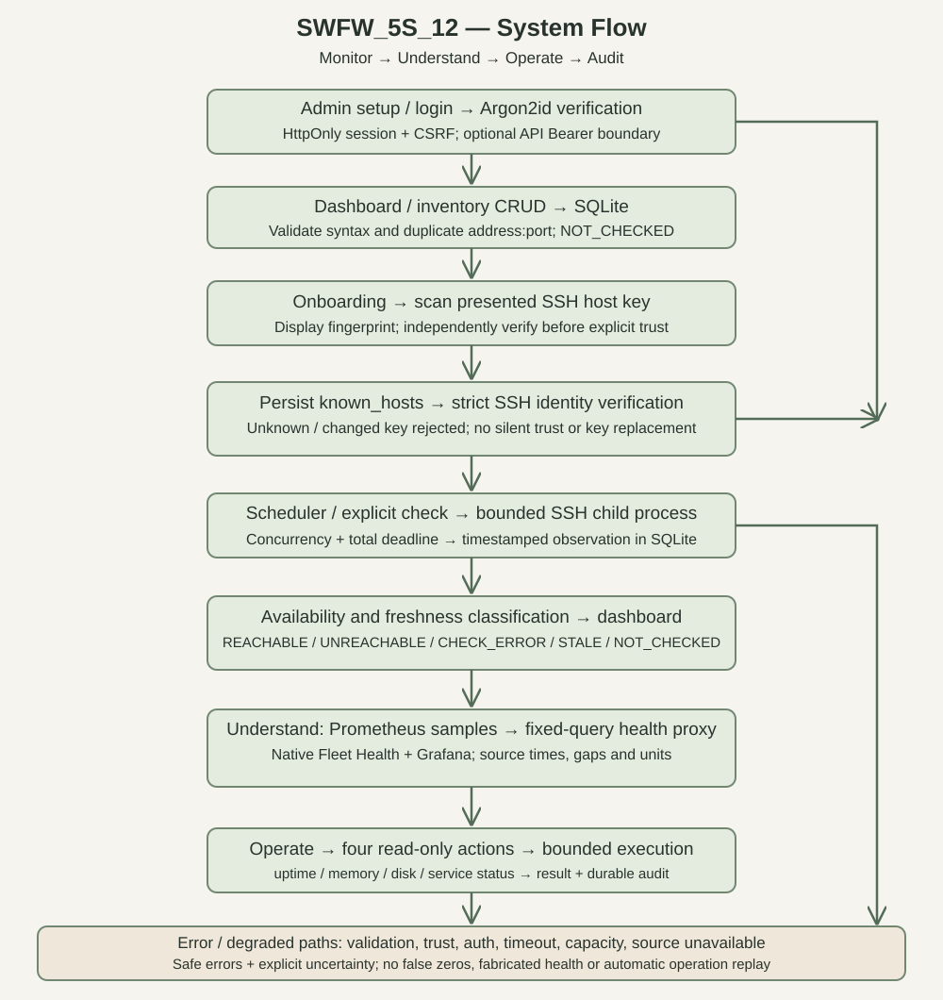

## 3. Architecture and technology choices

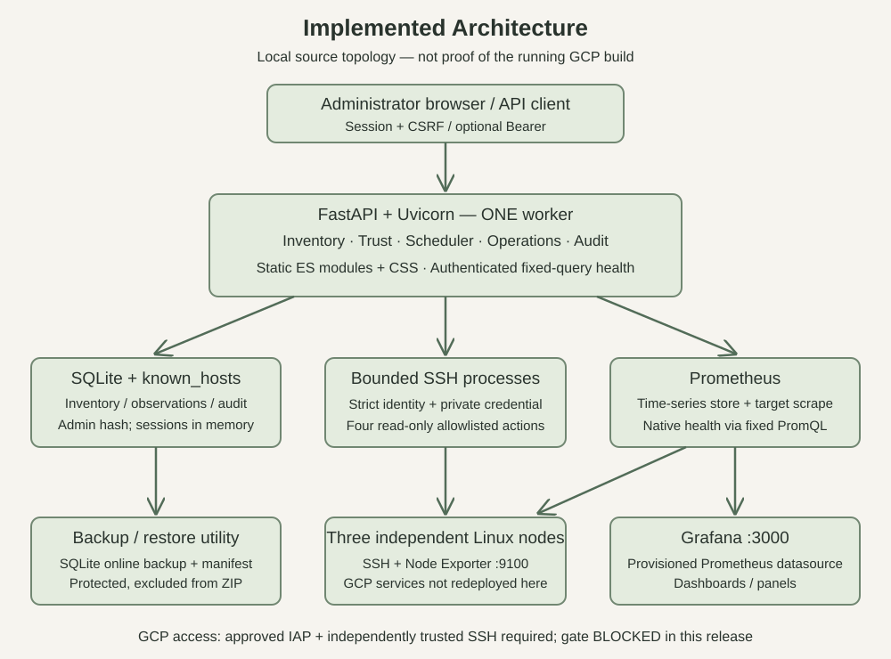

Python 3.12 and FastAPI provide typed HTTP boundaries and explicit application lifecycle management. Uvicorn runs exactly one worker because admission locks, scheduler state, sessions and metrics registries are process-local. SQLite supplies transactional local persistence for inventory, connectivity observations, administrator credential hash and operation audit; it is not used as a substitute time-series store.

Paramiko handles SSH authentication and strict pinned identity. Child-process execution bounds DNS/connection/authentication and operation work. ES modules, HTML, CSS and native SVG charts keep the UI build simple without introducing a frontend framework. Prometheus stores scraped time series; Grafana uses provisioned datasource/dashboard configuration. uv.lock fixes the dependency resolution. No new package was installed for report rendering; installed Chrome renders the PDF.

Code boundaries: `main.py` owns HTTP/lifecycle wiring; inventory rules and repository own normalization/persistence; connectivity owns scan/trust/check/scheduling; operations owns validation/admission/execution/audit; security owns passwords, sessions and API access; metrics owns fixed-query health adaptation; UI owns operator presentation.

## 4. Security and administrator authentication

Browser-first initialization is explicitly enabled with password authentication and an unused local database. First-run setup stores an Argon2id administrator password hash. Login produces an HttpOnly session cookie with SameSite protections and Secure when served over HTTPS. Server-side session storage keeps SHA-256 verifiers rather than raw session secrets. Default inactivity expiry is 30 minutes; absolute expiry is 12 hours. Restart invalidates in-memory sessions.

Mutating session requests require CSRF protection and strict same-origin Origin/Referer checks. Login throttling bounds repeated attempts; sign-out removes the session. Configured API Bearer access remains compatible for scripts. The application does not provide multi-user identity, roles or distributed session replication. Keep local HTTP on 127.0.0.1; HTTPS and reviewed deployment boundaries are required for remote access.

`CHANGEME` remains only an explicitly documented restricted loopback/demo bootstrap with mandatory replacement. The submission does not introduce a permanent known credential. Private SSH keys, runtime databases, environment secrets and browser profiles are excluded from the ZIP.

## 5. Inventory and node onboarding

Inventory supports node registration, listing, changes/deletion and SQLite persistence. Input normalization validates IPv4, IPv6, FQDN/hostname syntax and port range, rejects invalid/duplicate endpoints and keeps syntax acceptance distinct from DNS resolution. Registration starts as NOT_CHECKED; it does not imply trust or connectivity.

Onboarding scans a presented host key and shows its SHA-256 fingerprint. A first-contact scan is not independent proof of identity: the administrator must compare through a trusted console/channel, then explicitly trust it. Enrollment persists a known_hosts entry. Unknown/changed keys are not automatically accepted; mismatches must be rejected. Non-root authorized user credentials stay outside source. Safe errors distinguish identity, credentials, name resolution, connection refusal, deadline and uncertain transport failure without exposing secrets.

## 6. Availability, bounds and controlled operations

Connectivity checks use bounded child processes, per-node exclusion, a process-wide capacity limit and a whole-check deadline. Default SSH concurrency is four and total timeout twelve seconds. The scheduler periodically observes with bounded jitter. Observation outcome and freshness are separate: REACHABLE, UNREACHABLE and CHECK_ERROR describe the latest usable observation; STALE denotes expired evidence; NOT_CHECKED denotes absence. A failed refresh must not masquerade as a new healthy result.

The only four operations are `system.uptime`, `system.memory`, `system.disk` and `service.status`. Typed validated arguments compile into allowlisted commands; there is no arbitrary browser shell. Disk paths must be validated absolute POSIX paths and service names follow the explicit safe grammar. Defaults bound admitted operation duration to fifteen seconds, output to 65536 bytes and concurrent jobs to four. Same-node conflict is 409, saturation is 429 and admitted timeout/shutdown paths use explicit 503 handling where defined by the API.

Audit records persist target, action/arguments, IDs, timestamps, terminal outcome, exit status, failure category, output and truncation. UI output is rendered as text. Unknown or interrupted outcomes are not automatically replayed. Startup reconciles interrupted RUNNING records to UNCERTAIN rather than fabricating successful completion. Read-only does not mean zero information sensitivity: protect audit outputs and backups.

## 7. Prometheus, Grafana and native Fleet Health

Prometheus scrapes application metrics and Node Exporter targets, storing history independently of SQLite. Grafana provisioning defines its Prometheus datasource and monitoring dashboard. The authenticated native `/api/nodes/{node_id}/health` proxy selects registered-node targets and fixed PromQL; it is not an arbitrary query or URL proxy. Queries and responses have explicit bounds, including two-second query timeout and twelve-second whole-request deadline.

Native charts expose CPU and memory percent, filesystem capacity and network receive/transmit B/s where source data exists. CPU/network are five-minute rates. Source timestamp companion queries distinguish exporter sample time from query evaluation time; oldest contributing samples conservatively determine derived freshness. Repeated source timestamps are not counted as new observations. Missing, invalid, nonfinite, negative or future measurements do not become false zeroes; invalid samples retain gaps. Empty, collecting, stale and unavailable states remain explicit. Chart tooltips report source time and units; there is no fabricated interpolation.

The browser QA fixture injects Prometheus and SSH results. Its screenshots prove rendering and interaction only, not real exporter collection, live metric accuracy or cloud service health. This report contains no fresh verified Grafana panel screenshot because IAP/SSH prerequisites were blocked.

## 8. Build, local setup and deployment boundaries

The submitted project includes source, tests, locked configuration, systemd units, monitoring provisioning, backup utility and deployment runbook. From the extracted source directory, install the locked Python environment and start a fresh loopback instance:

```powershell
uv sync --locked
$env:FLEET_MANAGER_ENABLE_PASSWORD_AUTH='true'
$env:FLEET_MANAGER_DATABASE_PATH=(Join-Path $PWD '.local\manual-acceptance\inventory.db')
Remove-Item Env:FLEET_MANAGER_INITIAL_PASSWORD -ErrorAction SilentlyContinue
uv run --no-sync uvicorn fleet_manager.main:app --host 127.0.0.1 --port 8000 --workers 1
```

Open `http://127.0.0.1:8000/dashboard`. Choose a unique password in setup. Existing database credentials lead to login instead. Refer to the included manual checklist for exact original-workspace first command and safe SSH configuration. Never package the resulting runtime database or key.

Source topology ports are API 8000, Prometheus 9090, Grafana 3000 and Node Exporter 9100. Source GCP internal topology is controller 10.160.0.2, node-a 10.160.0.5, node-b 10.160.0.3, node-c 10.160.0.4. These values are configuration, not evidence that ports currently serve applications. The Linux runbook describes a single unprivileged service account, reviewed key paths, systemd lifecycle, Prometheus provisioning and Grafana. Deployment scripts can mutate infrastructure and are included for reproducibility, NOT executed or authorized by this report. No local code was deployed to GCP in this run.

Recompile the submission using installed Chrome:

```powershell
uv run --no-sync python scripts/compile_submission.py
```

The compiler checks required files/embedded diagram references, excludes runtime/secrets/recursive bundles, scans private-key headers, produces the exact required filenames, validates ZIP CRC, clean extraction and file hashes, and syntax-compiles extracted source. SHA256SUMS.txt and package-manifest.json describe the outputs. PDF bytes may vary with renderer metadata between compilations; ZIP metadata is normalized for identical inputs. This is repeatable compilation, not a claim of bit-identical PDF rendering.

## 9. Backup, restore and troubleshooting

The SQLite online-backup utility produces a protected backup with integrity/manifest information. Restore targets a new path after validation; do not overwrite an active database. Run the isolated utility self-test before touching user data:

```powershell
uv run --no-sync python scripts/backup_restore.py verify
uv run --no-sync python scripts/backup_restore.py backup SOURCE DESTINATION
uv run --no-sync python scripts/backup_restore.py restore BACKUP NEW_TARGET
```

Backups may contain password hashes and sensitive audit output; restrict access and exclude from submission. Preserve known_hosts and external credentials through a separately secured process; a SQLite backup does not provision the remote hosts.

Troubleshooting: 401 means inspect session/Bearer state; 403 inspect CSRF/origin and mandatory password replacement; 409 inspect same-node admission or duplicate endpoint; 429 wait for capacity without blind replay; 503 inspect configuration, storage, shutdown or admitted timeout details. Host-key mismatch requires independent investigation, not deleting the pin. Missing metrics require checking actual targets/source age, never injecting zeroes. Keep one worker. Inspect systemd journal read-only only after separately authorized trusted access.

## 10. Fresh tests and acceptance evidence

Fresh QA commands, timestamps, exits, counts and warnings are embedded below from the release evidence. Test support for scenarios 08–13 uses temporary databases and injected transports. Simulated outcomes intentionally leave live gates unmet and the all-scenario offline runner exits 2. A successful unit suite does not establish cloud acceptance.

##### Final fresh local QA — 9 November 2026

Author: Cline / QA teammate, Windows PowerShell. Final results after the malformed-cookie fix:

- Python: **535 passed, 7 pre-existing warnings**, 150.55 seconds, exit 0. Warnings: one Starlette/httpx TestClient deprecation and six per-request-cookie deprecations. No warning suppression or dependency changes.
- Frontend: **74 pass executions / 37 unique tests** through two compatibility entry points, exit 0. Node experimental VM module notices retained.
- Browser CDP: normal **126 assertions**, first-run **117 assertions**, both exit 0 and cleanup true, zero unexpected console/network failures. SSH, scans, operations and Prometheus are **MOCKED / DEMO**, not live metrics.
- Ruff lint and format check src/tests/scripts PASS; Mypy strict PASS (50 source files); whitespace check PASS (line-ending warnings retained).
- Offline wheel and sdist build PASS using pre-existing cached hatchling/dependencies via PYTHONPATH, no package installation. Exact path list is included for this workstation; a clean machine uses the locked build-system backend through uv normally.
- Acceptance all 14: exit **2**, **2 local passes / 6 skipped / 6 simulated / 0 failed**. No live gate closed by simulations.
- Focused packaging regressions: 16 pass / 1 existing warning before final full suite; acceptance-specific regression suite 37 pass, related connectivity/freshness 38 pass.

Initial failed invocations retained locally: frontend missing required experimental VM flag; build missing active-env hatchling (resolved through existing cache); a shell-limited partial pytest (not counted). Final normal browser first attempt hit Windows PermissionError reading its owned DevToolsActivePort, before driver launch; cleanup true. Sequential retry passed 126 assertions. No product assertions weakened. Initial full baseline was 530 tests; five malformed-cookie regression variants increased final count to 535.

#### Exact final command records

| Check | Start UTC | End UTC | Exit | Exact command |
| --- | --- | --- | --- | --- |
| final_browser | 2026-11-09T08:35:53.5699266Z | 2026-11-09T08:36:02.7095956Z | 1 | `.venv\Scripts\python.exe scripts/run_browser_qa.py` |
| final_browser_retry | 2026-11-09T08:37:07.7901550Z | 2026-11-09T08:37:54.6092679Z | 0 | `.venv\Scripts\python.exe scripts/run_browser_qa.py` |
| final_build | 2026-11-09T08:35:53.5989482Z | 2026-11-09T08:35:56.9118464Z | 0 | `uv build --offline --no-build-isolation --out-dir C:\Users\adars\Desktop\ZOHO\SWFW-12-Sem5\fleet-manager\.local\final-release\20261109T135321\qa-20261109T082946Z\final-dist` |
| final_diff | 2026-11-09T08:35:53.3882812Z | 2026-11-09T08:35:53.8699483Z | 0 | `git diff --check` |
| final_first_run | 2026-11-09T08:35:53.4799411Z | 2026-11-09T08:36:40.7748799Z | 0 | `.venv\Scripts\python.exe scripts/run_browser_qa.py --first-run` |
| final_format | 2026-11-09T08:35:53.4169780Z | 2026-11-09T08:35:53.9147198Z | 0 | `.venv\Scripts\python.exe -m ruff format --check src tests scripts` |
| final_frontend | 2026-11-09T08:35:53.5224959Z | 2026-11-09T08:35:54.7519509Z | 0 | `node --experimental-vm-modules --test tests/dashboard_modules.cjs tests/dashboard_regression.cjs` |
| final_lint | 2026-11-09T08:35:53.3340649Z | 2026-11-09T08:35:53.8895133Z | 0 | `.venv\Scripts\python.exe -m ruff check src tests scripts` |
| final_mypy | 2026-11-09T08:35:53.3480430Z | 2026-11-09T08:35:55.3475913Z | 0 | `.venv\Scripts\python.exe -m mypy src` |
| final_python | 2026-11-09T08:35:53.5244975Z | 2026-11-09T08:38:26.4353531Z | 0 | `.venv\Scripts\python.exe -m pytest -q` |

#### Inspection and evidence limits

Reviewed inventory syntax/normalization, strict SSH trust, bounded check/operation execution, availability/freshness, four-action catalog, session/CSRF/origin and fixed-query metrics paths. Confirmed malformed non-ASCII cookie caused request-level 500; fixed by validating generated 43-character URL-safe token grammar before lookup/revocation hashing. Regression verifies protected API 401, intentionally public session status 200/authenticated:false and idempotent logout 200. No auth bypass claimed.

Prometheus response length is validated after HTTPX buffers the body (262144-byte validation limit), not a hard streaming memory cap. The Prometheus URL is trusted operator configuration; hostile-server resource exhaustion was not experimentally tested. Host scan DNS/phase deadlines were not newly live-tested against hostile infrastructure. Single-worker process-local semantics remain mandatory.

No genuine live SSH, exporter, Prometheus, Grafana, independent-host failure/recovery or deployment-identity proof was obtained. No browser fixture is used as live evidence. All developer manual testing remains PENDING.


##### Fresh 14-scenario acceptance matrix — 9 November 2026

Command: `uv run --no-sync python scripts/gce_acceptance_test.py --mock`.
Also verified with `--mock --allow-fault-injection`. Both exit **2**: total 14, PASSED 2, SKIPPED 6, SIMULATED 6, FAILED 0. This is intentionally incomplete acceptance, not a green live gate. Regression tests establish that simulation success never closes live acceptance. `--allow-fault-injection` does not authorize or implement destructive cloud tests.

| ID | Exact scenario | Fresh local result | Unmet genuine/manual requirement |
| --- | --- | --- | --- |
| 01 | Authentication Boundary | PASS local missing/invalid 401, valid 200 | Deployed auth boundary not reverified |
| 02 | Controller-origin SSH Connectivity | SKIPPED | Three actual CONNECTED observations from controller |
| 03 | Inventory Onboarding & Trust | SKIPPED manual | Independent host fingerprint comparison and explicit trust |
| 04 | Availability & Freshness Derivation | SKIPPED | Three fresh real CONNECTED/REACHABLE observations |
| 05 | Controlled Remote Operations | SKIPPED | Nine real successful uptime/memory/disk outputs and matching audit |
| 06 | Prometheus Scrape Pipeline | SKIPPED | Four actual up=1 targets and stored range samples |
| 07 | Grafana Service/Datasource/Dashboard | SKIPPED | Live service/data/dashboard plus genuine rendered panels |
| 08 | Invalid Credentials | SIMULATED | Injected AUTH_FAILED persists as CHECK_ERROR; real SSH rejection pending |
| 09 | Host-Key Mismatch Rejection | SIMULATED | Injected mismatch persists as CHECK_ERROR; genuine transport identity rejection pending |
| 10 | Timeout & Unreachable Node Handling | SIMULATED | Four injected categories; actual bounded deadline measurement pending |
| 11 | Transient Outage Node Recovery | SIMULATED | New manual injected CONNECTED observation; automatic scheduler/live recovery pending |
| 12 | Partial Fleet Failure Resilience | SIMULATED | Three local records, two reachable/one unreachable; independent-host outage/concurrency pending |
| 13 | Controller Crash Reconciliation | SIMULATED | Seeded RUNNING record becomes UNCERTAIN on lifespan restart, terminal record preserved, idempotent; actual process crash pending |
| 14 | Disaster Recovery: Backup & Restore Pre-Flight | PASS local | Empty temporary SQLite integrity/manifest/restore; nonempty deployed recovery pending |

#### Scenario 08–13 classification

These were missing harness capability, not established missing product behavior. Deterministic test support now exercises persistence/classification/recovery/reconciliation using injected transports and temporary databases. Existing transport/security tests cover additional boundaries. No VM was stopped, no cloud credential/key changed and no network fault introduced. The live runner still reports these scenarios SKIPPED/NOT IMPLEMENTED because genuine infrastructure fault handling cannot be proven by injection.

Manual procedures: `submission/MANUAL-ACCEPTANCE-CHECKLIST.md` sections 5–8 and 14; `docs/DEPLOYMENT-RUNBOOK.md` section 15. All developer manual tests remain PENDING. Local simulation is useful regression evidence but not equivalent to three independently isolated Linux hosts, real deadlines, real host-key rejection, background scheduling or an actual crash.

## 11. Fresh GCP safety verification and deployed-build limits

### GCP read-only safety assessment — final closeout

Prepared 9 November 2026 using the existing gcloud session. Project and active principal were verified; principal email and raw SSH metadata remain only in local evidence, not this sanitized submission record. Project: project-3682976b-7d4a-465a-933; zone: asia-south1-a.

### Initial and final observations

Initial read window: 08:25:39–08:25:51 UTC. Final closeout: 08:39:25–08:39:35 UTC, 9 November 2026. All 19 closeout read-only requests succeeded. These are separate reads, not continuous or atomic monitoring.

| VM | Initial / final state | Initial / final internal IP | External IP / accessConfigs | Disk unchanged |
| --- | --- | --- | --- | --- |
| fleet-controller | RUNNING / RUNNING | 10.160.0.2 / 10.160.0.2 | None / absent in both | Same ID, attachment, 20 GiB pd-balanced, READY |
| fleet-node-a | RUNNING / RUNNING | 10.160.0.5 / 10.160.0.5 | None / absent in both | Same ID, attachment, 10 GiB pd-standard, READY |
| fleet-node-b | RUNNING / RUNNING | 10.160.0.3 / 10.160.0.3 | None / absent in both | Same ID, attachment, 10 GiB pd-standard, READY |
| fleet-node-c | RUNNING / RUNNING | 10.160.0.4 / 10.160.0.4 | None / absent in both | Same ID, attachment, 10 GiB pd-standard, READY |

Full allowlisted per-VM identity/NIC/accessConfig/disk projections and comparisons are included in cloud-sanitized.json. No reserved address or Cloud Router was returned in the inspected project; that is not proof of no guest/proxy egress. NIC external NAT accessConfig and Cloud NAT are different resources. No absent accessConfig was invented or restored.

### IAP and SSH safety gate: BLOCKED on all four

Effective NIC firewall reads permit 35.235.240.0/20 TCP22 for actual controller/node tag scope, with no returned higher-priority deny. Controller matching rule priority 65534; node matching rule priority 1000. Internal VPC SSH is also allowed, so observed rules are not proof of exclusively IAP ingress. No packet-path test was performed.

Project policy grants were observed, but full inherited deny/access-context/per-resource effective IAP authorization was not established. Installed stable CLI lacks the requested IAP policy read; beta help attempted component bootstrap and failed non-interactively. No installation workaround followed. This is a tooling/verification gap, not proof of denied permission.

Existing public identity matches controller OS Login and node-a instance authorization, not node-b/c instance keys. Private key file existence/ACL were inspected without reading contents; usable private/public pairing and guest authorization were not proved. Existing named known_hosts entries lack independently established current host-key provenance. This blocks strict identity verification. No key scan, key generation, upload, SSH, tunnel or port forward was attempted.

### Cleanup, normalization and evidence limits

No VM power/NAT/disk/firewall/IAM/metadata/SSH-key/VPC/route/DNS mutation occurred; no public IP was allocated by this run. Initially absent configurations stayed absent and all VMs stayed RUNNING. VM RUNNING and disk READY are control-plane states, not application/guest health.

Initial raw node-metadata comparisons differed because the collector initially could not parse username-prefixed SSH records; corrected parsing produced fingerprints. Metadata version fingerprints and non-SSH values stayed equal, and corrected-final versus closeout metadata matched. Original raw SSH key-content equality cannot be reconstructed from the first sanitized representation. Raw firewall ordering differences normalize to equal full rule content. The report does not falsely claim all initial raw metadata bytes were proved equal.

Deployed commit/build, /api/auth routes, native health, controller API readiness, Prometheus targets and actual scrape times/durations/errors, exporter endpoints, real CPU/memory/uptime/filesystem/network samples, internal DNS and Grafana service/panels are NOT freshly verified. Historical November 8 results remain historical, not current proof. No failure/recovery was manufactured. Next action requires independently authenticated host-key attestations and complete effective IAP/authorized identity proof before connectivity.


The historical 8 November records conflict in time and cannot establish the current service state. Historical healthy targets/exporters/DNS and IAP resets are context only. Local HEAD contains browser auth and native Fleet Health, but deployed build/commit was not identified in this run. `/api/auth/...` and `/api/nodes/{node_id}/health` are therefore NOT claimed live. No real CPU/memory/uptime/filesystem/network samples, target scrape timestamps/durations/errors, exporter endpoints, DNS response or Grafana panel data were freshly collected through SSH. Unknown is not zero or success.

## 12. Genuine UI screenshots and evidence labels

The following are actual Chrome screenshots of the local application driven by isolated QA. Prometheus and SSH responses are **MOCKED / DEMO**. Screenshots show genuine rendering, not live cloud hosts. Evidence IDs, timestamps, original locations and hashes are recorded in `submission/evidence/index.json`. No live Grafana/Prometheus image is substituted with a fixture.

### 01-first-run-setup

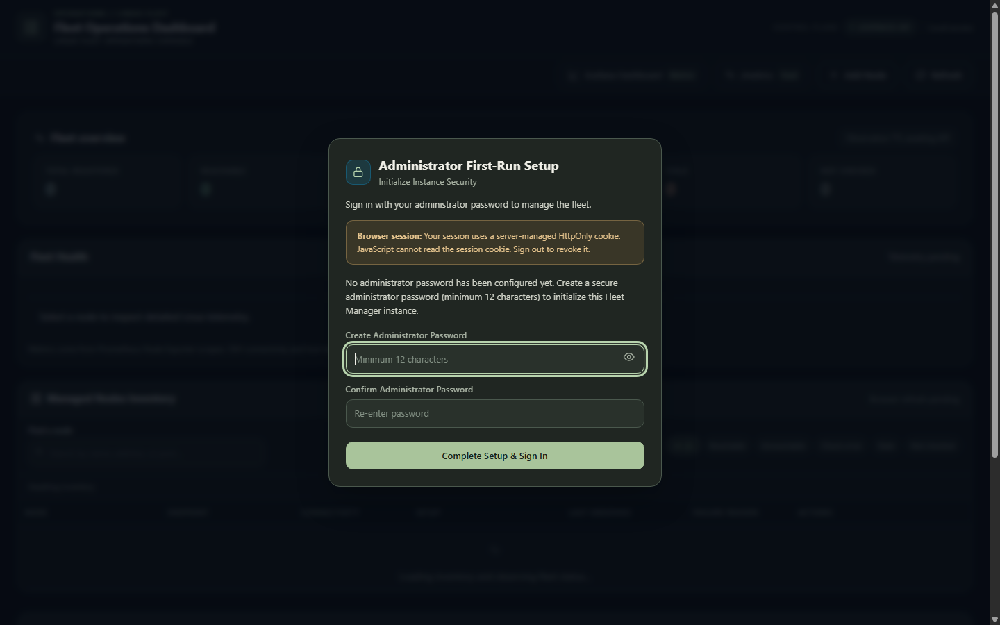

### 04-normal-login

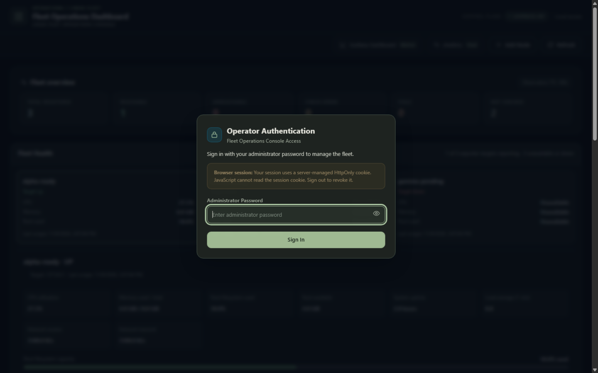

### audit-history

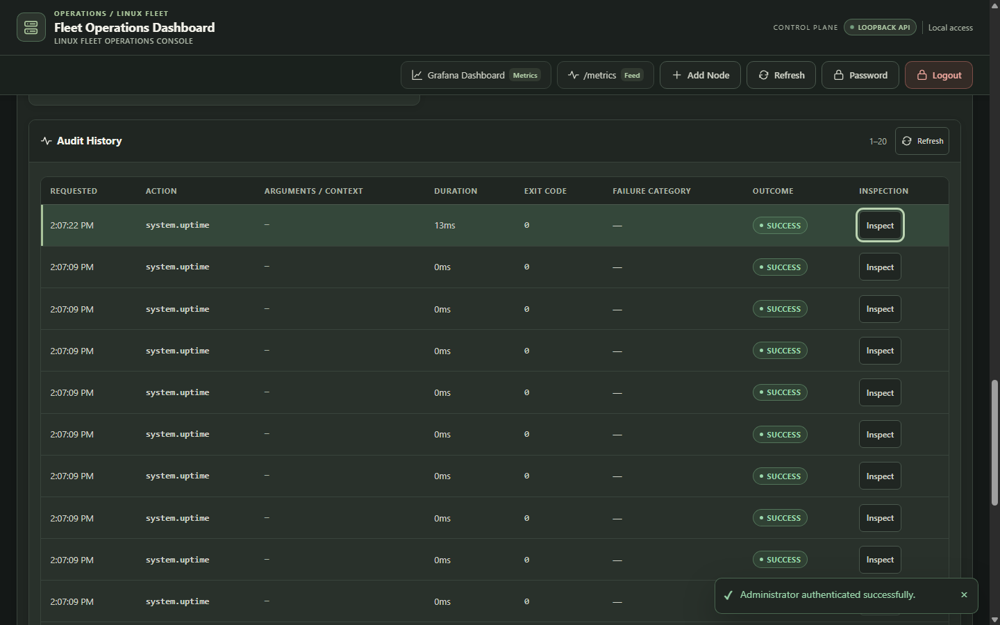

### dashboard-1024x800

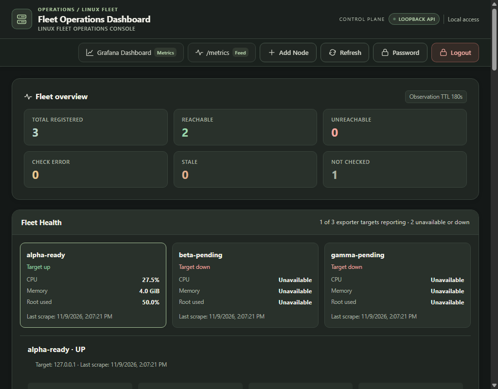

### dashboard-1440x900

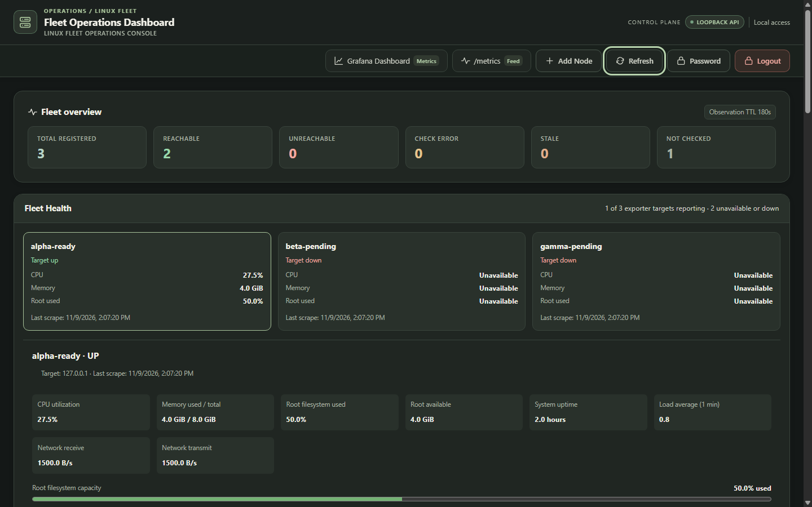

### health-1440x900

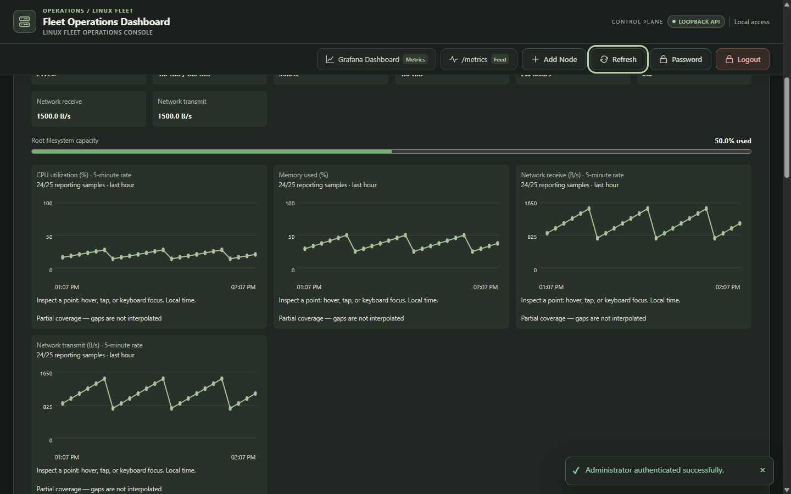

### health-390x844

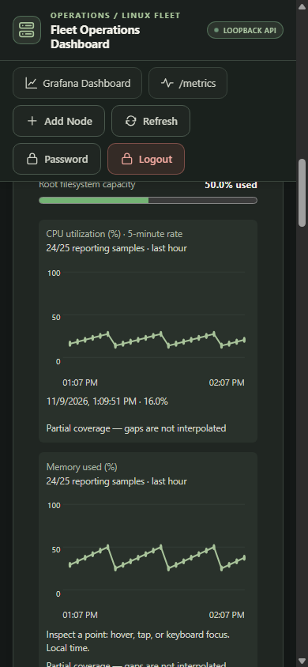

### health-missing

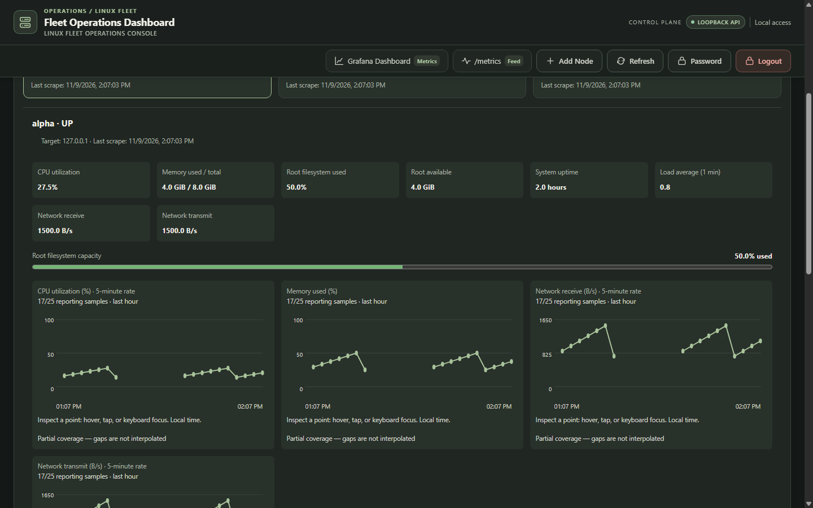

### inventory

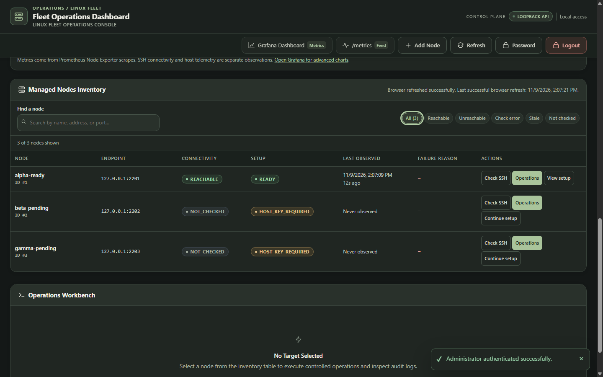

### onboarding-768x1024

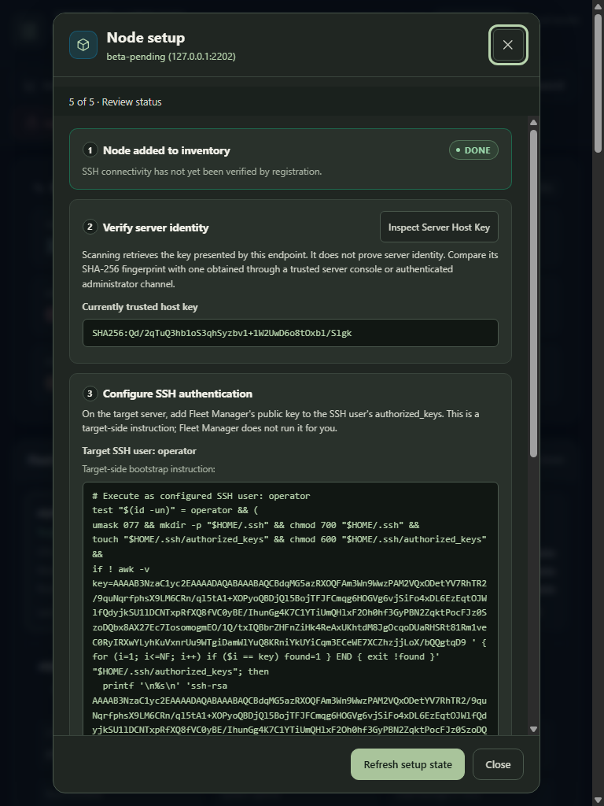

### onboarding-ready

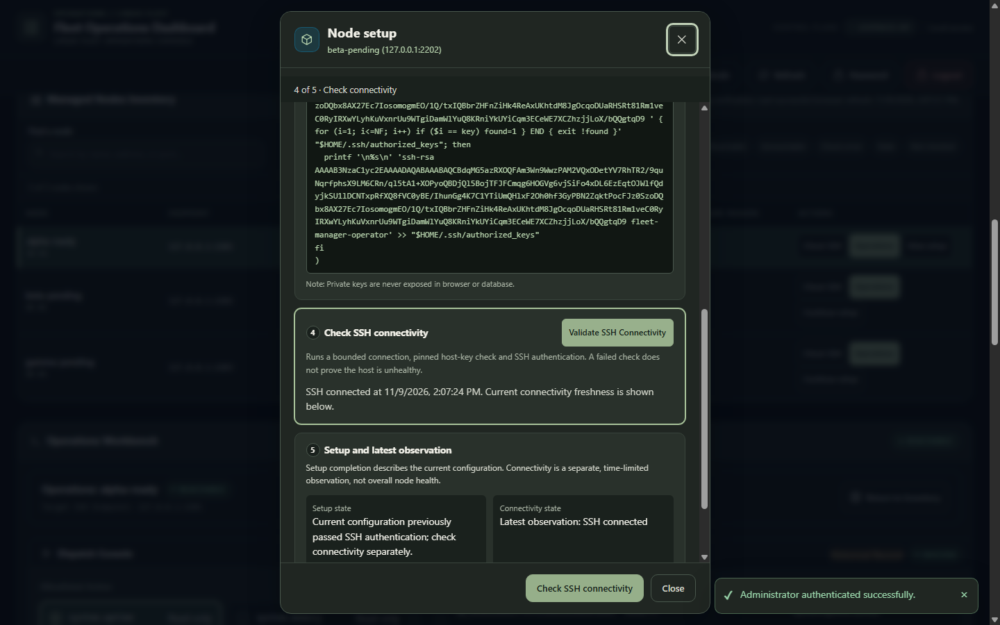

### operations-workbench

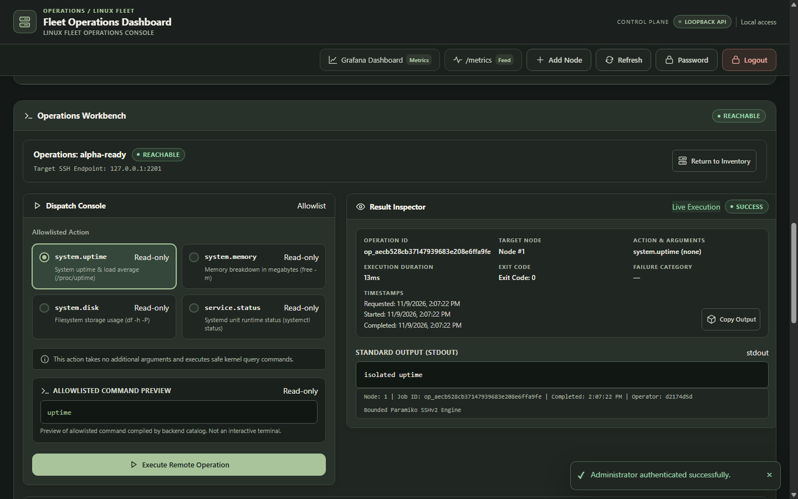

## 13. Limitations, manual handoff and future scope

All developer manual tests are **PENDING** in the included checklist. Live infrastructure requirements, independent host-key attestation, genuine automatic failure/recovery and deployed nonempty restore remain unmet. The offline acceptance runner is intentionally incomplete. No official rubric or deadline extension is invented. Learning understanding and video completion have not been assessed or advanced by automated release work.

This release changes acceptance test support, packaging safety, compilation, documentation/evidence and one verified malformed-session-cookie rejection fix with five regression variants. It does not redesign working UI, add arbitrary operations, introduce dependencies or deploy. Existing `docs/LEARNING-STATE.md` is preserved byte-for-byte and not staged. No Git push or history change occurs.

Future scope is explicitly noncommittal: separately authorize effective IAP/trusted identity remediation, identify deployed build, perform genuine multi-host acceptance without unsafe production drills, review HTTPS/operational identity needs, and validate workload limits. These are not claimed complete by this report. The next action is the developer's local manual acceptance using the exact checklist command and URL.