# Distributed Linux Fleet Management

SETU 2026 · SWFW_5S_12 · Engineering edition · architecture, workflows and evidence

**Adarsh Singh**

| Student detail | Value |
| --- | --- |
| Course / program | B.Tech in Computer Science and Engineering |
| Semester / year | Fifth semester / third year |
| Institution | Government College of Engineering, Aurangabad |
| Domain | Software / Firmware |
| Email | bt24f05f057@geca.ac.in |
| Problem statement | SWFW_5S_12 |
| Project title | Distributed Linux Fleet Management |
| Report revision | 11 November 2026 |


## Reading map and evidence vocabulary

This edition expands the engineering explanation without changing the application. Its diagrams describe inspected mechanisms, not new deployment experiments. Read the system from intent to runtime, then from failures to evidence.

| Topic | Sections | Question answered |
| --- | --- | --- |
| Scope and architecture | 1–3 | What is in the system, and where do trust and execution boundaries lie? |
| Runtime workflows | 4–8 | How do onboarding, checks, commands and metrics behave, including failures? |
| Data and recovery | 9–10 | What persists, and what is safe to restore? |
| Security and interface design | 11–13 | What can the operator do safely, and how is uncertainty communicated? |
| Verification and results | 14–18 | What was actually measured, and what remains unsupported? |
| Build and traceability | 19–20 | How can another engineer reproduce and audit the report? |

**Implemented / source-inspected** means the mechanism exists in code. **Verified locally** means a retained or explicitly dated local execution supports it. **Historical live observation** means a retained remote response supports only its time and context. **Mocked QA** means SSH/Prometheus were fixtures. **Proposed / unverified** is not an achieved feature.

Diagram grammar: blue = controller/control records; teal = telemetry or confirmed workflow result; amber = decision, limit or operator gate; red = error/uncertainty. Text labels carry the meaning without relying on color. Each figure is a separate view, not a claim that all boxes are independent services. Architecture views are C4-inspired, not formal C4 certification.

## 1. Requirements, scope and acceptance contracts

The official problem is web-based management of multiple remote Linux machines. The controller supports a small fleet and one administrative identity; Prometheus and Grafana are mandatory. A three-node reference demonstration is not a measured fleet-size ceiling.

| Requirement | Implemented mechanism | Acceptance evidence still needed |
| --- | --- | --- |
| Onboard/manage nodes | Validated persistent inventory; guided fingerprint enrollment; connectivity checks | Independent fingerprint comparison and authenticated results for deployed nodes |
| Collect/store/visualize metrics | Node Exporter → Prometheus TSDB → Grafana; native fixed-query health views | Genuine rendered Grafana panels and retained time-range queries |
| Availability/failure handling | Periodic bounded SSH checks; timestamped observations; freshness interpretation | Isolated independent-host outage with healthy peers and recovery timeline |
| Controlled commands | Four-action catalog; pinned SSH; deadlines; persisted outcomes | Raw request/output/audit correlation on each deployed host |

**Non-goals of the implemented baseline:** unrestricted shell, service repair, automatic remote replay, multi-administrator RBAC, distributed worker coordination and an HA controller. Node inventory registration does not automatically authorize SSH or prove that the exporter is scraping.

**Quality attributes:** correctness means truthful state and output; safety means explicit identity and bounded actions; reliability means bounded resource use and restart reconciliation; maintainability means routes/services/adapters/repositories; operability means classified failures and audit lookup. These are design goals whose achieved extent must be assessed separately.

The implementation uses Python 3.12, FastAPI, Paramiko, SQLite WAL and browser ES modules. Managed hosts require sshd, an authorized non-root user and Node Exporter; no custom fleet agent is installed. Source: AGENTS.md; docs/PROJECT-CHARTER.md; source routes and operation catalog. Acceptance contracts above are evaluation criteria, not a declaration of live completion.

## 2. System context and responsibility separation

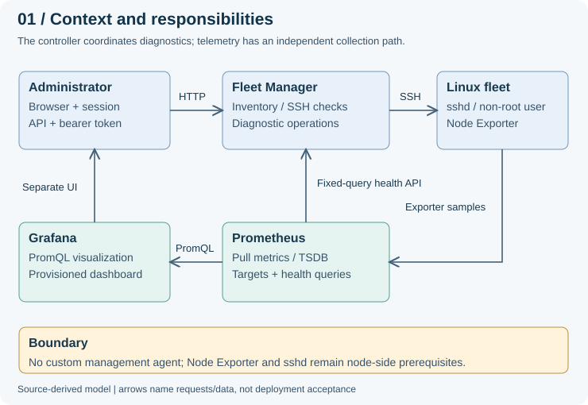

The controller owns inventory, host identity enrollment, SSH observations and diagnostic execution records. Prometheus owns metrics collection and time-series storage. Grafana queries Prometheus rather than reading the inventory database. The browser also receives a bounded native health projection through the controller.

Separating SSH and exporter paths prevents a misleading single healthy/unhealthy verdict: one can succeed while the other fails. A collector outage is not automatically a Linux host outage. A registered inventory node is also not proof that a Prometheus target is configured correctly.

The design chooses a modular monolith for the controller instead of distributing small use cases across services. This keeps deployment and transactions understandable, at the cost of a controller failure domain and process-local coordination. Prometheus and Grafana remain separate required services. Source: src/fleet_manager/main.py; inventory, connectivity, operations and health modules; monitoring/ configuration.

## 3. Deployment, process ownership and trust boundaries

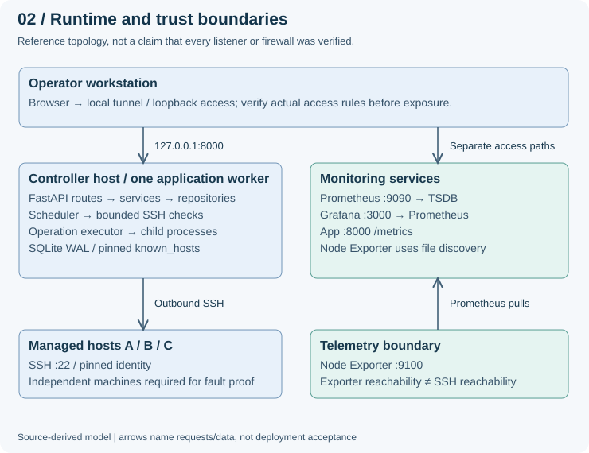

The supplied systemd unit launches Uvicorn at 127.0.0.1:8000 with exactly one worker. The service runs as fleet-manager with no new privileges, an empty capability set, read-only configuration and writable state under /var/lib/fleet-manager. These are configured hardening controls; their presence is not proof that the unit is deployed or that all exposure paths are safe.

Process-local admission locks, in-memory sessions and restart reconciliation make multiple application workers unsafe without a separately engineered coordination design. A newly started worker can otherwise mark another worker's active operation UNCERTAIN. Scaling therefore cannot be reduced to increasing --workers.

The UI's Grafana link currently points to browser loopback 127.0.0.1:3000. A remote evaluator needs a matching tunnel or corrected deployment configuration; do not assume that clicking it reaches controller-host Grafana. Verify actual listeners, tunnels, firewall rules and credentials before external exposure. Source: deploy/fleet-manager.service; main.py lifespan; ui/templates/dashboard.html.

## 4. Detailed onboarding and host identity workflow

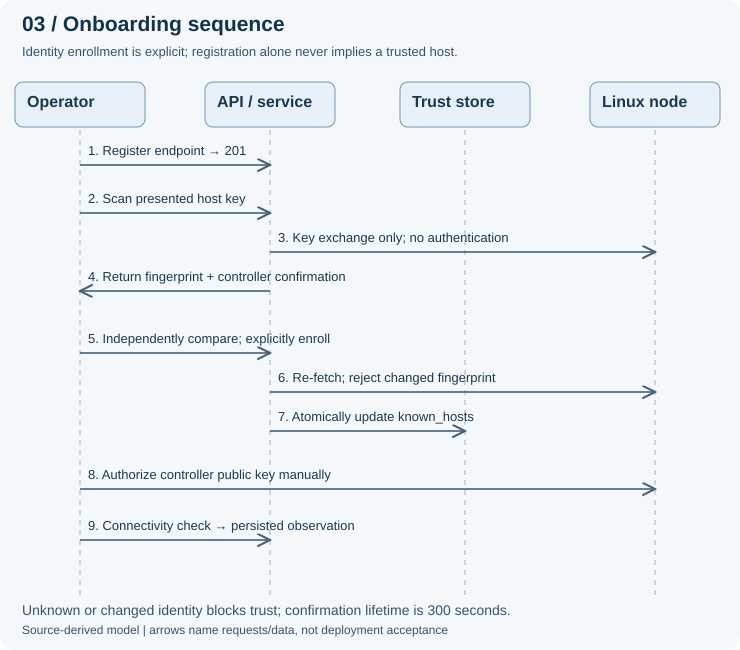

POST /api/nodes returns 201 for inventory creation; duplicate endpoints return 409. The onboarding read can return HTTP 200 with CONFIGURATION_ERROR: transport success does not mean setup success. Host-key scanning performs key exchange without authenticating or enrolling trust.

The confirmation binds node ID, address, port, configuration revision and fingerprint, with a 300-second lifetime. Enrollment re-fetches the presented key, rejects a changed or conflicting identity, then atomically replaces known_hosts. The administrator must compare the fingerprint through an independent trusted channel before enrollment. Manual public-key authorization remains a separate target-side step.

**Important implementation limitation:** confirmation validation currently uses Python assert statements (connectivity/service.py, validate_confirmation). Optimized Python execution can remove them. The report therefore does not claim unconditional enforcement; replace assertions with explicit checks in a separately approved security change and add optimized-mode regressions. No such application edit is made here.

Source: inventory/router.py; connectivity/router.py, service.py, trust.py and readiness.py. READY means successful setup history for a current revision, not continuous reachability.

## 5. Availability states and honest interpretation

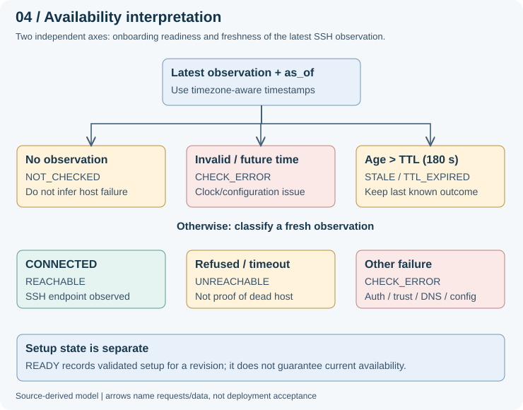

derive_status evaluates missing observations first, then invalid/future timestamps, then expiration, then the observed outcome. The default TTL is 180 seconds; age greater than TTL becomes STALE. CONNECTED becomes REACHABLE; connection refusal/timeout becomes UNREACHABLE; other fresh failures become CHECK_ERROR.

Setup uses configuration revision, pinned identity, credential configuration and successful authentication history. PENDING_SETUP, HOST_KEY_REQUIRED, AUTHENTICATION_REQUIRED, CONFIGURATION_ERROR and READY explain onboarding progress. These are not mutually interchangeable with reachability. A correctly configured node can later be unreachable; a fresh SSH response says nothing by itself about CPU saturation.

Every observation should be interpreted with its timestamp, outcome and current revision. Retaining the last observation when stale is useful context, but presenting it as current would hide uncertainty. Source: connectivity/freshness.py, readiness.py, models.py and service.py.

## 6. Scheduler, bounded capacity and failure isolation

### A monitoring cycle, step by step
- Startup initializes repositories, reconciles interrupted operations and starts the in-process scheduler when enabled.
- The first sweep waits a jittered interval unless an explicit initial delay is configured. Defaults: 60-second interval, ±10% jitter, 180-second observation TTL.
- Each cycle enumerates inventory and schedules bounded checks. The scheduler prevents its own overlapping work for a node; the shared executor enforces connectivity capacity.
- A check records the configuration revision before execution and rechecks afterward. A changed configuration removes the revision association rather than validating the new setup with an old check.
- The result is appended with a completion timestamp. Individual failures are handled without declaring all peers failed.
- After the sweep finishes, the scheduler sleeps again. This is interval-after-work scheduling, not an exact fixed-rate guarantee.

| Boundary | Current mechanism | Engineering consequence |
| --- | --- | --- |
| SSH observation worker | Default connectivity capacity 4; 12-second total worker deadline | Bounds controller waiting; does not prove any fleet-size throughput |
| Same node contention | Conflicting check admission can return 409 | Operator should inspect current work, not launch overlapping checks |
| Global contention | Exhausted admission can return 429 | Reject rather than accumulate unbounded work |
| Freshness | Default TTL 180 seconds | Slow cycles can age data even if polling is nominally 60 seconds |
| Browser refresh | Authenticated fleet refresh every 10 seconds | Refreshes display; does not trigger a new SSH observation each time |
| Recovery | Later automatic sweep re-observes a returning endpoint | Observation recovery, not automatic host repair or command replay |

For N nodes, concurrency C and slow-check duration T, a rough batch lower-bound intuition is ceil(N/C) × T plus interval and overhead; this is not a measured SLA. Actual scheduling/admission behavior must be benchmarked. No availability SLO, fleet capacity or detection percentile is established here. Source: config.py; connectivity/scheduler.py, executor.py and service.py; ui/static/js/app.js.

## 7. Controlled operation and audit lifecycle

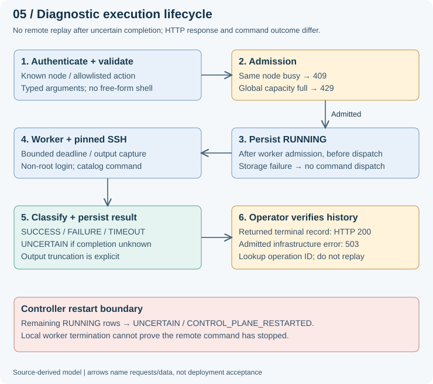

Only system.uptime, system.memory, system.disk and service.status are accepted. Typed arguments are validated before compilation; disk paths reject traversal/whitespace and service names use a restricted pattern. The catalog uses fixed command templates and quoting, not a browser-supplied shell program.

The executor reserves per-node/global capacity and spawns a dedicated worker. The on_start callback persists RUNNING before the request is sent to the worker. A rejected request creates no operation row. A successfully returned record uses HTTP 200 even when its outcome is FAILURE or TIMEOUT; inspect the outcome and failure category.

If an admitted operation has no confirmed response, HTTP 503 includes its operation ID and lookup URL with a do-not-replay message. Local completion writes may be retried; those retries are not remote execution retries. On startup, orphaned RUNNING records become UNCERTAIN / CONTROL_PLANE_RESTARTED. Source: operations/catalog.py, executor.py, service.py, router.py, transport.py and repository.py; main.py.

## 8. Observability architecture and missing-data semantics

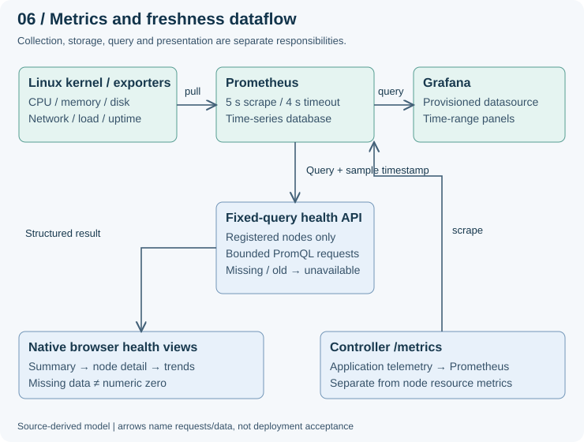

The checked-in Prometheus configuration uses a 5-second scrape interval, 4-second scrape timeout, self-monitoring, controller /metrics and Node Exporter file discovery. Five historical healthy targets are supported by the retained response; the diagram does not turn that snapshot into a time-range retention test.

The native health path restricts queries to registered nodes and predefined expressions, bounds upstream requests and response size, and reports unavailable/stale series rather than false zero values. It is not an arbitrary PromQL proxy. Grafana is a different visualization client; native charts are not a substitute for rendered Grafana acceptance evidence.

For diagnostic monitoring, review latency, traffic, errors and saturation (external design reference R3). Existing counters/histograms can support investigation, but no complete alerting/SLO deployment is claimed. Preserve sample timestamps, target identity and query context when capturing evidence. Source: monitoring/prometheus/prometheus.yml; src/fleet_manager/metrics/health.py and health_router.py; metrics/telemetry.py; monitoring/grafana/.

## 9. Data model, consistency and audit limitations

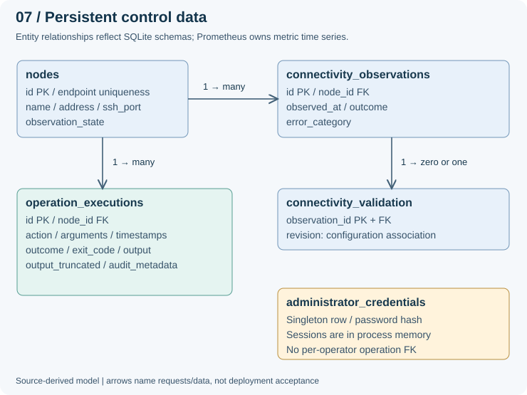

Inventory owns endpoint identity; observations are append-only history associated with nodes, with optional configuration validation. Operation records preserve requested/started/completed times, action, sanitized arguments, outcome, exit code, bounded output, truncation and audit metadata. Credential storage is a separate singleton; sessions are not persisted in this database.

SQLite WAL supports the compact controller, but writes remain a serialized resource. Per-repository connections enable foreign-key enforcement. Schema/integrity validation and short control transactions matter more than adding a second metrics store. There is no database-level tamper-evident or immutable audit guarantee: privileged file access can change records. Shared-token/session-admin metadata does not establish named-user nonrepudiation.

Source: inventory/repository.py; connectivity/repository.py; operations/repository.py; security/repository.py; main.py. The diagram omits nonessential columns but preserves entity relationships; it is not a new schema proposal.

## 10. Backup, restore and recovery boundaries

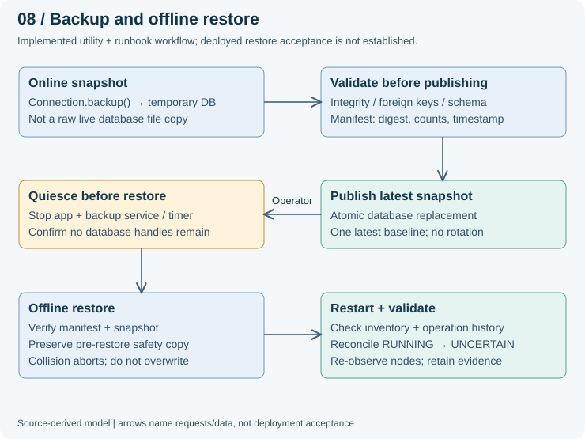

The backup utility uses sqlite3.Connection.backup(), validates integrity/foreign keys/schema, creates a digest/count/timestamp manifest, and publishes the database via replacement. Scheduled retention is one latest baseline, not multi-generation disaster recovery. A digest detects mismatch against the manifest; it does not authenticate an attacker-controlled manifest.

The runbook requires stopping database users and backup timers/services, checking handles, validating the snapshot, retaining a pre-restore safety copy, then restoring offline. A colliding safety snapshot aborts instead of silently overwriting it. After startup, compare inventory and history, inspect reconciliation outcomes and re-observe nodes.

Restoring the control database does not restore private keys, known_hosts, Prometheus TSDB, Grafana data, systemd configuration or remote hosts. Protect and recover those assets separately with authorized procedures. Do not infer measured RPO/RTO or deployed restore success from local utility tests. Source: scripts/backup_restore.py; deploy/fleet-manager-backup.*; docs/DEPLOYMENT-RUNBOOK.md sections 8–9.

## 11. Security model, threats and residual risks

| Threat / failure | Existing mechanism | Residual risk or limit |
| --- | --- | --- |
| Unauthorized API access | Bearer-token or authenticated browser-session gate | Single administrative identity; no RBAC or per-person attribution |
| Cross-site write request | Cookie-authenticated writes require CSRF validation | Transport, origin and deployment configuration still need verification |
| Host impersonation | Explicit fingerprint comparison and pinned known_hosts | Operator must use an independent trusted channel; confirmation assert caveat remains |
| Shell injection | Four fixed actions, typed/restricted arguments, quoted compilation | Target executable behavior and account privileges remain relevant |
| Resource exhaustion | Bounded admission, deadlines, bounded output and child workers | Not a distributed rate limit or established Internet-facing abuse defense |
| Unknown remote completion | UNCERTAIN outcome, operation lookup, no automatic remote replay | Cannot guarantee exactly-once effects or termination of remote processes |
| Database modification | File permissions / systemd isolation / persisted audit fields | Audit is not cryptographically immutable |
| Controller crash | Startup RUNNING reconciliation; systemd on-failure restart | Single controller remains a failure domain; sessions are lost |

**Authentication precedence:** an explicit Authorization header takes precedence; an invalid bearer does not fall back to a valid cookie. Mandatory password change blocks ordinary node workflows until resolved. Avoid describing shared token digest prefixes as human operator identity.

**Deployment boundary:** use non-root target credentials; keep secrets out of reports/source control. Do not expose the loopback-oriented reference deployment without a separate access/transport review. No security certification or penetration-test completion is claimed.

Prioritized follow-up, not implemented by this report: explicit confirmation checks with optimized-mode tests; endpoint/access review; named operator identities if required; coordinated worker ownership before horizontal scaling; authenticated off-host audit/backup only if justified. Source: security/auth.py and sessions; connectivity/service.py and trust.py; operation catalog/executor; systemd unit.

## 12. Information architecture and operator workflow

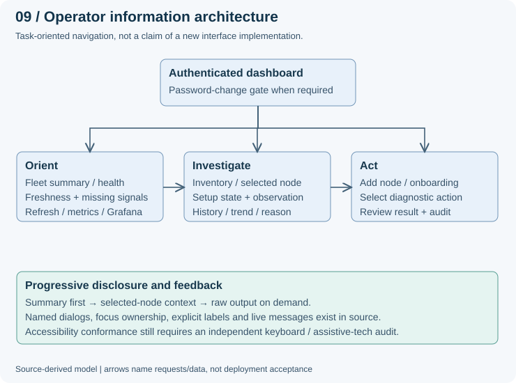

The intended journey is orient → investigate → act → verify. Fleet summaries show where attention is needed; selected-node detail preserves endpoint, setup, observation and measurement context; operations expose fixed action selection, preview and results/history rather than a terminal.

Progressive disclosure keeps raw output and detailed history available without forcing them into every overview card. Related information should stay together: setup state beside trust/auth guidance, freshness beside observed status, and operation result beside its ID and timestamps. This is an explanation of the current information model, not a claim that every improvement below is already implemented.

One dashboard plus registration drawer and dialogs avoids a large navigation hierarchy. A 10-second UI refresh and separately scheduled observations are intentionally explained as different clocks. Preserve selected-node context and avoid presenting a refresh timestamp as the actual measurement time. Source: ui/templates/dashboard.html; ui/static/js/app.js, fleet.js, node-onboarding.js, operations.js and history modules (see source index for exact files).

## 13. Design principles and usability review

| Principle | Concrete application / source mechanism | Verification or limitation |
| --- | --- | --- |
| Visibility of system status | Separate setup, observation outcome, freshness and operation result | Existing state models; not a single misleading green badge |
| Recognition over recall | Fixed action choices, labeled fields, command preview and guidance | Interface screenshots are mocked QA, not live action evidence |
| Error prevention | Input validation, explicit identity enrollment, no unrestricted shell | Server-side rules remain authoritative |
| Progressive disclosure | Overview → node detail → history/output | Source-inspected IA; no usability-study result claimed |
| Feedback without interruption | Live status/alerts, compact toasts and inline configuration guidance | Manual assistive-tech behavior not freshly audited |
| Focus and keyboard ownership | Named dialogs, background inert state and focus restoration | Source mechanisms, not WCAG conformance certification |
| Non-color meaning | Text status/reason plus visual differentiation | Report diagram labels preserve meaning in grayscale |
| Evidence context | Keep target/time/outcome/source beside values | Report requirement; live traces still incomplete |

W3C references R2 identify use of color, visible focus and status messages as relevant accessibility criteria. The existing modal ownership module and labeled/live interface elements provide implementation hooks, but claiming conformance requires contrast, keyboard, zoom/reflow and assistive-technology testing. Do not infer that browser assertion counts cover all accessibility criteria.

**Visual system used in this report:** consistent typography, restrained semantic colors, numbered views, labeled arrows, generous spacing and one main question per diagram. Tables compare mechanisms with consequences rather than decorating pages. Captions state whether a figure is source-derived or mocked.

**Focused usability review still needed:** can a new operator distinguish STALE from UNREACHABLE, recover from host-key mismatch without blindly trusting, and find an UNCERTAIN operation without re-running it? These are proposed evaluation tasks, not completed student or user studies. Source: dashboard.html; dialog-ownership.js; node-onboarding.js; CSS focus styles; references R1–R2.

## 14. Design decisions and explicit trade-offs

| Choice | Why it fits this project | Cost / rejected simplification |
| --- | --- | --- |
| Python / FastAPI / Paramiko | Existing stack keeps HTTP contracts, SSH and tests inspectable | Packaging/process overhead; not a claim of superior fleet throughput |
| Modular controller | Routes at boundary, use cases in services, SQL in repositories | Module boundaries need discipline; fewer deployment pieces than microservices |
| SQLite control store | Small-fleet persistence with simple deployment and transactions | Single writer/controller and backup operational constraints |
| Prometheus + Grafana | Required collection/storage/visualization responsibilities | Separate configuration, target identity and access paths to manage |
| Separate observation/setup/resource signals | Prevents unsupported health conclusions | More states to explain in the UI |
| Strict SSH identity enrollment | Avoids implicit trust-on-first-use during diagnostics | Requires independent fingerprint comparison and operator action |
| Process-bounded operations | Local deadline enforcement and worker cleanup | Child process cost; remote stop cannot be proven |
| No automatic remote replay | Preserves safety under unknown completion | Operator investigation required; not exactly-once semantics |
| Vanilla browser modules | Matches current code, keeps dependencies low | Manual state/focus discipline and regression coverage remain necessary |

These are reconstructed explanations tied to inspected implementation and existing ADRs, not newly accepted architecture decisions. Existing ADRs remain authoritative for historical rationale; where an original decision record is absent, the consequence above is analysis rather than invented author intent.

**Scaling path, proposed only:** first measure representative HTTP/SSH workloads and sweep durations; tune within the single-worker contract; only then introduce durable work ownership/leases, identity and storage changes if measurements justify them. Adding queues, Kubernetes or microservices without a demonstrated bottleneck is not evidence of engineering maturity.

Source: docs/decisions/0001–0007; main.py; repositories; operation executor; browser modules. See the source index for hashed paths inspected during this edition.

## 15. Verification strategy and failure matrix

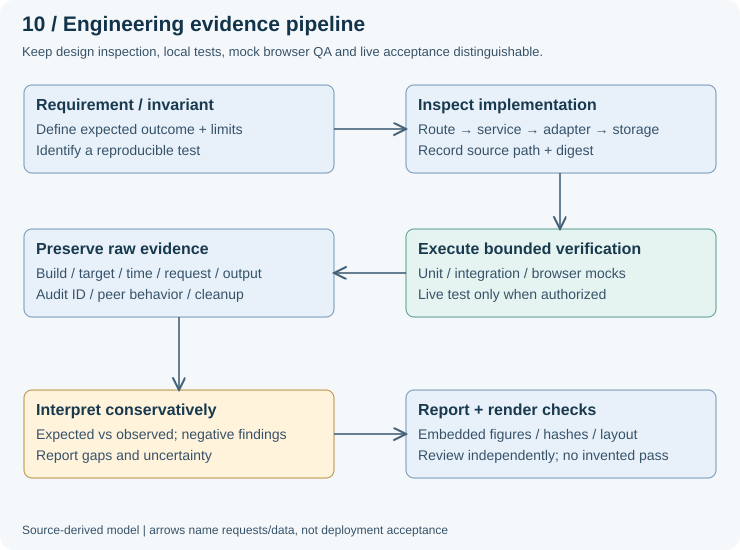

| Failure scenario | Expected behavior | Evidence class / limit |
| --- | --- | --- |
| Unknown host key / changed identity | Do not silently enroll; explain blocked trust | Code and local tests; independent deployed comparisons still needed |
| Authentication or DNS failure | Classified observation; do not call host dead | Local contracts; real failure topology unestablished |
| Capacity saturation | Bounded rejection; cleanup after work release | Controlled in-process benchmark, not HTTP/SSH load |
| Deadline / transport loss | TIMEOUT or UNCERTAIN; no blind replay | Code and operation tests; remote termination unproven |
| Controller restart mid-operation | Orphan RUNNING → UNCERTAIN | Source/test boundary, not a complete deployed interruption trace |
| Missing metric / collector outage | Unavailable/stale, never fabricated zero | Mock browser/local contracts; genuine Grafana gaps remain |

Every live capture needs target/build/time, raw requests and results, operation IDs, unaffected peer behavior and cleanup/recovery evidence. No new cloud experiment is authorized or performed in this edition.

## 16. Measured results and interpretation

### Historical monitoring snapshot — 8 November 2026

The retained controller-validation response contains Prometheus target health, last-scrape timestamps and durations. The table below transcribes the observed response, not a newly executed cloud query. Every listed target has an empty lastError and a five-second scrape interval.

| Target | Instance | Last scrape, UTC | Duration, ms | Health |
| --- | --- | --- | --- | --- |
| Fleet Manager | 127.0.0.1:8000 | 09:49:11.291883189 | 8.998 | up |
| Node A exporter | 10.160.0.5:9100 | 09:49:10.058377576 | 132.629 | up |
| Node B exporter | 10.160.0.3:9100 | 09:49:12.432012612 | 126.651 | up |
| Node C exporter | 10.160.0.4:9100 | 09:49:11.935733210 | 119.757 | up |
| Prometheus | localhost:9090 | 09:49:12.296315070 | 6.118 | up |

This establishes successful scrape observations in the retained response. It does not establish continuous availability, the deployed application build, rendered Grafana panels or a later failure/recovery experiment. Source: controller-validation.txt, historical run 20261108T1515; the accompanying evidence manifest records its hash.

### Capacity behavior — controlled local experiment, 9 November

The admission benchmark filled four operation slots, held them open, attempted twelve further requests, then released admitted work. It measured OperationService entry to rejection using time.perf_counter_ns. There was one measurement round, no warmup, and controlled in-process transport—not HTTP, SSH or remote hosts.

| Observation | Result |
| --- | --- |
| Requests / admitted / rejected | 16 / 4 / 12 |
| Peak active operations | 4 |
| Rejection latency p50 / p95 | 0.716 / 0.958 ms |
| Active operations / threads remaining after release | 0 / 0 |

The result supports bounded admission and cleanup for this controlled workload. It does not measure production throughput, network latency or independent-node isolation. Percentiles describe only twelve rejections in one round, not a fleet-capacity estimate. Source: admission-baef7aca7ebf4b3b80383bf99aa722b1/results.json.

## 17. Testing, chronology and unresolved verification

| Layer / date | Recorded execution | What it demonstrates |
| --- | --- | --- |
| Python, 9 November | 535 passed; seven warnings; 150.55 s | Covered local backend/security/persistence contracts |
| Frontend, 9 November | 74 pass executions / 37 unique tests | Module behavior, repeated through compatibility entry points |
| Normal browser QA, 9 November | Successful retry; 126 assertions; cleanup true | Mocked workflow and interface behavior |
| Automated acceptance, retained run | 2 local passes / 6 skipped / 6 simulated | Local contracts only; live gates remain unmet in that run |
| Authentication, 11 November | 25 passed; seven warnings; 4.70 s | Focused local authentication regressions |
| Operation units, 11 November | 33 passed; one warning; 1.65 s | Focused local operation behavior |

The browser's first normal-flow attempt failed with a Windows PermissionError before the driver launched; the subsequent run succeeded. Retaining that distinction is more useful than describing every invocation as successful. Existing warnings remain visible rather than being presented as a warning-free run.

### Chronology without overclaiming

The November 8 raw response supports historical monitoring. November 9 cloud safety records did not perform fresh SSH or application acceptance. November 10 checkpoint and execution summaries report a later deployment and four successful operation examples. The older blocked run does not disprove those later activities, but the newer summary alone does not establish every fault-injection and recovery scenario. This revision therefore separates those records instead of declaring all live gates closed.

### Required next live evidence

| Scenario | Evidence needed | Status in this report |
| --- | --- | --- |
| Three-node onboarding | Independently verified fingerprints plus authenticated results | Not fully embedded |
| Grafana | Actual rendered panels, time range and Prometheus datasource | Not established |
| Peer isolation | Before/during/after one independent VM outage, peers and controller measured | Not established |
| Automatic recovery | Timestamped scheduler observations and exporter recovery | Not established |
| Remote operations | Real response/output linked to target, build and audit UUID | Later summary only |
| Deployed restore | Restore real rows into separate destination and verify integrity/counts | Not established |

## 18a. Output screenshots — onboarding and diagnostics

These are retained browser-QA captures with mocked SSH/Prometheus, not live GCP screenshots. Labels such as alpha-ready and loopback endpoints identify the demonstration environment. They show interface implementation, not genuine remote command success.

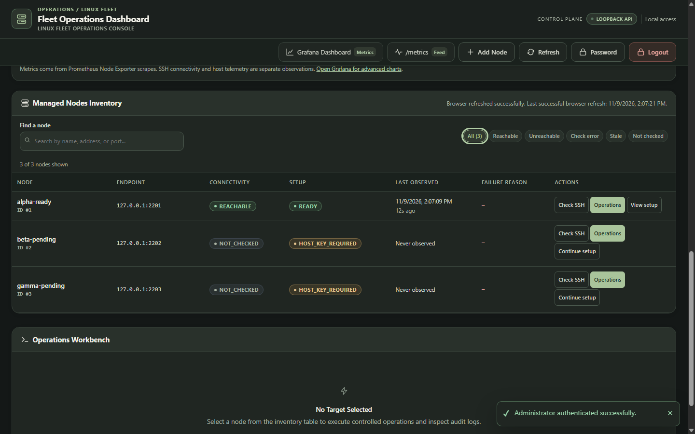

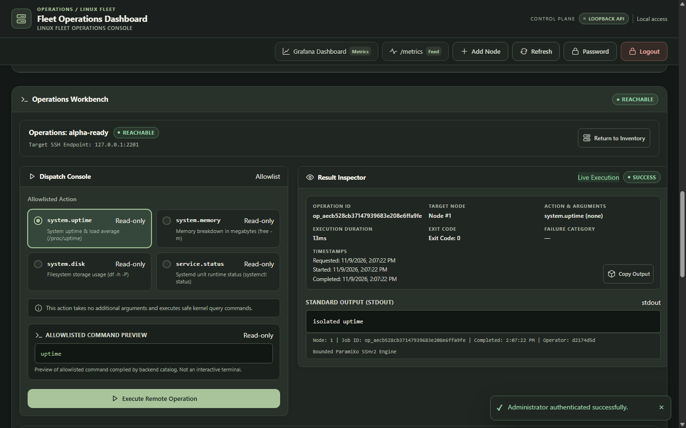

## 18b. Output screenshots — metrics and missing data

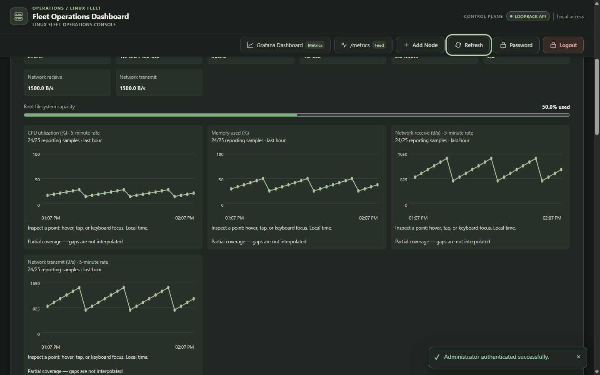

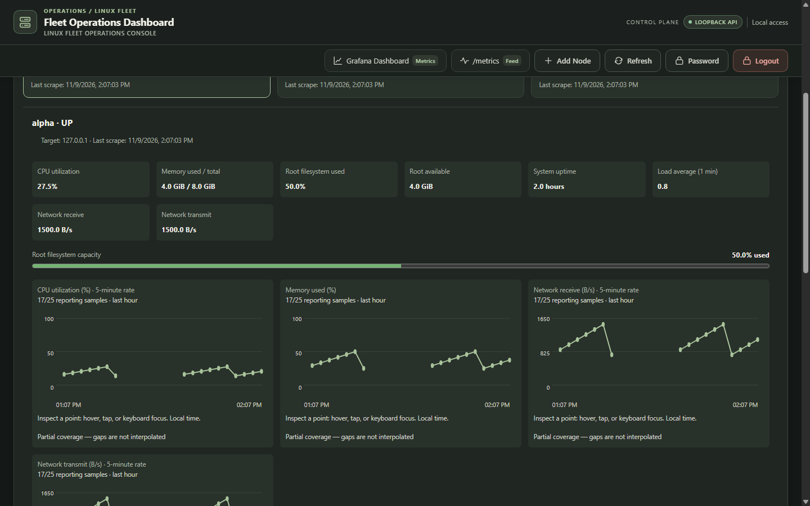

The interface makes independent signals visible: a machine can be SSH-reachable while exporter data is missing. Real operating measurements must retain their target, source timestamp and query context; screenshots alone do not establish long-term correctness.


## 19. Build, deployment and reproduction

### Local test environment
Use the existing fleet-manager project root, locked Python 3.12 environment and Node.js. These commands are reproduction instructions, not executions performed by this report page. uv sync may access package sources; deployment commands are not executed here.

```text
uv sync --locked
uv run --no-sync python -m pytest -q
node --experimental-vm-modules --test tests/dashboard_modules.cjs tests/dashboard_regression.cjs
uv run --no-sync python -m ruff check src tests scripts
uv run --no-sync python -m mypy src
```

### Reference deployment order
- Prepare independently isolated Linux nodes, sshd, restricted login accounts and Node Exporter. Record target identities and network boundaries.
- Install locked controller dependencies and service configuration; create private configuration/state paths with correct permissions.
- Configure Prometheus target discovery and Grafana provisioning; verify actual listeners and operator access paths.
- Start the single-worker controller through the documented runbook. Independently compare host fingerprints before enrollment; authorize the public key on targets.
- Verify inventory, authenticated observations, exporter scrapes, time-range samples and rendered Grafana panels as distinct checks.
- Execute authorized diagnostics; preserve request/result/audit IDs. Only then run an explicitly authorized bounded fault/recovery experiment.

Use docs/DEPLOYMENT-RUNBOOK.md and deploy/gce/ as the operational authority. This report is not an instruction to create cloud resources, alter firewall rules, or inject failures without authorization.

### Report rebuild
From the repository root, run the existing Python environment against .local/build_engineering_report.py. It produces the separate editable Markdown, self-contained HTML, vector-diagram PDF and evidence manifest under docsSX. It does not invoke the release ZIP compiler. Source code, old reports and archives remain untouched.

## 20. Traceability, references and final assessment

### Source-to-claim map
| Report concern | Primary local source |
| --- | --- |
| Requirement boundary | AGENTS.md; docs/PROJECT-CHARTER.md |
| Lifecycle / one worker / reconciliation | src/fleet_manager/main.py; deploy/fleet-manager.service |
| Enrollment / trust / setup | connectivity/router.py, service.py, trust.py, readiness.py |
| Observation semantics / scheduler | connectivity/freshness.py, scheduler.py; config.py |
| Controlled actions / uncertain outcomes | operations/catalog.py, executor.py, service.py, transport.py, repository.py |
| Control schema / auth boundary | inventory and security repositories; security/auth.py |
| Telemetry and native health | monitoring/; src/fleet_manager/metrics/health.py, health_router.py and telemetry.py |
| Operator interface / focus | ui/templates/dashboard.html; ui/static/js/dialog-ownership.js and app modules |
| Backup and restore | scripts/backup_restore.py; docs/DEPLOYMENT-RUNBOOK.md |
| Measured historical values | Companion manifest's retained raw logs and benchmark JSON |

Paths in module-family rows are relative to src/fleet_manager unless stated otherwise. The companion manifest records exact existing source paths and SHA-256 digests; a source digest identifies inspected bytes, not successful runtime behavior.

### External design references, consulted 11 November 2026
R1. Simon Brown, C4 model: Introduction and Diagrams (official c4model.com). Used only to structure context/runtime views, not as a certification claim.

R2. W3C WAI, Understanding WCAG 2.2: Use of Color (1.4.1), Focus Visible (2.4.7), Status Messages (4.1.3). Used for review criteria; no conformance claim.

R3. Google SRE, Monitoring Distributed Systems (official SRE book): latency, traffic, errors and saturation. Used as a monitoring review lens, not proof of implemented alerting or SLOs.

### Assessment and next evidence
The controller has concrete trust, admission, persistence, recovery-interpretation and operator-feedback mechanisms. This edition explains them through ten source-derived diagrams, explicit failure paths and trade-offs. Historical local tests, controlled admission measurements and a five-target scrape snapshot remain distinct evidence classes. Genuine rendered Grafana, complete deployed operation traces, independent-host outage/recovery and deployed restore verification remain open. A source-inspected confirmation-validation weakness is now explicit; fixing it is a separate application change.

The next useful step is to review these workflows against the student's understanding, then locate existing genuine artifacts before authorizing new live capture. Student explanation, live acceptance and report completeness are separate outcomes.
