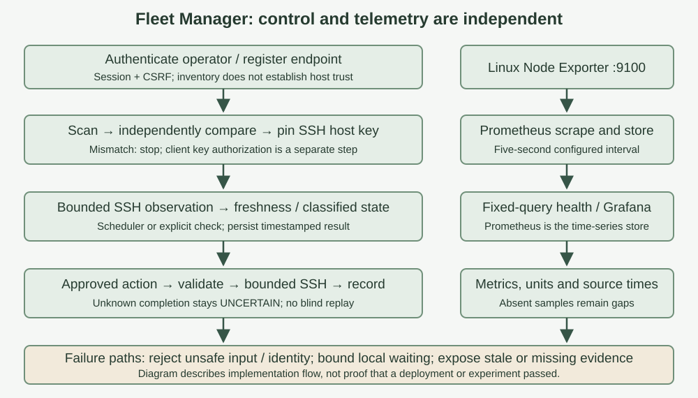
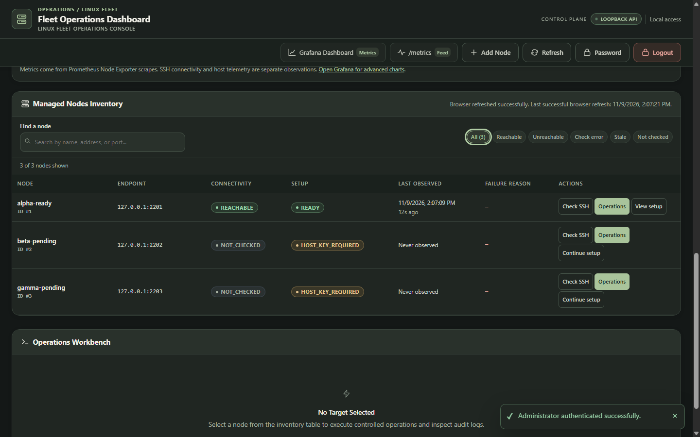
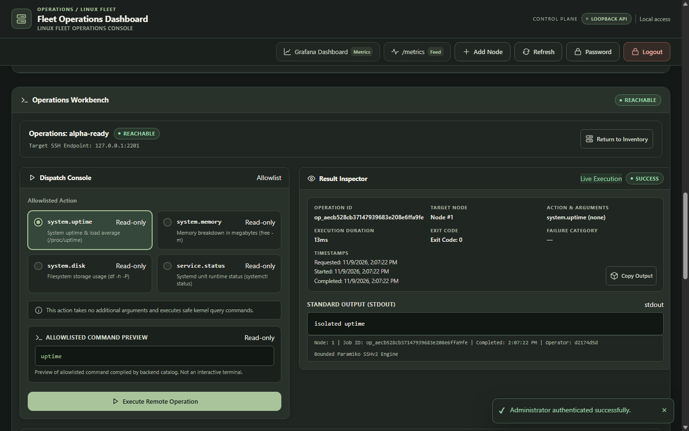
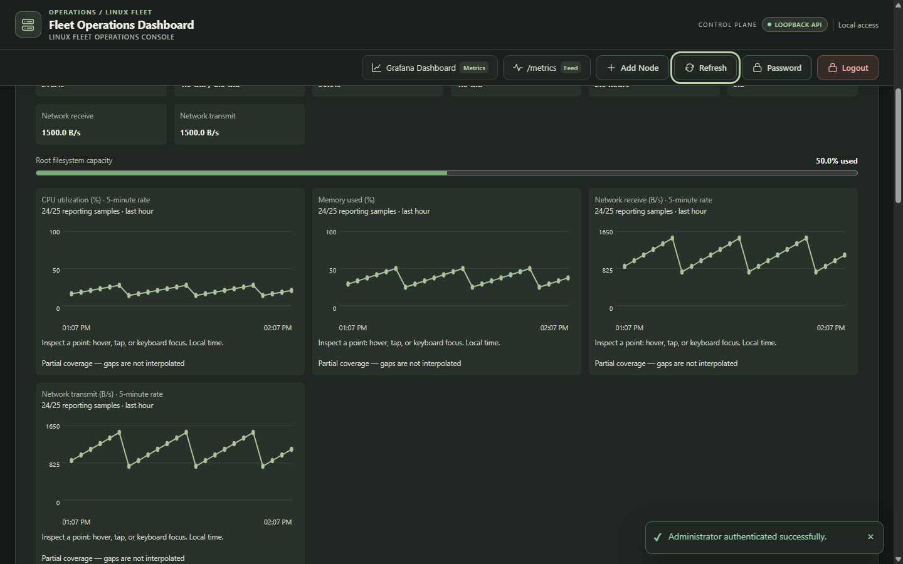
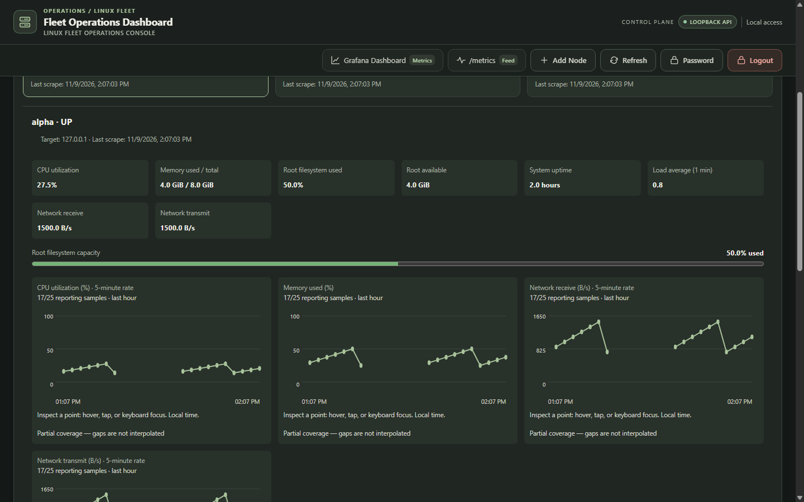

# Distributed Linux Fleet Management

SETU 2026 · SWFW_5S_12 · Evidence-first project report

**Adarsh Singh**

| Student detail | Value |
| --- | --- |
| Course / program | B.Tech in Computer Science and Engineering |
| Semester / year | Fifth semester / third year |
| Institution | Government College of Engineering, Aurangabad |
| Domain | Software / Firmware |
| Email | bt24f05f057@geca.ac.in |
| Problem statement | SWFW_5S_12 |
| Project title | Distributed Linux Fleet Management |
| Report revision | 11 November 2026 |

### Project in one minute

Fleet Manager is a browser-based controller for registering Linux machines, verifying their SSH identity, observing availability and running four read-only diagnostic actions. Prometheus collects host metrics independently; Grafana provides a separate visualization path. SQLite stores control records rather than metric time series.

The implementation targets a small fleet and one administrator. It uses Python 3.12, FastAPI, Paramiko, SQLite WAL and a lightweight HTML/CSS/JavaScript interface. Managed machines require sshd, an authorized non-root login account and Node Exporter; no custom management daemon is required.

### Results at a glance

| Evidence | Observed result | Boundary |
| --- | --- | --- |
| Retained GCP monitoring response, 8 November | Three node exporters, controller and Prometheus all reported scrape health up | Historical snapshot, not current deployment acceptance |
| Python suite, 9 November | 535 passed; seven warnings; 150.55 seconds | Local regression suite |
| Frontend checks, 9 November | 74 pass executions / 37 unique tests | Two compatibility entry points repeat the tests |
| Browser QA, 9 November | 126 normal-flow assertions; successful retry | Mocked SSH and Prometheus |
| Focused checks, 11 November | 25 authentication + 33 operation-unit tests passed | Local checks during report audit |

Live operation examples dated 10 November are reported in the project execution summary. They are not promoted here to independently verified results without matching raw request/output/audit artifacts. Real Grafana panels and an independent-node outage/recovery sequence remain evidence gaps in this revision.

## 1. Work done and requirement coverage

The project brings node inventory, SSH onboarding, availability observations, host telemetry and diagnostic execution into one operator workflow. Each capability has a separate success condition: registering a machine is not verifying its identity, and an SSH success is not a resource-health measurement.

| Required outcome | Implementation | Evidence in this report | Remaining limit |
| --- | --- | --- | --- |
| Node management and onboarding | Persistent inventory; endpoint validation; explicit fingerprint verification and key pinning | Sections 2–3; browser-QA views in Section 7 | Independent console attestations for all deployed hosts not embedded |
| Availability and graceful degradation | Bounded workers; classified outcomes; 180-second freshness TTL | Section 3; controlled capacity experiment in Section 5 | Capacity experiment is not an independent-host outage |
| Controlled commands | Four-action catalog; typed inputs; execution records; deadlines | Sections 3–4; local regressions; workbench in Section 8 | Demo output is not live GCP execution proof |
| Prometheus monitoring | Node Exporter scraping; time-series storage; fixed-query health API | Five-target historical response in Section 5 | Does not prove continued uptime or time-range retention |
| Grafana visualization | Provisioned Prometheus datasource and dashboard artifacts | Architecture and configuration description | Rendered live Grafana panel evidence still required |
| Flow diagram | Parallel trust/control and metrics paths | Embedded Figure 1 | Diagram describes design, not execution evidence |

### What is deliberately not claimed

This release does not implement named-user RBAC, a general remote terminal, service restart automation, multi-controller high availability or demonstrated large-fleet capacity. Audit records are persistent SQLite history, not a cryptographically immutable ledger. The system is production-oriented in its boundaries; production readiness is not established by the available tests alone.

### Evidence labels

**Observed artifact** means the retained output was inspected. **Local test** means execution on the development workstation. **Browser QA** means interface behavior with mocked transport/telemetry. **Reported live result** means a later project summary asserts the result but the complete raw evidence was not established during this revision. These labels prevent test fixtures from being mistaken for deployed measurements.

## 2. Architecture and mandatory system flow



| Component | Responsibility | Communication / state |
| --- | --- | --- |
| Browser | Inventory, onboarding, health and diagnostic workflows | Authenticated HTTP session; CSRF on mutations |
| FastAPI / one Uvicorn worker | Validation, use cases, lifecycle and admission | Loopback port 8000; process-local sessions and limits |
| SQLite and known_hosts | Inventory, observations, execution records and SSH trust | Transactions, schema migrations, pinned server keys |
| Bounded SSH workers | Verify remote identity and execute approved actions | SSH on port 22; explicit non-root credentials |
| Node Exporter / Prometheus | Export Linux metrics and retain numeric time series | HTTP port 9100; configured five-second scrapes |
| Grafana | Query and visualize Prometheus time series | Controller port 3000; provisioned datasource |

The recorded reference topology has one controller (10.160.0.2) and three managed nodes: A (10.160.0.5), B (10.160.0.3), C (10.160.0.4). The deployment zone is asia-south1-a. Operator access is designed around an IAP-backed SSH tunnel; application listeners bind to loopback. This describes deployment artifacts and historical records, not a fresh inspection of effective IAM/firewall configuration.

## 3. Implementation mechanisms and failure behavior

### Node onboarding

The operator registers a name, address and ssh_port. Validation rejects invalid ports and duplicate normalized endpoints. A scan retrieves the server's presented public host key. The operator compares its SHA-256 fingerprint with an independently obtained console value before explicit enrollment in known_hosts. The controller's public key must separately be authorized for the intended Linux account.

Host identity and client authorization are different steps. Scanning a key over an untrusted path does not authenticate it. Later SSH connections enforce the pinned identity rather than silently accepting or replacing an unknown key.

### Availability is an observation, not a universal health verdict

| Display state | Meaning |
| --- | --- |
| NOT_CHECKED | No observation is available |
| REACHABLE | A fresh verified SSH check succeeded |
| UNREACHABLE | A fresh connection-refused or connection-timeout result was recorded |
| CHECK_ERROR | The check could not establish a verdict, for example authentication, identity, DNS or other timeout errors |
| STALE | The retained observation is older than the configured TTL |

Defaults are a 60-second SSH schedule with 10% jitter, a 180-second freshness TTL, four concurrent SSH checks and a 12-second total check deadline. These are configured behavior, not measured recovery guarantees. Prometheus scraping uses a separate five-second interval in the supplied configuration and the historical target response.

### Controlled operations

| Action | Input contract | Compiled command |
| --- | --- | --- |
| system.uptime | No arguments | uptime |
| system.memory | No arguments | free -m |
| system.disk | Validated absolute path; reject traversal and unsafe characters | df -h -P -- <quoted path> |
| service.status | Validated service identifier | systemctl --no-pager status -- <quoted service> |

The server enforces the catalog independently of the browser. Default execution budget is 15 seconds; captured output is limited to 64 KiB per stream. A local worker is terminated and reaped on deadline. That bounds controller waiting, but does not prove the remote process has stopped. A controller restart reconciles unfinished executions to UNCERTAIN rather than replaying them blindly.

## 4. Security, persistence and design trade-offs

| Threat / failure | Implemented control | Residual boundary |
| --- | --- | --- |
| Host substitution | Independent fingerprint comparison and pinned SSH keys | Operator must use an authentic comparison channel |
| Password disclosure | Argon2-based password hashing | Secret handling and rotation remain operational duties |
| Session theft / CSRF | HttpOnly session; idle/absolute expiry; token and origin checks | Not multi-user authorization or a substitute for trusted access transport |
| Shell injection | Fixed action catalog, typed validation, quoting and option separators | Each new action needs review; catalog is intentionally narrow |
| Stalled host | Worker deadlines and admission limits | Local bounds are not proof of remote process cancellation |
| Service compromise | Non-root systemd identity and restricted writable paths | Supplied unit is not proof every hardening option is deployed |
| Audit modification | Transactional execution history | Privileged access can modify records; no tamper-evident ledger |

SQLite WAL keeps inventory, observations, administrator credential metadata and execution records in a compact transactional store. Prometheus handles time-series retention, avoiding a custom metrics database. Process-local sessions and admission locks explain the one-worker deployment requirement. Multiple controllers would require shared coordination and a revised persistence topology.

### Decisions and costs

**SSH instead of a custom daemon:** standard administration tools reduce custom node software, but each connection incurs handshake work. No connection-latency figure is asserted without a measured workload.

**Small fixed operation catalog:** less flexibility than a terminal, but substantially smaller command-input surface. service.status inspects a service; it does not start, stop or repair it.

**Explicit missing data:** absent metric samples remain chart gaps. A zero is a measured value, not a substitute for failed scraping. Native charts and Grafana are separate views; a native chart screenshot is not proof that Grafana rendered correctly.

**Online backup:** the project includes a SQLite backup/restore utility. The retained automated acceptance exercise used an empty temporary database, so deployed recovery with real rows is not claimed as verified here.

## 5. Measured results and interpretation

### Historical monitoring snapshot — 8 November 2026

The retained controller-validation response contains Prometheus target health, last-scrape timestamps and durations. The table below transcribes the observed response, not a newly executed cloud query. Every listed target has an empty lastError and a five-second scrape interval.

| Target | Instance | Last scrape, UTC | Duration, ms | Health |
| --- | --- | --- | --- | --- |
| Fleet Manager | 127.0.0.1:8000 | 09:49:11.291883189 | 8.998 | up |
| Node A exporter | 10.160.0.5:9100 | 09:49:10.058377576 | 132.629 | up |
| Node B exporter | 10.160.0.3:9100 | 09:49:12.432012612 | 126.651 | up |
| Node C exporter | 10.160.0.4:9100 | 09:49:11.935733210 | 119.757 | up |
| Prometheus | localhost:9090 | 09:49:12.296315070 | 6.118 | up |

This establishes successful scrape observations in the retained response. It does not establish continuous availability, the deployed application build, rendered Grafana panels or a later failure/recovery experiment. Source: controller-validation.txt, historical run 20261108T1515; the accompanying evidence manifest records its hash.

### Capacity behavior — controlled local experiment, 9 November

The admission benchmark filled four operation slots, held them open, attempted twelve further requests, then released admitted work. It measured OperationService entry to rejection using time.perf_counter_ns. There was one measurement round, no warmup, and controlled in-process transport—not HTTP, SSH or remote hosts.

| Observation | Result |
| --- | --- |
| Requests / admitted / rejected | 16 / 4 / 12 |
| Peak active operations | 4 |
| Rejection latency p50 / p95 | 0.716 / 0.958 ms |
| Active operations / threads remaining after release | 0 / 0 |

The result supports bounded admission and cleanup for this controlled workload. It does not measure production throughput, network latency or independent-node isolation. Percentiles describe only twelve rejections in one round, not a fleet-capacity estimate. Source: admission-baef7aca7ebf4b3b80383bf99aa722b1/results.json.

## 6. Testing, chronology and unresolved verification

| Layer / date | Recorded execution | What it demonstrates |
| --- | --- | --- |
| Python, 9 November | 535 passed; seven warnings; 150.55 s | Covered local backend/security/persistence contracts |
| Frontend, 9 November | 74 pass executions / 37 unique tests | Module behavior, repeated through compatibility entry points |
| Normal browser QA, 9 November | Successful retry; 126 assertions; cleanup true | Mocked workflow and interface behavior |
| Automated acceptance, retained run | 2 local passes / 6 skipped / 6 simulated | Local contracts only; live gates remain unmet in that run |
| Authentication, 11 November | 25 passed; seven warnings; 4.70 s | Focused local authentication regressions |
| Operation units, 11 November | 33 passed; one warning; 1.65 s | Focused local operation behavior |

The browser's first normal-flow attempt failed with a Windows PermissionError before the driver launched; the subsequent run succeeded. Retaining that distinction is more useful than describing every invocation as successful. Existing warnings remain visible rather than being presented as a warning-free run.

### Chronology without overclaiming

The November 8 raw response supports historical monitoring. November 9 cloud safety records did not perform fresh SSH or application acceptance. November 10 checkpoint and execution summaries report a later deployment and four successful operation examples. The older blocked run does not disprove those later activities, but the newer summary alone does not establish every fault-injection and recovery scenario. This revision therefore separates those records instead of declaring all live gates closed.

### Required next live evidence

| Scenario | Evidence needed | Status in this report |
| --- | --- | --- |
| Three-node onboarding | Independently verified fingerprints plus authenticated results | Not fully embedded |
| Grafana | Actual rendered panels, time range and Prometheus datasource | Not established |
| Peer isolation | Before/during/after one independent VM outage, peers and controller measured | Not established |
| Automatic recovery | Timestamped scheduler observations and exporter recovery | Not established |
| Remote operations | Real response/output linked to target, build and audit UUID | Later summary only |
| Deployed restore | Restore real rows into separate destination and verify integrity/counts | Not established |

## 7. Output screenshots — onboarding and diagnostics

These are retained browser-QA captures with mocked SSH/Prometheus, not live GCP screenshots. Labels such as alpha-ready and loopback endpoints identify the demonstration environment. They show interface implementation, not genuine remote command success.





## 8. Output screenshots — metrics and missing data





The interface makes independent signals visible: a machine can be SSH-reachable while exporter data is missing. Real operating measurements must retain their target, source timestamp and query context; screenshots alone do not establish long-term correctness.

## 9. Setup, reproduction and supporting files

### Local checks

From the fleet-manager project directory, the locked Python environment and Node.js are prerequisites. The commands below exercise local tests; they do not connect to cloud nodes or verify the monitoring deployment.

```text
uv sync --locked
uv run --no-sync python -m pytest -q
node --experimental-vm-modules --test tests/dashboard_modules.cjs tests/dashboard_regression.cjs
uv run --no-sync python -m ruff check src tests scripts
uv run --no-sync python -m mypy src
```

### Deployment sequence

Use docs/DEPLOYMENT-RUNBOOK.md and deploy/gce/ scripts for the reference GCE topology. Prepare sshd, the restricted login account and Node Exporter on each node. Install the controller service and locked dependencies; configure Prometheus targets and Grafana provisioning. Keep credentials outside source control. Independently verify host fingerprints before enrollment and validate actual listeners and access rules before exposing the application. Existing report artifacts do not authorize infrastructure changes.

### Supporting artifacts

This PDF embeds its flow diagram, results tables and interface figures. The companion Markdown is editable report source; the self-contained HTML embeds image bytes. The evidence JSON identifies source paths, hashes and selected raw values used for the historical monitoring and local capacity results. These companion files are working/review artifacts, not a claim that the older source ZIP has been rebuilt for this revision.

References: project ADRs 0001–0007; deployment runbook; monitoring/prometheus/prometheus.yml; deploy/fleet-manager.service; operation catalog and worker implementation; retained QA logs and acceptance log. Product background: Prometheus and Grafana official documentation. Runtime behavior and security claims in this report are tied to inspected project artifacts, not to promotional guarantees.

### Conclusion

Fleet Manager implements a compact Linux management workflow with explicit trust, bounded diagnostics, persistent observations and independent telemetry. The retained evidence includes local regressions, a historical five-target scrape response and a controlled admission experiment. Live Grafana, independent-host failure/recovery and complete deployed-operation traceability remain the next verification work. Keeping those boundaries visible makes the engineering easier to assess and defend.