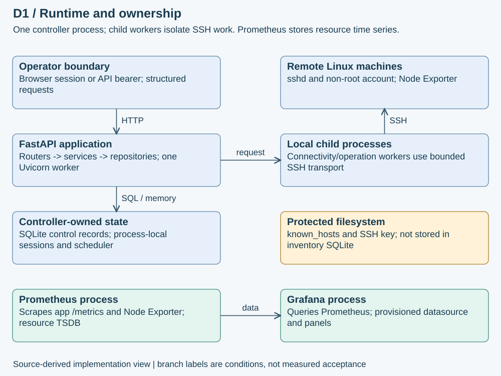
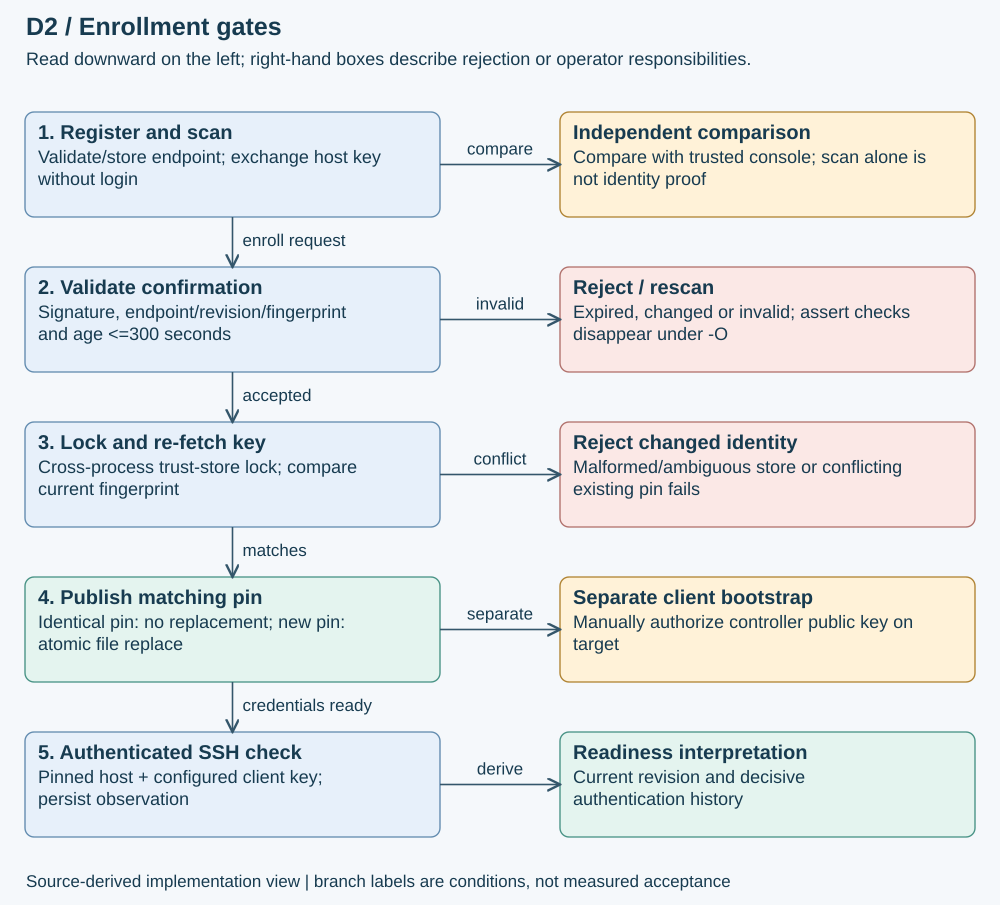
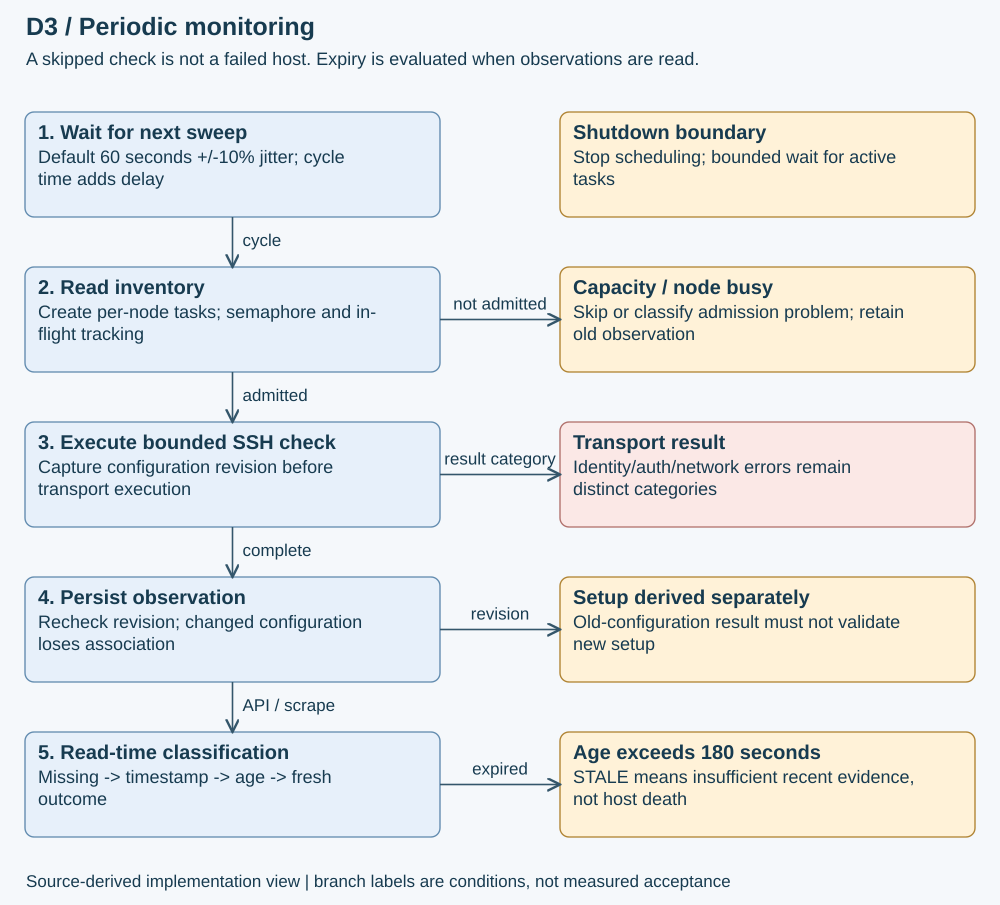
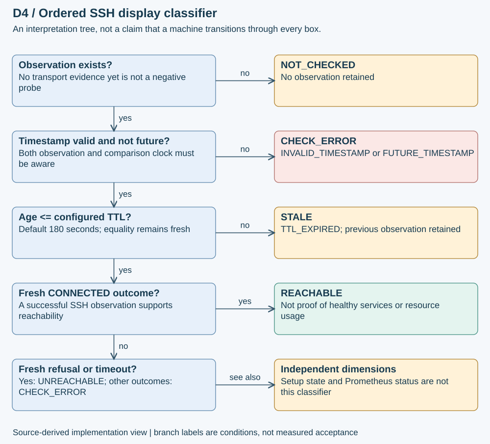
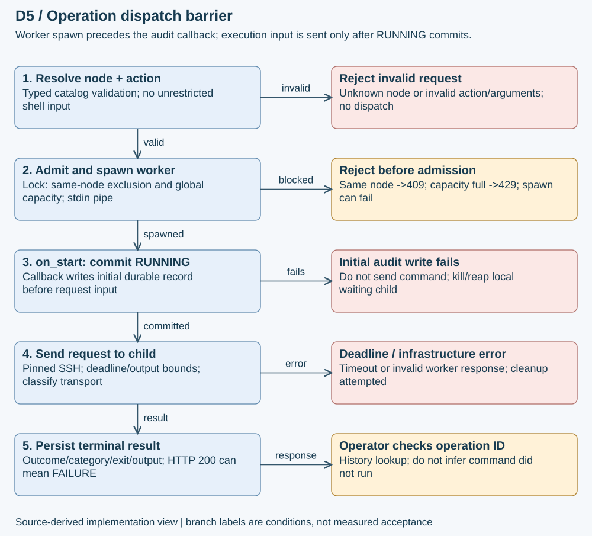
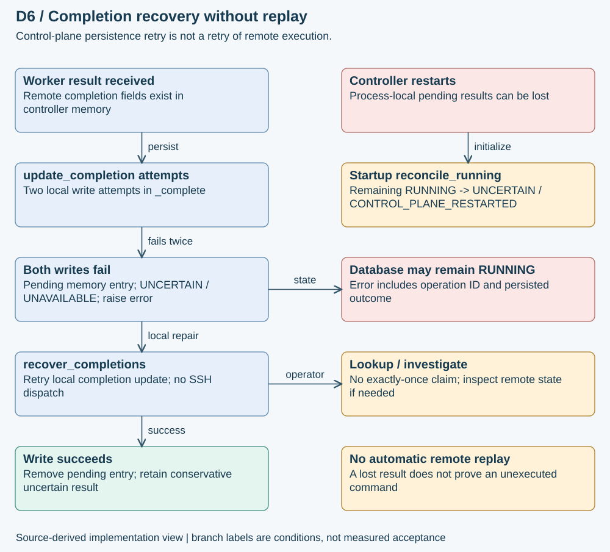
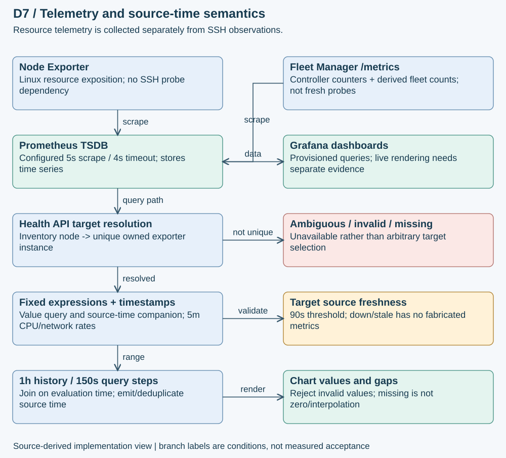
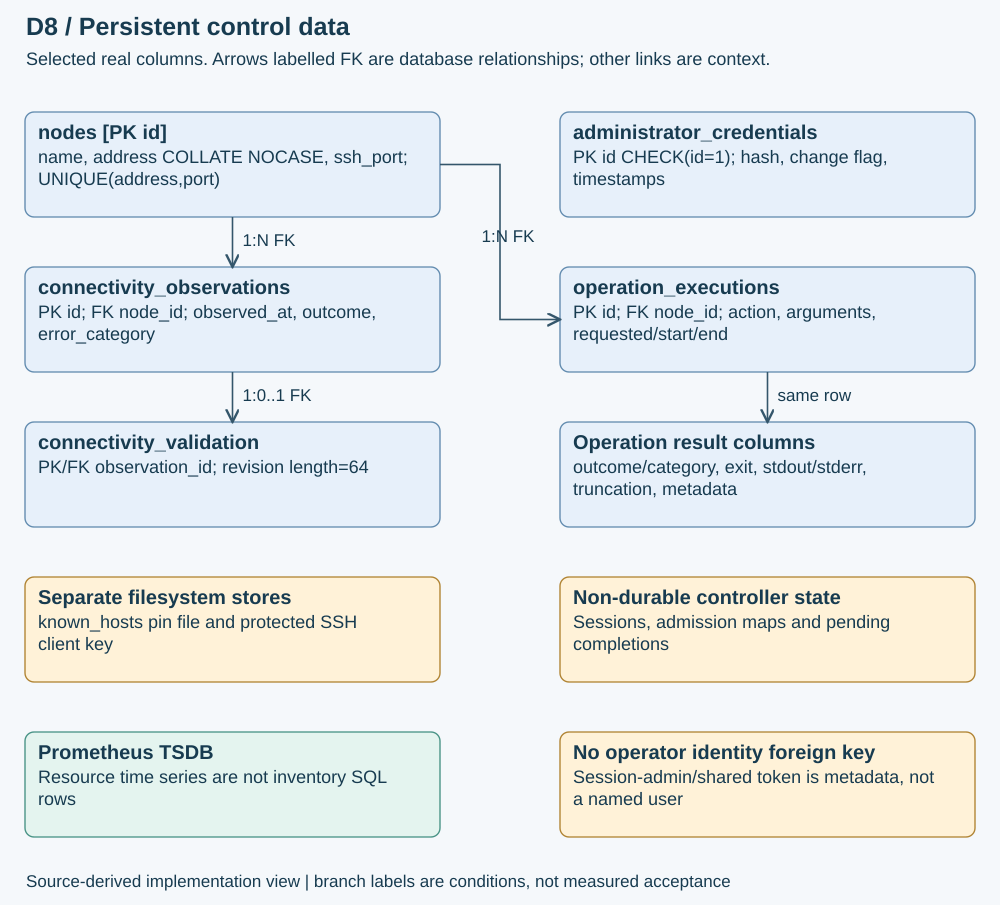
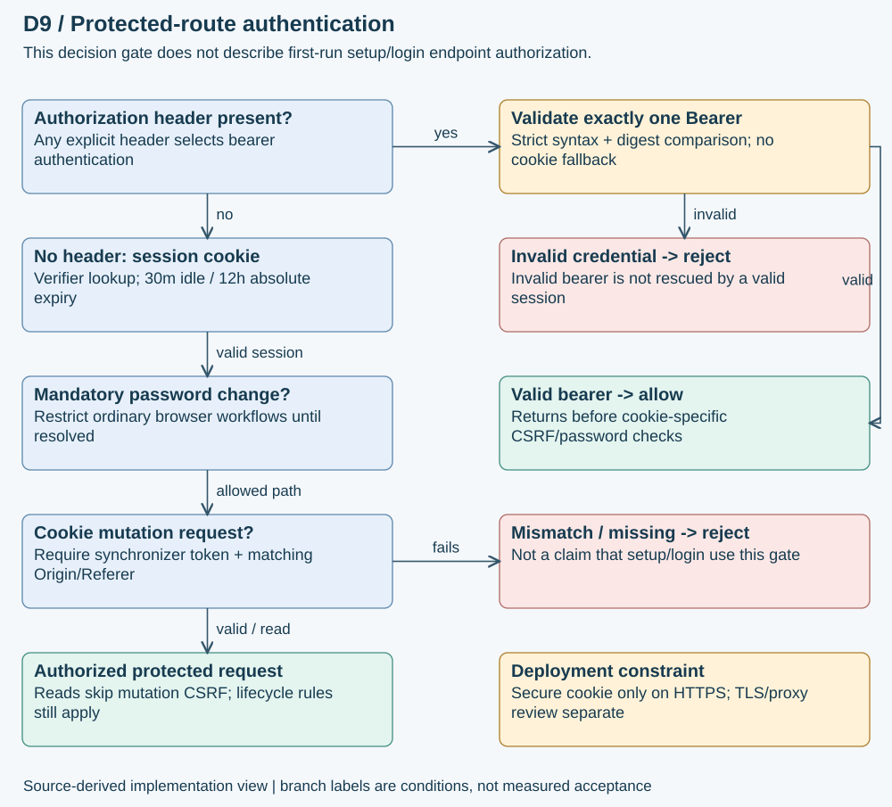
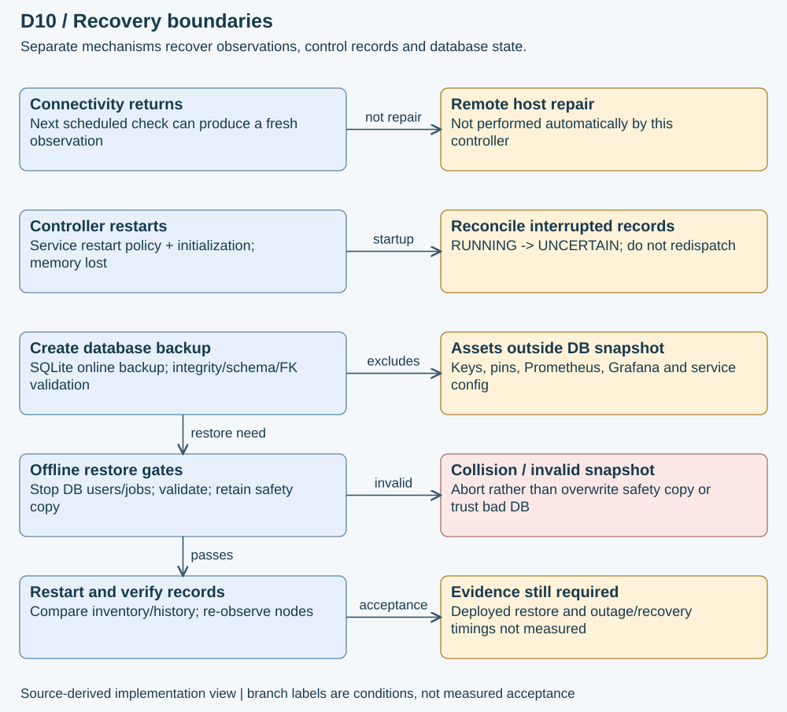

# Implementation depth supplement

## D1. Runtime architecture: modules are not microservices

The application is a modular controller, not a distributed control-plane cluster. FastAPI routers form the HTTP boundary; services coordinate use cases; repositories own SQL. The connectivity scheduler and browser session store live inside one application process. Diagnostic child processes provide a killable local execution boundary, not a durable queue or another independently deployed service.

### One request across the boundaries
- The authenticated operator selects a registered node and a catalog action. The router accepts structured input rather than a shell command.
- The service resolves inventory and validates the action. The executor admits bounded work and starts a local worker waiting on standard input.
- A callback commits the RUNNING audit record before the parent sends the execution request to the worker. The worker then uses SSH to execute on the remote machine.
- The service persists the classified result; the browser displays the returned operation record and can inspect history.

The single-worker restriction is functional: adding Uvicorn workers would duplicate schedulers and split in-memory sessions and admission tracking. Horizontal scaling needs shared coordination and a redesigned ownership boundary; it is not achieved by changing a worker-count flag.

**Why this design:** a small-fleet controller can keep deployment simple while isolating blocking transport work. Its cost is a single control-plane failure domain. A child-process deadline bounds local work but cannot prove termination of a remote command.

**Source anchors:** src/fleet_manager/main.py lifespan; connectivity/scheduler.py::ConnectivityScheduler; operations/executor.py::ProcessOperationExecutor; security/session.py::SessionStore; deploy/fleet-manager.service.

## D2. Host identity: a scan is not a trust decision

Registration validates and stores an endpoint without proving DNS resolution, host identity, credentials or reachability. The scan performs key exchange without authenticating and returns the presented fingerprint. An independent trusted console or equivalent channel must supply the fingerprint against which the operator compares it. Merely comparing two values delivered by the same potentially impersonated endpoint does not establish identity.

### What binds the confirmation
ConnectivityService.confirmation serializes node ID, address, SSH port, configuration revision, fingerprint and issue time, signs the payload with HMAC-SHA256, and returns encoded payload plus signature. The signing secret is service-instance-local. In ordinary Python execution, validation checks signature, binding and an age between zero and 300 seconds. Restart invalidates outstanding confirmations; confirmations are not consumed after use.

**Known implementation defect:** validate_confirmation uses assert for these three security checks. Python optimization can remove them. This is an authenticated enrollment weakness, not an unauthenticated login bypass. Re-fetching the key, matching the expected fingerprint and rejecting replacement of an existing different pin remain separate checks. The report does not claim the confirmation gate is unconditionally enforced; correcting it is outside this documentation-only increment.

### Persistence and concurrency
Enrollment takes a cross-process sidecar lock, re-fetches the presented identity, rejects a changed fingerprint, and reads the existing trust store fail-closed. Multiple matching entries are ambiguous even when duplicate keys are identical. An identical existing pin succeeds without replacement; a different existing pin cannot be rotated through this workflow. New enrollment preserves existing content and publishes through temporary-file replacement with fsync and POSIX metadata handling.

Controller public-key authorization on the node is a separate manual bootstrap action. Trusting the server does not grant the client access, and authorizing a client key does not identify the server.

**Source anchors:** connectivity/service.py::confirmation, validate_confirmation; connectivity/router.py::scan_host_key, trust_host_key; connectivity/trust.py::endpoint_identity, _read_store, _unique_key, enroll_host_key; connectivity/transport.py::ParamikoSSHTransport.verify.

## D3. Monitoring: scheduling is not the same as freshness

The scheduler uses an in-process asyncio task. Its default interval is 60 seconds with ten-percent jitter; the first cycle also waits unless explicitly configured otherwise. Each cycle reads inventory, creates bounded node-check tasks, gathers outcomes independently, and sleeps after the cycle. Therefore the interval is not a guaranteed maximum time between observations: check duration, contention and failures contribute additional delay.

The scheduler has a semaphore and an in-flight set; the shared connectivity executor has its own admission boundary. A busy node or exhausted capacity produces a skip/error path rather than an invented failed probe. One node's exception is handled without claiming all peers failed. Existing observations remain available and can expire naturally.

### Configuration changes during a check
The service captures the configuration revision before checking and compares it afterward. If configuration changed, the observation loses its revision association. A result from old credentials or a former trust configuration must not validate the new setup. The revision includes endpoint and credential/trust identity, so setup history is not an unconditional lifetime approval.

### A concrete interpretation example
Suppose a successful observation is stored at 12:00:00 UTC and no later check completes. With the default 180-second TTL, it remains fresh at 12:03:00; at 12:03:01 it is STALE because the code uses age greater than TTL. That does not prove the host went down at 12:03:01. It means the controller no longer has sufficiently recent evidence.

Reconnection is observed by a subsequent scheduled check. This is automatic observation recovery, not automatic host repair or remote-operation replay. Recovery latency has not been measured by the report's documentation build.

**Source anchors:** connectivity/scheduler.py::calculate_delay, run_cycle, _loop, stop; connectivity/service.py::check; connectivity/freshness.py::derive_status; config.py.

## D4. Three independent questions about a node

| Question | Inputs and interpretation | What it does not prove |
| --- | --- | --- |
| Is setup validated? | Current configuration revision, unique host pin, credential configuration and decisive authentication history | Current reachability or healthy resource use |
| What does the latest SSH observation support? | Observation existence, timestamp validity, age and outcome | Overall host/service health or exporter reachability |
| What resource data is available? | Prometheus target ownership, up sample, source timestamps and metric validity | SSH credentials, host pin validity or diagnostic success |

derive_status first handles a missing observation, then naive/future timestamps, then expiry, then the fresh outcome. CONNECTED maps to REACHABLE. CONNECTION_REFUSED and CONNECTION_TIMEOUT map to UNREACHABLE; other fresh failures map to CHECK_ERROR. The UI should not compress these into a single green/red claim about the entire machine.

The distinction matters operationally. A machine with a changed SSH host key may still export metrics. A host with valid setup history may be temporarily unreachable. A reachable host can have stale metrics if the exporter or scraper fails. Diagnosing these as different failures preserves useful information and avoids unsafe remediation based on a guessed cause.

**Boundary case:** no observation yields NOT_CHECKED. It is neither a successful check nor an unreachable result. A future timestamp yields CHECK_ERROR rather than silently extending freshness.

**Source anchors:** connectivity/freshness.py::derive_status; connectivity/readiness.py::derive_setup, configuration_revision; connectivity/service.py::fleet_status, setup; metrics/health.py::PrometheusHealth.node.

## D5. Remote operation: admission, dispatch and the audit barrier

### Before dispatch
Action validation produces a sanitized argument record and a catalog-generated command. Per-node exclusion prevents simultaneous admitted operations on that node; the default global capacity is four. Same-node contention returns 409 and global saturation returns 429. These are admission outcomes, not evidence of remote execution failure.

The process executor serializes the request, prepares an allowlisted environment, takes its lock, checks shutdown/node/global admission and spawns a child with piped stdin/stdout and discarded stderr. It records the child as active. The on_start callback then persists RUNNING. Only after that callback returns does communicate send the request to the worker. Thus a local child may already exist before the audit commit, but the remote command has not yet been supplied to it.

If the initial database write fails, the executor's finally block attempts to kill/reap the local child. It does not proceed with command dispatch. If the worker cannot be spawned, no on_start callback occurs. These distinctions are stronger and more precise than saying merely 'audit logging is supported'.

### After dispatch
The remaining deadline subtracts elapsed monotonic time since executor startup. A timeout returns TIMEOUT and finally attempts local termination/reaping. A nonzero worker exit or malformed JSON is an infrastructure failure, not a remote exit code. Worker exit code 2 maps to configuration failure. Transport results separately carry outcome, failure category, exit code, bounded stdout/stderr and output_truncated.

When a terminal operation record is returned, HTTP 200 means the request produced a result record; the record may still say FAILURE or TIMEOUT. An admitted infrastructure exception can carry an operation ID and uncertain audit state. The operator should inspect that ID instead of pressing 'run again' blindly.

**Source anchors:** operations/catalog.py::validate_action; operations/executor.py::ProcessOperationExecutor.run, _terminate_and_reap; operations/service.py::OperationService.execute; operations/router.py; operations/transport.py.

## D6. The difficult case: command result exists, audit write fails

OperationService._complete attempts update_completion twice. If both writes fail, it retains a process-local pending completion with UNCERTAIN / UNAVAILABLE, preserves returned output fields, and raises StorageError carrying operation ID and persisted_outcome RUNNING. The durable database may still say RUNNING even though a worker result was received. That is a control-plane persistence problem, not permission to execute the remote action again.

recover_completions retries only the local completion write. It does not reopen SSH or resubmit the catalog command. Pending data is not a durable queue; a controller crash can lose it. Startup reconciliation then converts leftover RUNNING records to UNCERTAIN / CONTROL_PLANE_RESTARTED with a completion timestamp.

### Why not automatically retry every error?
A connection loss after dispatch cannot establish whether a command ran. Even though the current catalog is read-only, replaying work can still duplicate load and confuse the audit trail. Future actions could have side effects. The controller therefore preserves uncertainty instead of pretending to offer exactly-once execution.

| Failure location | Durable state or response | Safe interpretation |
| --- | --- | --- |
| Before worker admission | Rejection/configuration exception; no admitted record | No command dispatched by this attempt |
| Initial RUNNING write | Write error; local worker cleanup attempted | Request was not supplied to worker |
| Worker after dispatch | Terminal result or infrastructure exception | Inspect record/category; do not infer no execution |
| Completion write | RUNNING can remain; pending local repair | Retry persistence, not the command |
| Controller restart | RUNNING reconciled to UNCERTAIN | Historical result cannot be reconstructed as success |

Audit rows are mutable through completion updates and privileged database access. 'Durable audit' is not cryptographic immutability or named-user nonrepudiation.

**Source anchors:** operations/service.py::_complete, recover_completions; operations/repository.py::create, update_completion, reconcile_running; main.py startup lifecycle.

## D7. Telemetry: ownership, source time and missing samples

Prometheus scrapes Node Exporter directly for node resources and Fleet Manager /metrics for controller instrumentation. The checked configuration uses a five-second scrape/evaluation interval and four-second scrape timeout. File discovery refreshes target configuration. These configured values do not establish scrape success or long-term retention.

The native health endpoint does not accept arbitrary PromQL. It resolves a registered inventory node to an exporter target, checks ownership/ambiguity, and queries a fixed catalog. Queries include CPU idle rate converted to utilization, available/total memory, root-filesystem capacity, uptime, load and network rates excluding loopback/selected virtual interfaces. CPU and network rates use five-minute windows, not instantaneous measurements.

### Source time is not query time
_observation requests both a value expression and a companion source-timestamp expression. It joins by evaluation time, then emits the source timestamp. For multi-selector expressions, _source chooses the oldest current contributing source sample. This does not describe every sample in a five-minute rate window; it is a conservative freshness indicator for the current source selectors.

The source freshness threshold is 90 seconds, independently of the SSH observation TTL. A fresh up=0 target returns down without fabricated resource values. A stale target returns stale; invalid/ambiguous data returns unavailable. Histories span one hour at 150-second query steps and deduplicate repeated source timestamps. Displayed observation count is not exporter scrape count.

Nonfinite/negative measurements, percentages above 100, future sample timestamps and inconsistent capacity pairs are rejected. Invalid history measurements retain a null gap when their source position is valid. The chart must leave a disconnected segment rather than replacing missing values with zero or interpolating across an outage.

**Source anchors:** metrics/health.py::METRICS, _source, _sample, PrometheusHealth._observation, PrometheusHealth._node; metrics/health_router.py; metrics/telemetry.py::_collect_fleet_status; monitoring/prometheus/prometheus.yml; ui/static/js health/chart modules.

## D8. Data architecture: persistence is intentionally split

Inventory nodes are unique by case-insensitive address plus SSH port. SQLite constrains nonempty names/addresses and valid integer ports. Connectivity observations reference nodes. A separate connectivity_validation row associates an observation with a 64-character configuration revision; that auxiliary relationship prevents old setup evidence from being applied blindly to new configuration.

Operation records reference nodes and contain action, JSON arguments, request/start/completion timestamps, outcome/category, exit code, stdout/stderr, truncation flag and JSON audit metadata. Database checks constrain outcomes and truncation. RUNNING is updated to completion, so operation rows are not append-only in the immutable-log sense.

administrator_credentials is a singleton constrained to id=1 with password hash, mandatory-change flag and timestamps. It has no SQL foreign key to operations. The reported metadata identifies session-admin or shared-token context, not a uniquely identified human.

### Separate durability boundaries
| Asset | Store | Recovery implication |
| --- | --- | --- |
| Inventory, observations, operations, administrator hash | SQLite, repository-owned SQL | Database backup covers these records |
| Host identity pins | known_hosts file | Recover separately; do not trust a restored database to recreate pins |
| SSH client private key | Protected filesystem | Secret, excluded from report/archive; separate authorized backup |
| Browser sessions, admission maps, pending completions | Process memory | Lost on restart; not restored from SQLite |
| Resource time series | Prometheus TSDB | Not stored in the controller inventory database |
| Grafana configuration/data | Provisioning files and Grafana store | Restore/verify separately |

Repositories use parameterized SQL, foreign-key enforcement and short transactions. Initialization checks schema version and uses explicit migration steps; schema validity is not inferred from a filename. This report inspected schema definitions, not a live production database.

**Source anchors:** inventory/repository.py::_SCHEMA; connectivity/repository.py::_SCHEMA, _VALIDATION_SCHEMA; operations/repository.py::_SCHEMA; security/repository.py::_SCHEMA; scripts/backup_restore.py.

## D9. Browser and API security are different paths

If any Authorization header exists, the gate validates exactly one well-formed Bearer credential and compares digests in constant time. Invalid explicit bearer authentication does not fall back to a valid browser cookie. A valid bearer returns before the cookie-specific password-change/CSRF branches.

Without that header, a valid server-managed session is required. Session defaults are 30-minute idle and 12-hour absolute expiry, tracked with monotonic time. The store retains a session-token verifier; session CSRF material remains server-side. Session lookup refreshes activity before later route authorization checks. Sessions and login throttling are process-local, not a distributed identity service.

Cookie-authenticated protected mutations require a matching synchronizer token plus matching Origin, or Referer when Origin is absent. Missing origin information rejects. This is not a claim that every POST endpoint—including setup/login—passes through this gate. Password-change state restricts ordinary browser workflows until the lifecycle completes.

The browser cookie is HttpOnly and SameSite=Lax; Secure is conditional on an HTTPS request. This does not make a plain-HTTP deployment encrypted. Proxy address/scheme handling and external exposure require deployment review. Password hashes use Argon2, but that alone does not establish penetration-test completion or Internet-facing readiness.

The frontend uses same-origin credentials and attaches CSRF on mutations. On authentication failure it prompts for login without automatically replaying a remote operation. This preserves the distinction between restoring operator access and repeating work with unknown completion.

**Source anchors:** security/auth.py::require_operator_token; security/session.py::SessionStore, validate_csrf; security/router.py; security/passwords.py; ui/static/js/api.js.

## D10. Recovery is a set of boundaries, not one green tick

| Recovery type | Actual mechanism | Remaining responsibility |
| --- | --- | --- |
| Observation after network returns | Subsequent scheduled SSH check persists a fresh observation | Independently measure outage, unaffected peers and recovery timing |
| Controller service crash | systemd restart policy plus startup initialization | Verify deployed configuration and restart behavior |
| Interrupted operation record | RUNNING to UNCERTAIN reconciliation | Inspect remote state; never silently replay |
| Failed completion write | Process-local retry of local persistence | Pending completion is lost on process crash |
| Database corruption/loss | Verified backup and explicitly offline restore | Protect credentials, pins, telemetry and service configuration separately |
| Failed remote host/service | Not automatic host repair | Operator diagnosis and authorized repair procedure |

The backup script uses SQLite online backup and validates integrity, foreign keys and schema. Restore is an offline procedure: stop database users and backup jobs, validate the snapshot, retain a non-overwriting safety copy, restore, restart, compare records and re-observe. A checksum detects changes relative to its manifest; it does not authenticate an attacker-controlled manifest.

The report does not invent recovery-point or recovery-time objectives. A local utility test does not establish deployed restore, and service startup alone does not establish that all four project requirements recovered.

**Source anchors:** scripts/backup_restore.py; docs/DEPLOYMENT-RUNBOOK.md; operations/repository.py::reconcile_running; connectivity/scheduler.py; deploy/fleet-manager.service and backup units.

## D11. Evidence reconciliation and acceptance map

This edition separates implementation depth from demonstration completeness. A confidently written checklist cannot substitute for the request, response, timestamps, environment and build identity supporting it.

| Claim | Inspected artifact | Defensible status |
| --- | --- | --- |
| Historical Python test gate | submission/evidence/final_python.txt | 535 passed, seven warnings, exit 0 on 9 November; historical local result |
| Automated acceptance completed | submission/evidence/acceptance-final.json and .txt | Explicit --mock run, exit 2; not live acceptance |
| Exporter scraping worked | .local/live-gcp-verification/20261108T1515/controller-validation.txt | Historical five-target up snapshot, including three exporters; not current health |
| November 10 deployed operations and complete sign-off | November 10 learning/checklist entries | Reported; matching full raw traces not established by this inspection |
| Genuine Grafana visualization | Provisioned dashboard/configuration exists | Live rendered panels remain an evidence gap |
| Independent-host outage and recovery | Required manual acceptance procedure | Matching complete fault/recovery capture remains a gap |

### What would close the four official requirements
- Onboarding: deployed build identity, registered independent nodes, independently compared fingerprints, explicit enrollment and successful authenticated checks.
- Metrics: target list, stored time-range samples and actual rendered Grafana panels with node/time context.
- Availability: a bounded isolated-host interruption, healthy peers, timestamped failure/freshness behavior and observed automatic reconnection.
- Operations: request/action/node, raw returned output, operation ID and matching persisted history, including catalog rejection and meaningful failure behavior.

No new live experiment is performed by this edition. Existing reported successes are not asserted to be false; they remain uncorroborated where underlying captures have not been located. Mocked screenshots retain their labels. Source hashes identify inspected bytes, not a deployed build unless deployment identity is separately established.

## D12. Evaluator walkthrough and reproducibility

### A five-minute reading path
- Start with requirements and architecture. Identify controller, remote machines and the independent telemetry path.
- Follow onboarding and distinguish server identity from client authorization.
- Follow one diagnostic through admission, the audit barrier and SSH dispatch.
- Explain a lost-result scenario: why UNCERTAIN is more accurate than success/failure and why persistence retry must not replay the command.
- Read the freshness classifier and metric-source timestamps. Explain why stale or missing is not zero.
- Finish with measured results, evidence gaps and the selected recovery boundaries.

### Technical review checklist
Every detailed view names its source anchors. Arrows represent control/data flow; branch labels identify rejection/uncertainty instead of hiding it. Overview views stay separate from detailed runtime views so module boundaries, processes and machines are not confused. The depth diagrams are embedded as SVG resources in the self-contained HTML and rendered into the PDF, preserving selectable vector text rather than screenshots of diagrams.

### Rebuilding this edition
From the existing Windows repository environment, execute the local builder with the repository Python: C:\Users\adars\Desktop\ZOHO\SWFW-12-Sem5\.local\build_depth_report.py. The build creates a separate edition, not a replacement release ZIP. Its manifest records source/report/image hashes and output bytes. Validation renders every page, checks resource completeness, text boundaries, diagram font size and the conservative 20,000,000-byte ceiling.

The PDF is the upload candidate. Markdown, HTML, diagrams, manifest and validation receipt are review/reproduction companions. Student identity, selected project/account and portal timezone must still be checked by the student. This documentation increment does not demonstrate independent student understanding or video completion.